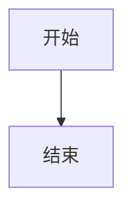

# 仓库维护说明（给 AI 代理与未来的自己）

这个仓库是一本关于 Qt 工业软件的电子书，不是软件项目。`docs/` 是书稿，MkDocs 构建，发布在 GitHub Pages。

## 目标

写一本讲 Qt 工业软件开发实践的书，五部十二章：应用与选型背景、工程基础、架构与工程经验、库选型参考、AI 驱动开发。书名暂定《Qt 工业软件工程实践：架构、交付与 AI 协作》。

全书以作者维护的开源项目为贯穿案例（SARibbon、QWT 分支、QIm、DAWidgets、QtPropertyBrowser、SAColorWidgets、qwindowkit、data-workbench），第 1 章集中介绍 FreeCAD、ParaView、QGIS 等工业软件项目作为背景，第 11 章按能力矩阵比较第三方库，第 12 章讲 AI Agent 如何接进 Qt 项目的日常流程。

**权威大纲是仓库根目录的 `OUTLINE.md`，写作规范是 `STYLE.md`。** 结构调整先改大纲，再改正文；文风、图注、Mermaid 规则以 `STYLE.md` 为准。

## 仓库结构

| 路径 | 作用 | 能否手改 |
| --- | --- | --- |
| `OUTLINE.md` | 全书大纲，章节结构的唯一依据 | 可以，改完同步正文 |
| `STYLE.md` | 写作规范：语气、段落、图注、Mermaid 约束 | 可以，改完同步正文 |
| `docs/index.md` | 封面与全书目录 | 可以 |
| `docs/preface.md` | 前言 | 可以 |
| `docs/chapters/` | 正文，一章一文件 | 可以 |
| `docs/appendix/` | 附录 A–D | 可以 |
| `docs/assets/css/book.css` | 全部自定义样式 | 可以 |
| `docs/assets/js/book.js` | 阅读进度条、封面标记 | 可以 |
| `docs/assets/js/mermaid-init.js` | Mermaid 按需加载、主题切换重绘 | 可以 |
| `docs/assets/js/vendor/mermaid.min.js` | 本地 Mermaid 11 运行时 | 升级时整体替换 |
| `docs/assets/images/` | 站点用 WebP | **不要手改**，由脚本生成 |
| `screenshot/`、`screenshot-visualization2D/` | 原始截图，素材源 | 可以新增 |
| `drafts/v1/` | v1 旧稿，素材，不参与构建 | 可以查资料，不要搬回 `docs/` |
| `overrides/main.html` | 主题模板覆盖 | 可以 |
| `hooks.py` | 注入章节号、字数、阅读时长 | 可以 |
| `tools/` | 图片转换、元数据抓取、引号规范化 | 可以 |
| `mkdocs.yml` | 站点配置与目录 | 可以 |

`site/`、`.cache/`、`__pycache__/` 是构建产物，不入库。

## 常用命令

```bash
pip install -r requirements.txt
mkdocs serve -a 127.0.0.1:8000     # 本地预览
mkdocs build --strict              # 发布前检查，必须零警告
python tools/check_book.py         # 书稿结构检查：字数、图号、图片路径、禁用词
python tools/build_images.py       # 重新生成 WebP（改了原图后）
python tools/fix_quotes.py         # 把正文里的 ASCII 引号换成中文引号
```

部署由 `.github/workflows/pages.yml` 完成：推送 `main` 后构建并发布到 GitHub Pages。不需要本地 gh-pages 分支。

## 写一章的流程

1. 在 `docs/chapters/` 新建 `NN-slug.md`，front matter 写三项：

   ```yaml
   ---
   title: 章节标题
   chapter: 3
   part: 第二部 · 工程基础
   ---
   ```

   章节号和所属部会由 `hooks.py` 自动排版，正文里不要再手写“第 3 章”。

2. 一级标题与 `title` 一致。开头放一个 `!!! abstract "本章要点"`，用一段话说清本章结论，不要复述目录。
3. 正文用五到九个二级标题，编号写成 `3.1`、`3.2`。每节至少有一个具体支撑：项目案例、代码片段、对比表、截图或 Mermaid 图。
4. 加图时：原图放进 `screenshot/`（可建子目录），在 `tools/build_images.py` 的 `ASSETS` 里登记“源文件名 → 分组/目标文件名”，运行脚本，然后在正文引用 `../assets/images/<分组>/<名字>.webp`。图注统一写成：

   ```html
   <figure markdown>
     { loading=lazy }
     <figcaption><span class="fig-no">图 3-1</span>图注文字。</figcaption>
   </figure>
   ```

   图号按“章-序”手写，新增图时检查同章编号不重复。

5. 在 `mkdocs.yml` 的 `nav` 里加一行，标签用 `NN 短标题`，不要用全称，侧边栏放不下。
6. 跑 `mkdocs build --strict`，再用浏览器看三种状态：1600px 宽、500px 宽、夜间模式。

**完成标准**：构建零警告；页面在 1600px 与 500px 下都没有横向滚动；所有图片有图注；所有链接可点；夜间模式下没有低对比度文字，Mermaid 图能跟着日间/夜间模式重绘。

## Mermaid

正文里直接写围栏：

````markdown
<figure class="book-diagram" markdown>

<figcaption><span class="fig-no">图 3-1</span>图注。</figcaption>
</figure>
````

构建时 `pymdownx.superfences` 会把围栏输出成 `<pre class="book-mermaid">`，`mermaid-init.js` 在 `window.load` 之后按需加载本地 `mermaid.min.js`，渲染时按日间/夜间模式注入配色。**不要用 `class="mermaid"`**：Material 9.6 自带 Mermaid 集成，会从 unpkg 拉 CDN 并接管同名节点，既违反“不引 CDN”的约束，也会和本地渲染器抢同一批节点。把类名换成 `book-mermaid` 是为了绕开它。

Mermaid 写作约束：

- 单图节点不超过 14 个；超过就拆成两张。
- 节点文字用中文短语，不超过 12 字；箭头标签不超过 8 字。
- 线性流程优先 `flowchart TB`，横向对比或分层用 `LR`。
- 类图、时序图、状态图、时间线优先用 Mermaid 原生语法。
- 图内不要写 `style` 自定义颜色，配色由脚本统一注入。
- 渲染期间脚本靠宿主节点的布局计算连线位置，不要把 `.book-mermaid` 或 `.mermaid-host` 设成 `display: none`；加载态用的是 `visibility: hidden`，改样式时注意保留。

## 图片

`docs/assets/images/` 下的文件全部由脚本生成，不要手工替换：

```bash
python tools/build_images.py
```

原始截图保留在 `screenshot/` 与 `screenshot-visualization2D/`，脚本递归扫描这两个目录，按文件名匹配 `ASSETS`。新增图片时先在 `ASSETS` 里登记映射，文件名不要重复。站点图片统一 WebP，最大宽度 1680，全站图片总量控制在 5 MB 以内。

## 写作规范

- **语气**：技术白皮书加书的叙述。先给判断，再给证据，最后给代价。完整段落承载论证，避免“随着……的发展”“众所周知”“总而言之”“首先其次最后”这类填充句，避免一句一段。
- **具体**：写“`QUndoStack::mergeWith()` 决定撤销粒度”，不写“良好的撤销机制很重要”。
- **不编造**：示例代码要么能编译，要么在代码块上方标注“结构示意”。不确定的项目内部实现，用“从公开仓库结构看”限定，或直接不写。
- **术语**：首次出现给中英文，例如“边界表示（B-Rep）”。之后只用中文。
- **标点**：中文引号用 “ ”，中英文之间加空格，数字与单位之间加空格。写完跑一次 `tools/fix_quotes.py`。
- **篇幅**：按 `OUTLINE.md` 的目标字数写，允许 ±20%；宁可少写一个项目，也不要每节都浅尝辄止。
- **许可证**：以仓库 LICENSE 原文为准。GitHub 识别为 `NOASSERTION` 或 `Other` 的，写“见仓库”，不要猜。

详细规则见 `STYLE.md`。

## 技术约束

- **MkDocs Material 9.6.x**：只用社区版特性，不依赖 Insiders。Zensical 是官方后继，但仍是 0.x，暂不迁移；书稿是纯 Markdown，将来迁移成本很低。
- **字体**：不引 Google Fonts 或任何 CDN 字体。大陆访问不稳定，且会拖慢首屏。只用 `book.css` 里的系统字体栈。
- **搜索**：`search` 插件配置 `lang: zh`，依赖 `jieba` 做中文分词。
- **图片**：统一 WebP，最大宽度 1680，全站图片总量控制在 5 MB 以内。原图不入 `docs/`。
- **Mermaid**：运行时本地存放，不引 CDN；只在有图的页面加载。
- **样式**：自定义集中在 `docs/assets/css/book.css`。覆盖 Material 的高特异性选择器时，就近加注释说明原因。
- **模板**：`overrides/main.html` 只加 head 元信息，不改布局。

## 不要做的事

- 不提交 `site/`；不把构建产物塞进 `docs/`。
- 不在 `docs/` 里直接引用 `screenshot/` 的原始文件。
- 不新增运行时依赖（CDN 脚本、在线字体、统计代码）。Mermaid 例外，但必须本地化。
- 不删除 `screenshot/` 原图，它是图片脚本的输入。
- 不改 `nav` 的结构却不同步更新 `docs/index.md` 的书目。
- 不把 `drafts/v1/` 的旧稿直接搬回 `docs/`，要按大纲重写。

## 已知缺口

- 十二章正文与附录 A–D 已按 v4 大纲重写完成，合计约 10 万中文字符；后续主要是事实核查与局部润色，不再改结构。
- 第 11 章的许可证和维护状态按 2026 年 11 月核对，但部分库（DAWidgets、QtPropertyBrowser、Analysis Situs 等）仓库未附标准 LICENSE 文件或自动识别不可靠，正文写“见仓库”，商用前需人工确认。
- 第 5、6 章的 data-workbench 模块数量、文件数、插件 IID 等细节来自公开文档或结构示意，未对当前 HEAD 逐个复核；引用时已用“从公开文档看”“结构示意”限定。
- 附录 A 的 30 个项目许可证按仓库原文或官网口径核对，个别项目（GPXSee、LabPlot、libmodbus 等）未取到 LICENSE 原文，使用前需再查。
- 书架书名尚未最终确认（候选见 `OUTLINE.md` 第二节），封面暂用第一个候选。
- 没有英文版；如果要做，先确认是否需要 `mkdocs-static-i18n`，再决定目录结构。
