# 用 Qt 写成的工业软件版图

!!! abstract "本章要点"
    工业软件的门类很多，但把它们拆到结构层，会发现高度趋同：一个领域数据模型，一套编辑命令，一个渲染视口，若干扩展点。Qt 在这套结构里承担人机接口，几何内核、网格算法、求解器和数据标准则由别的项目提供。本章按设计与制造、电子设计、仿真、科学可视化、地理信息五条线，梳理用 Qt 写成的代表性项目，再从这些项目里读出三条规律：界面可以换，内核很难换，扩展点决定软件的寿命。

## 1.1 为什么先看别人做了什么

一个工程师第一次接到“做一款工业软件客户端”的任务时，最容易犯的错误，是把问题理解成“做一个界面”。窗口、菜单、工具栏、三维视口，这些看得见的部分确实占用了前期大量时间，但它们不是这类软件真正的成本中心。真正的成本在窗口背后：模型怎么表达，编辑怎么撤销，结果怎么和视图对应，文件怎么和其他工具交换，插件怎么在不重新编译主程序的前提下接进来。这些问题不会因为界面做得漂亮而消失。

看别人做了什么，价值不在于抄界面，而在于看他们如何在约束下做选择。FreeCAD 把应用层和界面层拆成两个库，不是为了代码好看，而是为了让无界面脚本和 Python 绑定成为可能；ParaView 把可视化管线抽象成“源—过滤器—渲染器”，不是为了追求设计模式，而是因为科学数据的处理步骤天然可以组合；QGIS 把坐标系转换藏在图层加载的必经路径上，是因为 GIS 数据一旦坐标系错了，后面所有分析都没有意义。每一个结构决策背后，都有一组具体的约束。

本章挑选项目有三条标准。项目要有真实用户，能查到公开的代码和文档；它的结构要对后来者有参考价值，而不是只展示功能；它的许可证和依赖要能说清楚，方便读者判断能否用于自己的产品。按这三条标准筛下来，有些名气很大的项目没有入选，有些规模不大但结构干净的项目反而值得单独一节。读者如果发现自己的项目不在表里，不必介意，书里的判断并不依赖某一个具体项目。

把这些约束串起来，会看到一条贯穿工业软件的数据链：

<figure class="book-diagram" markdown>
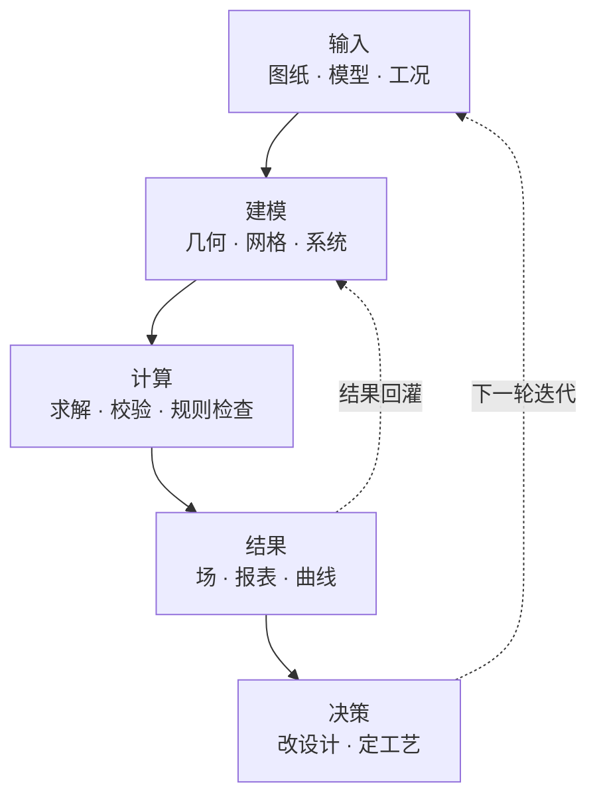
<figcaption>图 1-1工业软件维护的是一条数据链，而不是一组功能。界面是链条的显示器，模型、算法和文件格式才是链条本身。</figcaption>
</figure>

这条链上的每一环都有专门工具，但用户买的不是工具，是链条不断。一个 CAD 的价值，很大程度上取决于它的模型能不能被 CAM 读、被 CAE 用、被 PDM 管；一个 CAE 的价值，取决于计算结果能不能回到 CAD 里改设计。单点功能再强，接不上上下游，就只是一个昂贵的画图板。

链条要维持不断，至少需要三种一致性。**几何一致性**要求同一个零件在建模环境里是 B-Rep 面，在网格环境里是三角形，在结果文件里是单元编号，三者能对应回同一个实体；否则改一个倒角就要重新对一遍结果。**单位与坐标系一致性**要求毫米、英寸、弧度、角度、全局坐标与局部坐标在每一步都有明确归属，工业软件里大量看似低级的错误，根源都在这里。**版本一致性**要求模型改了之后，网格要失效、结果要标记过期、引用它的图纸要提示更新；这套依赖关系如果没有显式建模，软件就会在半年后变成一堆互相矛盾的缓存。界面是这条链的显示器，链条本身才是资产。

本章选取的项目，覆盖了这条链的主要环节。它们不全是 Qt 项目，这恰恰是有用的地方：当同一个问题在 Qt、wxWidgets、FLTK 甚至无界面程序里反复出现时，说明问题本身与界面框架无关，值得单独记住。每个项目只讲三件事——它解决什么问题、它的结构里哪一部分值得看、它的选择付出了什么代价。更细的库选型放在第 11 章，架构模式放在第 6 章。

## 1.2 设计与制造：从内核到制图

设计与制造是 Qt 工业软件里历史最长、代码量最大的一条线。它有四种角色：几何内核提供数学与拓扑能力，应用框架把内核包装成文档对象，界面负责交互和展示，行业插件补充工艺知识。本章选取的项目分别落在这四种角色上，把它们放在一起看，能明白一个 CAD 产品为什么不是“内核 + 界面”这么简单。

### FreeCAD：把参数化 CAD 拆成两层

FreeCAD 是开源世界里少有的、试图覆盖完整参数化建模流程的项目。它用 Qt 写界面，用 OpenCASCADE（以下简称 OCCT）做几何内核，用 Coin3D 做三维渲染，用 Python 做脚本和工作台扩展。代码量超过一百万行，但结构可以先用一句话概括：`App` 层负责文档、对象、属性和重算，`Gui` 层负责视图、命令和交互，两层之间通过信号和属性系统连接。

这种拆分带来的直接好处，是 FreeCAD 可以在没有界面的情况下运行脚本，也让它后来接入 Python 生态时不需要重写核心。一个 `Part::Box` 对象在 `App` 层只是一个带长度、宽度、高度属性的文档对象，在 `Gui` 层才对应一个可拾取、可高亮的视口实体。属性系统同时承担序列化、撤销、属性编辑器生成和依赖追踪四件事，这是 FreeCAD 最值得借鉴的设计之一。

FreeCAD 的第二个核心是重算图。每个文档对象有输入属性，也有输出属性，修改一个参数会把依赖它的对象标记为“需要重算”，`Document::recompute()` 按拓扑序重新求值。参数化的本质不是“记录操作历史”，而是“记录一张可以重新求值的图”。这也解释了为什么 FreeCAD 的撤销和重做不能简单理解为“反向执行操作”：它恢复的是属性值，然后触发重算，最终形状由重算图重新算出来。把撤销和重算混在一起设计，是自研参数化 CAD 最常见的架构错误。

代价也很清楚。工作台之间的 API 稳定性一般，社区扩展的质量参差不齐；Coin3D 的渲染管线在处理超大装配时不如现代 OpenGL 渲染器；Python 绑定让启动变慢，插件越多越明显。这些问题不是能力问题，而是“历史选择 + 社区规模”共同作用的结果。

<figure markdown>
  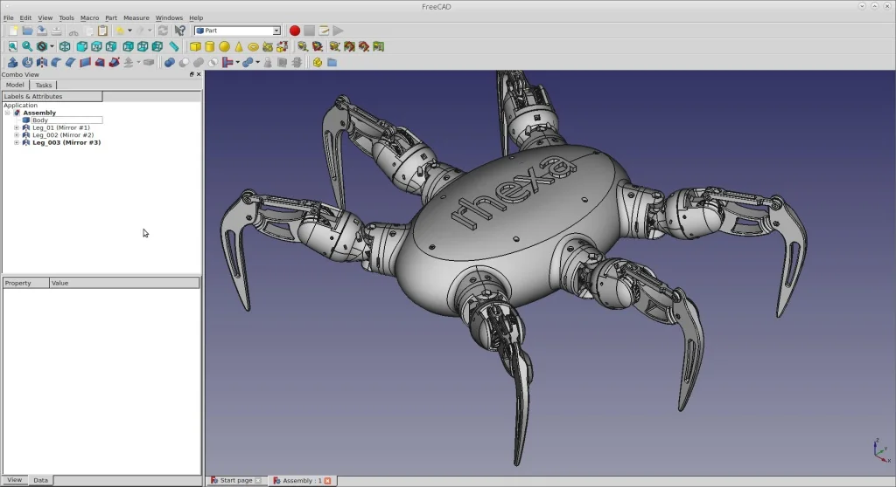{ loading=lazy }
  <figcaption>图 1-2FreeCAD 的主界面：左侧模型树、中间三维视口、下方 Python 控制台。界面是“文档—视图—脚本”三层结构的外化。</figcaption>
</figure>

### Mayo：最小可用的 OCCT + Qt 参考

如果只想学“怎么把 OCCT 接进 Qt”，不要从 FreeCAD 开始，从 Mayo 开始。Mayo 是一个 CAD 查看器和格式转换器，核心代码只有几千行，BSD-2 许可，代码分成 `app`、`gui`、`io`、`occ` 四层。它做的事很聚焦：读 STEP、IGES、BREP、STL、OBJ 等格式，显示，导出。

Mayo 真正有价值的地方是边界处理：OCCT 的 `TopoDS_Shape` 怎么变成 Qt 场景里的可绘制对象，选中怎么映射回 shape，XDE 文档的装配层级怎么显示成树。这些问题每个 CAD 前端都要解决，Mayo 给出了一份不到一万行的参考答案。它没有参数化建模，没有草图约束，也没有工作台，但把“读入、显示、选中、导出”这条最小链路做完整了。

<figure markdown>
  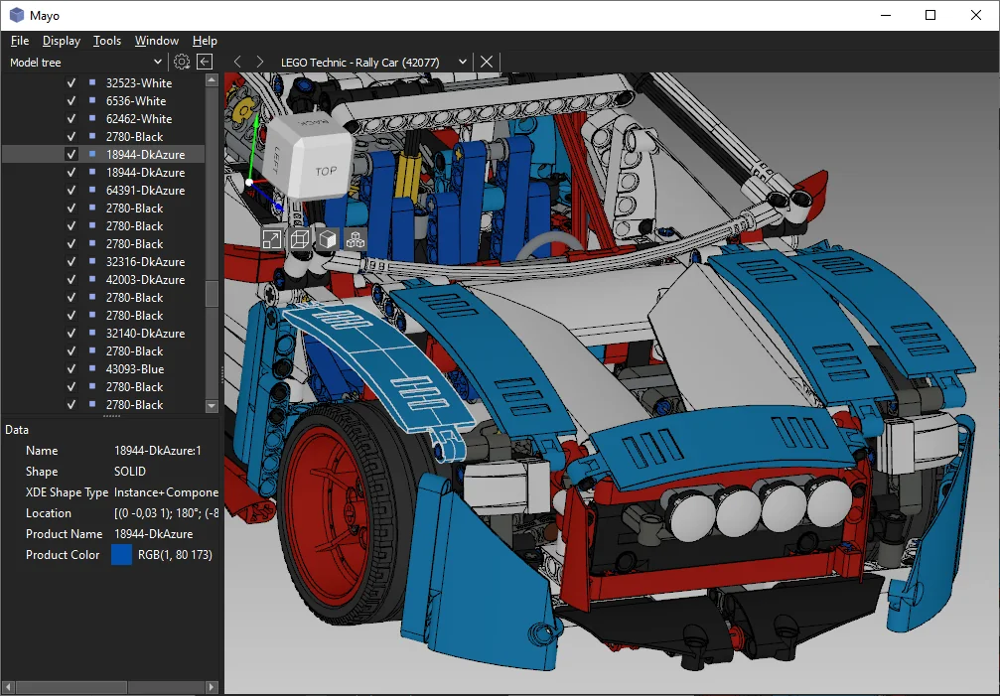{ loading=lazy }
  <figcaption>图 1-3Mayo 的界面克制到近乎朴素，但读入、显示、选中、导出四个环节齐全，适合作为自研 CAD 前端的起点。</figcaption>
</figure>

### QCAD 与 LibreCAD：二维图纸的另一种重心

三维 CAD 很热闹，但工业现场大量交付物仍然是二维图纸。在这个方向上，QCAD 和 LibreCAD 是两个绕不开的项目。

QCAD 由 RibbonSoft 维护，采用 GPLv3 与商业许可并行的双授权模式。它的架构比多数人想象的现代：`RDocument` 持有实体，`REntity` 是几何基元，渲染、命中和编辑分别有独立抽象。最有意思的是它的 ECMAScript 脚本接口，几乎所有功能都能被脚本调用，社区用它写插件、做批量处理和定制命令。这是一种比 C++ 插件轻得多的扩展方式，代价是脚本 API 的稳定性和性能不如编译型插件。

LibreCAD 是从 QCAD 社区版分叉出来的项目，GPLv2 许可，代码更老，`RS_*` 前缀的类遍布全局，但功能完整、用户基数大。它的价值在于展示了一个纯 Qt 的二维 CAD 能做成什么样，以及大量 DXF 兼容性问题的实战处理。二维 CAD 的技术难点不在几何内核，而在图纸语义：图层、线型、标注、图块、打印样式，这些东西构成了工程制图的规则，比几何更难标准化。

<figure markdown>
  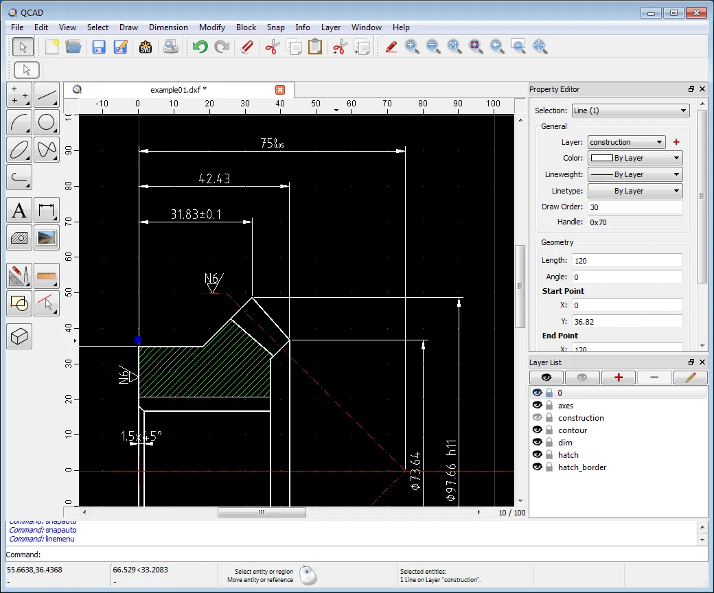{ loading=lazy }
  <figcaption>图 1-4QCAD 的绘图区与工具栏。二维 CAD 的重心是图层、捕捉和标注，而不是三维视口。</figcaption>
</figure>

<figure markdown>
  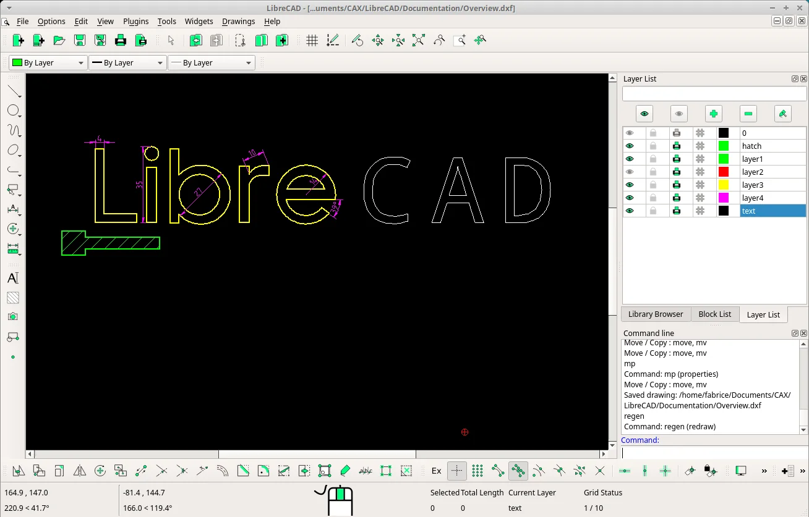{ loading=lazy }
  <figcaption>图 1-5LibreCAD 的界面。命令行、图层列表和捕捉设置三件套，构成了二维制图交互的全部骨架。</figcaption>
</figure>

### OCCT 生态：内核之外的算法工具

OCCT 本身不是一个应用，而是这一整节里多数项目的地基。它把几何与拓扑数据、布尔运算、倒角、抽壳、格式交换、网格化和可视化分成了相对清晰的模块。理解这些模块的划分，比记住几个类名更有用，因为它决定了一个 CAD 前端从哪里接入内核。

| 模块 | 职责 | 代表类 |
| --- | --- | --- |
| Foundation | 基础类型、数学、异常 | `Standard_Real`、`gp_Pnt`、`gp_Trsf` |
| Modeling Data | 几何与拓扑数据 | `Geom_BSplineSurface`、`TopoDS_Shape` |
| Modeling Algorithms | 求交、布尔、倒角、抽壳 | `BRepAlgoAPI_Fuse`、`BRepFilletAPI_MakeFillet` |
| Data Exchange | STEP、IGES、STL 读写 | `STEPControl_Reader`、`IGESControl_Writer` |
| Visualization | OpenGL 视口与交互 | `AIS_InteractiveContext`、`V3d_Viewer` |
| Mesh | 三角化与网格数据 | `BRepMesh_IncrementalMesh` |

`TopoDS_Shape` 是理解 OCCT 的关键。它是一个句柄，内部指向共享的拓扑结构，所以复制一个 shape 很便宜，修改它则需要用 `BRep_Builder` 或算法类产生新 shape。这种“不可变 + 共享”的设计让大装配的内存占用可控，但也让初学者经常困惑于“为什么我改了这个 shape，那个 shape 也变了”。前端代码如果不理解这一点，很容易在中途缓存一个 shape 句柄，等到布尔运算替换了底层结构，界面上还显示着旧数据。

围绕 OCCT 生长出一批更垂直的工具：Analysis Situs 用 Qt + VTK + Tcl 做 CAD/CAM/CAE 算法验证，TiGL 用 CPACS 数据标准生成飞机外形，Topologic 用非流形拓扑描述建筑空间关系。这些项目规模不大，但共同说明了一件事：通用内核之上，行业知识和数据标准才是产品差异化的来源。OCCT 能给你一个准确的圆柱体，但给不了“这个圆柱体是发动机缸孔、公差是多少、按什么工艺加工”的语义；后者只能由行业层自己定义。

## 1.3 电子设计：两条界面框架的分岔

### KiCad：不用 Qt 的反例

KiCad 是开源 EDA 里最完整的项目之一，原理图、PCB 布局、3D 查看、仿真接口、元件库管理都在同一个代码库里。它从 1990 年代起步，界面用 wxWidgets，而不是 Qt。原因不神秘：项目开始时 Qt 的许可和成熟度都不适合一个 GPL 项目，wxWidgets 更接近各平台原生控件，依赖也更轻。三十年后，KiCad 的界面谈不上精致，但功能完整、跨平台稳定，社区规模还在扩大。

把 KiCad 放进这本书，不是因为它用 Qt，而是因为它证明了界面框架不是工业软件的核心。KiCad 真正值得看的是它的文档对象模型、工具框架和原理图—PCB 之间的数据同步。它的符号、封装、网表、设计规则检查，和界面框架没有关系。换掉 wxWidgets，这些结构仍然成立；反过来，只学 Qt 控件，做不出 KiCad。

KiCad 的内部结构可以粗略分成三层：工程与库管理、原理图与 PCB 的文档模型、编辑与检查工具。原理图编辑器把符号和连线写进一份文档，PCB 编辑器维护另一份文档，两者通过网表和封装关联。真正困难的地方不是绘制，而是“改了一边，另一边怎么同步、哪些检查要重跑”。这类跨文档的一致性维护，与界面框架无关，却决定了软件能不能用在真实项目里。wxWidgets 在这里付出的代价主要是界面细节：高 DPI、主题、复杂控件的观感都要自己补，但它的许可和原生控件优势，让项目在早期活了下来。

<figure markdown>
  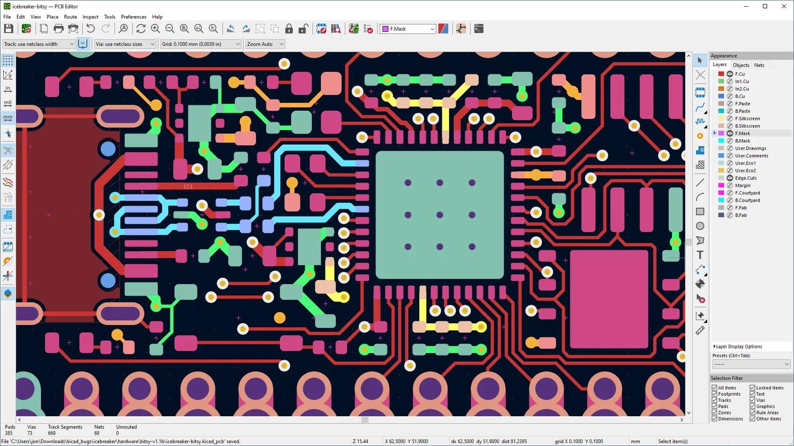{ loading=lazy }
  <figcaption>图 1-6KiCad 的 PCB 编辑器。界面使用 wxWidgets，功能密度和交互复杂度并不比 Qt 项目低。</figcaption>
</figure>

### LibrePCB：用 Qt 重做一遍 EDA

LibrePCB 是一个年轻得多的项目，用 Qt 写界面，GPLv3 许可。它没有试图复刻 KiCad 的全部功能，而是从数据模型重新设计：库、元件、符号、封装、电路、板子被拆成清晰的层次，工程文件用自定义的二进制格式保存，版本控制友好。它的界面比 KiCad 现代，交互逻辑也更一致，但生态和元件库规模远不如 KiCad。

LibrePCB 的库模型值得单独看一眼。它把“元件”和“符号”“封装”分开：元件描述电气属性，符号描述原理图上的图形，封装描述 PCB 上的焊盘和轮廓，三者通过库元素关联。这种拆分让同一个元件可以有不同的符号和封装变体，也让库的升级和迁移有章可循。代价是用户建库的门槛更高，而 EDA 项目的生死恰恰取决于库的规模。工程结构与生态规模之间的这种张力，在工业软件里非常常见：架构更干净的项目，往往输给生态更厚的项目。

这两个项目放在一起，能看出一条很现实的规律：在电子设计领域，界面框架的选择影响的是开发手感和跨平台细节，真正决定项目能否活下来的是元件库、格式兼容性和社区贡献。LibrePCB 的架构更干净，KiCad 的生态更厚，后者赢了市场。工业软件的竞争，很少是纯技术竞争。

<figure markdown>
  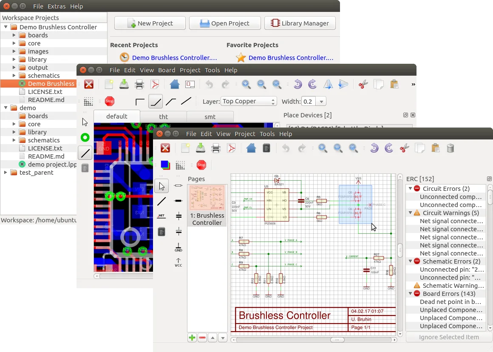{ loading=lazy }
  <figcaption>图 1-7LibrePCB 的原理图编辑器。它用 Qt 重做了 EDA 的交互，但生态规模仍是它和 KiCad 之间最难逾越的差距。</figcaption>
</figure>

## 1.4 仿真与网格：求解器之外的战场

### ParaView：把可视化管线产品化

ParaView 是科学计算可视化的标杆项目。它用 Qt 做界面，用 VTK 做数据处理和渲染，用客户端—服务器架构支持远程超算。用户在界面上看到的每一个“过滤器”，在底层都是 VTK 管线里的一个 `vtkAlgorithm`；每一次参数修改，都会触发管线重新执行。这种“数据流编程”模型让 ParaView 可以用同一套界面处理结构网格、非结构网格、粒子数据、多块数据，而不需要为每种数据类型写一套界面。

ParaView 的架构里有两个地方特别值得工业软件借鉴。第一是**管线与界面的分离**：界面只负责收集参数，真正的计算和渲染在 VTK 管线里，界面刷新是管线执行的结果。第二是**状态可序列化**：整个会话可以保存成 Python 脚本或状态文件，从而支持批处理、远程复现和自动化测试。很多自研后处理软件把逻辑写进界面槽函数里，做到第三个求解器就维护不动了，问题就出在这。

ParaView 还有一层容易被忽略的设计：**表示（representation）与视图（view）分离**。同一份数据可以同时出现在三维视图、二维切片、图表和表格里，每个视图有自己的相机、颜色映射和交互方式，但它们共享同一个数据源。用户改一处颜色映射，所有引用该数据的视图一起更新。这个模型对工业软件很有用，因为工业现场经常需要“同一个结果，用云图、曲线、表格三种方式看”，而不是为每种展示方式复制一份数据。

<figure markdown>
  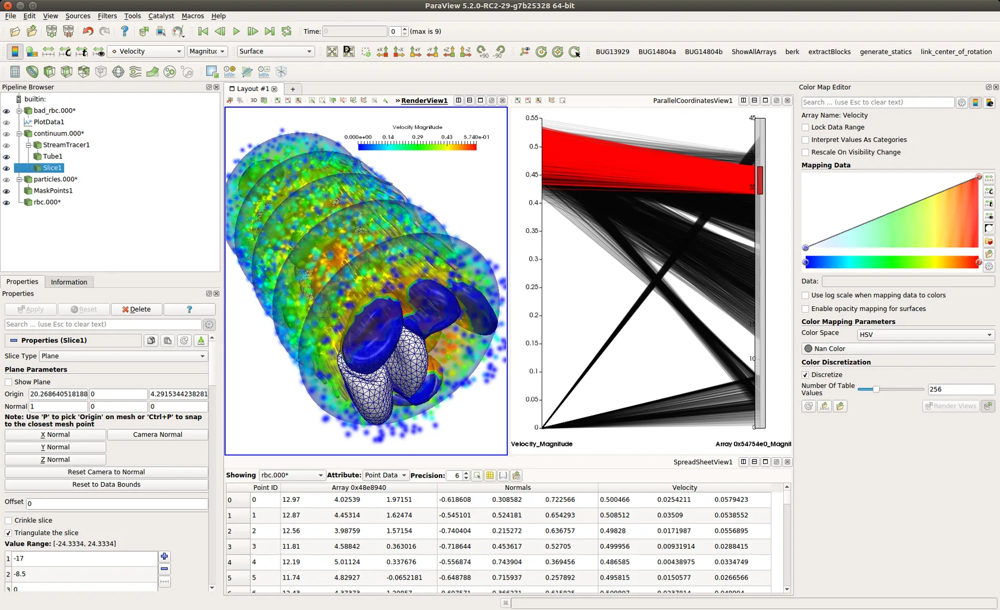{ loading=lazy }
  <figcaption>图 1-8ParaView 的管线浏览器、渲染视口和属性面板。界面上的每个过滤器都对应 VTK 管线中的一个算法节点。</figcaption>
</figure>

### Gmsh：轻量界面与重型算法的组合

Gmsh 是开源网格生成领域的常青树。它用 FLTK 做界面，而不是 Qt，原因和 KiCad 类似：项目追求的是“一个可执行文件解决网格问题”，FLTK 足够轻，静态链接方便，跨平台依赖少。代价是界面能力有限，复杂交互要靠自绘。

Gmsh 的核心是几何建模、网格生成和后处理的算法，界面只是算法的一个入口。它的脚本语言、命令行参数和 `.geo` 文件才是自动化流程里真正被使用的东西。这一点对工业软件很有启发：如果你的用户最终要把操作写进批处理脚本，那么界面的第一职责不是“好看”，而是“把参数准确地暴露出来”。

`.geo` 文件的设计也值得注意。它用一套简单的文本语法描述点、线、面、体和网格尺寸，用户可以手写，也可以由其他程序生成。这种“文本即接口”的做法，让 Gmsh 很容易被集成进参数化流程：上游的 CAD 或优化程序生成 `.geo`，Gmsh 负责网格化，下游的求解器读取网格。界面在这里是可选的，算法和文件格式才是稳定的契约。很多自研网格工具把参数藏在对话框里，结果每接一个上游工具就要改一次界面，问题就出在没有把文件格式当成第一接口。

<figure markdown>
  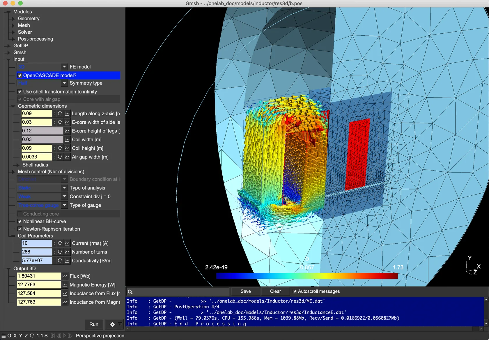{ loading=lazy }
  <figcaption>图 1-9Gmsh 的网格视图与命令行窗口。FLTK 界面朴素，但几何、网格、后处理三条链路完整。</figcaption>
</figure>

### FastCAE 与 OpenFOAM：平台化与去界面化

FastCAE 是一个国产开源 CAE 集成平台，用 Qt 和 VTK 做界面，目标是让求解器开发者把自研求解器接进一套统一的前后处理框架。它的价值不在某个算法，而在“平台”这个定位：几何交互、网格划分、边界条件、材料库、结果可视化被拆成可替换的模块，求解器通过接口接入。这种结构和 FreeCAD 的工作台、ParaView 的插件是同一个思路，只是领域换成了 CAE。

平台化的难点不在界面，而在接口的稳定性。一个求解器接口一旦发布，就会有外部团队按它写代码；接口每改一次，所有接入方都要跟着改。FastCAE 这类平台通常会把接口分成“数据接口”和“流程接口”两部分：数据接口描述几何、网格、边界条件怎么传入传出，流程接口描述求解器什么时候被调用、如何报告进度和错误。前者要求格式稳定，后者要求生命周期清晰。把这两类接口混在一起，平台就会在接入第三个求解器时失控。

OpenFOAM 走的是另一个极端：没有图形界面，一切交给字典文件和命令行，前后处理外挂 ParaView。这不是偷懒，而是把“求解”和“呈现”彻底解耦，让求解器可以跑在超算上，界面可以是任何东西。工业软件未必要有界面，但只要有界面，就要想清楚界面和计算之间的边界在哪里。

<figure markdown>
  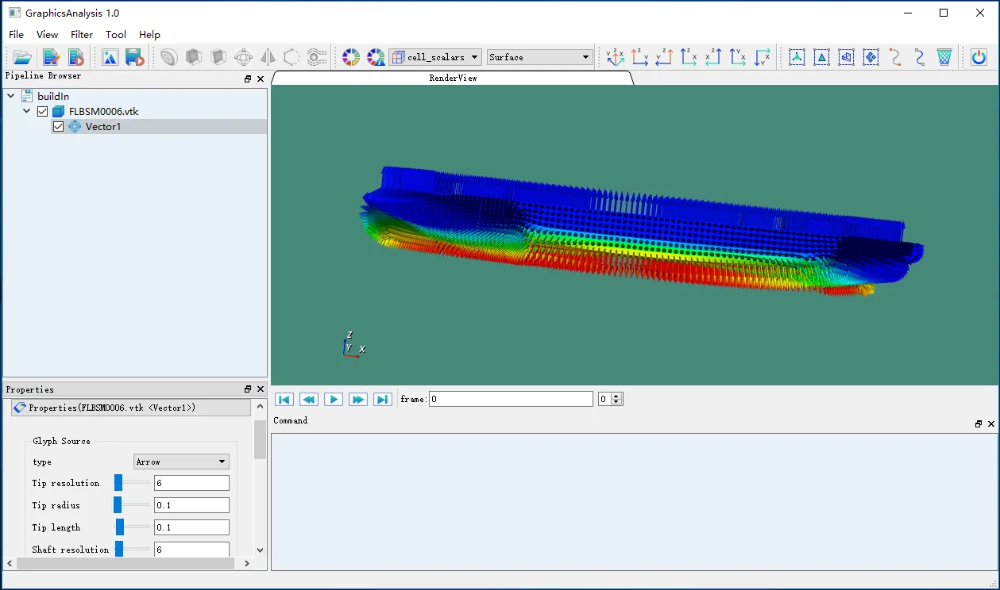{ loading=lazy }
  <figcaption>图 1-10FastCAE 的集成界面。几何、网格、求解设置和结果后处理被组织成一套平台化的工作流。</figcaption>
</figure>

## 1.5 科学可视化：库、框架与应用的层次

科学可视化是 Qt 工业软件里最容易被低估的一块。它看起来只是“画图”，实际上涉及图像处理、体绘制、等值面、流线、交互拾取和大规模数据调度。这个领域的项目可以分成三层。

最底层是算法与数据结构库。VTK 提供可视化管线和渲染，ITK 提供图像分割、配准和滤波，两者都不带界面。中间层是应用框架。CTK 把 Qt 和 OSGi 式的模块系统结合起来，为医学影像应用提供插件、服务注册和 DICOM 支持。最上层是应用。3D Slicer 用 Qt + VTK + ITK + CTK 做医学影像分析，Inviwo 用 Qt + OpenGL 做可视化算法原型，VisIt 用 Qt + VTK 做大规模科学数据可视化，LabPlot 用 Qt/KDE 做数据分析与绘图。

这三层的关系，和 CAD 领域的“OCCT—FreeCAD—Mayo”完全同构。底层库只关心算法正确性和性能，中间层解决模块组合和生命周期，应用层才处理具体领域的工作流。很多团队一上来就写应用，写到第三个功能才发现缺一层“把算法组织起来”的框架，于是把框架逻辑散落在界面类里，最后无法维护。

| 层次 | 代表项目 | 解决的问题 | 界面 |
| --- | --- | --- | --- |
| 算法与数据 | VTK、ITK | 管线、渲染、分割、配准 | 无 |
| 应用框架 | CTK、Qt | 模块、服务注册、DICOM、窗口 | 部分 |
| 领域应用 | 3D Slicer、Inviwo、VisIt、LabPlot | 医学影像、可视化原型、大规模数据、统计分析 | 有 |

VisIt 和 LabPlot 代表了应用层的两种方向。VisIt 面向大规模科学数据，强调多服务器并行渲染和远程可视化，界面复杂但能处理 TB 级数据；LabPlot 面向实验数据和统计分析，界面轻量，重点是导入、拟合、绘图和导出。两者的用户群不同，但都把“数据源—处理—展示”这条链固定下来，再在链上增加领域功能。工业软件选型时，先判断自己属于哪一类，再决定是自研应用层，还是基于现有框架扩展。

<figure markdown>
  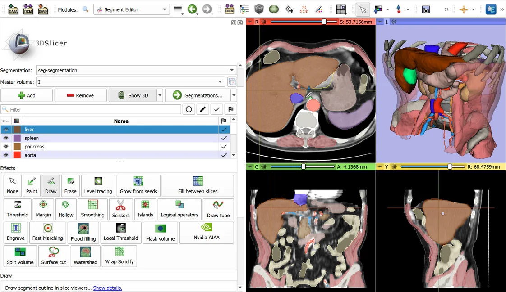{ loading=lazy }
  <figcaption>图 1-113D Slicer 的医学影像分割界面。Qt 负责工作区，VTK 负责体绘制和切片视图，CTK 负责模块与服务。</figcaption>
</figure>

<figure markdown>
  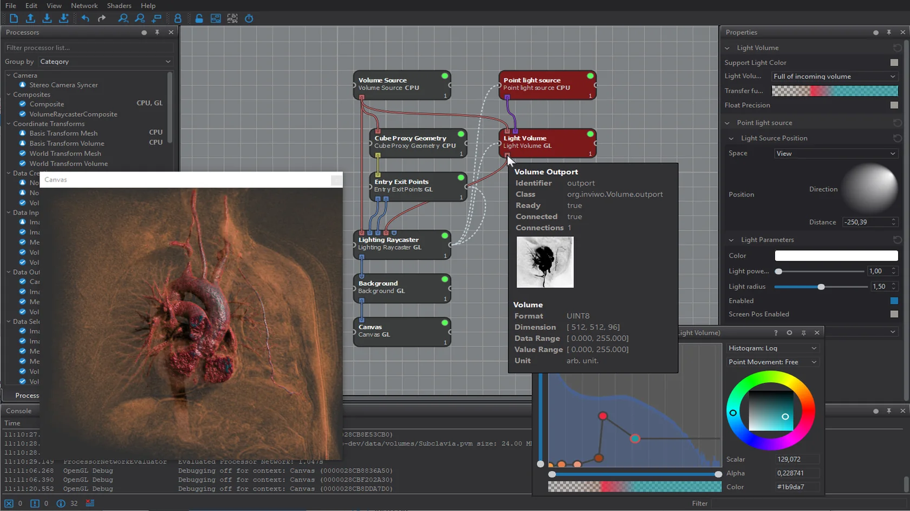{ loading=lazy }
  <figcaption>图 1-12Inviwo 的可视化网络编辑器。节点和连线就是数据处理管线，界面本身就是管线的可视化编辑器。</figcaption>
</figure>

## 1.6 地理信息：坐标、图层与插件

QGIS 是开源 GIS 的代表作。它用 Qt 写界面，底层依赖 GDAL/OGR 读写各种地理数据格式，用 PROJ 做坐标参考系转换，用 GEOS 做几何运算。QGIS 的结构里有两个地方对工业软件特别有参考价值。

第一是**坐标参考系（CRS）贯穿全流程**。图层加载、空间查询、距离计算、导出，每一步都必须知道数据用的是什么坐标系，并在必要时转换。QGIS 把这件事做进了核心数据模型，而不是留给插件。第二是**插件生态**。QGIS 的插件可以用 C++ 写，也可以用 Python 写，插件通过稳定的接口访问图层、地图画布、处理算法和界面菜单。QGIS 能从一个小工具长成完整平台，插件生态的贡献大于核心代码的贡献。

QGIS 的处理框架（Processing Framework）是插件生态的关键基础设施。它把栅格、矢量、几何、数据库操作统一包装成“算法”，每个算法声明输入参数和输出结果，界面自动生成参数对话框，批处理、模型构建器和 Python 控制台共用同一套算法。用户写一次算法，可以在图形界面、批处理、脚本和第三方插件里重复使用。这种“算法即插件”的设计，比“每个功能写一个对话框”的做法多花一层抽象，但换来了自动化能力和生态扩展性。第 6 章讲插件接口时，会回到这个例子。

GPXSee 是一个小得多的项目，用 Qt 显示 GPS 轨迹和地图。它没有 QGIS 的插件体系，也没有复杂的数据模型，但把“轨迹解析、地图配准、渲染、导出”这条链路做得很完整。把 QGIS 和 GPXSee 放在一起看，会发现工业软件的规模差异并不改变结构：都是一个领域数据模型，加一个渲染视口，加若干输入输出格式。

<figure markdown>
  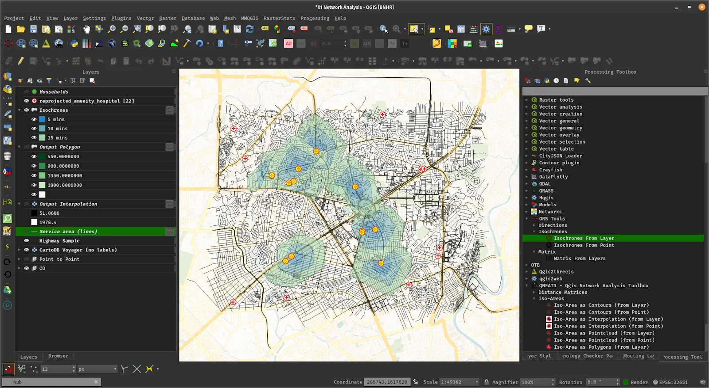{ loading=lazy }
  <figcaption>图 1-13QGIS 的主界面：图层树、地图画布、处理工具箱。坐标参考系和插件接口是它真正的骨架。</figcaption>
</figure>

## 1.7 从案例里读出的三条规律

把这些项目放在一起，能读出三条规律。它们会在后面的章节里反复出现。

**第一条：界面框架可以换，领域模型不能换。** 这一章里，KiCad 用 wxWidgets，Gmsh 用 FLTK，OpenFOAM 没有界面，但它们要解决的问题和 Qt 项目没有区别。反过来，一个团队如果把业务逻辑写进 `QMainWindow` 的子类，换界面框架时就得重写整个产品。判断一个工业软件的架构好不好，有一个简单的测试：把界面层全部删掉，剩下的代码还能不能表达这个领域的模型和算法？能，说明分层成立；不能，说明界面和业务已经长在一起。

**第二条：内核很难换，所以选型要一次做对。** OCCT、VTK、GDAL、ITK 这些库都发展了十几年以上，背后是大量退化情况、格式兼容和性能优化。自研一个“够用”的内核，前六个月看起来很顺利，第三年开始被各种边界情况拖住。工业软件的内核选型，本质上是在“长期维护成本”和“短期可控性”之间做取舍。大多数团队应该选成熟内核，把精力放在领域层和交互层。

**第三条：扩展点决定软件的寿命。** FreeCAD 的工作台、QGIS 的插件、ParaView 的过滤器、3D Slicer 的模块、FastCAE 的求解器接口，本质上都是同一件事：把“什么可以扩展、怎么扩展、扩展如何被加载”固化成接口。没有扩展点的软件，所有需求都要回到核心团队；有扩展点的软件，社区和合作伙伴可以自己长出功能。扩展点设计得好不好，不取决于接口有多少方法，而取决于接口是否足够窄、版本是否可控、插件是否只能通过上下文访问宿主能力。

这三条规律也有边界。界面与内核分离得再干净，如果团队没有能力维护内核，产品依然做不出来；扩展点设计得再好，如果核心功能不稳定，插件生态也长不起来。三条规律解释的是“结构如何影响寿命”，不是“结构决定一切”。读这些项目时，既要看它们做对了什么，也要看它们在哪些地方付出了代价：FreeCAD 的启动速度、QGIS 的插件兼容性、ParaView 的界面复杂度、KiCad 的界面观感，都是结构选择的副产品。判断一个项目值不值得学，不是看它有没有缺点，而是看它的缺点是否来自你可以接受的取舍。

## 1.8 总表：项目、领域、界面框架、内核与许可

下表把本章提到的项目放在一起。许可证以各仓库的 LICENSE 文件为准，核对时间为 2026 年 11 月；实际使用前请再看一眼仓库当前状态。“界面”一列写的是图形界面框架，“内核”一列写的是项目依赖的领域能力来源，“无”表示该项目不提供图形界面。

| 项目 | 领域 | 界面框架 | 内核 / 依赖 | 许可证 |
| --- | --- | --- | --- | --- |
| FreeCAD | 参数化 CAD | Qt | OCCT、Coin3D | LGPL-2.1 |
| OCCT | 几何内核 | 无 | 自研 | LGPL-2.1（含例外） |
| Mayo | CAD 查看 / 转换 | Qt | OCCT | BSD-2 |
| QCAD | 二维制图 | Qt | 自研 RDocument | GPLv3 / 商业 |
| LibreCAD | 二维制图 | Qt | 自研 RS_* | GPL-2.0 |
| Analysis Situs | 几何算法平台 | Qt / VTK | OCCT | 见仓库 |
| TiGL | 飞机几何 | Qt | OCCT、CPACS | Apache-2.0 |
| KiCad | EDA | wxWidgets | 自研 | GPL-3.0 |
| LibrePCB | EDA | Qt | 自研 | GPL-3.0 |
| ParaView | 后处理 | Qt | VTK | BSD-3 |
| Gmsh | 网格 | FLTK | 自研 | GPL-2.0 |
| FastCAE | CAE 平台 | Qt | VTK、求解器接口 | BSD-3 |
| OpenFOAM | CFD | 无 | 自研 | GPL-3.0 |
| VTK | 可视化库 | 无 | 自研 | BSD-3 |
| ITK | 图像处理库 | 无 | 自研 | Apache-2.0 |
| CTK | 医学影像框架 | Qt | Qt、DCMTK | Apache-2.0 |
| 3D Slicer | 医学影像 | Qt / VTK | VTK、ITK、CTK | BSD 风格 |
| Inviwo | 可视化原型 | Qt / OpenGL | 自研 | BSD-2 |
| VisIt | 大规模可视化 | Qt / VTK | VTK | BSD-3 |
| LabPlot | 数据分析 | Qt / KDE | 自研 | GPL-2.0 |
| QGIS | GIS | Qt | GDAL、PROJ、GEOS | GPL-2.0 |
| GPXSee | GPS 轨迹 | Qt | 自研 | GPL-3.0 |

这张表最该看的不是“谁用了 Qt”，而是“谁的界面框架和内核是分开的”。分开的项目，界面可以重写，内核可以替换，扩展点可以独立演进；长在一起的项目，任何一次界面升级都会变成一次产品重构。第 6 章会把这条判断展开成可操作的模块边界和依赖方向，第 11 章会给出具体库的能力矩阵和选型建议。

读表时还要注意三件事。第一，许可证一列只写主许可证，实际项目往往还依赖别的库，整条依赖链的许可证要单独核；例如一个 BSD 项目可能链接了 GPL 的组件，最终分发时仍受 GPL 约束。第二，“界面框架”写的是主界面，不代表项目内部没有用其他框架，很多大型项目会同时使用 Qt、VTK 自带的窗口和平台原生 API。第三，项目状态是动态的，今天活跃的项目可能明年停更，表中信息只能作为起点，不能替代尽调。

下一章换一个角度：不看你用什么库，而看你的客户给你什么约束。实时性、数据量、硬件、离线、保密、生命周期，这六条约束决定了桌面框架的选择，也决定了 Qt 在什么情况下不是最优解。
