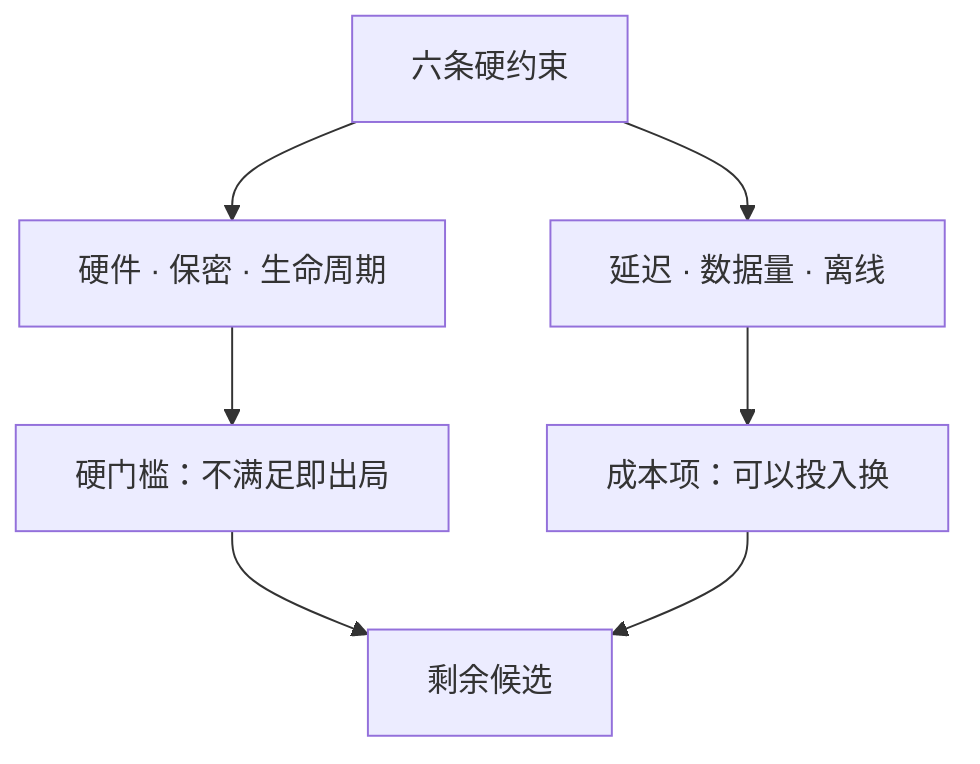
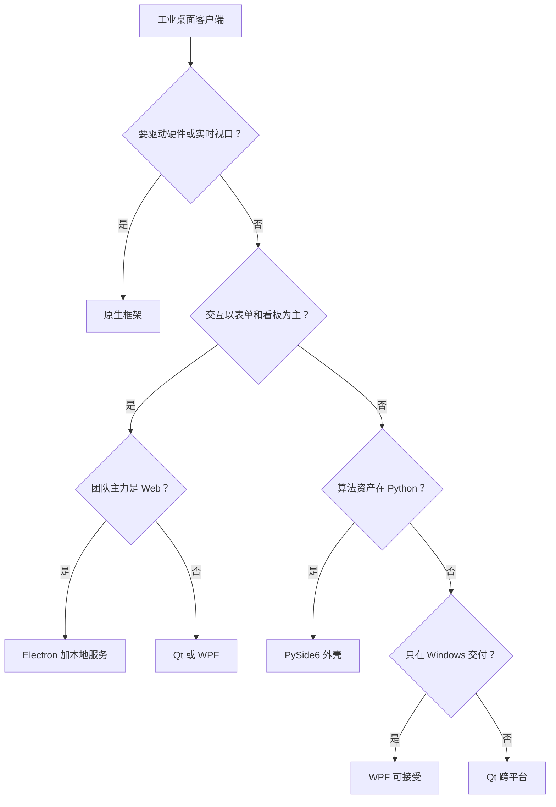
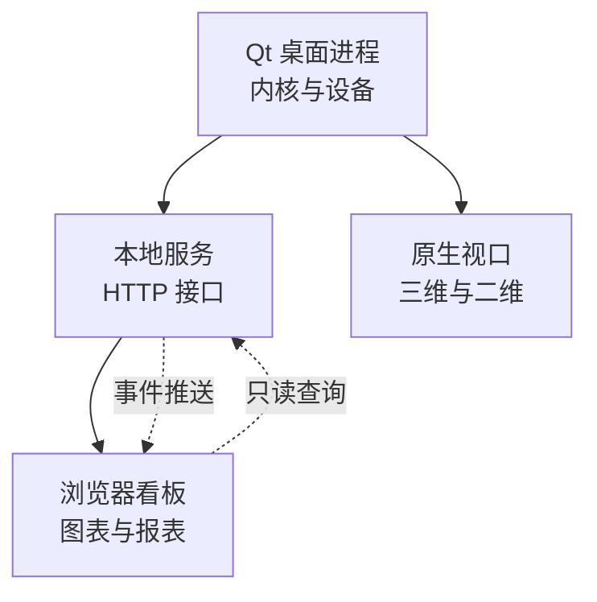

# 桌面框架选型：Qt、Electron、Python 与 Web

!!! abstract "本章要点"
    桌面框架的选型很少有“Qt 最好”这样的结论，多数时候要回答的是：在你的约束下，哪一档框架最不容易出错。工业客户端被六条硬约束钉住：延迟、数据量、硬件、离线、保密、生命周期。硬件、保密、生命周期是硬门槛，踩中即出局；延迟、数据量、离线是成本项，可以用工程投入换。本章按这六条约束逐个检验 Qt、Electron、PySide/PyQt、.NET/WPF、Flutter 与纯 Web，给出一张可打分的决策表和一套“Qt 做重活、浏览器做看板”的混合架构，并说明每种选择的代价。

## 2.1 工业客户端的六条硬约束

桌面框架的选型，先从“这个客户端被哪些约束钉死”问起，比从“哪个框架更强”问起有用得多。普通桌面应用和工业客户端的差别，不在界面复杂度，而在约束的数量和硬度：工业客户端要接设备、读大文件、算结果、跑十年，任何一条没满足，功能做得再全也进不了现场。把这些约束按“违反了会怎样”排一遍，候选框架会自己少掉一半。

<figure class="book-diagram" markdown>

<figcaption>图 2-1六条约束不是同一类东西：硬件、保密、生命周期一旦不满足就没有讨论空间，延迟、数据量、离线则可以用人力、硬件配置和工程手段去换。先分清楚属于哪一类，才不会在成本项上误判出局。</figcaption>
</figure>

延迟约束说的是“操作到画面”的往返时间。拖动一个零件、缩放一张图纸、拾取一个面，用户期望的是每帧 16 毫秒左右完成重绘，慢了就有“发涩”的观感。这条约束不只考验渲染速度，还考验数据放在哪、由谁计算：模型在本地进程、视口直接持有 GPU 资源时路径最短；如果每一帧都要跨进程序列化，或者经过浏览器的合成器转一手，帧率未必掉，但延迟的可预测性会变差。工业现场的操作员对“跟手”非常敏感，因为拖拽和拾取本身就是工作内容。

数据量约束来自装配体和结果文件。一个整车装配体几十 GB，打开时要按需加载、内存映射、显存管理，读盘和解压的每一秒都算在交付体验里。浏览器的内存模型和文件接口会把“映射文件”退化成“复制进堆”，峰值内存翻倍是常事；而原生程序可以直接映射文件、用自定义分配器管理大块内存、把顶点数据交给 GPU，代价是内存泄漏和悬垂指针要自己兜住。

硬件约束最硬。采集卡、运动控制卡、加密狗、相机 SDK、专用 GPU 驱动，这些东西只提供驱动和 C/C++ 头文件，没有 HTTP 接口。浏览器有 WebUSB、WebSerial、WebHID，但权限模型、实时性和驱动覆盖都不足以支撑产线设备；Electron 遇到同样的墙，到头来还是要写 native addon，等于把 C++ 又请回来，而且多了一层跨语言边界。

离线约束在现场比在办公室更常见。军工、能源、制造的内网往往没有外网更新通道，装完即锁，升级靠人带着安装包进机房。框架启动时必须能完全离线：不检查更新、不加载远程字体、不依赖 CDN；部署包里要带齐运行库和驱动。这一条看似只是运维问题，实际会筛掉大量“先连云端、再回退本地”的方案，因为回退路径往往没人测过。

保密约束决定了数据能不能离开内网。图纸、工艺参数、测量结果在很多行业属于受控数据，不允许上传到第三方云，甚至不允许跨机器流转。任何“云端渲染、本地只做显示”的架构直接出局；即使是私有化部署，把模型转成中间格式再传到另一台机器也要走审批。这条约束把浏览器加云算力的组合限制在看板、报表和协同评审，而不是主编辑流程。

生命周期约束是六条里最容易被低估的。工业客户端的寿命通常是八到十五年，跨越 Windows 7 到 Windows 11，跨越两代编译器和三次硬件升级。框架版本要能钉住，LTS 补丁要能拿到，许可证要能覆盖整个周期，源码最好能自己掌控。Electron 一年多个大版本、Python 每两年一个破坏性周期、前端框架三年换一茬，这些节奏最终都会折算成维护成本，落在同一个团队身上。

| 约束 | 违反后的症状 | 对框架的硬要求 |
| --- | --- | --- |
| 延迟 | 拖动发涩、拾取迟滞、现场投诉 | 本地进程、GPU 直连、帧时间可预测 |
| 数据量 | 大装配打不开、内存翻倍 | 内存映射、按需加载、显存管理 |
| 硬件 | 设备接不进、实时性不达标 | 原生驱动接口、C ABI、稳定工具链 |
| 离线 | 现场装不上、启动报错 | 无网络依赖、离线安装包 |
| 保密 | 数据出内网、合规不通过 | 本地计算、私有部署 |
| 生命周期 | 三年后补丁断供、无法升级 | LTS、源码可控、许可覆盖 |

这张表的价值在于把“框架能力”翻译成“项目风险”。六条里有三条是门槛，讨论到门槛就结束了；另外三条是成本，可以花钱、花人、花时间去补。选型会上的常见错误，是拿一张功能对照表把六条混在一起打分，结果一个明显踩了保密红线的方案，靠界面漂亮拿了高分。正确的顺序是先用门槛筛掉不可行的，再在剩下的方案里算成本的账。

## 2.2 Qt 的强项与代价

Qt 在工业客户端里的地位，来自它把四套基础设施同时做全了：窗口与输入、模型视图、元对象、插件加载。这四样恰好是工业界面里最耗时间的四块工作，而且彼此咬合，缺一块就要用自研代码去补，补出来的东西通常还不如它稳定。

窗口与输入这一层，覆盖了跨平台窗口、拖放、剪贴板、高 DPI 缩放、输入法、快捷键、多显示器、无边框窗口这些琐碎但必须正确的事情。工业软件经常要自绘视口、嵌入第三方渲染器，`QOpenGLWidget`、`QRhi`、`QQuickWidget` 提供了接入点，团队不必自己处理窗口系统、上下文创建和平台事件差异。这一层做不好，后面所有性能优化都会被窗口管理的偶发问题抵消。Qt 的版本与模块信息可以在 [Qt 官网](https://www.qt.io/)和文档站查到，选型时以当前版本的文档为准。

模型视图这一层，解决的是属性面板、图层树、结果列表、任务队列这类“表格加树”的界面。`QAbstractItemModel` 把数据和显示拆开，一个模型可以同时挂在树、表、下拉框上；`QSortFilterProxyModel` 负责过滤与排序；`QStyledItemDelegate` 负责编辑器。自研框架通常补到第三个视图才发现缺了“模型通知”这一环，于是每个视图各自刷新，到头来没人说得清界面为什么慢。

元对象系统这一层，提供信号槽、属性、反射和对象树。信号槽解决模块解耦，`Q_PROPERTY` 支撑序列化、属性编辑器、动画与数据绑定，`QObject` 父子关系解决生命周期。工业软件的属性面板、撤销栈、脚本绑定都依赖一个可反射的对象模型；Qt 的元对象不是最现代的方案，但工具链完整，`moc`、`QMetaObject`、`QMetaType` 之间的配合经过长期验证。

插件这一层，`QPluginLoader` 配合 `Q_DECLARE_INTERFACE` 让主程序在运行期加载二进制插件，`QJSEngine` 提供轻量脚本，`uic` 提供界面描述。工业软件的扩展点通常就落在这三种机制上，第 6 章会把插件接口的设计展开，这里只需要记住：Qt 把“加载”这件事做完了，把“接口怎么设计”留给了你。

Qt 的能力边界也随版本移动，选型时要把版本一起看。Qt 6 把图形栈重写成 `QRhi`，把 OpenGL、Vulkan、Metal、D3D 收到一层抽象后面，新建的视口代码可以按这套抽象写；Qt 5 时代基于 `QGLWidget` 的自研视口，迁到 Qt 6 通常要重写上下文和绘制路径。模块拆分同样影响选型：`QtOpenGLWidgets`、`Qt5Compat` 这些模块在 Qt 6 里被拆出去，老代码的 `find_package` 和头文件都要跟着改。版本的详细信息放到第 3 章，这里先记住一个判断：新项目从 Qt 6 起步，老项目在决定换框架之前，先算一遍迁移的代价。

代价有三块，第一块是 C++ 的工程门槛。编译、链接、ABI、内存、跨平台工具链，团队里必须有人对这些负责；Qt 的信号槽和元对象还引入了一套自己的构建步骤（`moc`、`uic`、`rcc`），构建系统的复杂度比纯 C++ 项目高一档。第二块是包体与部署，Qt 运行时加上插件、平台插件、翻译文件、第三方依赖，安装包以几十 MB 起步，如果用到 Qt WebEngine，体积会被推到百 MB 量级。第三块是许可，闭源商用默认走 LGPLv3 加动态链接这条路，静态链接、LTS 补丁、商业支持都要另外算账，第 3 章专门讲这些义务。

还有一块隐形成本：Qt 只管人机接口，领域模型、命令栈、插件接口、数据格式全部要自己设计。第 1 章的判断在这里兑现——界面框架可以换，数据模型不能换。用 Qt 的项目如果没把模型从窗口类里拆出来，换框架的成本和重写差不多；拆出来的项目，Qt 只是可替换的一层皮。这个成本在项目第一年看不出来，在第三年要换渲染方案或支持新平台时集中爆发。

所以 Qt 适合的是“团队有 C++ 能力、产品要做十年、界面里既有表格又有视口”的项目。它不适合“三个月出原型、只有表单和图表”的项目，那边的成本结构和迭代节奏完全不同，用 Qt 反而会把前期的速度拖慢。判断 Qt 是否合适，不看团队喜不喜欢 C++，而看这个产品有没有一个必须由本地进程承担的“重活”。

## 2.3 Electron 的适用边界

Electron 的边界，落在“数据要不要穿过进程边界”这个问题上。它把 Chromium 和 Node.js 打包成一个运行时，界面用 Web 技术写，文件和系统调用走 Node，两者通过进程间通信（IPC）传递消息。这个结构决定了哪些活它干得轻松，哪些活它干得别扭。

从结构上看，渲染进程在 Chromium 的沙箱里，界面绘制与合成由 Chromium 负责，DOM 更新和动画可以很流畅；主进程持有文件、网络、子进程能力，能读本地文件、起本地服务、调用原生扩展；两个进程之间传数据要序列化，大缓冲要么复制，要么用共享内存。界面逻辑天然按浏览器的方式组织，组件化、热更新、前端调试工具都是现成的，[Electron 官方文档](https://www.electronjs.org/)对进程模型和安全建议有完整说明。

适用的场景很清晰：以表单、表格、图表、看板为主的界面；需要 Web 团队快速迭代；要跨 Windows、Linux、macOS 保持一致外观；后端已经有 HTTP 服务；界面数据量在 MB 级。从公开资料看，Electron 在生产系统里常见的角色是监控看板、配置工具、报表客户端，而不是三维编辑主界面。它的优势是界面迭代速度和前端人才供给，这两项在工业软件里同样值钱。

越界的第一条是实时视口。Electron 不是不能渲染三维，WebGL 和 WebGPU 都能跑；问题在数据路径：模型如果在内核进程里，每一帧都要经过 IPC 搬运，或者把内核整个搬进渲染进程。前者增加延迟并且让帧时间抖动，后者让沙箱形同虚设，等于放弃 Electron 的安全模型。第二条是大文件，Chromium 的内存上限、文件接口的复制语义、渲染进程崩溃后的恢复成本，都不适合几十 GB 的装配体。

第三条是硬件与离线。串口、采集卡、加密狗最终都要原生扩展或本地服务，这部分又回到 C++，于是项目同时维护两套构建、两套崩溃排查、两套签名流程。离线分发也要自己解决：Electron 的自动更新依赖 Chromium 的下载链路，内网环境要自建更新服务器，或者干脆不更新——不更新意味着安全补丁也停了，而 Chromium 的补丁节奏不会等一个工业项目。

Electron 的安全模型还带来一笔工程账。渲染进程必须按浏览器对待：关闭 nodeIntegration，打开 contextIsolation，用 preload 暴露窄接口；任何一个图省事直接开 nodeIntegration 的做法，都会把本地文件系统交给页面脚本，而工业软件恰恰要读本地文件、连数据库、跑批处理。这些能力要走主进程的有权限接口，接口设计得好不好，直接决定这套架构能不能过安全评审。签名和离线更新也要提前设计：安装包要代码签名，企业内网常常只能手工分发，更新通道和回滚方案要在第一版就留出来。

团队结构是另一笔账。Electron 项目的前端部分和原生部分往往由不同的人维护，接口就是 IPC 协议；协议一变，两边都要改，联调成本随界面复杂度上升。判断 Electron 是否合适，有一个简单的测试：把界面里的数据全部换成 mock，项目能不能在一周内跑起来？能，说明界面逻辑与内核耦合不深，Electron 的迭代优势成立；不能，说明重活在本地进程里，Electron 只是把重活挪到了一个更难调试的位置。

## 2.4 Python 桌面（PySide/PyQt）的适用边界

Python 桌面的价值，在于把已有的 Python 算法和数据处理能力包成界面，而不是用它重写一个 C++ 产品的全部界面。这两件事的成本差一个数量级，混在一起讨论，结论必然是错的。

PySide6 是 Qt 官方的 Python 绑定，也就是 Qt for Python，许可是 LGPLv3 或商业许可；PyQt6 是 Riverbank 维护的第三方绑定，许可是 GPLv3 或商业许可。两者 API 接近，差别在许可、发布节奏和社区生态，版本与许可细节分别见 [Qt for Python 文档](https://doc.qt.io/qtforpython-6/)和 [Riverbank 的 PyQt 页面](https://www.riverbankcomputing.com/software/pyqt/)。用它们写界面，窗口、控件、模型视图、信号槽都是 Qt 那一套，只是调用从 C++ 换成 Python，所以 Qt 在界面层的积累可以继承，C++ 的工程负担则被换成了 Python 的分发与性能问题。

适用的场景是内部工具、科研原型、算法验证平台、数据分析前端。算法团队已经有 NumPy、SciPy、pandas 组成的处理链，用 PySide6 包一层界面，几天就能出可用的工具；界面卡顿时，热点可以下沉到 C++ 扩展，或者交给 NumPy 里释放全局解释器锁（GIL）的部分。这种“Python 外壳加 C++ 热点”的组合，在科学计算和仿真前后处理里很常见，也是 PySide 真正发挥价值的地方。

越界的地方有三个。启动与分发：Python 运行时、Qt 库、第三方包一起打包，安装包体积和启动时间都高于纯 C++ 程序；PyInstaller 的 onefile 模式每次启动要解压到临时目录，冷启动可能要几秒，现场操作员会把这当成“软件卡”。性能：界面线程受 GIL 约束，重计算必须放到工作线程或子进程，跨线程传大对象还要序列化。类型与工具链：Python 的动态类型在大型界面代码里会失去编译期检查，重构只能靠测试和类型注解，团队规模一大就吃力。

许可上有一个常见的坑：PyQt6 的 GPLv3 版本要求分发时开源，闭源商用要买商业许可；PySide6 走 LGPLv3，可以动态链接闭源使用，但要满足 LGPL 的义务，第 3 章会把这些义务拆开讲。选 Python 桌面时，先把“用哪个绑定、走哪条许可”定下来，再谈技术，否则做到一半发现许可不合规，换绑定的成本不比换框架低。

打包与调试是 Python 桌面的日常摩擦。PyInstaller 和 Nuitka 都能出可执行文件，前者上手快，后者能编译一部分代码、启动更快；两者都要处理隐藏导入，Qt 的平台插件、第三方 DLL、数据文件很容易漏打包，表现是开发机上正常、客户机器上白屏或报找不到平台插件。调试混合栈也麻烦：Python 层的异常用 debugpy 看，C++ 层要 gdb 或 cdb，信号槽报错的调用栈里往往丢了 Python 帧，团队里必须有人能同时读两种栈。

对工业产品来说，Python 桌面适合做外围工具和算法验证台，不适合直接承担主产品的十年维护。主界面如果确定要用 Python，内核必须是独立的 C++ 库或本地服务，界面只是调用方；这样将来换壳、换框架、做无界面批处理，都不至于重写算法。反过来，如果内核本身就是 Python，那么用 PySide 是顺势而为，硬上 C++ 界面只会把团队拆成两半。

## 2.5 .NET/WPF、Flutter、纯 Web 为什么少见

这三种技术都能画出工业界面，少见的原因不在能力，而在各自被一条结构性限制挡住：WPF 被平台挡住，Flutter 被原生集成挡住，纯 Web 被浏览器沙箱挡住。三条限制的性质不同，绕法也不同，值得分别看清楚。

WPF 在只在 Windows 交付的产线、上位机、检测设备里并不少见。C# 的开发效率、与 Windows 生态的集成（COM、注册表、加密狗、Win32 消息）、成熟的图表与表格控件，让它成为很多设备厂的首选。限制在平台：WPF 只在 Windows 上跑，.NET 跨平台不等于 WPF 跨平台；客户一旦要求 Linux 或国产化操作系统，界面层就要换，Avalonia、WinUI、Qt 都是候选。选择 WPF 的前提，是确认这个产品未来十年不会离开 Windows。

Flutter 用 Dart 写界面，自绘引擎保证多端一致，移动端生态成熟，桌面端在 2022 年前后进入稳定，能跑 Windows、Linux、macOS，官方文档见 [flutter.dev](https://flutter.dev/)。真正的障碍在集成：工业客户端要嵌三维视口、要接串口与采集卡、要处理中文输入法与无障碍、要跟原生窗口管理器打交道，Flutter 的插件生态在这些角落不如 Qt 和 .NET 厚。把现有 C++ 内核接进来要走外部函数接口（FFI），跨语言调试的成本不低，三维视口的纹理共享也没有现成方案。

纯 Web 的前提是“数据和服务都在别处”，浏览器只负责展示。这个前提在看板、报表、远程监控里成立，在编辑与实时控制里不成立：浏览器拿不到设备驱动，文件访问受权限与沙箱约束，长时间运行的内存与崩溃恢复也不可控。WebAssembly 能把计算搬进浏览器，但内存上限、线程模型、GPU 访问仍有边界。工业软件把 Web 当第二界面是合理的，当唯一界面要非常谨慎。

人才供给也是现实因素。WPF 和 C# 在设备制造集中的地区招聘容易，做上位机的工程师往往同时懂电气和串口；Flutter 的桌面岗位少，招来的人通常只做过移动端；纯 Web 的前端供给充足，但懂工业协议、懂实时数据的少。选型表之外，人力市场要单独算一列权重，否则框架选得再合理，招不到人维护也是空谈。

这三条限制有一个共同点：都不是靠框架自己努力就能消掉的。WPF 要等 Windows 生态变化，Flutter 要等插件生态补齐，纯 Web 要等浏览器标准演进。工业项目的交付周期等不起这种演进，所以选型时更倾向于“限制已经暴露清楚、有成熟绕法”的框架。这条判断同样适用于 Qt：Qt 的限制也清楚，绕法也成熟，这才是它在工业领域被反复选择的原因。

## 2.6 决策表：按实时性、数据规模、硬件、团队、交付方式打分

到这一步，候选通常只剩两三个。打分表算不出唯一答案，它的作用是把“我觉得”翻译成“它在哪个维度赢、赢多少”。分数本身可以争论，争论的过程会把隐藏的假设翻出来，这比在会上重复“Qt 生态好”有用得多。

五个维度按项目性质定权重：实时性对应交互与视口，数据规模对应本地大文件与内存，硬件与系统集成对应驱动和设备，团队技能对应现有人力能否维护，交付方式对应离线安装、包体、更新与许可。做闭源商用产品时，交付与许可的权重应该更高；做内部工具时，团队技能的权重应该更高。下面这张表按一个“Windows 为主、可能上 Linux、要接设备、团队是 C++ 背景”的假想项目打分，分值 1 到 5。

| 维度 | 权重 | Qt | Electron | PySide6 | WPF | 纯 Web |
| --- | --- | --- | --- | --- | --- | --- |
| 实时性与视口 | 25% | 5 | 2 | 4 | 4 | 1 |
| 数据规模 | 20% | 5 | 2 | 4 | 4 | 1 |
| 硬件与系统集成 | 20% | 5 | 2 | 4 | 5 | 1 |
| 团队技能与招聘 | 15% | 3 | 4 | 4 | 4 | 5 |
| 交付与许可 | 20% | 3 | 3 | 4 | 4 | 5 |
| 加权合计 | 100% | 4.3 | 2.5 | 4.0 | 4.2 | 2.4 |

分数是示例，不要直接抄。WPF 拿到 4.2，是因为这个假想项目只在 Windows 交付；一旦加入 Linux，硬件集成和交付两项会掉到 2 分以下，总分立刻被 Qt 反超。纯 Web 在团队与交付两项拿 5 分，但实时性和硬件两项直接把它挡在门外。Qt 的短板在团队技能与交付许可，而这两项恰好可以通过培训和采购补上，这也是它在工业项目里总分稳定的原因。

<figure class="book-diagram" markdown>

<figcaption>图 2-2决策树的顺序是先硬门槛、再团队结构、再算法资产。顺序反了，讨论会停在“框架好不好看”上；按这个顺序走，第二层就能砍掉大多数候选组合。</figcaption>
</figure>

决策树和打分表要一起用：树负责砍掉不合法的组合，表负责在剩下的组合里排序。树的第一层问硬件和实时视口，是因为这两项一旦不满足，后面的所有优势都没有意义；第二层问团队结构，是因为团队是长期成本，换人的代价通常比换框架高；第三层问算法资产，决定的是“界面包算法”还是“算法换界面”。走完这三层，剩下的答案通常只有一个，而且团队自己就能说出为什么。

## 2.7 混合架构：Qt 做重活，浏览器做看板

当主编辑界面和看板、报表的需求节奏差到一定程度，混合架构比单选更经济：Qt 负责内核、设备、实时视口，浏览器负责看板、报表和远程查看。这个结构更接近分工，把两种技术的优势放在各自合适的位置上，前提是接口切得干净。

<figure class="book-diagram" markdown>

<figcaption>图 2-3混合架构的关键是本地服务的定位：它只提供只读快照和事件流，浏览器不直接改模型。写操作全部留在 Qt 进程里，两台进程之间就没有状态同步问题，只有数据消费关系。</figcaption>
</figure>

桌面上跑一个 Qt 进程，持有文档、内核和设备连接；进程内起一个只监听回环地址的 HTTP 与 WebSocket 服务，把快照查询和只读事件流暴露给浏览器；看板页面从本地服务取数据，不直接碰模型。也可以把 Qt WebEngine 内嵌进窗口，但那样等于把 Chromium 打进安装包，体积、许可和更新负担都要重新算一遍，通常不如用外部浏览器划算。

这个结构的好处很实际。看板可以用 Web 团队熟悉的图表库和组件，迭代速度不受 C++ 编译约束；远程查看只需要在客户允许的网络内开放一个端口，桌面端不必把渲染管线搬上服务器；主界面的实时性不受影响，因为重活还在本地进程里。对客户来说仍然是“装一个客户端”，不需要额外部署服务器，这一点在隔离网里很关键。

接口设计决定这套结构能活多久。快照接口要带版本号、生成时间和数据修订号，让看板知道自己在看哪一刻的数据；事件流要有背压和断线重连，报警类事件要能补发；查询要能取消，否则一个慢查询会把本地服务堵住。服务的监听地址限定在回环地址，校验 Origin 和 Host 头以防域名重绑定，请求体设上限，认证令牌在每次启动时重新生成。这些细节看起来琐碎，却是本地服务不被当成安全漏洞的前提。

代价是两套技术栈、两套测试、两套发布。接口要定成只读快照和事件流，不能让浏览器写模型，否则两台进程之间的状态同步会变成主要 bug 来源。本地服务要处理端口冲突、防火墙提示、认证（至少一个一次性令牌）、跨域与请求伪造；如果监听在 `0.0.0.0` 而不是回环地址，等于把工业数据暴露到整个局域网。版本也要对齐：桌面端升级后，旧的看板页面可能对不上新的字段，接口要带版本号并保持一段时间的兼容。

混合架构值得做的条件很具体：看板与报表占界面工作量一半以上，且需求变化快；团队里有 Web 人力；客户接受客户端内起一个本地服务。三个条件有一个不成立，先把 Qt 界面做对更划算。框架选型的最终标准落在“团队能维护、约束能过关、十年后还能改”，追新不在其中。

下一章把选型里最容易被低估的一项单独拿出来：Qt 的版本与许可证。版本决定你能拿到哪些补丁，许可证决定你能不能闭源交付，两者都写在合同和发布清单里，改起来的代价比换框架还高。
