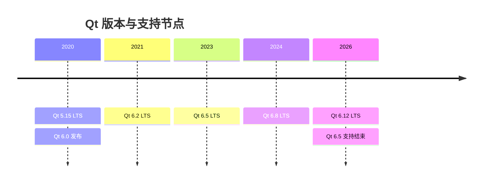
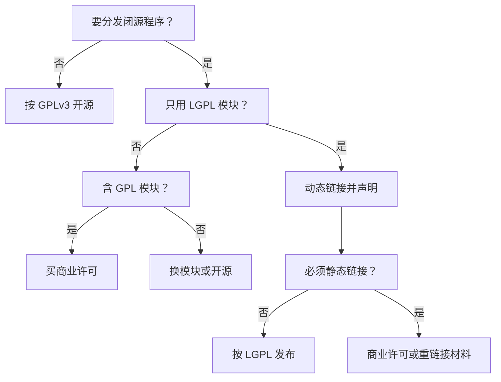

# Qt 版本与许可证

!!! abstract "本章要点"
    2026 年 11 月这个时点，Qt 的版本和许可都需要重新算一遍账：Qt 6.12 LTS 在 2026 年 9 月 30 日发布，标准支持到 2031 年；Qt 6.10 的标准支持刚到 2026 年 10 月结束；Qt 5.15 的商业标准支持停在 2025 年 5 月。许可方面，多数模块走 LGPLv3，但图表、虚拟键盘、Qt Quick 3D 等模块是 GPLv3-only，选错模块等于选错授权。本章给出支持周期表、GPLv3 模块清单、LGPL 的实际义务、静态链接的边界和一张发布前检查表。结论是：新项目从 Qt 6.8 LTS 或 6.12 LTS 起步，闭源商用默认走 LGPLv3 加动态链接，碰到 GPLv3 模块就买商业许可或换库。条款以 Qt 官网为准，本章为 2026 年 11 月核对，不构成法律意见。

## 3.1 版本时间线与支持周期

Qt 的版本节奏是半年一个小版本，每第四个小版本出一个长期支持（Long-Term Support，LTS）版本；发布节奏和支持承诺是两套时钟，混在一起看就会做错决定。发布会快，补丁会慢，支持承诺则写在商业合同里，三者对同一个版本号给出不同的日期，产品该钉哪一版，取决于你更需要哪一个日期。

从公开的发布节奏看，Qt 的小版本一年两次，通常在春季和秋季；每个小版本在下一个版本发布前会出两到三个补丁，修缺陷、修安全问题、更新文档。[Qt Releases 页面](https://doc.qt.io/qt-6/qt-releases.html)把版本规则、兼容承诺和支持周期写在一起，是核对这件事的第一手材料。LTS 版本享受额外的补丁周期，但初次发布的几个补丁之后，后续的 LTS 补丁只对商业客户开放。这条规则在 Qt 6.8 之后写得更清楚：从 6.8 起，每第四个小版本是 LTS，LTS 的支持期是五年；6.8 之前的 LTS 只承诺三年。开源用户能拿到的，是 LTS 版本最初的几个公开补丁，后面的补丁要商业许可才能下载。

<figure class="book-diagram" markdown>

<figcaption>图 3-1版本节奏与支持承诺是两条线：半年一版保证功能推进，LTS 保证补丁供给，两者在时间轴上并不重合。判断一个版本能不能用于长期产品，看的是它的 LTS 身份和补丁可获取性，而不是版本号的新旧。</figcaption>
</figure>

截至 2026 年 11 月的核对结果如下表。需要说明的是，表中“开源补丁”一列指公开渠道能下载到的补丁版本，“商业标准支持”一列来自 Qt 官方“Qt Releases”页面的支持表格，两者不是同一件事；产品选型时先确定自己走哪条渠道，再看对应的日期。

| 版本 | 发布时间 | 开源补丁范围 | 商业标准支持到 | 2026 年 11 月状态 |
| --- | --- | --- | --- | --- |
| Qt 6.12 LTS | 2026-09-30 | 初始补丁公开，之后转商业 | 2031-09-30 | 当前最新 LTS |
| Qt 6.11 | 2026-03-23 | 6.11.0 至 6.11.2 | 2027-03-17 | 常规维护 |
| Qt 6.10 | 2025-10-07 | 6.10.0 至 6.10.3 | 2026-10-07 | 标准支持刚结束 |
| Qt 6.8 LTS | 2024-10-08 | 6.8.0 至 6.8.3 | 2029-10-08 | 仍在出商业 LTS 补丁 |
| Qt 6.5 LTS | 2023 年 4 月 | 6.5.0 至 6.5.3 | 2026 年 4 月结束 | 已结束，扩展安全维护可用 |
| Qt 5.15 LTS | 2020-05-26 | 到 5.15.2 为止 | 2025-05-26（订阅客户） | 已结束，扩展安全维护可用 |

这张表最该看的是两列日期之间的落差，而非哪一版最新。Qt 6.8 LTS 的商业支持到 2029 年，但开源渠道的补丁停在 2025 年 3 月的 6.8.3；Qt 5.15 的商业支持在 2025 年 5 月结束，开源补丁则早在 2020 年 11 月的 5.15.2 就停了。如果把“版本还在”误当成“补丁还在”，产品上线三年后遇到一个已修复的安全漏洞，就只能自己打补丁或者买支持。

选基线版本时，至少要对齐三个日期：发布日、公开补丁的终点版本日、商业支持的截止日。发布日决定生态磨合的时间，公开补丁日决定开源渠道的安全底线，支持截止日决定你要为延长支持付多少钱。工业产品的交付周期往往跨越这三个日期，立项时按“产品退场日加两年维护期”倒推，比按“现在最新”选版本更稳。

对工业产品来说，可行的版本策略通常是这样：钉一个 LTS 版本，把它当产品基线；内部建一个二进制依赖仓库，把 Qt、第三方库、编译器的安装包都存进去；在支持窗口内规划一次升级，而不是每个小版本都跟。升级窗口的长度取决于产品交付周期，现场设备通常比桌面软件更难升级，所以基线版本要选在支持的早中期，而不是末期。商业客户可以直接用 LTS 补丁，开源客户则要评估“自己维护补丁”的成本，这部分成本往往被低估。

## 3.2 什么情况必须 Qt 5

Qt 5 只在某条硬约束动不了的时候才是正确选择，“团队熟 Qt 5”不构成理由。版本选择是一笔长期账，选 Qt 5 意味着接受“没有公开补丁”这个事实，换来的是对旧环境的兼容；这笔交易只有在旧环境确实无法替换时才划算。

最常见的硬约束是操作系统。Windows 7 的支持停在 Qt 5.15，Qt 6 的官方支持平台从 Windows 10 起步，Windows 10 的支持到 Qt 6.12 为止。如果客户现场是 Windows 7 的工控机，且升级操作系统的计划排在三年后，那么界面层只能停在 Qt 5.15；如果现场是 Windows 10，Qt 6 还能陪你到 6.12 之后的版本，但要在下一个大版本前把系统升到 Windows 11。

第二类硬约束是编译器与运行时。老项目可能绑在 MSVC 2015、GCC 4.8、老版本 glibc 或某个厂商的定制工具链上，Qt 6 对编译器的最低要求把它们挡在门外。第三类是依赖没有迁移：自研或第三方的界面库、图表库、插件 SDK 只提供 Qt 5 的二进制，重新编译需要源码和人力；设备和加密狗的厂商 SDK 也可能只支持旧版运行库。这三类约束的共同点是“改起来的成本高于停在 Qt 5 的成本”，而不是“Qt 6 不好”。

旧系统的范围不止 Windows 7。Linux 侧的工业现场常见 CentOS 7、老版本 Ubuntu 和国产化发行版，glibc 版本可能低于 Qt 6 官方二进制要求的 2.34；官方安装器里的二进制包按较新的发行版构建，装到老系统上会报符号版本错误，解决办法只有自己从源码编译 Qt，或者停在使用 Qt 5.15 的自建版本上。国产化平台的支持情况要按 CPU 架构和操作系统分别确认，Qt 官方支持列表与厂商的适配列表不是同一份东西，选型前要各查一遍。

停在 Qt 5 的代价要提前写清楚。Qt 5.15 的公开发布停在 2020 年 11 月的 5.15.2，之后的补丁只对商业客户开放；商业标准支持在 2025 年 5 月结束，之后是扩展安全维护（Extended Security Maintenance，ESM），覆盖范围与费用要单独谈。这意味着安全漏洞的修复责任落到自己头上：要么买 ESM，要么自己从 Qt 5.15 分支 cherry-pick 补丁，要么接受风险。Qt 5.15 的工具链是 C++11 时代的产品，高 DPI、Wayland、现代 GPU 驱动的适配都要自己做，这些工作在 Qt 6 里是默认行为。

如果确实被钉在 Qt 5，做法上要把“将来能走”准备好。业务代码尽量不用 Qt 5 私有 API，不用 `QGLWidget` 这类已废弃的类，图形相关代码集中到少数几个类里；用 `QT_VERSION_CHECK` 隔离版本差异，让同一份源码能同时编译 Qt 5 和 Qt 6；构建系统尽早迁到 CMake，qmake 工程在 Qt 6 里会变成迁移的额外负担（第 4 章会讲迁移路径）。这些准备不会让 Qt 5 变得有补丁，但会让“换到 Qt 6”从重写变成移植。

## 3.3 什么情况应该 Qt 6

只要没有硬约束钉在 Qt 5，新项目就应该从 Qt 6 起步；2026 年下半年的具体落点是 Qt 6.8 LTS 或 Qt 6.12 LTS。这个结论来自补丁供给、平台支持和工具链寿命三笔账，与追新无关：Qt 6.12 的支持到 2031 年，足够覆盖一个工业产品从立项到退场的周期。

Qt 6 的技术变化值得在这里点几处，因为它们直接影响工程决策。语言标准从 C++11 提到 C++17，新代码可以用结构化绑定、`std::optional`、`if constexpr`；图形栈重写成 `QRhi`，把 OpenGL、Vulkan、Metal、D3D 收进一层抽象，自绘视口有了统一的接入方式；高 DPI 缩放默认开启，不再需要 `AA_EnableHighDpiScaling` 这类开关；模块做了拆分，`QtOpenGLWidgets`、`Qt5Compat` 从原来的大模块里分出来，`find_package` 的组件名和头文件路径都要跟着改。构建系统方面，Qt 6 自身用 CMake 构建，应用侧也以 CMake 为主，qmake 还能用，但插件和依赖内部构建的库必须走 CMake。

版本落点要看依赖的迁移进度。Qt 6.12 LTS 是当前最新的 LTS，支持到 2031 年，适合新立项且依赖链已经验证过的产品；Qt 6.8 LTS 支持到 2029 年，生态更成熟，OCCT、VTK、ITK、QWT 这些库在 6.8 上的组合被验证得更多，适合“依赖多、不愿当小白鼠”的项目。Qt 6.10 和 6.11 不是 LTS，标准支持分别到 2026 年 10 月和 2027 年 3 月，只适合短期工具或跟随验证，不适合做产品基线。

从 Qt 5 迁到 Qt 6，工作量集中在四处。第一处是 API 替换：`QRegExp` 换成 `QRegularExpression`，`QTextCodec` 换成 `QStringConverter`，`QGLWidget` 换成 `QOpenGLWidget`，`QDesktopWidget` 换成 `QScreen`，一批容器和 `QVariant` 的接口也改了签名。第二处是高 DPI 行为变化，原来按像素写死的布局和图标，在 150% 缩放下会暴露问题。第三处是渲染差异，OpenGL 上下文、帧缓冲、合成方式都变了，自绘控件要重新测。第四处是构建与部署，qmake 工程要转 CMake，插件要重新声明，`windeployqt` 收集的文件集合也变了。

迁移策略有一个稳妥的顺序：先把第三方依赖升到支持 Qt 6 的版本，再让代码在 Qt 5 和 Qt 6 下都能编译，然后用 `Qt5Compat` 补上暂时没有替代的旧接口，按模块逐个切换，每切一个模块跑一遍回归测试。中型项目的迁移周期通常在几周到几个月之间，具体取决于自绘控件和私有 API 的用量；没有公开数据能给出统一数字，但“自绘越多、迁移越久”这条经验在多个项目里成立。迁移期间保持两个版本同时可编译，是控制风险最有效的办法。

估算迁移工作量有一个笨办法很有效：用 Qt 6 的头文件把项目编译一遍，把编译错误按类型归类，再按“API 替换、高 DPI 布局、渲染重写、构建迁移”四类分别估时。Qt 5.15 里被标记弃用的接口，在 Qt 6 里大多直接移除，靠“先不报错”混过去的代码会在迁移时集中爆发；编译错误清单比任何评估模板都更接近真实工作量。迁移顺序上，先动依赖最少的模块，把 CI 的双版本编译跑通，再碰自绘控件和插件。

## 3.4 三种授权：LGPLv3、GPLv3 与商业许可

Qt 的授权有三条路：LGPLv3、GPLv3、商业许可。选哪条由“分发方式”和“能否开源”决定，不由预算单独决定；同一个产品在不同阶段可以换路，但换路意味着重新做合规，成本要提前算。

LGPLv3 是开源授权里对闭源最友好的一条。它允许你把 Qt 链接进闭源程序并分发，条件是满足一组义务：声明你在用 Qt、附上许可证全文、让用户能够替换 Qt 库、修改过 Qt 的部分要以 LGPLv3 公开。它不要求你公开自己的应用源代码，这也是大量商业软件敢用 Qt 开源版的原因。LGPLv3 是 Qt 5.7 之后的开源授权版本，Qt 4 时代的 LGPLv2.1 已经不再适用于新版 Qt，老项目做许可审计时容易在这里记错。Qt 官网的[许可总览页](https://doc.qt.io/qt-6/licensing.html)列着当前每个模块的授权，做审计时以它为准。

GPLv3 是另一条开源路。同一个 Qt 模块往往同时提供 LGPLv3 和 GPLv3 两种授权，你选 GPLv3 就意味着整个程序在分发时都要按 GPLv3 开源。GPLv3 没有“网络服务”条款，内部使用不分发时不产生开源义务；一旦把程序交给客户，客户就有权拿到整个程序的源码。对闭源商业产品来说，GPLv3 基本等于“要么开源，要么买商业许可”。

商业许可是第三条路，也是 Qt 公司的主要收入来源。它允许闭源分发、允许静态链接、不要求公开任何源码，附带合同期内的技术支持和 LTS 补丁下载权限。商业许可按开发者席位计价，具体条款、部署权利、OEM 限制以 Qt 的许可协议和合同为准，不同版本、不同产品类型的条件不一样，采购前要让法务读原文。商业许可还有一个隐性价值：它把“合规”从工程问题变成了合同问题，出问题时有人可找。

三条路不能混着走。一个分发物要么按开源义务发布，要么整体走商业许可；把商业安装包里的模块拷进 LGPL 构建，或者把 GPL 模块塞进闭源产品再补一份商业许可，都会让授权状态说不清。产品在不同阶段换路是允许的，比如原型期用 LGPL、量产前买商业许可，但换路意味着重新做一次合规检查，不是签完合同就自动合规。

<figure class="book-diagram" markdown>

<figcaption>图 3-2许可决策的分岔点只有三个：是否闭源分发、是否只用 LGPLv3 模块、是否必须静态链接。三个问题答完，授权路径基本确定；剩下的工作是把对应义务落进发布流程，而不是每次发版重新讨论一遍。</figcaption>
</figure>

| 授权 | 闭源分发 | 静态链接 | 源码义务 | 补丁与支持 |
| --- | --- | --- | --- | --- |
| LGPLv3 | 可以，需满足义务 | 需提供可重链接材料 | 修改 Qt 的部分需公开 | 公开补丁按发布节奏，LTS 后段需商业许可 |
| GPLv3 | 不可以，须整体开源 | 同左 | 整个程序源码 | 同上 |
| 商业许可 | 可以 | 可以 | 无 | 合同期内的支持与 LTS 补丁 |

三种授权之外，还有几类容易忽略的许可对象。Qt 的工具（`moc`、`uic`、`rcc`、Qt Designer 等）走 GPLv3 加 Qt GPL 例外 1.0，这个例外允许你用这些工具处理自己的代码而不影响代码的许可；Qt 的示例代码走 BSD-3；Qt 文档走 GNU FDL。这些都不影响应用本身的授权选择，但做合规包时要把它们列全，别在“Qt 用了什么许可”这一项上只写一个 LGPLv3。

## 3.5 LGPL 的实际义务

LGPLv3 的义务可以压成一句话：用户必须能替换 Qt，并且知道自己在用 Qt；你的源代码不必公开。这句话展开成工程动作，有六件事要做，漏掉任何一件，合规性都会打折扣。

第一件是声明。每个分发包里要有醒目的说明，指出产品使用了 Qt、Qt 的版本和版权归 Qt 公司及贡献者所有、Qt 以 LGPLv3 授权。安装目录里要带 LGPLv3 和 GPLv3 的许可证全文，Qt 的版权声明要出现在“关于”对话框或类似的版权页面里。这些文件不是装饰，合规审计时第一眼看的就是它们。

第二件是可替换。动态链接的 Qt 库要允许用户用接口兼容的修改版替换，不能改库文件名、不能加壳、不能用哈希校验或签名校验阻止替换，也不能把 Qt 库塞进加密的资源包。LGPLv3 的条文可以在[自由软件基金会官网](https://www.gnu.org/licenses/lgpl-3.0.html)读到原文，第 4 条 d 项是“可替换”和“重链接”义务的核心。Windows 上的常见做法是 `windeployqt` 把 Qt DLL 收集到安装目录，应用从同目录加载；这个结构本身是合规的，但如果为了“防篡改”把 DLL 重命名或包进自解压模块，就破坏了可替换性。

第三件是修改公开。如果你改了 Qt 的源码，修改部分必须以 LGPLv3 公开，并且随分发提供修改后的源码。工业项目常见的修改是给 `QStyle` 打补丁、改 `QWebEngine` 的编译参数、给平台插件加设备适配，这些补丁要么上游合并，要么自己维护一个公开的补丁仓库。只改不改都不公开，是 LGPL 合规里最常见的错误。

第四件是反向工程许可。LGPLv3 要求你允许用户为了调试对 Qt 的修改而进行反向工程，产品的最终用户许可协议（EULA）不能禁止这件事。很多公司的 EULA 模板里有“禁止反向工程”的通用条款，直接套用会和 LGPLv3 冲突，需要法务单独加例外。

第五件是安装信息。如果产品属于“用户产品”（User Product），并且用技术手段阻止用户运行修改过的 Qt，那么要提供安装信息，让用户能把自己改过的 Qt 装回去。工业设备、带锁定固件的仪器最容易踩这一条：设备上跑的是签名固件，用户没法替换其中的 Qt，就属于需要评估安装信息的场景。这条义务来自 GPLv3 的反锁定条款，LGPLv3 通过引用把它带进来，做设备类产品时不能忽略。

第六件是源码获取方式。较稳妥的做法是随安装包附上 Qt 的源码包，或者在文档里给出书面要约和官方下载地址，写明版本号和获取方式；改过 Qt 的项目必须提供修改后的源码。不同法务团队对“未修改的 Qt 是否需要随包提供源码”有不同判断，实务上按更保守的口径做，成本并不高。

| 义务 | 工程动作 | 常见错误 |
| --- | --- | --- |
| 声明使用 Qt | 安装包与关于页放版权和许可全文 | 只在源码里写，分发包没有 |
| 可替换 | 动态链接、保持库名、不加密不校验 | 重命名 DLL、加壳、塞进资源包 |
| 修改公开 | 补丁仓库或源码包 | 改了 Qt 但只在内部保留 |
| 反向工程许可 | EULA 加调试例外 | 套用禁止反向工程的模板 |
| 安装信息 | 设备类产品评估锁定场景 | 默认认为与设备无关 |
| 源码获取 | 随包源码或书面要约 | 合规包里没有任何源码线索 |

需要再强调一次：上面这些是工程口径的整理，不是法律意见。LGPLv3 的条文以自由软件基金会的原文为准，Qt 对开源义务的说明以 Qt 官网为准，商业合同以签署文本为准。本书写作时的核对时间是 2026 年 11 月，条款和 Qt 的模块授权都可能变化；真正做商业决策时，让法务过一遍，比在代码仓库里猜要可靠。

## 3.6 哪些模块是 GPL-only

闭源商用项目最容易踩的坑，是需要一个只提供 GPLv3 的 Qt 模块，于是整个程序被迫按 GPLv3 开源。Qt 把大部分模块放在 LGPLv3 下，但有一批模块只给 GPLv3 和商业许可两条路，选型时如果只看“Qt 有图表模块”，很容易在集成阶段才发现授权不对。

按 [Qt 6.12 官方许可页面](https://doc.qt.io/qt-6/licensing.html)的列表，只提供 GPLv3 的模块包括：Qt Canvas Painter、Qt CoAP、Qt Graphs、Qt GRPC、Qt HTTP Server、Qt Lottie Animation、Qt MQTT、Qt Network Authorization、Qt Qml Compiler、Qt Quick 3D、Qt Quick 3D Physics、Qt Quick Timeline、Qt Virtual Keyboard、Qt Wayland Compositor。此外 Qt Charts 的授权是“商业许可或 GPLv3”，并且在 Qt 6.10 起被标记为弃用，官方建议新项目改用 Qt Graphs；Qt Graphs 本身也在 GPLv3-only 列表里。这个清单以 2026 年 11 月的 Qt 6.12 文档为准，版本升级后可能增减，发布前要再核对一次。

| 模块 | 能力 | 闭源项目的替代方向 |
| --- | --- | --- |
| Qt Charts（6.10 起弃用） | 二维与三维图表 | QWT、JKQtPlotter（许可以仓库为准） |
| Qt Graphs | Qt 6 的新图表模块 | 同上 |
| Qt Quick 3D | QML 三维场景 | Qt 3D（LGPLv3）或自研视口 |
| Qt Virtual Keyboard | 触屏虚拟键盘 | 系统输入法、自绘键盘 |
| Qt MQTT | MQTT 客户端 | Eclipse Paho |
| Qt HTTP Server | 进程内 HTTP 服务 | cpp-httplib 等轻量库 |
| Qt GRPC | gRPC 通信 | gRPC C++ 官方库 |
| Qt Quick Timeline | 时间线动画 | `QPropertyAnimation` |
| Qt Quick 3D Physics | 三维物理 | Bullet、Jolt 等物理引擎 |
| Qt Wayland Compositor | Wayland 合成器 | 系统窗口管理器 |

判断 GPL 的边界，要回到“是否构成衍生作品”。把 GPL 模块链接进同一个进程，通常被认为构成衍生作品，整个程序在分发时要按 GPLv3 开源；通过独立进程、命令行、套接字或文件交换数据，通常不被视为衍生，这也是很多项目把 GPL 组件做成外部工具的原因。静态链接和动态链接在 GPL 下没有本质区别，都会触发开源义务；商业许可则同时解决这两条路。内部使用不分发时，GPL 不产生开源义务，但“内部使用”的界定要看公司结构和客户关系，不能想当然。

为省一笔商业许可去买 GPL 模块，代价通常是把整个产品变成 GPL。如果产品本来就计划开源，或者只在公司内部使用，这条路没问题；如果产品要闭源卖给客户，正确的做法只有两个：买商业许可，或者换掉模块。换模块要趁早，图表、虚拟键盘、三维这几类模块在选型阶段就能识别出来，拖到集成阶段再换，界面代码要重写一遍。

替代方案本身也要过选型这一关。QWT 和 JKQtPlotter 的许可要按各自仓库的 LICENSE 原文核对，不能只看“LGPL”几个字；Qt 3D 在 Qt 6 里的维护状态要去官网确认，别用一个人气下降的模块替换一个被弃用的模块；Eclipse Paho、gRPC C++、Bullet 这些库的许可相对宽松，但版本与 ABI 要跟现有工具链对齐。替代方案的验证成本要算进迁移预算，尤其是图表和三维这两类，替换往往意味着界面代码重写。

## 3.7 静态链接的代价与例外

静态链接对工业软件很有吸引力：一个可执行文件、不怕 DLL 丢失、安装包结构简单、启动路径可控。但在 LGPLv3 下，静态链接把“合规”从一份声明变成了一项工程，代价往往比省下的部署麻烦更大。

LGPLv3 第 4 条 d 项给了静态链接一条合法路径：提供“最小对应源码”（Minimal Corresponding Source），以及能让用户把应用与修改后的 Qt 重新链接的目标代码或源码，并按要求提供安装信息。翻译成工程语言，就是你要把应用的目标文件交给客户，或者提供完整的重链接材料，让客户能把自己改过的 Qt 换进去。对多数商业软件公司来说，交出目标文件这件事本身就不可接受，所以静态链接加 LGPLv3 的组合在实务上很少走通。

商业许可把这条路打通了：它允许静态链接、允许闭源分发、不要求提供重链接材料。这也是商业许可最有说服力的卖点之一，尤其是产品要交付到无法保证 DLL 完整的现场时。判断标准很直接：如果“单文件交付”是产品的硬需求，就把商业许可的成本算进项目预算；如果没有这个硬需求，动态链接加安装包就能满足绝大多数离线部署场景。

有一种误解是把 Qt 做成独立进程就能绕开许可义务。进程边界改变的是“衍生作品”的认定，不改变分发物里包含 Qt 库这个事实：只要安装包里带着 Qt 的二进制，LGPLv3 的声明、可替换、修改公开这些义务一样跟着走；如果产品还要把 Qt 的源码编进自己的可执行文件，静态链接的义务也照样成立。真正能改变许可路径的只有两条：换授权，或者换实现。

静态链接还有技术代价。静态版 Qt 通常要自己从源码编译，编译参数、插件、OpenSSL、ICU 都要自己配；平台插件（`windows`、`cocoa`、`xcb`）要静态注册，图片格式插件要用 `Q_IMPORT_PLUGIN` 显式引入，漏一个就会出现“开发机正常、客户机器白屏”；Qt 出安全补丁时，静态链接的产品要整体重编译、重新发版，而不能只替换一个 DLL。调试符号、崩溃转储、二进制体积也都会变复杂。

真正适合静态链接的场景不多：产品是 GPLv3 开源软件；或者只静态链接自有代码和 BSD、MIT 这类宽松许可的库；或者已购商业许可且产品确实需要单文件交付。除此之外，“为了部署方便”选择静态链接，通常是在用合规风险换运维便利，而这笔交易的隐性成本会在第一次安全审计或客户尽调时出现。

## 3.8 发布前合规检查表

合规检查要发生在发布流程里，不能等到法务季度检查。做法是把检查项做成清单，挂在发布流水线的末端，每次发版留档；这样客户尽调时要的三样东西——模块清单、许可声明、源码获取方式——随时能拿出来。

检查表分三类。授权类确认“选的路和实际用法一致”：用了哪些 Qt 模块、有没有 GPLv3-only 模块混进闭源产品、链接方式是动态还是静态。分发类确认“安装包里该有的都有”：许可证全文、版权声明、Qt 版本、源码获取方式。流程类确认“组织层面能持续”：EULA 有没有冲突条款、修改过的 Qt 有没有公开渠道、发布标签与二进制能不能对应。三类都过，才算一次合规发布。

| 检查项 | 通过标准 | 证据 |
| --- | --- | --- |
| 模块清单 | 与选型记录一致，无遗漏 | `find_package` 组件列表、安装器组件截图 |
| 模块授权 | 闭源产品不含 GPLv3-only 模块 | 对照 Qt 官网许可页逐项核对 |
| 链接方式 | 动态链接且库可替换 | 依赖列表、安装目录结构 |
| 许可声明 | 安装包含 LGPLv3、GPLv3 全文与 Qt 版权 | 安装目录 `licenses/` |
| 修改记录 | 修改过的 Qt 已按 LGPLv3 公开 | 补丁仓库或源码包 |
| EULA | 不禁止为调试修改而反向工程 | 法务确认的 EULA 文本 |
| 安装信息 | 设备类产品的锁定场景已评估 | 评估记录 |
| 第三方库 | 各自许可与声明齐全 | SBOM 或依赖清单 |
| 源码获取 | 获取方式写进文档与安装包 | 合规包、下载地址、书面要约 |
| 版本追溯 | 发布标签对应唯一二进制 | 构建号、SBOM、发布记录 |

这张表最有价值的地方，是把“许可”从一次性的法务判断变成每次发版都要跑的动作。Qt 的模块授权会随版本变化，产品用的模块也会随需求增加；今天合规的组合，明天加一个图表模块就可能变成 GPLv3。把核对动作固定在发布流程里，比在立项时写一份合规报告更可靠。

客户尽调的问题通常很具体：用了哪些开源组件、版本是多少、哪些是 GPL、能不能提供软件物料清单（SBOM）、源码从哪里获取、有没有未公开的补丁。平时把这些信息维护在仓库里，尽调时两天能交差；等到要融资或投标才整理，往往发现某个模块的来源已经说不清了。

版本与许可定下来之后，下一个问题是“用什么把它建起来”。编译器怎么选、构建系统怎么组织、IDE 和调试器怎么配、三个平台的差异怎么处理，这些决定会直接影响后面每一章的开发效率。下一章从一个空目录开始，搭一套能编译、能调试、能打包的工程骨架。
