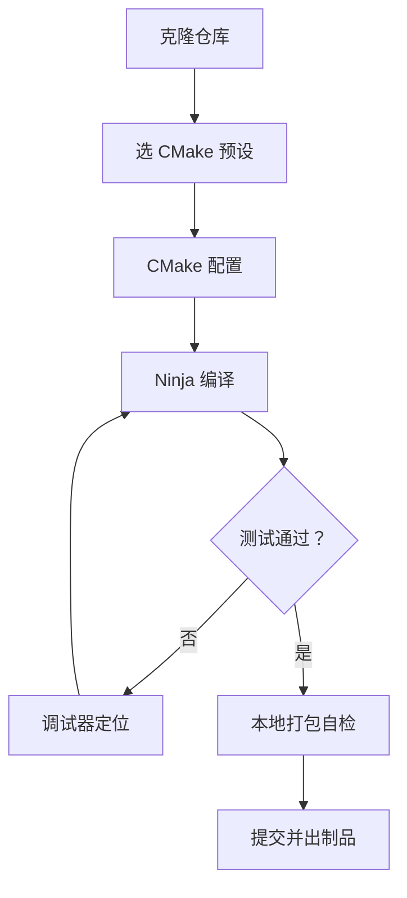
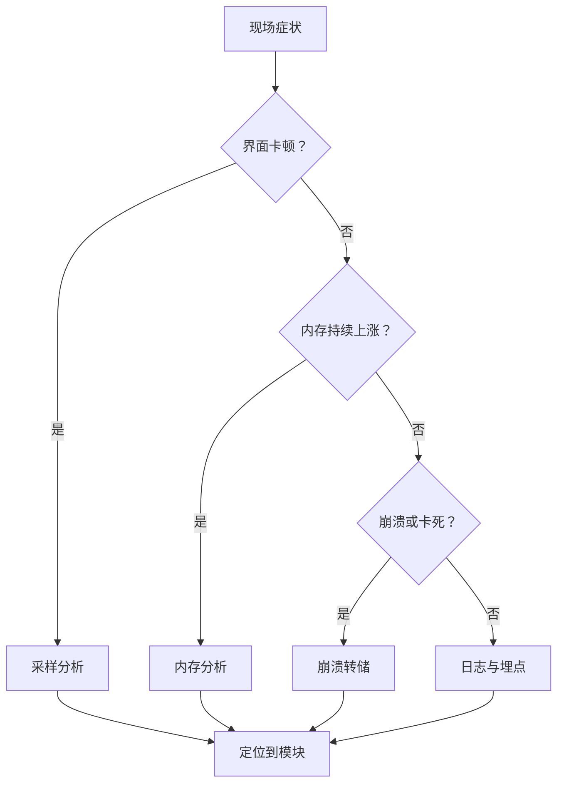

# 开发环境与技术栈

!!! abstract "本章要点"
    开发环境的目标可以写成三句话：新同事克隆仓库后一条命令能构建，一个断点能停住，一台干净机器能装上。只做到“装上 Qt 能跑 Hello World”，离这三句话还差一截。三句话分别对应工具链、构建系统和打包验证。本章从编译器选型讲到 qmake 的退场，再讲清大型工程为什么必须用 CMake，给出一套带 `CMakePresets.json` 的工程骨架、IDE 与调试器的搭配、性能与崩溃分析工具，以及 Windows、Linux、macOS 三平台最容易踩的差异。结论是：工具链要跟 Qt 官方二进制对齐，编译器只选一种且全团队统一，构建系统从第一天就用 CMake，环境用清单管理而不是靠口口相传；代价是前期配置多花两三天，换来的是后面几年里“我这能跑”这类问题的大幅减少。

## 4.1 编译器与工具链：MSVC、MinGW、Clang 的选择与禁忌

编译器选择的第一原则，是跟你下载的 Qt 二进制用同一个工具链，第二原则是全团队、全流水线统一，第三原则才是性能偏好。这三条顺序不能换，因为 Qt 的二进制兼容性建立在“同一个编译器、同一个 C++ 运行时、同一套 ABI”之上；混用工具链的后果很少在编译期暴露，多数拖到链接期或运行期才发作。

在 Windows 上，Qt 官方安装器提供 MSVC 和 MinGW 两套二进制。Qt 6.12 官方支持的 Windows 组合是 MSVC 2022 和 MinGW-w64 15.1，操作系统从 Windows 10 1809 起步，Windows 11 在列，Windows 10 的支持到 Qt 6.12 为止（配置以 [Qt 官方支持平台页面](https://doc.qt.io/qt-6/supported-platforms.html)为准，2026 年 11 月核对）。MSVC 的优势是与 Visual Studio、PDB 调试符号、Windows SDK 的配套最完整，崩溃转储和性能分析工具的链路也最顺；MinGW 的优势是安装轻、命令行体验接近 Linux、GPL 生态工具多，但调试体验和 Windows 原生集成的深度不如 MSVC。工业软件如果只在 Windows 交付、需要和 ActiveX、COM、加密狗、Windows 服务打交道，选 MSVC 更省事。

Qt 安装器里的组件选择也要写进环境约定。Windows 上至少要选 MSVC 2022 64-bit 与 Sources，需要调试 Qt 内部时要装 Qt Debug Information Files；MinGW 只在确实要用时安装，避免一个 Qt 目录里混着两套工具链的库，配置时选错路径。安装器还提供附加组件与存档版本，工业项目要把离线安装包和版本号一起归档，几年后重新出包时能不能找回同一版 Qt，取决于当年有没有留档。

Clang 在 Windows 上有一条独立的路线：用 LLVM 的编译器前端配 MSVC 的标准库和链接器，产出的 ABI 与 MSVC 兼容，可以用 MSVC 的调试器，也可以用 LLVM 的工具链。它的诊断信息通常更清楚，静态分析工具更完整，代价是要自己维护一套和 Qt 官方二进制匹配的构建配置。除非团队已经重度使用 clang 工具链，否则 Windows 上的默认答案还是 MSVC。

MSVC 的版本还有一层容易忽略的细节：Visual Studio 的版本号与 MSVC 工具集版本号不是一回事，同一台机器可以装多个工具集，Qt 官方二进制对应的是某个具体工具集。团队要在 CMakePresets 里用 `CMAKE_GENERATOR_TOOLSET` 或环境脚本固定工具集，升级 Visual Studio 时先确认新工具集与 Qt 二进制兼容。C++ 运行库的链接方式也要统一：Qt 官方二进制用 `/MD`（动态运行库），应用如果改成 `/MT`，会出现重复的运行时和两个内存分配器，跨 DLL 释放内存时会崩。工业软件常要分发 VC 运行库安装包，版本要和编译器对应，不能想当然地用最新版。

Linux 上编译器相对简单，Qt 6.12 支持的发行版用 GCC 10 到 15 不等，Ubuntu 22.04 用 GCC 11、Ubuntu 24.04 用 GCC 13、RHEL 10 用 GCC 14。官方二进制包对 glibc 有最低要求，页面注明是 2.34，官方安装器里的二进制又是在 Ubuntu 24.04 上构建的，所以给老发行版做交付时要自己编译 Qt 或在更老的构建环境里出包。这属于部署问题，但根在编译器与运行时版本，选型时就要查清楚目标机器的 glibc 版本。

macOS 上只有一条路：Apple Clang 加 Xcode 的命令行工具，官方要求 Xcode 16 及以上，最低支持 macOS 14.4。Intel 与 Apple Silicon 的通用二进制（universal binary）可以用 `CMAKE_OSX_ARCHITECTURES` 一次构建出两个架构，代价是包体翻倍、构建时间变长。工业软件在 macOS 上的交付量通常最小，但签名与公证流程不能省，否则用户双击打不开。

混用工具链的后果很少在编译期暴露，多数拖到链接期或运行期才发作，表现是符号不匹配、内存分配器冲突或随机的堆损坏。用 MinGW 编译的 Qt 配 MSVC 编译的应用，链接期就会报符号不匹配；Debug 版 Qt 配 Release 版应用，或者反过来，会在运行时崩在内存分配器上；MSVC 的 `_ITERATOR_DEBUG_LEVEL` 在不同构建类型下不一致，会把标准库容器的大小算错，症状是随机的堆损坏。Qt 官方二进制只提供 Release 与 Debug 两套，对应的运行库是固定的，团队该做的事是把编译器和构建类型写进 CMakePresets，让混用没有机会发生，别把力气花在给混用打补丁上。

## 4.2 构建系统的历史：qmake 的定位与退场

qmake 曾经是 Qt 的默认构建系统，语法简单，`.pro` 文件几行就能描述一个工程，非常适合小项目和教学。它自动处理 `moc`、`uic`、`rcc` 这些 Qt 特有的构建步骤，跨平台也能用，在 Qt 5 时代几乎是“Qt 项目的默认写法”。问题出在规模：`.pro` 文件的依赖描述能力弱，子目录工程靠 `SUBDIRS` 拼，第三方库靠手写 `INCLUDEPATH` 和 `LIBS`，工程一大，构建逻辑就散落在各个 `.pro` 里，没法被别的构建系统复用。

Qt 6 把构建系统迁到了 CMake，官方文档说得很直接：Qt 6 的构建系统基于 CMake 重写，qmake 仍然可以用于构建应用，但不能用来编译依赖 Qt 内部构建系统的自定义插件和库。这句话包含两层意思：存量 qmake 应用不必立刻重写；新插件、新库、新工程不要再从 qmake 起步。Qt 官方的主推方向和所有新特性都围绕 CMake，qmake 处于维护状态，修缺陷但不再获得新能力。

老项目的迁移有一条现实路径，核心是“先并存、再替换”。第一步，在仓库里保留 qmake 构建，同时加一套 CMake 构建，两者产出同样的目标，CI 上先让 CMake 构建跑通但不作为发布依据。第二步，把库和插件先迁到 CMake，因为它们是构建系统的边界，迁完之后应用的依赖可以按 target 表达。第三步，把应用迁过去，删除 qmake 工程。Qt 提供了一个 `qmake2cmake` 工具，可以把 `.pro` 转成初始的 `CMakeLists.txt`，但转换结果只是起点，include 路径、编译选项、平台条件、安装规则都要人工整理。

迁移中最容易被忽略的是“构建产物的一致性”。qmake 和 CMake 对 `moc` 的处理顺序不同，对资源文件的打包方式不同，对 Debug 与 Release 的默认宏也不同；同一份代码在两套构建下生成的可执行文件可能有细微差异，测试时要在两套构建上都跑一遍。迁移完成的标志有三条：CI 只跑 CMake，发布包只从 CMake 产出，qmake 工程文件被删除。“CMake 能编过”只是起点。只要 qmake 工程还在仓库里，就会有人在上面改代码，两套构建迟早会分叉。

qmake 时代的工程还有一批历史资产要处理：`.pri` 文件里的公共配置、`mkspecs` 里的平台条件、`CONFIG +=` 控制的一串特性开关、`DESTDIR` 与 `OBJECTS_DIR` 的输出约定。迁移到 CMake 时，这些资产不能一股脑塞进 `CMakeLists.txt`，要按“编译选项、依赖、安装规则”重新归类；`.pri` 里常见的“按平台拼路径”逻辑，在 CMake 里应该用生成器表达式或 toolchain 文件表达。把 qmake 的隐式约定显式化，是迁移里最费心力、也最有价值的一步。

新项目没有历史包袱，直接从 CMake 开始，不要写 `.pro` 文件。工业软件的生命周期长，构建系统是十年尺度的基础设施，为一个“语法简单”的短期便利选一个停止演进的工具，代价会在后面每一次加依赖、做安装包、接第三方库时还回来。

## 4.3 为什么大型工程必须 CMake

大型工程必须用 CMake，原因不在语法，而在依赖传递、安装导出和生态兼容这三件事。qmake 也能编大工程，但它的依赖模型是“全局变量加手写路径”，CMake 的依赖模型是“目标加使用要求”，这两种模型在工程规模上的差别，和用记事本管代码与用 Git 管代码的差别类似。

第一件事是依赖传递。CMake 用 target 表达一个模块：`add_library(app_core ...)` 定义目标，`target_link_libraries(app_core PUBLIC Qt6::Core)` 声明依赖，`target_include_directories(app_core PUBLIC src)` 声明头文件路径。`PUBLIC` 的意思是“链接我的人也需要这些”，`PRIVATE` 的意思是“只有我自己用”，这两个关键字把“谁需要什么”表达清楚了。工程分成几十个 target 之后，依赖关系由 CMake 自动传递，加一个库不需要在几十个 `.pro` 里补 `INCLUDEPATH`；反过来，如果某个依赖被误标成 `PUBLIC`，它的头文件会传染给所有下游，编译时间会立刻变长，问题也能被定位。

第二件事是安装与导出。CMake 的 `install(TARGETS ...)` 和 `install(EXPORT ...)` 可以生成 `config.cmake` 文件，让别的工程用 `find_package(MyLib CONFIG)` 找到你的库。工业软件经常要把自己的内核库交给另一个团队或另一个产品使用，能不能被 `find_package` 找到，决定了集成成本是“改一行 CMake”还是“读一周文档手动配路径”。Qt 自己、OCCT、VTK、ITK、GDAL 这些库都提供 CMake 配置，你的库如果不提供，就会成为整条依赖链上唯一需要手工配置的环节。

第三件事是生态兼容。几何内核、可视化库、科学计算库、打包工具、测试框架、静态分析工具，绝大多数以 CMake 为第一等公民：VTK 和 ITK 的官方构建流程就是 CMake，OCCT 提供 `OpenCASCADEConfig.cmake`，GDAL 提供 CMake 包，CPack 负责打安装包，CTest 负责测试调度。选 CMake 的理由与它是否完美无关：绕开它意味着每一处集成都自己写脚本，而这些脚本没有人维护。

第三方依赖的接入方式要统一约定。`find_package` 适合系统已安装的库，`FetchContent` 适合版本需要钉死的小型库，vcpkg 或 Conan 适合依赖多、需要二进制缓存的团队，把源码放进 `3rdparty/` 并用 `add_subdirectory` 适合需要打补丁的库。四种方式可以混用，但要有明确分工，否则同一个库在开发机和 CI 上可能来自不同来源，版本和编译选项对不上。约定写进文档，新加依赖时按规则选，不要让每个模块各自发明一套。

CMake 的代价也要说清楚。它的语法不现代，变量作用域、函数与宏的区别、生成器表达式这些概念需要时间熟悉；不同版本的 CMake 行为有差异，`cmake_minimum_required` 写低了会缺特性，写高了会挡住还在用旧版本 CI 的团队；构建目录、缓存变量、多配置生成器（Visual Studio、Xcode）与单配置生成器（Ninja、Make）的行为不一致，初学者容易在“为什么我改了 CMakeLists 没生效”上卡住。这些成本是一次性的，学会之后，换来的是依赖关系的可控和工具链的统一。

测试也要挂在构建系统上。CMake 的 CTest 随工程一起配置，`ctest --preset` 可以在构建完成后直接跑测试，CI 与开发机用同一套入口；把单元测试、集成测试、脚本冒烟测试注册成 CTest 用例，失败时能定位到具体测试而不是整个构建。测试与构建系统绑在一起，团队才有“跑过一遍”的统一含义，而不是每个人各自记一套命令。

把 CMake 用好，有几条经验值得记住。用 target 而不用全局变量，`include_directories`、`link_directories`、`add_definitions` 这些全局命令要尽量避免；用 `target_compile_options` 和 `target_compile_definitions` 把选项绑到具体目标上；第三方依赖优先用 `find_package`，找不到再考虑 `FetchContent`，实在不行才用手工路径；把公共的编译选项、警告级别、安装规则抽到 `cmake/` 目录下的模块里，不要在每个 `CMakeLists.txt` 里复制粘贴。这些做法不复杂，但需要从第一个 target 就开始坚持。

## 4.4 CMake 骨架与 CMakePresets.json

一个能撑住中型工业项目的 CMake 骨架，最少要有这几层：顶层工程定义、一个不依赖界面的核心库、一个可执行程序、测试目标和安装规则。下面的代码是结构示意，路径和文件按实际项目替换；它演示的是 target 的划分与依赖方向，不是可以直接复制运行的完整工程。

```cmake
# 顶层 CMakeLists.txt（结构示意，非完整实现）
cmake_minimum_required(VERSION 3.25)
project(IndustrialClient VERSION 0.3.0 LANGUAGES CXX)

set(CMAKE_CXX_STANDARD 20)
set(CMAKE_CXX_STANDARD_REQUIRED ON)
set(CMAKE_CXX_EXTENSIONS OFF)

find_package(Qt6 6.8 REQUIRED COMPONENTS Core Gui Widgets OpenGLWidgets)
find_package(OpenCASCADE REQUIRED)

# Qt 6.3 起提供的统一设置：AUTOMOC、AUTOUIC、AUTORCC 与安装目录约定
qt_standard_project_setup()

# 核心库不链接 Widgets，保证无界面批处理与测试可以复用
qt_add_library(app_core STATIC
    src/core/document.cpp
    src/core/document.h
    src/core/geometry_service.cpp
)
target_link_libraries(app_core PUBLIC Qt6::Core)
target_include_directories(app_core PUBLIC src)

# 应用目标：界面层只依赖核心库与 Qt Widgets
qt_add_executable(industrial_client
    src/main.cpp
    src/mainwindow.cpp
    src/mainwindow.h
)
target_link_libraries(industrial_client PRIVATE
    app_core
    Qt6::Widgets
    Qt6::OpenGLWidgets
    TKernel TKMath
)

enable_testing()
add_subdirectory(tests)

include(GNUInstallDirs)
install(TARGETS industrial_client
    RUNTIME DESTINATION ${CMAKE_INSTALL_BINDIR}
)
```

这段骨架里有三个设计意图。核心库 `app_core` 只链接 `Qt6::Core`，不链接 `Widgets`，这样无界面工具、单元测试、批处理程序都能复用它，界面层换不换都不影响内核；应用目标用 `qt_add_executable` 而不是 `add_executable`，让 Qt 的插件与资源处理按官方约定走；依赖用 `PUBLIC` 与 `PRIVATE` 区分，核心库的头文件路径对下游可见，Qt Widgets 只对应用可见。这三条决定会影响后面所有模块的依赖方向，第 5、6 章展开目录结构和模块边界时，会回到这套 target 划分上。

手写这套骨架能跑，但换一台机器、换一个编译器就要重新敲一遍参数。更好的做法是把配置固化进 `CMakePresets.json`，让“怎么构建”成为仓库的一部分，而不是某个人脑子里的命令行。下面的预设文件演示了 MSVC Debug 与 Release 两套配置，Qt 路径、生成器、C++ 标准、输出目录都写在里面，新同事只需要选一个 preset。

```json
{
  "version": 6,
  "cmakeMinimumRequired": { "major": 3, "minor": 25, "patch": 0 },
  "configurePresets": [
    {
      "name": "msvc-debug",
      "displayName": "MSVC 2022 Debug",
      "generator": "Ninja",
      "binaryDir": "${sourceDir}/build/${presetName}",
      "cacheVariables": {
        "CMAKE_BUILD_TYPE": "Debug",
        "CMAKE_PREFIX_PATH": "D:/Qt/6.12.0/msvc2022_64",
        "CMAKE_CXX_STANDARD": "20"
      }
    },
    {
      "name": "msvc-release",
      "displayName": "MSVC 2022 Release",
      "inherits": "msvc-debug",
      "cacheVariables": { "CMAKE_BUILD_TYPE": "RelWithDebInfo" }
    }
  ],
  "buildPresets": [
    { "name": "msvc-debug", "configurePreset": "msvc-debug" },
    { "name": "msvc-release", "configurePreset": "msvc-release" }
  ]
}
```

预设之外，还要有一个能讲的构建流程。工业项目的构建要回答的是“从克隆仓库到产出可交付制品的固定路径”，编过只是其中一步：选 preset、配置、构建、跑测试、打包、在干净机器上自检。这条路径写进文档、写进 CI，最终由脚本和流水线固化，人对它的要求是“能复现”，不是“记得住”。

<figure class="book-diagram" markdown>

<figcaption><span class="fig-no">图 4-1</span>构建流程的关键在入口可复现，命令顺序反而是次要的：preset 固定配置，测试决定是否继续，打包在本地先跑一遍。把这条链路写进脚本，CI 与开发机就用同一套配方，区别只在触发器。</figcaption>
</figure>

预设文件不只服务于本机开发，也服务于 CI 和多平台。常见做法是拆成两层：基础 preset 定义生成器、C++ 标准、公共缓存变量，平台 preset 继承它并补自己的 Qt 路径与工具集，CI 再继承平台 preset 并把构建目录换到流水线工作区。这样“开发机怎么编”和“CI 怎么编”共用同一份配置，差异只留在最上面一层。预设里涉及绝对路径的变量尽量用环境变量展开，仓库里不出现某台机器的盘符。

把 preset 与 CI 对齐时要注意两点。`CMAKE_PREFIX_PATH` 在开发机上是本地 Qt 路径，在 CI 上是安装器或镜像里的路径，预设文件里不要写死绝对路径，用环境变量展开（例如 `$env{QTDIR}`）或者用继承出来的 CI 专用 preset；构建目录要按 preset 名分开，Debug 与 Release 不能共用一个目录，否则 CMake 缓存会把两次配置混在一起，症状是“改了构建类型但产物没变”。这些细节看起来琐碎，却是“新同事第一天能不能跑起来”的分水岭。

## 4.5 IDE 与调试：Qt Creator、Visual Studio、CLion、VS Code + clangd

IDE 的选择不影响构建结果，影响的是调试效率、代码导航和团队协作成本。选 IDE 的标准只有一条：它能不能可靠地读到你项目的构建配置和调试符号。能，就用顺手的；不能，再漂亮也没用。

Qt Creator 是 Qt 项目最自然的入口，CMake preset 支持完整，调试器可以接 CDB、GDB、LLDB，QML 调试、Qt 类型可视化、信号槽跳转这些功能是别家没有的。它适合“纯 Qt 项目”和“需要 QML 调试”的团队，插件体系也够用。缺点是大型 C++ 工程的索引速度一般，跨平台的重构能力不如 CLion 和 Visual Studio 成熟。

Visual Studio 2022 在 Windows 上是调试体验最好的选项，PDB、dump 分析、Windows SDK、性能探查器都在一处，配合 Qt VS Tools 可以打开 `.pro` 和 CMake 工程。工业软件的 Windows 交付团队如果能用 VS，排障时的工具链是最完整的。代价是跨平台能力弱，Linux 和 macOS 的构建要么靠 WSL，要么靠独立的构建机。

CLion 在 CMake 工程上的体验最顺，索引、重构、代码分析的完成度高，跨平台支持也完整，适合以 C++ 为主的跨平台团队。它的缺点是启动慢、内存占用高，Qt 的元对象和 `.ui` 文件支持需要插件配合，QML 调试能力不如 Qt Creator。VS Code 加 CMake Tools 加 clangd 的组合轻量、启动快、免费，适合“命令行构建为主、编辑器为辅”的团队；前提是 `compile_commands.json` 要生成（在 CMake 里打开 `CMAKE_EXPORT_COMPILE_COMMANDS`），clangd 才能提供准确的跳转和补全。

编辑器配置也要进仓库，但只进“团队共享”的那部分。`compile_commands.json`、`.clang-format`、`.clang-tidy`、`.editorconfig`、`cmake/` 下的公共模块应该入库，让所有编辑器读到同一套规则；IDE 的个人窗口布局、断点、运行配置不入库，避免互相覆盖。这样新同事打开仓库，导航、格式化、警告规则就是对的，不用先花半天“调 IDE”。

Qt Creator 还有两个对工业项目有用的能力：远程调试和混合调试。Linux 设备上跑的版本可以在开发机上连 GDB Server 调试，Windows 侧的 CDB 也能连远程目标；QML 与 C++ 混合的界面性能问题，可以同时在 QML Profiler 和 C++ 分析器里看。Visual Studio 的优势在 dump 分析与 Windows 特定问题，比如 COM 调用失败、驱动交互异常，WinDbg 的扩展命令能省很多时间。选 IDE 时可以把“线上崩溃怎么分析”作为一条硬指标，而不是只看写代码顺不顺手。

代码导航的质量取决于编译数据库。CMake 打开 `CMAKE_EXPORT_COMPILE_COMMANDS` 后会生成 `compile_commands.json`，clangd、CLion、VS Code 都靠它拿到每个文件的编译参数；没有这个文件，clangd 会退回猜测，头文件路径和宏定义经常不准，跳转和补全时好时坏。把编译数据库的生成写进基础 preset，编辑器打开仓库就能导航，不用每个人手工配置。

调试器的选择要跟编译器对齐。MSVC 编译的程序用 CDB 或 Visual Studio 调试，生成的 PDB 要跟二进制一起归档，否则线上崩溃拿回来也解不出调用栈；GCC 编译的程序用 GDB，Clang 编译的程序用 LLDB，Linux 上还要注意 `ptrace_scope` 和容器权限。跨平台项目常见的配置是：开发机用平台原生的调试器，CI 上生成符号文件并在发布时单独归档，崩溃收集系统按版本号自动匹配符号。符号文件的管理经常被忽略，直到第一次要分析客户现场的 dump 才发现没有。

工业软件的调试还有一类特殊场景：跨语言和跨进程。Python 脚本嵌在 C++ 应用里，调试时要在 Python 层放断点、在 C++ 层也放断点，两个调试器能否挂在同一个进程上，取决于嵌入方式和调试器版本；插件运行在独立进程里，主程序和插件要分别附加调试器，共享内存和 IPC 的消息要能对上。这些场景没有统一的 IDE 支持，团队要提前演练一次，把步骤写进文档，出事时才不会现场学。

## 4.6 性能与调试工具

性能工具分三类：采样分析器、内存分析器、图形与系统级追踪。工业软件的性能问题，多数时候卡在“不知道慢在哪”；真正需要重写算法的情况反而少。先把测量工具配齐，比提前做性能优化有用。

排查的第一步是把症状分类，而不是先打开最重的分析器。卡顿看采样与帧时间，内存看分配栈，崩溃看转储与符号，行为异常看日志与埋点；分类错了，工具再强也白费。

<figure class="book-diagram" markdown>

<figcaption><span class="fig-no">图 4-2</span>排查路径按症状分类：先判断问题属于卡顿、内存、崩溃还是行为异常，再选对应工具。分类做在前面，可以避免一上来就开最重的分析器，也避免把“数据问题”当成“性能问题”去查。</figcaption>
</figure>

Windows 上的主力工具是 Visual Studio 自带的性能探查器、ETW 加 Windows Performance Analyzer（WPA）、Intel VTune。ETW 是系统级追踪，能同时看到 CPU 采样、磁盘 I/O、线程切换、DLL 加载，WPA 负责把追踪结果按时间轴展开，适合分析启动慢、界面卡顿、后台线程抢 CPU 这类跨模块问题；VTune 的微架构分析更强，适合热点函数的指令级优化。Linux 上用 `perf` 采样、用火焰图看调用栈，内存用 heaptrack 或 Valgrind，未定义行为用 AddressSanitizer 和 UndefinedBehaviorSanitizer 在测试环境里跑一遍。

Qt 层面的问题要看 Qt 自己的诊断开关。`QElapsedTimer` 用来测关键路径的耗时，`qInfo`、`qWarning` 配合 `QT_LOGGING_RULES` 可以按模块打开日志，`qInstallMessageHandler` 把 Qt 的日志接到项目统一的日志系统里；事件循环卡顿可以用 Qt Creator 的分析器看事件处理耗时，QML 性能问题用 QML Profiler。Qt 还提供了 `clazy` 这类静态检查工具，能发现一些 Qt 特有的性能陷阱，比如信号槽连接时的拷贝、`QString` 的隐式转换，这部分第 7 章会展开。

图形相关的排查要单独准备工具。三维视口的帧率、绘制调用数量、GPU 占用，用 RenderDoc 抓帧看每一帧的绘制命令和纹理状态；NVIDIA 的 Nsight Graphics 在 Windows 和 Linux 上都能用；Qt 6 的 `QRhi` 有调试层，可以打开验证信息和资源统计。工业软件里“界面卡”有时是 GPU 驱动问题，有时是渲染线程和界面线程的同步问题，不抓帧就只能猜。

日志是性能分析的第一手材料。工业软件要在关键路径上埋点：启动各阶段耗时、文件打开与解析耗时、首帧渲染时间、每次计算的输入规模与耗时；埋点用可开关的日志类别，默认关闭，现场排障时用环境变量打开。Qt 的 `QLoggingCategory` 可以按模块控制日志级别，配合 `QElapsedTimer` 记录耗时，比事后在客户机器上装分析器可行得多。

崩溃与卡死的分析工具要在项目第一天就配好。Windows 上准备 WinDbg 或 cdb，配置符号服务器，写一份“如何抓 dump”的说明；Linux 上配置 `coredumpctl` 和 `ulimit -c`，容器环境要单独处理；macOS 上保留 `.dSYM` 文件。这些工具平时用不上，出事时缺一样就会拖上几天。第 9 章讲稳定性时会把这些流程串起来，这里先把工具装进环境清单。

## 4.7 三平台差异：路径、编码、高 DPI、文件锁、字体

跨平台的麻烦很少出在“功能不支持”，而是出在“同一个功能在三个平台上的默认行为不同”。这些差异单看都不大，叠在一起就变成“Windows 上好好的，Linux 上打开就乱码”这类问题，而且往往在交付前才暴露。

路径是第一类差异。Windows 用反斜杠和盘符，Linux 和 macOS 用正斜杠，Linux 的文件名大小写敏感，Windows 不敏感；Windows 有传统路径长度限制，长路径要开注册表项或加前缀，Linux 的路径长度限制更宽松但整体长度仍受约束；网络共享、符号链接、快捷方式的行为也各不相同。Qt 的 `QDir`、`QFileInfo`、`QStandardPaths` 处理了大部分差异，但要注意 `QStandardPaths::AppDataLocation` 在三个平台指向的位置完全不同，配置文件和缓存目录不能写死；日志里打印路径要用 `QDir::toNativeSeparators`，给用户看的路径才符合平台习惯。

编码是第二类差异。源码统一用 UTF-8 保存，MSVC 需要加 `/utf-8` 编译选项，否则中文字符串字面量会按本地代码页解释，在中文 Windows 上“看起来正常”，换到英文系统就乱码；Qt 6 的 `QString` 内部是 UTF-16，`QStringLiteral`、`u8` 字面量的用法要统一；读写文本文件显式指定编码，不要依赖系统默认值；Windows 控制台默认代码页不是 UTF-8，`qDebug` 输出中文可能变成问号，要么设置控制台代码页，要么把日志写到文件。文件名里的中文在 Linux 上通常没问题，在 Windows 上要注意压缩包解压后的编码，跨平台传文件时最容易在这里出乱子。

下面的片段是结构示意，演示路径与日志的统一入口，不是完整程序：

```cpp
// 结构示意，非完整实现：路径取法与日志输出
#include <QApplication>
#include <QDir>
#include <QStandardPaths>

int main(int argc, char *argv[])
{
    QApplication app(argc, argv);   // Qt 6 默认启用高 DPI 缩放
    // 配置目录按平台约定取，不要写死 "C:/Users/..."
    const QString dataDir = QStandardPaths::writableLocation(
        QStandardPaths::AppLocalDataLocation);
    QDir().mkpath(dataDir);
    qInfo() << "data dir:" << QDir::toNativeSeparators(dataDir);
    return app.exec();
}
```

高 DPI 是第三类差异。Qt 6 默认启用高 DPI 缩放，开发者不用再设置 `AA_EnableHighDpiScaling`，但界面代码如果按像素写死尺寸，在 125%、150%、200% 缩放下仍会错位：图标模糊、布局挤压、自绘控件线宽不对。正确做法是用布局管理器而不是绝对坐标，图标用矢量图或多倍图，`QPixmap` 设置正确的设备像素比，测试时至少覆盖 100%、150%、200% 三档。Windows 的分数缩放、Linux 各桌面环境的缩放实现、macOS 的 Retina 都有自己的怪癖，跨平台产品要在三个系统上各看一遍。

文件锁是第四类差异。Windows 的文件锁是强制的，一个文件被打开时其他进程不能删除或重命名，Linux 的锁是建议性的，不遵守约定的程序照样能改；工业软件经常要“打开文件、写临时文件、原子替换”，在 Windows 上如果读文件的句柄没关，重命名就会失败。Qt 的 `QSaveFile` 提供了原子写入的封装，但设计文件格式时仍要假设“写入过程中可能断电”，用临时文件加原子替换，而不是直接覆盖原文件。杀毒软件、同步盘、网络共享也会插一手，这些环境因素要在测试清单里。

字体是第五类差异。Windows 自带中文字体，macOS 有苹方，Linux 的最小安装可能一个中文字体都没有，界面上全是方框；即便有字体，不同发行版的默认字体、字号、行高也不同，按像素算好的布局会变。做法是随安装包带一套开源中文字体并在 `QFontDatabase` 里注册，或者明确声明依赖系统字体并在安装说明里写清楚；字体文件的许可要单独核对，别把商用字体打进安装包。表格、报表、打印这些对字体敏感的功能，要在三个平台上各出一份样例对比。

还有几类差异不常被写进文档，却会在现场冒出来。时间与时区：工业数据的时间戳要统一存 UTC 或带时区偏移，界面按本地时区显示，跨时区的厂区之间传数据时这条尤其重要；数字与日期格式跟随区域设置，Qt 的 `QLocale` 能处理，但不要把格式字符串写死。剪贴板与拖放：Windows 支持文件拖放和自定义格式，Linux 的剪贴板有“选择区”和“剪贴板”两套机制，macOS 的文件拖放要处理沙箱授权；跨平台产品要把这些路径各测一遍。后台能力：Windows 有服务、计划任务、注册表，Linux 有 systemd、udev、权限模型，macOS 有 launchd 和权限弹窗，实现方式完全不同。

打包层面的差异也属于开发环境的一部分。Windows 要把 VC 运行库、Qt 平台插件、第三方 DLL 一起收进安装包，`windeployqt` 能收 Qt 相关文件，但 MSVC 运行库和自研 SDK 要另外处理；Linux 要处理 glibc 版本、发行版包管理、AppImage 或 deb 打包，Qt 的平台插件路径要用 `qt.conf` 或相对路径固定；macOS 用 `macdeployqt` 生成 `.app`，再做签名与公证，字体和第三方框架要嵌进 bundle。这些工作在第 10 章会展开成流水线，这里先把它们列进环境清单，别等到发布前才发现打包工具没装。

| 差异点 | Windows | Linux | macOS |
| --- | --- | --- | --- |
| 路径 | 反斜杠、盘符、大小写不敏感 | 正斜杠、大小写敏感 | 正斜杠、默认大小写不敏感 |
| 源码编码 | MSVC 需 `/utf-8` | UTF-8 默认 | UTF-8 默认 |
| 高 DPI | 分数缩放常见 | 桌面环境差异大 | Retina 固定倍率 |
| 文件锁 | 强制锁，占用时不能改名 | 建议锁，靠约定 | 强制锁，行为接近 Linux |
| 中文字体 | 系统自带 | 最小安装可能缺失 | 系统自带 |
| 调试符号 | PDB，需单独归档 | DWARF，随二进制或单独包 | dSYM，需单独归档 |

这张表不用背，用法是做成测试清单：每个平台交付前，按行过一遍，把发现的问题补进自动化测试或发布检查项。跨平台问题的特点是“修一个冒出一批”，与其指望一次做对，不如把检查变成流程的一部分。

## 4.8 环境自检清单

环境问题最好的处理方式是“在开始写代码之前就发现”。新同事入职、CI 机器重建、换一台构建机，都用同一张清单过一遍，比事后排查“为什么只有你的机器能编过”省时间。

清单要覆盖四类：工具链、依赖、构建、交付。工具链确认编译器版本、位数、Qt 安装的组件与架构；依赖确认第三方库的版本、路径、Debug 与 Release 是否齐全；构建确认 CMake 与 Ninja 的版本、preset 能否配置、能否跑测试；交付确认 `windeployqt` 能不能收集齐运行库、干净机器上能不能启动。每一类都给出可执行的验证命令和预期结果，而不是“检查一下环境”这种无法执行的描述。

| 检查项 | 通过标准 | 验证方式 |
| --- | --- | --- |
| 编译器 | 版本与 Qt 二进制匹配，x64 | `cl` 或 `gcc --version` |
| Qt 版本 | 与项目基线一致，含所需模块 | `qtdiag` 或安装器组件列表 |
| 架构一致 | 应用、Qt、第三方库同为 x64 | 检查各库的位宽 |
| CMake | 版本不低于项目要求（Qt 6.12 建议 3.25） | `cmake --version` |
| 生成器 | Ninja 可用且版本匹配 | `ninja --version` |
| 依赖路径 | `CMAKE_PREFIX_PATH` 指向正确 Qt | 配置输出里的 Qt 路径 |
| 第三方库 | Debug/Release 齐全，能找到配置 | `find_package` 成功 |
| 编码 | 源码 UTF-8，MSVC 加 `/utf-8` | 编译日志与中文显示 |
| 调试符号 | PDB 或 DWARF 已生成并归档 | 构建目录产物 |
| 打包自检 | 干净虚拟机能启动、能打开样例文件 | 手动或脚本冒烟测试 |
| 离线可用 | 断网后能完整构建与安装 | 断网重跑构建 |
| 许可文件 | 安装包含 Qt 许可与声明 | 安装目录 `licenses/` |

清单只有变成脚本才有约束力。做法是写一个 `doctor` 脚本，检查编译器、CMake、Qt、依赖路径、环境变量，输出“通过、失败、警告”三种状态，新同事第一天跑一遍，CI 每次构建前也跑一遍。脚本维护成本不高，收益是把“我机器上能跑”变成“环境差异能被看见”。环境清单和 doctor 脚本要一起进仓库，谁改了工具链版本，谁就负责更新检查项。

交付前的收尾是干净机器验证。开发机装过一堆运行库、SDK、字体，能跑不代表客户机器能跑；交付前用一台没装过开发环境的虚拟机或容器，按安装包默认路径装一遍，检查启动、打开样例、显示中文、加载插件、卸载。容器更适合 Linux，Windows 侧的干净虚拟机要提前准备镜像，别等到发版当天才找机器。

环境清单要有负责人和复核时间。工具链升级、Qt 换版本、新增第三方库，都会让清单里的某些项失效；把清单放进仓库，和代码一起评审，比放在某个人的笔记里可靠。第 5 章会把这套清单扩展成工程结构的一部分，第 10 章会把它变成发布流水线上的自动检查。

环境搭好之后，下一步是把目录、依赖、构建目标组织成能撑住多人协作的结构。下一章从一个空仓库的目录树开始，讲清楚每个目录放什么、不放什么，以及第三方库、插件、测试、文档这些“非代码资产”怎么和构建系统配合。
