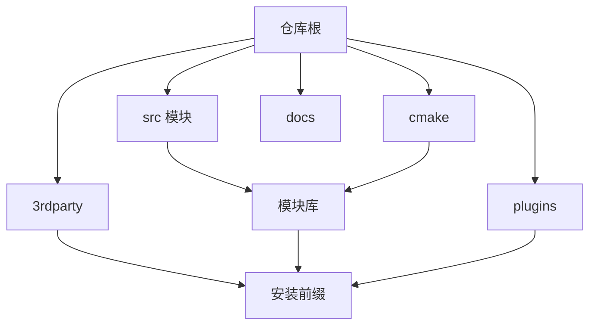
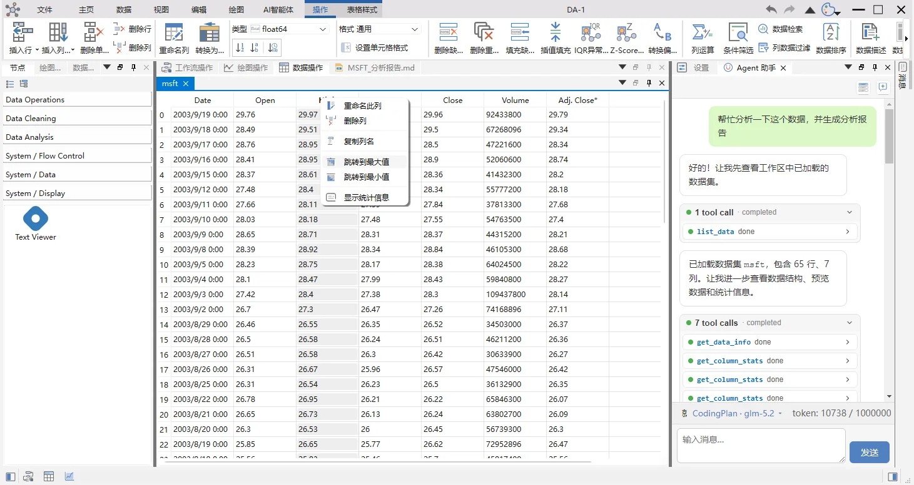
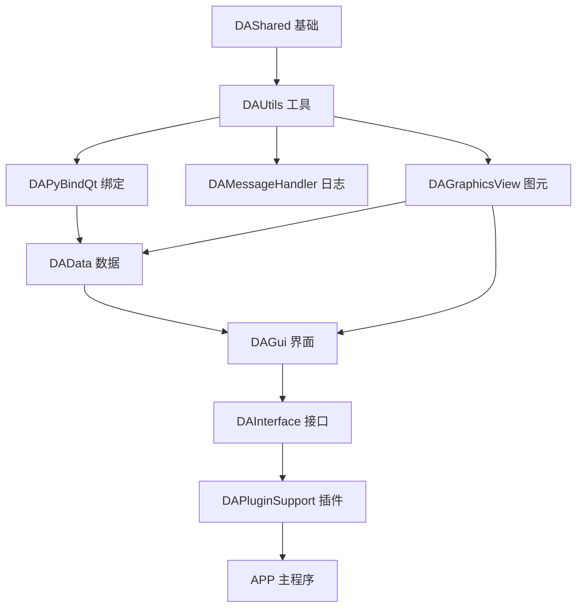
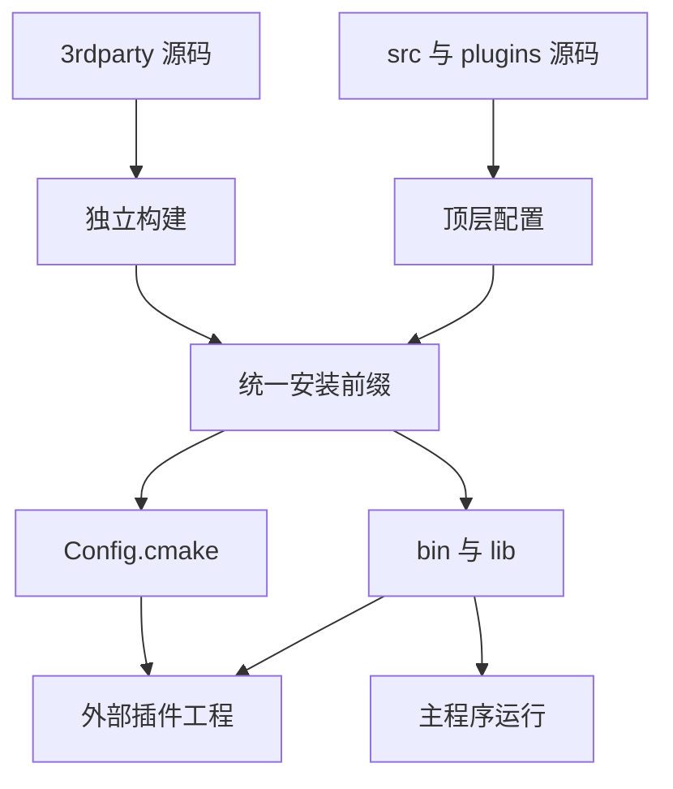

# 大型项目工程结构管理

!!! abstract "本章要点"
    大型工程的目录结构本质上是一份把编译成本、依赖方向和新人上手时间固定下来的协议，和审美无关。约定得好，模块边界可以靠目录名和 target 名一眼认出，插件和主程序在同一个安装前缀里各自构建、互相找到；约定得不好，边界就退化成口头约定，三个月后没人说得清哪一层能依赖哪一层。本章给出一套能直接落到仓库的目录与依赖约定，以 data-workbench 的公开结构为案例，并对照 Qt、FreeCAD、QGIS 的组织方式。代价是前期多写几十行 CMake、多维护一层 submodule，换来的是构建可复现、扩展点可安装、团队换人之后结构不塌。

## 5.1 结构的成本在哪里

判断一个工程结构好不好，不用看目录树画得漂不漂亮，看四个数字：改一个头文件要重编多少个 target，加一个功能要动多少个模块，新人几天能自己加出一个能编译的模块，第三方开发者能不能只拿安装目录就编出插件。这四个数字都可以在半天内测出来，并且会跟团队规模一起恶化。

data-workbench 的公开文档里有一张模块文件数表：`DAShared` 19 个源文件、`DAUtils` 48 个、`DAData` 21 个，而界面层 `DAGui` 是 405 个。这个数量级差距说明了一件事：如果 `DAGui` 的头文件被下层模块包含，或者 `DAUtils` 里出现一行 `#include "DAGui/..."`，任何一次界面改动都会把编译范围扩大到整个仓库。结构管理的第一个目标，是让这种包含在物理上写不出来，而不是靠代码评审时提醒。

CMake 的 target 是这件事的执行者。一个模块一个 target，`target_link_libraries` 只声明它真正需要的下游，编译器看到的 include 路径就自然收窄。data-workbench 把这条规则写进了公开的依赖矩阵：`DAUtils` 的 PUBLIC 依赖只有 Qt 的 Core、Gui、Widgets、Xml，没有项目内其他模块；`DAGui` 反过来依赖所有下层模块。依赖方向一旦被 target 固化，方向错了就链接不过，这比任何文档都可靠。

一个具体的失败路径值得记住。假设某个工具函数先放在 `DAUtils`，后来发现它需要弹一个提示框，于是加了 `#include <QMessageBox>`；再过两周，它需要读取当前工程的文档对象，于是又 include 了 `DAData`。这两步在当时的代码评审里都说得过去，但 `DAUtils` 的依赖从“Qt 四个模块”变成了“Qt 加数据层”，`DAGui` 依赖 `DAUtils` 之后，界面层和数据层之间就多了一条隐蔽的环形路径，编译顺序开始依赖链接器的心情。这类问题不会以“架构错误”的形式报出来，只会在某次改配置时变成一堆无法解释的链接错误。

结构还决定了并行开发的冲突半径。按模块分目录以后，两个人分别改 `DAData` 和 `DAGui`，改动落在不同目录、不同 target，合并冲突通常只出现在接口头文件；所有代码平铺在一个目录、共用几个巨大的 CMake 文件时，两个人的改动会在同一个文件列表里相撞，合并成本按天计算。团队越大，目录作为冲突隔离层的价值越高。

编译之外还有三个成本。耦合的扩散没有编译错误那么显眼，一个工具函数被抄进四个模块，半年后改一处漏三处；新人上手的成本体现在“这个类放哪”这个问题上，如果答案只能靠问人，说明结构没有把职责表达出来；插件的可行性取决于主程序能不能被当成一个可安装的库，如果主程序只会 `add_executable`，插件就只能和主程序一起编译。

结构约定也有代价。它要求每个新模块在创建时就想清楚职责、依赖和导出，前期比“先塞进去再说”慢；它会产生一些看起来多余的目录和 CMake 文件，小团队会觉得是负担；它还会和“就近修改”的本能冲突，让人绕路。这些代价换来的是可预测的构建和可交接的工程，规模越大，账越划算。结构约定还要有一个落点。放在老员工脑子里，换人即失效；放在文档里，至少可以被评审、被 diff。data-workbench 的做法是把目录结构、模块依赖和“禁止依赖上层”写进 `AGENTS.md`，新人和 AI Agent 读到的是同一份说明。文档不会自动阻止错误，但它让“这个类该放哪”从口头问答变成可以查的条目，评审时也有依据。

第 4 章讨论过 CMake 为什么是大型工程的默认选择，这一章讨论在此基础上怎么把目录和依赖安排成一套能维持几年的约定。

## 5.2 目录脚手架：每个目录只回答一个问题

顶层目录应该按构建角色划分，而不是按文件类型划分。把 `.h`、`.cpp`、`.ui` 分别放进三个目录，看起来整齐，实际上每个模块都被拆散，CMake 要为每个文件单独写路径，重构时改到崩溃。按角色划分的目录，每个目录回答一个构建问题：这段代码编成什么、装到哪里、被谁使用。

表 5-1 是一套可以直接抄的目录约定，它的每一行都对应一个 CMake target 或一个安装动作。判断某个文件该放哪，先问它在构建里扮演什么角色，再看目录名。

| 目录 | 放什么 | 不放什么 | 构建角色 |
| --- | --- | --- | --- |
| `src/<Module>/` | 一个模块的 `.h`、`.cpp`、`.ui` 和模块级 `CMakeLists.txt` | 其他模块的实现文件、临时脚本 | 一个共享库 target |
| `src/APP/` | 程序入口、主窗口、接口实现 | 可复用的业务逻辑 | 一个可执行文件 target |
| `src/3rdparty/` | 以 submodule 引入的第三方源码 | 项目自己的代码 | 独立的构建入口，产物装进统一前缀 |
| `plugins/<Name>/` | 插件主类、工作类、对话框、图标、Python 脚本 | 对主程序源码目录的引用 | 独立插件 target，输出到 `bin/plugins` |
| `tests/` 或 `src/tst/` | 测试可执行文件，一个子目录一个测试 | 生产代码 | 测试 target，按套件打标签 |
| `cmake/` | 公共 CMake 函数、`Config.cmake.in` 模板 | 任何 C++ 源码 | 被各模块 `include()` 的脚本 |
| `scripts/` | 构建、测试、打包脚本 | 二进制产物 | 命令行入口 |
| `docs/` | 文档源码与图片 | 生成物、原始截图 | 文档构建的输入 |
| `resources/` | 图标、翻译、qrc 引用的静态资源 | 运行时生成的数据 | 编进目标的资源 |

data-workbench 的实际目录和这张表基本对得上：`src/` 下每个 `DA` 前缀目录是一个模块，`src/3rdparty/` 单独构建，`plugins/` 独立，`cmake/` 放 `daworkbench_utils.cmake`、`daworkbench_3rdparty.cmake`、`daworkbench_plugin_utils.cmake`，`docs/` 放 MkDocs 文档源。它没有顶层的 `tests/`，测试放在 `src/tst/`。从公开文档看，这样安排是为了让测试和被测模块处在同一棵 `add_subdirectory` 树里，直接复用模块导出的宏和 CMake 函数；代价是测试目录和源码目录混在一起，找测试时要记住这个约定。

### src/ 里的五个角色目录

如果项目还没形成模块划分，可以先从五个角色目录起步：`app`、`core`、`gui`、`data`、`3rdparty`。它们分别对应程序入口、与界面无关的基础能力、界面与交互、领域数据模型、第三方源码。这套分法不依赖具体领域，新项目第一天就能用，之后哪个角色膨胀了，再把它拆成多个模块。

`core` 最容易变成垃圾桶。判断一个文件能不能进 `core`，标准是它能否脱离界面编译：字符串处理、文件读写、配置、日志、几何算法都可以，弹窗、控件、图标资源不行。`core` 里一旦出现 `QMessageBox`，界面层和基础层的依赖方向就被打穿了，之后 `core` 会被迫依赖越来越多的界面模块，直到它无法在命令行工具里复用。

`gui` 只做界面和交互。菜单、工具栏、停靠窗口、视图、委托、对话框放在这里，业务规则和算法不放在这里。判断标准同样简单：把 `gui` 整个目录删掉，剩下的代码还能不能表达这个领域的模型和处理流程？能，说明界面层是薄的；不能，说明业务已经长进了界面类，这个项目离“界面一换就要重构”不远了。

`data` 放领域数据模型、序列化、导入导出和撤销命令。它应该只依赖 `core`，不依赖 `gui`，这样批处理、脚本和测试都能直接构造数据。`3rdparty` 放第三方源码，单独构建。`app` 是入口，负责把前面四块拼起来，越薄越好：`main.cpp`、主窗口装配、插件加载、命令行参数解析，业务逻辑不应该在 `app` 里二次实现。

data-workbench 走得更远，用 `DA` 前缀的模块名代替了角色名：`DAShared`、`DAUtils` 属于基础层，`DAData`、`DAFigure`、`DAPyWorkFlow` 属于功能层，`DAGui` 是界面层。模块名比角色名更能表达职责，代价是新人对着一串 `DA` 开头的目录要先读一遍文档。项目规模小的时候，角色目录加清晰的头文件比十几个模块更好维护。

目录深度也要控制。从仓库根到具体文件，四层左右是上限，超过四层说明分类过细，找文件要一路点开；反过来，所有文件堆在两层以内，说明没有分类。`src/<module>/<area>/<file>` 是常见形态，data-workbench 的 `src/DAGui/Table/Controllers/` 就是模块内部再分三层，再往下不再分。

还有一种常见错误是按团队分目录：`team-a/`、`team-b/` 各放各的代码。团队会重组，功能不会，按人分目录的工程在组织调整后必然要重排；按职责分目录，人员怎么流动都不影响结构。按“新”“旧”分目录同样要避免，新旧是时间属性而不是职责，迁移完成之后 `old/` 会变成没人敢删的角落。

<figure class="book-diagram" markdown>

<figcaption><span class="fig-no">图 5-1</span>顶层目录各自对应一段构建链路，最终汇合到同一个安装前缀。判断目录划分是否合理，看每个目录能不能独立回答“我编成什么、装到哪里”。</figcaption>
</figure>

这张图还解释了为什么第三方库不能随手放进主树。第三方源码有它自己的 `CMakeLists.txt`、自己的安装规则和自己的版本节奏，把它 `add_subdirectory` 进主工程，等于把别人的构建逻辑接进自己的配置阶段，配置失败、选项冲突、安装路径互相覆盖都会跟着来。data-workbench 的处理是让 `src/3rdparty/` 成为独立的构建入口，产物安装到与主工程一致的前缀，主工程只消费安装结果。

目录约定还要处理例外。数据文件放 `resources/` 还是 `docs/`，翻译文件放 `src/i18n/` 还是 `resources/`，这类问题没有唯一答案，关键是写下决定并保持一致。data-workbench 把翻译 `.ts` 文件放在 `src/i18n/`，由 CMake 选项 `DA_ENABLE_AUTO_TRANSLATE` 控制是否自动编译；图标资源分散在 `DAGui/icon/`、`APP/Icon/` 和插件自己的 `icon/` 目录，跟着使用它的模块走。例外本身不可怕，例外没有记录才可怕。

## 5.3 参考项目的组织方式

看成熟项目怎么分目录，比看任何架构书都直接。它们的目录结构是十几年演进的结果，里面藏着真实的取舍。

### data-workbench 的五层与依赖顺序

data-workbench 把 15 个模块分成五层，公开文档给出的依赖顺序是：基础层 `DAShared`、`DAUtils`、`DAMessageHandler`、`DAPyBindQt`；功能层 `DAData`、`DAFigure`、`DAPyWorkFlow`、`DAGraphicsView`、`DAPyScripts`、`DAPyCommonWidgets`；界面层 `DAGui`；接口层 `DAInterface`、`DAPluginSupport`、`DAAgent`；应用层 `APP`。依赖规则只有一条：上层可以依赖下层，下层不能依赖上层。

表 5-2 把这条规则展开成可以对照的清单。文件数是公开文档 2026 年 11 月的口径，用来判断模块重量，不用来精确比较。

| 层 | 模块 | 职责 | 公开文档口径的源文件数 |
| --- | --- | --- | --- |
| L1 基础层 | `DAShared` | 纯头文件的数据结构、兼容宏、并发容器 | 19 |
| L1 基础层 | `DAUtils` | XML 序列化、字符串、文件、主题、翻译管理 | 48 |
| L1 基础层 | `DAMessageHandler` | 基于 spdlog 的日志与 Qt 消息路由 | 12 |
| L1 基础层 | `DAPyBindQt` | pybind11 类型转换、解释器生命周期、numpy 与 pandas 绑定 | 30 |
| L2 功能层 | `DAData` | 数据抽象、DataFrame 封装、数据管理器、撤销命令 | 21 |
| L2 功能层 | `DAFigure` | 基于 Qwt 的图表容器、编辑器、序列化 | 85 |
| L2 功能层 | `DAPyWorkFlow` | 工作流节点、场景、执行引擎、序列化 | 52 |
| L2 功能层 | `DAGraphicsView` | 通用 QGraphicsView 框架与撤销命令 | 51 |
| L2 功能层 | `DAPyScripts`、`DAPyCommonWidgets` | Python 脚本包装、列选择器等通用控件 | 13、5 |
| L3 界面层 | `DAGui` | 表格、图表、工作流、Agent、数据管理的界面整合 | 405 |
| L4 接口层 | `DAInterface` | 核心、UI、停靠、Ribbon、命令、工程等抽象接口 | 29 |
| L4 接口层 | `DAPluginSupport` | 插件基类与插件管理器 | 9 |
| L4 接口层 | `DAAgent` | 不依赖 GUI 的 Agent 框架与工具注册 | 17 |
| L5 应用层 | `APP` | 主程序、接口实现、工程文件、插件管理 | 92 |

<figure markdown>
  { loading=lazy }
  <figcaption><span class="fig-no">图 5-2</span>data-workbench 的表格视图：一屏之内，Ribbon、数据操作面板、表格页、AI 助手面板同时出现。界面背后是 L3 的表格域、L2 的数据与图表模块、L1 的 Python 绑定和 L4 的接口在协作，这正是分层目录要支撑的复杂度。</figcaption>
</figure>

这张截图真正值得看的是它证明的结构：表格页在 `DAGui/Table/` 下又按 `Core`、`Controllers`、`Views`、`Models`、`Metadata`、`Ops`、`Chart`、`Dialogs` 分了子目录，一个界面域接近两百个源文件。如果这些文件平铺在 `DAGui/` 根目录，找页面入口都要靠搜索；按角色分目录之后，读代码的人可以先找到页面入口，再顺着控制器和数据算子往下看。

<figure class="book-diagram" markdown>

<figcaption><span class="fig-no">图 5-3</span>data-workbench 的模块依赖顺序，箭头从被依赖方指向依赖方。图里没有一条反向箭头，这就是“下层不能依赖上层”在目录和 CMake 上的样子。</figcaption>
</figure>

表里有几个位置值得单独解释。`DAAgent` 被放在接口层，却和界面层是兄弟关系：公开文档明确写它不依赖 `DAGui`、`DAFigure`、qwt 和 ADS，聊天窗口在 `DAGui/Agent`，21 个内置工具在 `plugins/DAAgentTools/`，设置页在 `APP/SettingPages/`，三处通过 `DAAppController` 连线。这样拆的收益是 Agent 框架可以被无界面场景复用，代价是模块之间的信号连接多了一层，读代码时要回到 APP 里找完整链路。

`DAInterface` 的依赖方向是另一个值得看的取舍：它 PUBLIC 依赖 `DAGui`，于是所有依赖 `DAInterface` 的插件自动获得全部界面能力。这违反了“接口层不应依赖界面层”的教科书说法，换来的是插件开发者只 include 一个头文件就能用完整 UI。代价是接口层无法脱离界面层编译，将来要做无界面版本时得重新切一刀。这个例子说明分层规则是判断工具，不是判决书，关键是把例外和它换来的收益写在同一份文档里。

### 其他三个项目给出的共同约定

Qt 自己的组织方式是“一个模块一套导出”。Qt 6 把 `Core`、`Gui`、`Widgets` 拆成独立模块，每个模块有自己的 CMake 配置和最低依赖，`Widgets` 依赖 `Gui`，`Gui` 依赖 `Core`，不会反过来。应用通过 `find_package(Qt6 COMPONENTS Widgets OpenGLWidgets)` 只引入用到的模块，没用到的模块不进入编译，也不进入安装包。这套做法支撑了 Qt 二十多年的版本演进。

FreeCAD 分得更粗：`App` 放文档、对象、属性和重算，`Gui` 放视图、命令和交互，`Mod` 放工作台。`Gui` 依赖 `App`，`App` 不依赖任何界面库，所以 FreeCAD 可以在没有界面的情况下跑 Python 脚本。代价是 `App` 和 `Gui` 之间的信号与属性约定要长期维护，工作台开发者必须同时理解两边。

QGIS 的 `src/` 分成 `core`、`gui`、`app`、`plugins`：`core` 放图层、要素、坐标参考系、渲染符号和处理算法，`gui` 放地图画布和控件，`app` 放主程序和插件加载，`plugins` 放 C++ 与 Python 扩展。QGIS 的插件生态能长起来，靠的是 `core` 和 `gui` 对外提供稳定的头文件与安装规则，插件才能脱离主程序源码独立编译。Python 插件还能直接调用处理框架里的算法，不需要重新编译 C++，这是 QGIS 生态扩张最快的一条路径。

回到 Qt 自己，模块化还带来一个常被忽略的好处：安装包可以裁剪。一个只用 `Core`、`Gui`、`Widgets` 的客户端，不需要把 `WebEngine`、`Multimedia`、`3D` 打进安装包；Qt 6 把 `OpenGLWidgets` 这类组件从 `Widgets` 里拆出来，项目要显式声明才链接。代价是升级 Qt 大版本时，`find_package` 的组件列表和模块名会变，有些旧模块被并入新模块，有些被移出仓库，构建脚本要跟着改。Qt 5 升 Qt 6 的项目普遍在这一步返工过。

FreeCAD 的 `Mod` 目录值得单独看一眼。每个工作台在 `Mod/<Workbench>/` 下自带 `App` 和 `Gui` 两个子目录，分别实现无界面逻辑和界面交互，工作台之间尽量不互相依赖，共享能力下沉到 `App` 或 `Gui` 的公共层。这套结构支撑了社区工作台的独立开发：一个工作台可以只依赖公共层，编译成独立模块，主程序启动时加载。代价是公共层的接口一旦变动，所有第三方工作台都要跟着改，所以 FreeCAD 的工作台 API 稳定性一直是个公开的抱怨点。

把四个项目放在一起，共同点只有三条：领域模型和界面分开，程序入口层很薄，扩展放在独立目录。这三条也正是本章建议的目录脚手架的骨架。差异在粒度和代价：data-workbench 按模块分到 15 个库，适合插件生态；FreeCAD 按 `App`、`Gui`、`Mod` 分三层，适合工作台生态；QGIS 按 `core`、`gui`、`app`、`plugins` 分四块，适合 Python 插件生态。没有一种划分放之四海皆准，能说清“谁依赖谁、扩展放哪里”的就是好划分。

判断一个项目的目录结构成熟不成熟，有三个便宜的观察点。看它有没有安装规则：能把库和头文件装到一个前缀里给外部用，说明模块边界是真的；看它的第三方库是不是集中在少数几个目录，并且有版本记录，说明依赖管理不靠碰运气；看它的测试目录是不是和模块一一对应，说明每个模块都能被单独验证。三个都满足的项目，目录结构通常撑得住三五年；只满足第一个的项目，开源生态起得来，内部维护会越来越吃力。

## 5.4 第三方库管理

第三方源码要满足两个条件才适合进仓库：能被锁定到具体提交，并且不污染主工程的配置阶段。git submodule 满足第一条，独立构建入口满足第二条。这两条同时成立，依赖升级和回滚才是一次提交的事，而不是一次冒险。

data-workbench 的 `.gitmodules` 在公开仓库里列了十个 submodule：`zlib`、`quazip`、`spdlog`、`ADS`（Qt-Advanced-Docking-System）、`SARibbon`、`pybind11`、`QtPropertyBrowser`、`qwt`、`ordered-map`、`DAWidgets`；另外 `ctk` 是 vendored 源码，直接放进 `src/3rdparty/`，不在 submodule 里。这份清单本身就是一份取舍记录：能从上游持续跟进的就用 submodule，需要裁剪或上游不提供 CMake 的就 fork 或 vendored。

添加一个库的命令很短，代价却在后面：

```bash
# 添加 submodule，路径必须指定到库名目录
git submodule add https://github.com/pybind/pybind11 ./src/3rdparty/pybind11

# 首次克隆后拉取所有第三方库
git submodule update --init --recursive

# 升级某个库到远程最新提交，再提交指针变化
git submodule update --remote src/3rdparty/SARibbon
```

submodule 记录的是提交指针，不是分支。升级时更新指针、编译、跑测试、提交指针，回滚时把指针改回旧提交，历史里能看清每次升级发生在哪一天。复制源码的做法记录不了这些信息，仓库里多出几万行别人的代码，两年后没人说得清这版和上游哪一版对应，许可证声明也容易漏。

submodule 的麻烦集中在三处。嵌套 submodule 要 `--recursive` 才能拉全，data-workbench 的 `SARibbon` 自己还带 `qwindowkit`、`qmsetup`、`syscmdline` 一层链，漏拉一层就是空的头文件目录；内网环境访问 GitHub 不稳定，公开文档里专门写了 Gitee 镜像与 `git submodule sync` 的用法；submodule 目录被误删后，`git status` 只显示一个空目录，报错信息不指向根因。

表 5-3 把四种管理方式放在一起比较。选哪种，取决于依赖数量、是否需要改库源码、CI 时间预算和交付环境。

| 方式 | 适用场景 | 优点 | 代价 | 回滚方式 |
| --- | --- | --- | --- | --- |
| git submodule | 需要跟上游、偶尔打补丁的库 | 版本锁定在提交级，历史可查 | 嵌套拉取、内网访问、目录误删 | 提交指针改回旧值 |
| vendored 源码 | 上游停更、需要大幅裁剪的库 | 完全可控，不依赖外网 | 升级靠手工，许可证要自己记 | 回滚对应提交 |
| vcpkg / Conan | 依赖多、需要二进制缓存、CI 时间紧 | 一次配置，多机复用 | 版本冲突、ABI 匹配、离线环境复杂 | 锁文件回滚 |
| 系统包管理器 | Linux 内部工具、不对外分发 | 安装简单 | 版本随发行版，Windows 不可用 | 包版本回退 |

第三方库进 CMake 有两条路：直接 `add_subdirectory` 把源码编进同一个工程，或者独立编译安装、主工程只 `find_package` 安装结果。前者配置简单，源码级调试方便，适合频繁打补丁的小库；后者把构建时间和配置复杂度隔离开，适合大型库和只需要链接的库。data-workbench 对两者都用了：`zlib`、`spdlog` 这类能在独立入口里统一编译的走预编译安装，`ctk` 这种需要裁剪、跟着主工程构建的用 vendored 源码直接 `add_subdirectory`。判断标准是“你会不会改它、改了之后别人要不要同样一份预编译产物”。

CMake 侧的做法是把 `src/3rdparty/` 当成独立工程：它有自己的一份 `CMakeLists.txt`，配置时指定与主工程相同的 `CMAKE_INSTALL_PREFIX`，先编译安装第三方，再编译主工程。这样第三方库和项目库最终躺在同一个 `bin`、`lib`、`include`、`lib/cmake` 布局里，主工程和插件都能用同一套 `find_package` 找到它们。

```cmake
# src/3rdparty/CMakeLists.txt（结构示意，非完整实现）
cmake_minimum_required(VERSION 3.21)
project(MyProject3rdparty LANGUAGES CXX)

# 安装目录必须与主工程一致，否则 find_package 找不到
if(NOT CMAKE_INSTALL_PREFIX)
    set(CMAKE_INSTALL_PREFIX "${CMAKE_CURRENT_SOURCE_DIR}/../../bin_Release_qt6.7.3_MSVC_x64")
endif()

add_subdirectory(zlib)     # quazip 依赖 zlib，顺序不能反
add_subdirectory(quazip)
add_subdirectory(spdlog)
add_subdirectory(SARibbon)
```

这段顺序不是风格问题。data-workbench 的公开文档专门提醒 `quazip` 依赖 `zlib`，必须先构建安装 `zlib`，否则 `quazip` 的 `find_package` 直接失败。第三方库之间的依赖同样要按拓扑顺序排，排错了报错信息往往指向最下游那个库，容易误判。

### 升级、回滚与许可证

依赖升级要当成一次独立的改动，别当成顺手 `git pull`。可行的流程是：在分支上 `git submodule update --remote` 只升一个库，单独提交指针；先编译 `src/3rdparty` 并安装到前缀，跑该库相关的测试；再编译主工程和插件，确认没有新的编译警告和链接错误；收尾时在提交信息里写清从哪个版本升到哪个版本、为什么升、有没有打补丁。一次升五个库的做法，出问题时无法定位是哪个库引入的变化。

回滚就是把子模块指针提交改回旧值，再重新编译安装。二进制前缀的存在让回滚更安全：旧版本库和新版本库可以并存在不同的 `bin_*` 目录里，出问题时切回旧前缀就能复现现场。反过来，如果第三方库是直接复制进仓库的，回滚要靠人工比对文件，几万行代码里找差异，基本不可行。

许可证要有单独的账本。`.gitmodules` 里只有仓库地址，没有许可证信息；第三方库一多，谁是什么许可、能不能闭源、有没有静态链接义务，散落在十几个 `LICENSE` 文件里。data-workbench 的公开文档专门列了一张第三方依赖表，逐项写明仓库地址、作用、应用场景和许可证：`zlib` 是 zlib license，`quazip` 是 LGPL-2.1，`spdlog` 是 MIT，`ADS` 是 BSD-3-Clause，`SARibbon` 是 MIT，qwt 是 Qwt License。这张表比在每个 README 里抄一遍许可证有用，发布前法务看的就是它。

有的库需要打补丁。qwt 和 QtPropertyBrowser 在 data-workbench 里用的是作者 fork 的版本，公开文档说得很直接：上游没有提供 CMake，fork 一份补上。打补丁的库必须固定在自己的 fork 提交上，补丁内容单独记录，升级上游时先把补丁重放一遍；不要让 submodule 指向一个会变的开发分支，否则每次拉取拿到的代码都可能不同。

什么时候该换 vcpkg 或 Conan？依赖超过十个、需要在多台机器和 CI 上复用二进制、又不打算改库源码时，包管理器省下的配置时间很可观。反过来说，需要给库打补丁、需要裁剪模块、交付环境完全离线时，submodule 加独立构建入口更稳。这两种方式可以共存：核心依赖用 submodule，编译期工具用包管理器，前提是安装前缀和 `find_package` 的查找顺序在文档里写清楚。

## 5.5 插件目录与工程管理

插件的目录约定决定它能不能脱离主工程独立构建。做不到独立构建，插件就只是主工程里的一个子目录，第三方开发者拿到的是整个仓库和一套构建环境，而不是一个可以链接的 SDK。

data-workbench 的 `plugins/` 下有 `DataAnalysis`、`DASystemNodes`、`DAAgentTools` 和 `plugin-template`。公开文档把插件目录的标准结构写得很细：`CMakeLists.txt`、插件主类、工作类、`Dialogs/`、`PyScripts/`（再分算法层、界面层、节点层）、`icon/`，以及生成器用的 `template.json`。`plugin-template/make-plugin.py` 按 `template.json` 里的 `plugin-iid`、`plugin-display-name` 生成一套可编译的骨架，新插件的起点是一致的。

命名和元数据要当成接口的一部分。目录名、target 名、插件显示名、IID 四者要能对上，IID 一旦发布就不能随版本改，因为宿主靠它确定“这是不是我的插件”。版本号单独管理，插件版本和宿主版本不必同步，但插件编译时依赖的宿主接口版本必须写清楚。插件里那些“看起来像接口”的东西，比如工作类、节点工厂、属性面板，都应该放在插件自己的目录里，不要反向引用主程序源码路径。

构建关系有三种写法，对应三种使用场景。主工程带上所有插件一起编译时，`DA_BUILD_PLUGINS` 打开后 `add_subdirectory(plugins)`，插件输出到安装前缀的 `bin/plugins`；插件作者只拿到宿主安装目录时，用 `da_plugin_bootstrap` 在独立目录里完成 `project()`、安装目录计算和依赖预查找，`cmake -S plugins/<name> -B build` 就能配置；一个宿主工程里带多个插件时，用 `da_plugin_env_setup` 先设置环境，再逐个 `add_subdirectory`，避免每个插件的 `project()` 覆盖宿主的版本号。

插件的发布单位和 DLL 一样：插件本体进 `bin/plugins`，它依赖的第三方 DLL 进 `bin`，宿主启动时扫描目录、读取元数据、按生命周期调用 `initialize()` 和 `retranslate()`。卸载时反向释放资源、断开信号槽。这套流程 data-workbench 的公开文档用状态机画过，从 `Unloaded` 到 `Active` 再到 `Unloading`，异常路径也标了出来。

插件工程最容易低估的是测试。插件里的工作类、序列化、属性面板都可以在没有主程序的情况下测，但插件加载、菜单注册、信号连线只能等宿主起来之后测。可行的做法是给插件准备一个最小的宿主冒烟测试：加载插件、检查 IID、调用 `initialize()`、验证注册项存在、卸载，不涉及具体业务。data-workbench 的公开测试文档把这类测试归到集成测试，和模块边界的测试放在同一层，因为它们验证的都是“拼起来还能不能用”。

插件的发布包要能回答三个问题：宿主是哪个版本、插件依赖哪些运行时、用户拿到之后放哪里。常见做法是把插件 DLL 放进 `bin/plugins`，它依赖的第三方 DLL 放进 `bin`，再在元数据里声明版本和 IID。宿主启动时扫描目录、逐项加载，哪个插件缺依赖就跳过并写日志，不能让一个插件拖垮整个程序。

插件与宿主的版本关系要写成分级规则。接口层的小版本升级保持二进制兼容，旧插件继续加载；接口方法增删或语义变化时提升主版本并换 IID，宿主拒绝旧插件；插件的显示名、描述、图标可以随版本改，IID 不能。data-workbench 的插件模板把 `plugin-iid`、`plugin-display-name`、`factory-name` 这些字段放在 `template.json` 里，生成新插件时一次填好，不再散落在代码里各处修改。

还有一个容易被忽略的问题：插件依赖的第三方库版本必须和宿主一致。宿主用 Qt 6.7 编译的 qwt，插件用 Qt 5 编译的 qwt，DLL 名字一样但二进制不兼容，加载时崩在静态初始化里，报错信息完全看不出来。所以插件的构建环境要么由宿主安装前缀统一提供，要么在插件工程里锁死同一套 `CMAKE_PREFIX_PATH`。

代价在 ABI。插件和宿主必须用同一套 Qt、同一个编译器、同一种运行库编译，宿主升级接口后旧插件可能加载失败甚至崩溃。更稳的做法是让接口层版本化、接口变窄，变更时换 IID，宿主安静地拒绝旧插件；要求所有插件每次跟着宿主重编并不现实。这条规则第 6 章会展开，它也是插件架构里最难守的一条。

## 5.6 CMake 如何把这些组织起来

CMake 在结构里的角色不是“把文件列表写下来”，而是把目录关系翻译成 target 关系，再用 `install` 和 `export` 把 target 关系变成一套可被第三方 `find_package` 的开发环境。前者决定编译顺序，后者决定插件能不能独立构建。

data-workbench 的顶层 `CMakeLists.txt` 做的事很典型：定义版本号、声明工程、设置 C++ 标准与编译选项、`add_subdirectory(src)` 组织模块、把各模块的安装统一导出成一个 `DAWorkbenchTargets`，并用 `cmake/DAWorkbenchConfig.cmake.in` 生成总包配置。各模块的 `CMakeLists.txt` 只负责自己的 target、依赖和安装，不生成 `Config` 文件。这是多模块工程的常规写法，和 Qt 自己把多个模块导出成一个 `Qt6Config.cmake` 是同一个思路。

统一安装前缀是这套结构的关键。data-workbench 在 Windows 上把安装目录命名为 `bin_<Config>_qt<QtVersion>_<Compiler>_<Arch>`，例如 `bin_Release_qt6.7.3_MSVC_x64`。命名里带 Qt 版本和编译器，同一台机器上就能并存多套构建产物，切换 Qt 版本时不会互相覆盖。第三方库、项目库、主程序、插件全部装进这个前缀，`find_package` 只需要一个 `CMAKE_PREFIX_PATH`。

<figure class="book-diagram" markdown>

<figcaption><span class="fig-no">图 5-4</span>两阶段构建与安装前缀的关系：第三方库先装进前缀，主工程再装进同一个前缀，`Config.cmake` 让外部插件工程可以只依赖前缀而不依赖源码。前缀是整个结构的汇合点。</figcaption>
</figure>

两阶段构建的顺序有实际影响。第三方库不常变，装好一次之后，日常构建只编项目自己的代码，CI 里也可以把第三方产物做成缓存。如果把第三方库塞进主工程的 `add_subdirectory`，每次配置主工程都要重新走一遍第三方的配置逻辑，配置时间从几秒涨到几十秒，还容易因为别人的选项默认值改变而失败。

```cmake
# 顶层 CMakeLists.txt（结构示意，非完整实现）
cmake_minimum_required(VERSION 3.21)
project(MyProject VERSION 1.4.0 LANGUAGES CXX)

set(CMAKE_CXX_STANDARD 17)
set(CMAKE_CXX_STANDARD_REQUIRED ON)

include(GNUInstallDirs)
include(CMakePackageConfigHelpers)

option(MYPROJ_BUILD_PLUGINS "构建插件" ON)

add_subdirectory(src)                 # 各模块自带 CMakeLists.txt
if(MYPROJ_BUILD_PLUGINS)
    add_subdirectory(plugins)         # 插件输出到前缀的 bin/plugins
endif()

# 所有模块导出的 target 汇总成一个导出集，生成总包配置
install(EXPORT MyProjectTargets
    FILE MyProjectTargets.cmake
    NAMESPACE MyProject::
    DESTINATION ${CMAKE_INSTALL_LIBDIR}/cmake/MyProject
)
```

安装路径不要硬编码。`include(GNUInstallDirs)` 之后用 `CMAKE_INSTALL_BINDIR`、`CMAKE_INSTALL_LIBDIR`、`CMAKE_INSTALL_INCLUDEDIR` 这些变量，Windows、Linux、macOS 上的布局才一致。库的 `target_include_directories` 要用 `$<BUILD_INTERFACE:...>` 和 `$<INSTALL_INTERFACE:...>` 两个生成器表达式区分构建目录和安装目录，否则导出的 target 会把源码绝对路径写进 `Config.cmake`，第三方拿到就失效。

这套写法有学习成本。`install(EXPORT)`、`configure_package_config_file`、`write_basic_package_version_file` 三个函数第一次见都要查文档；Windows 的多配置生成器在安装时要显式给 `--config Release`，忘了就会装到 Debug 目录；安装前缀如果设成 `C:\Program Files`，开发阶段的安装会要求管理员权限。data-workbench 的处理是把安装前缀默认放在工程目录下，用命名区分配置，开发阶段不需要提权。

模块级的 `CMakeLists.txt` 模式固定，几乎可以当模板用：

```cmake
# src/DAData/CMakeLists.txt（结构示意，非完整实现）
add_library(DAData SHARED
    DAAbstractData.h DAAbstractData.cpp
    DAData.h DAData.cpp
    DADataManager.h DADataManager.cpp
)
add_library(MyProject::DAData ALIAS DAData)

target_include_directories(DAData PUBLIC
    $<BUILD_INTERFACE:${CMAKE_CURRENT_SOURCE_DIR}>
    $<INSTALL_INTERFACE:${CMAKE_INSTALL_INCLUDEDIR}/MyProject>
)

target_link_libraries(DAData
    PUBLIC MyProject::DAPyBindQt
    PRIVATE MyProject::DAUtils
)

# 追加到顶层定义的统一导出集，不在这里生成 Config.cmake
install(TARGETS DAData
    EXPORT MyProjectTargets
    RUNTIME DESTINATION ${CMAKE_INSTALL_BINDIR}
    LIBRARY DESTINATION ${CMAKE_INSTALL_LIBDIR}
    ARCHIVE DESTINATION ${CMAKE_INSTALL_LIBDIR}
)
```

这段模板里有三个决定要在项目早期定下来：`add_library` 用 SHARED 还是 STATIC（插件要求共享库）、哪些依赖是 PUBLIC（会传递给消费者）、头文件安装到哪个子目录。PUBLIC 依赖写错是常见错误：一个只在实现里用到的工具库被写成 PUBLIC，所有消费者都被迫链接它，依赖矩阵慢慢失控。

模块多了以后，重复的 CMake 代码会膨胀。data-workbench 在 `cmake/` 下封装了声明式函数：`da_add_library` 一次完成建 target、加别名、加编译定义、`find_package` Qt 组件、链接 DA 模块和第三方库、安装导出；`da_add_plugin` 一次完成插件 target、输出到 `bin/plugins` 和安装；`da_plugin_bootstrap` 让插件工程脱离主工程独立配置。公开文档显示，旧的 `damacro_lib_setting`、`damacro_lib_install` 那套三段式宏已经被这组函数取代，方向是减少样板，而不是把构建逻辑藏起来。

插件工程配置时最常卡住的是 `find_package`。插件只拿到宿主安装目录，没有宿主的源码树，CMake 需要在 `CMAKE_PREFIX_PATH` 里找到总包的 `Config.cmake`，再顺着 Config 里的 include 路径、库路径和依赖列表找到所有模块与第三方库。这条链路要求导出文件生成正确、依赖声明完整，任何一处硬编码绝对路径都会让插件在另一台机器上配置失败。“插件能不能独立构建”因此是检验安装导出的最有效方式，比写文档更直接。

构建产物的布局也要在文档里写清楚。data-workbench 公开文档给出的输出结构是 `bin/`（主程序、插件、DLL）、`lib/`（静态库与导入库、`lib/cmake`）、`share/cmake`，以及可选的 `python/` 环境。第三方开发者只需要知道前缀路径，就能找到头文件、库、CMake 配置和运行时依赖；安装布局一旦成为约定，插件工程、CI 缓存、安装包脚本都能复用同一套路径。

## 5.7 结构检查清单

结构约定只有变成检查项才能活下来。写进文档但不检查的约定，三个月后就会被例外淹没；检查项太多也没人执行，八到十条是能被记住的上限。

新建模块时检查：目录名与 target 名一致；`CMakeLists.txt` 声明完整依赖；公共头文件清单明确；没有包含上层模块的头文件。

合并代码时检查：新依赖只指向下层；第三方库没有直接进主目标；插件没有引用主程序源码路径；新增资源进了 qrc 而不是散落在目录里。

发布前检查：安装前缀里能找到所有模块的头文件和 `Config.cmake`；外部插件工程能只依赖安装目录完成配置；测试按套件打好了标签；`AGENTS.md` 或 `CONTRIBUTING` 里的结构说明与仓库一致。

```text
结构检查十条（建议放进评审模板）
1. 一个模块一个目录一个 target，目录名等于 target 名
2. 依赖只允许指向下层，反向依赖在 CMake 层就应该链接失败
3. 第三方库不进主工程的配置阶段，统一装进安装前缀
4. 公共头文件有明确的安装清单，内部头文件不进 include
5. 插件只依赖安装前缀，不 include 主程序源码路径
6. 资源文件进 qrc，翻译文件进 i18n，运行期数据不进仓库
7. 测试一个套件一个标签，性能用例与常规用例分开
8. 每个模块的 CMakeLists.txt 不超过一屏，复杂逻辑进 cmake/
9. 安装路径用 GNUInstallDirs，不硬编码盘符和目录名
10. 结构变更与 AGENTS.md 里的目录说明同一次提交
```

这十条里最容易被跳过的是第九条和第十条。安装路径硬编码在开发机上从来不出问题，换一台机器、换一个 CI 环境才暴露；结构说明不同步，下一个接手的工程师只能从 CMake 反推设计意图。两个问题的修复成本都不高，前提是有人在合并前问一句。

已经长起来的老项目，结构改造不要一次推倒。可行的顺序是：先把 CMake 的边界立起来，给每个现有目录一个 target，依赖关系照着现状写，目标是不改代码也能编译；再把明显违反方向的依赖标出来，逐个下沉或抽接口，每修一个跑一遍构建；然后统一安装前缀，把第三方库从主工程里搬出去；移动目录放在整条路线的末尾，让目录名和 target 名对齐。这个顺序的每一步都能独立提交、独立回滚，任何一步出问题都不会让整个工程停摆。

反过来，一次性“重构目录结构”的改造风险极高。移动文件会打断所有人的在途改动，`git blame` 失真，把修复 cherry-pick 到旧版本时全部冲突；更糟的是移动过程中顺手改了逻辑，出问题时无法判断是结构问题还是行为问题。结构改造的价值在长期，操作上要按能快速回滚的小步走。

结构债不会自己消失。一个目录里同时存在两套模块划分、一个文件被三个 target 编译、一个“临时”的第三方副本被提交进仓库，这些都是结构债的形态，和代码里的 TODO 一样需要登记、排期、偿还。区别在于代码债通常由编译器提醒，结构债只会由新人和 CI 提醒，而新人往往没有话语权，CI 往往被改配置绕过。

结构解决的是“东西放在哪里、谁能依赖谁”，它不回答“模块内部怎么组织”。同一个目录约定下，有的模块三千行一个类，有的模块八十个类各司其职，区别在模块内部的架构。下一章从目录往里走一层，看模块边界、接口设计和文档对象模型怎么把结构约定落成代码。
