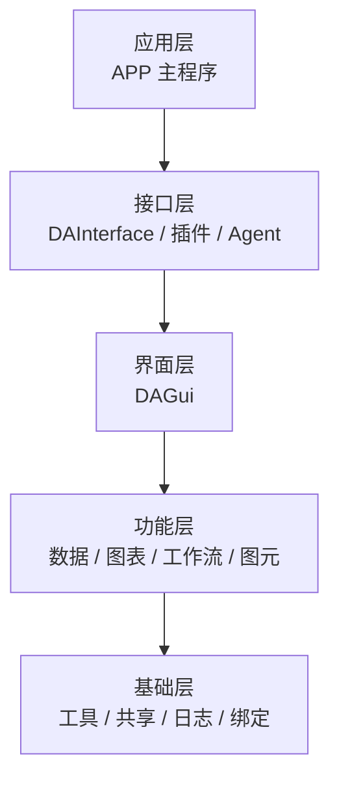
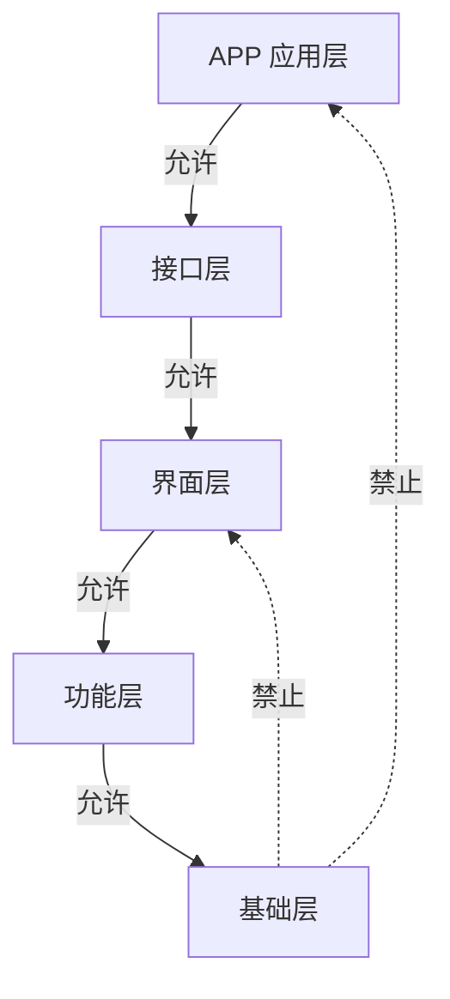
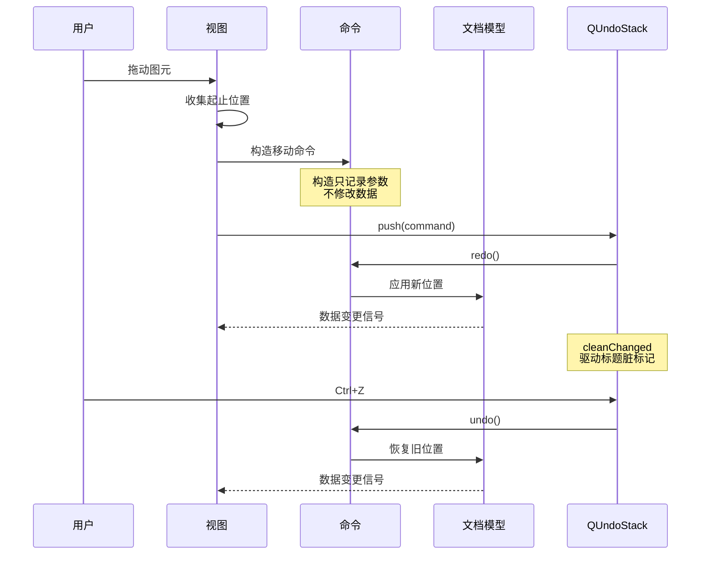
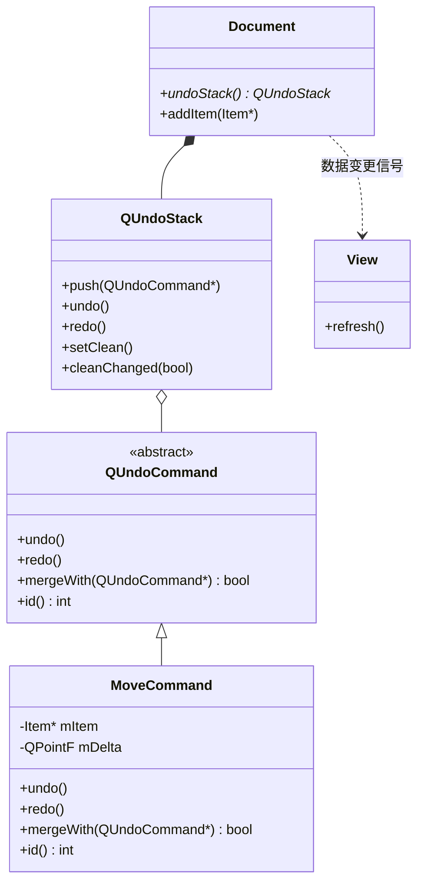

# 架构：模块化与插件化

!!! abstract "本章要点"
    大型工业软件的架构问题，最终都会落到两个具体决定上：模块之间的依赖箭头朝哪边，扩展点以什么形状固定下来。依赖方向决定一个改动会波及多少代码，扩展点决定第三方能不能在不改主程序的前提下加功能。data-workbench 用五层模块、一张依赖矩阵和一套版本化的插件接口回答了这两个问题，代价是接口一旦发布就很难改、分层会带来一层转发代码。本章按分层、边界、类放置、插件、接口、文档对象与撤销、事件解耦的顺序展开，最后列出四种最常见的反模式。判断架构好坏的标准只有一条：把界面层删掉，剩下的代码还能不能运行。

## 6.1 功能多带来的四个后果

一个 Qt 界面程序长到十万行以后，开发者会同时感受到四种变慢，它们的根源不同，解法也不同。把这些症状分开看，才能判断该改目录、改依赖还是改接口。

编译变慢是最先被注意到的。C++ 的头文件包含是传递的，一个界面类的头文件里包含 `QMainWindow`、包含文档对象、包含图表控件，所有 include 它的源文件都要把这些头文件重新解析一遍。从公开文档看，data-workbench 的界面层 `DAGui` 有 400 多个源文件，如果这些文件之间互相包含头文件而不是用前向声明，改一个私有成员就会触发大半个仓库重编。大型工程普遍用两种手段对抗这个问题：把实现细节藏进 PIMPL，让头文件只留下指针和接口；把模块切成独立 target，让编译单元的上限由依赖图决定，而不是由目录深度决定。

耦合变深是第二层。功能一多，模块之间开始互相“借用”一点东西：图表模块想用数据模块的某张表，数据模块想用界面模块的某个进度对话框，界面模块又反过来需要图表的导出接口。每一次借用单独看都有理由，合起来就形成环。环在 C++ 里不会立刻报错，只在链接顺序、初始化顺序、卸载顺序上出问题，症状是随机的崩溃和随机的“第一次打开正常、第二次打开失败”。

测试变难是第三层。没有模块边界的程序，只有启动整个应用才能验证一个功能：测排序要打开主窗口、导入数据、点菜单，测试用例写成了操作手册。这种测试跑得慢、失败定位难、覆盖率上不去，久而久之没人维护。反过来，如果数据层能在没有 `QApplication` 的情况下构造、能在单元测试里直接建一个 DataFrame 并调用处理函数，测试成本会低一个数量级。

新人上手慢是第四层，也是最容易被低估的一层。新人问“加一个图表类型要改哪些文件”，如果答案是“先看主窗口的槽函数，再找图表操作类，再改图元注册表”，说明结构没有把流程表达出来；如果答案是“在 `DAFigure` 加一个图元类，注册到工厂，在 `DAGui/Chart/Setting` 加一个属性面板”，说明分工已经写进了目录。前者需要老员工带三个月，后者需要三天。

这四种变慢有一个共同的放大器：团队规模。一个人写代码时，所有结构都能装在脑子里，耦合再深也能改；五个人并行开发时，没有边界的目录每天都会产生合并冲突，没有测试的模块每次改动都在赌。架构的价值在这里体现：它把“依赖于某个人记得”变成“依赖于代码和构建系统的约束”。代价是前期要多做设计、多写接口、多拆 target，功能交付看起来慢了一拍。项目越大，这笔投入回收得越快；只做三个月的工具，不值得为它设计五层架构。

## 6.2 分层：应用层、接口层、界面层、功能层、基础层

分层是模块化最直接的形式：把代码按“离用户多远”排成上下几层，规定依赖只能从上往下。data-workbench 分了五层，这个数字不是拍脑袋定的，每一层对应一种变化原因。

基础层放不依赖业务的知识：字符串与文件工具、XML 序列化、日志、Python 绑定、纯头文件的数据结构。它们的共同点是可以在任何项目里复用，变化频率最低。功能层放领域能力：数据容器、图表容器、工作流引擎、图形视图框架。它们知道“数据”“图表”“节点”这些概念，但不知道菜单和按钮。界面层把功能层组装成可操作的界面。接口层定义插件和主程序之间的契约。应用层是入口，把上面四层装配成可执行程序。

这种分法的直接好处是变化被隔离。界面改版只动界面层，功能层可以原样保留；换一个图表库只动图表模块，数据层不受影响；加一个插件只动接口层和应用层，功能层不需要知道插件的存在。表 6-1 把五层的职责、允许依赖和变化频率放在一起，对照它就能判断新代码该落在哪一行。

| 层 | 职责 | 允许依赖 | 典型模块 | 变化频率 |
| --- | --- | --- | --- | --- |
| L5 应用层 | 程序入口、接口实现、模块装配 | 接口层、功能层 | `APP` | 随产品功能变化 |
| L4 接口层 | 插件契约、核心接口、Agent 框架 | 界面层、功能层、基础层 | `DAInterface`、`DAPluginSupport`、`DAAgent` | 慢，接口变更代价高 |
| L3 界面层 | 控件、面板、视图、交互 | 功能层、基础层 | `DAGui` | 随交互需求变化 |
| L2 功能层 | 数据、图表、工作流、图形视图 | 基础层 | `DAData`、`DAFigure`、`DAPyWorkFlow`、`DAGraphicsView` | 随领域能力变化 |
| L1 基础层 | 工具、序列化、日志、Python 绑定、基础类型 | 只依赖 Qt 与第三方 | `DAShared`、`DAUtils`、`DAMessageHandler`、`DAPyBindQt` | 最慢，一旦改动影响全局 |

<figure class="book-diagram" markdown>

<figcaption><span class="fig-no">图 6-1</span>data-workbench 的五层架构，箭头从上层指向被依赖的下层。每一层内部的模块清单见表 6-1；这里只保留层与层的依赖关系，避免把模块细节塞进一张图。</figcaption>
</figure>

分层不是越细越好。三层（界面、业务、基础）能覆盖大多数中型项目，五层适合有插件生态、有脚本绑定、有多个可独立发布的模块的项目。再往上加到七层八层，层与层之间的转发代码会超过实际逻辑，改一个字段要穿过四个 `getXxx()`，这时层数已经从约束变成了负担。判断层数是否合适的办法是看每一层有没有独立的交付物：能单独编译、单独安装、单独被外部依赖的层才有资格存在。

还有两种常见的分层错误。一种是把分层写成目录，构建系统里却仍然是一个 target 全量编译，层与层之间没有任何编译期约束，方向靠自觉，三个月就乱。另一种是把分层做成“每层一个库”但没有接口，上层直接调用下层的具体类，功能层改了函数签名，界面层全部编译失败。前者需要把 target 拆开，后者需要在上层和下层之间引入稳定的抽象，前者是构建问题，后者是设计问题，不能互相替代。

## 6.3 模块边界：职责、依赖方向、依赖矩阵

模块边界由三样东西定义：这个模块负责什么，它能依赖谁，别的模块怎么使用它。前两样可以写进文档，第三样必须由接口和构建系统强制。只写文档的边界，在第一次赶进度时就会破防。

依赖方向要具体到箭头。data-workbench 的公开规则写得很直白：上层可以依赖下层，下层不能依赖上层，同层模块尽量不直接依赖，由上层整合。换成检查动作就是：`DAGui` 里出现 `#include "DAUtils/..."` 合法，`DAUtils` 里出现 `#include "DAGui/..."` 非法；`DAData` 依赖 `DAPyBindQt` 合法，`DAPyBindQt` 依赖 `DAData` 非法。这条规则之所以有效，是因为它同时写进了 CMake 的链接关系，方向错了链接阶段就报错，不依赖评审者的记忆力。

<figure class="book-diagram" markdown>

<figcaption><span class="fig-no">图 6-2</span>依赖方向的两面：实线是允许的上层到下层，虚线是禁止的反向依赖。反向依赖一旦存在，环就可能在任意两个模块之间形成，编译顺序与初始化顺序随之变得不可预测。</figcaption>
</figure>

依赖矩阵是把这个规则记录下来的工具。表的行是模块，列是它可以直接依赖的对象，单元格里写 PUBLIC 还是 PRIVATE。PUBLIC 会传递给消费者，PRIVATE 只影响自己。data-workbench 的公开文档里有一张完整的矩阵，下面摘出关键部分，它同时说明了每个模块在 CMake 里应该链接谁。

| 模块 | 层 | 允许直接依赖 | 禁止依赖 |
| --- | --- | --- | --- |
| `DAShared` | L1 | 仅 Qt Core | 所有项目内模块 |
| `DAUtils` | L1 | Qt Core、Gui、Widgets、Xml | 界面层、功能层、接口层、应用层 |
| `DAMessageHandler` | L1 | Qt 组件、`DAUtils`（PRIVATE）、spdlog | 除基础层以外的模块 |
| `DAPyBindQt` | L1 | Qt Core、pybind11、`DAUtils`（PRIVATE） | 所有业务模块 |
| `DAData` | L2 | Qt 组件、`DAPyBindQt`、`DAPyScripts`、`DAUtils`（PRIVATE） | 界面层、接口层、应用层 |
| `DAFigure` | L2 | Qt 组件、Qwt、`DAUtils`、`DAWidgets` | 界面层、接口层、应用层 |
| `DAPyWorkFlow` | L2 | `DAUtils`、`DAGraphicsView`、`DAPyBindQt` | 界面层、接口层、应用层 |
| `DAGraphicsView` | L2 | Qt 组件、`DAUtils`（PRIVATE） | 界面层、接口层、应用层 |
| `DAGui` | L3 | 所有 L1、L2 模块、SARibbon、ADS、Qwt | 接口层、应用层 |
| `DAInterface` | L4 | `DAGui`（PUBLIC，传递给消费者） | 应用层 |
| `DAPluginSupport` | L4 | `DAInterface`、`DAPyWorkFlow`（PUBLIC） | 应用层 |
| `DAAgent` | L4 | `DAInterface`、`DAData`、`DAPyBindQt`、`DAPyScripts` | 界面层各模块（刻意不依赖 GUI） |
| `APP` | L5 | `DAPluginSupport`、`DAPyWorkFlow`、全部第三方库 | 无 |

这张矩阵最有价值的地方，是它能检查出三类问题。单元格里出现下层模块依赖上层模块，是方向错误；同一层的两个模块互相依赖，是环的前兆，应该把公共部分下沉或引入协调者；某个模块的依赖列表突然变长，说明它的职责在膨胀，需要拆。矩阵不需要每周更新，但每次加新模块、加新依赖时要改，改的时候顺手检查这三类问题，成本只有几分钟。

拿 data-workbench 的真实结构验证一下这套检查。`DAInterface` 依赖 `DAGui` 是 PUBLIC 的，意思是任何链接 `DAInterface` 的插件自动获得整个界面层的能力。这条依赖违反了“接口层不应该依赖界面层”的常见说法，公开文档也承认这是为了让插件能访问完整 UI 而做的取舍。它的代价是接口层无法脱离界面层编译，好处是插件开发者只用一套头文件。矩阵的价值在于让这类依赖显式存在、被评审、被记录，而不是悄悄发生。

## 6.4 判断一个类该放哪：三条放置规则

依赖矩阵解决模块之间的关系，类放在哪个模块则要具体到每个新类。data-workbench 的公开文档给了一张“创建新类之前必须回答的问题”清单，可以归纳成三条规则。

第一条，按职责放置，看这个类因为什么原因变化。图表要加一种新的坐标轴，变化的是图表能力，放 `DAFigure`；主窗口要加一个菜单项，变化的是产品功能，放 `APP`；日志格式要改，变化的是基础能力，放 `DAMessageHandler`。如果一个类同时因为界面和算法变化，说明它承担了两个职责，先拆开再放置。

第二条，按依赖方向放置，看它会不会迫使下层依赖上层。一个类放在某层，就意味着这层要引入它的依赖。把“进度对话框”放进数据模块，数据模块就被迫依赖界面层；把“DataFrame 类型转换”放进工作流模块，基础绑定层想复用它时就要反向依赖。判断方法是问一句：不依赖当前模块的模块，会不会想用这个类？会，就往下沉。

第三条，按通用性放置。纯工具和基础类型进基础层或共享层；领域能力进功能层；界面组件进界面层；只有一处使用、且强绑定当前业务的东西留在原地，不要为了“将来可能复用”提前抽象。data-workbench 的公开文档里有一组真实的历史迁移记录，正好是这三条规则的反面教材与修正：

| 类 | 原位置 | 现位置 | 违反的规则 |
| --- | --- | --- | --- |
| `DAPyGILGuard`、`DAPyGILRelease`、`DAPySafePyObjectHolder` | `DAPyWorkFlow` | `DAPyBindQt` | 通用 GIL 工具被放在业务模块，其他 Python 模块无法复用 |
| `DAParameterDescriptor` | `DAPyWorkFlow` | `DAGui/Workflow/NodeSetting` | 参数描述符属于界面表单体系，不在工作流引擎 |
| `DAPyPainterProxy` | `DAPyWorkFlow` | 仍在评估是否迁移 `DAPyBindQt` | QPainter 与 Python 的桥接无工作流逻辑 |

这三行记录比任何设计原则都更有说服力，因为它们说明“放错”是常态，放错的代价也是可修复的。第一行里，GIL 守卫是典型的通用工具，工作流模块用得上，Python 绑定层也用得上，放在工作流模块里，绑定层就只能复制一份或者反向依赖；迁到 `DAPyBindQt` 之后，两边都能用，依赖方向也顺了。第三行更有意思：`DAPyPainterProxy` 目前只有一个使用点，所以暂时不迁，这体现了第三条规则的另一半，通用性要由第二个真实使用场景证明，不能靠想象。

规则之外还有一条工程判断：看这个类能不能在没有主程序的情况下被测试。一个类如果必须启动 `QApplication`、必须创建主窗口、必须加载插件才能实例化，它大概率属于界面层或应用层；如果它能用几行测试代码构造出来，它就适合放在功能层或基础层。这个测试和“能否复用于其他模块”高度相关，但更容易执行。

## 6.5 插件化：什么该做成插件，什么不该

插件化（plugin architecture）解决的是“功能增长速度快于主程序发布速度”的问题。工业软件里，这个矛盾通常出现在三个地方：行业规则随客户变化、数据格式随设备变化、后处理算法随研究进展变化。这三类功能适合做成插件，因为它们的变化节奏和主程序不同，绑在一起发布会让主程序永远在发版。

判断标准可以归纳成四条：功能是否可选，是否由第三方维护，是否需要独立版本节奏，是否能在运行时动态加载。四条全中的功能，做成插件收益最大；只中一两条的，先做成模块，接口稳定之后再插件化。data-workbench 的公开插件清单包括 `DataAnalysis`（数据分析）、`DASystemNodes`（内置工作流节点）、`DAAgentTools`（Agent 工具）和 `plugin-template`（插件模板生成器），它们分别对应可选分析功能、可扩展节点、可替换的 AI 工具三类扩展点。

反过来，有四类东西不该做成插件。基础类型和工具库不该，因为所有插件都依赖它们，放进插件目录会让每个插件各带一份；核心文档模型不该，因为插件一旦能替换文档模型，序列化格式就无法保证一致；界面框架不该，因为插件需要稳定的主窗口和停靠体系才能挂载；性能热路径上的能力不该，因为跨 DLL 调用和虚函数分发的开销在百万级数据上会被放大。

插件化的代价集中在四个地方。启动变慢，宿主要在启动时扫描目录、加载 DLL、调用初始化，插件越多开机越慢，需要懒加载和按需加载；调试变难，插件里的崩溃要跨进程或跨模块定位，栈回溯经常缺符号；ABI 绑定，插件和宿主必须用同一套编译器和 Qt 版本，升级宿主就等于要求插件重编；接口维护，接口一旦发布，加方法容易、改方法难，删方法基本不可能。这四条合起来决定了插件化的第一条纪律：扩展点要少，接口要窄，版本要能拒绝。

data-workbench 的做法是双模式：需要高性能或深度集成的用 C++ 动态库插件，轻量的工作流节点用 Python 的 entry_points 注册。公开文档把这两种模式的取舍写得很清楚：C++ 插件适合需要和宿主共享数据结构的场景，Python 插件适合算法变化快、发布到 PyPI 就能用的场景。这种“两种插件”的结构比强制所有人都写 C++ 更现实，代价是宿主需要同时维护两套发现机制和两套生命周期。

插件不是越多越好。一个宿主有五十个插件时，启动时间、依赖冲突、界面菜单的拥挤程度都会成为新问题。成熟的做法是把插件分成“随宿主发布的核心插件”和“用户可选的扩展插件”，前者保证开箱可用，后者由用户按需安装。这条边界不写在代码里，但要在产品层面想清楚，否则插件化会从解耦手段变成部署难题。

## 6.6 接口设计：窄接口、版本化、上下文对象

插件接口是宿主和未知代码之间唯一稳定的接触面，它的设计质量决定插件生态能走多远。data-workbench 的接口层拆得很细：`DACoreInterface` 是核心入口，`DAUIInterface` 聚合界面能力，下面再分 `DAActionsInterface`、`DACommandInterface`、`DADockingAreaInterface`、`DARibbonAreaInterface`、`DAStatusBarInterface`、`DADataManagerInterface`，另外还有独立的 `DAProjectInterface`。这种拆法对应接口隔离原则（ISP）：插件只依赖它真正用到的那一组方法，不用为了拿一个动作管理器而链接整个 UI。

窄接口的好处是稳定。一个只有五个方法的接口，两年后要改的概率远低于一个有五十个方法的“全能接口”；方法少了，实现类也少，宿主改内部结构时不必担心破坏插件。窄接口的代价是宿主需要组合多个接口才能完成一件事，插件开发者要先搞清楚该用哪一个。host 提供的便利入口 `DAInterfaceHelper` 就是为这个代价准备的：它把所有接口的访问收在一处，但接口本身仍然保持窄。

版本化要写进接口的身份里。Qt 的插件机制用 IID 区分接口，`Q_DECLARE_INTERFACE` 和 `Q_PLUGIN_METADATA` 把 IID 编进 DLL 的元数据，宿主加载时先比对 IID，对不上就拒绝加载。data-workbench 的节点插件用 `DAABSTRACTNODEPLUGIN_IID` 作为 IID，接口变更时换 IID，比在运行时判断版本号更早、更安全。插件元数据文件里还会写插件名、描述、版本和依赖，这些字段和 IID 一起构成插件的身份。

```cpp
// 接口与 IID（结构示意，非完整实现）
class DAAbstractPlugin {
public:
    virtual ~DAAbstractPlugin() = default;

    // 宿主注入的上下文对象，插件通过它访问宿主能力
    virtual bool initialize() = 0;
    virtual void retranslate() = 0;

    DACoreInterface* core() const { return m_core; }
    virtual QString getName() const = 0;
    virtual QString getDescription() const = 0;
    virtual QString getVersion() const = 0;

protected:
    DACoreInterface* m_core { nullptr };
};

// 接口变更时换 IID，宿主会拒绝旧插件而不是运行时崩溃
#define DAABSTRACTNODEPLUGIN_IID "com.daworkbench.DAAbstractNodePlugin/1.0"
Q_DECLARE_INTERFACE(DA::DAAbstractNodePlugin, DAABSTRACTNODEPLUGIN_IID)
```

上下文对象是接口设计里最容易被忽略的一条。插件需要访问文档、命令栈、日志、数据管理器，最省事的做法是把 `QMainWindow*` 直接传给插件，插件想点什么就调什么。这样做的后果是插件和主窗口的类结构焊死，主窗口换布局、换 Ribbon、换停靠框架，所有插件一起编译失败。data-workbench 的插件基类只持有一个 `DACoreInterface*`，插件通过它拿数据管理器、动作接口、停靠接口，主窗口的具体类型不出现在接口里。这条约定让界面重构不会波及插件，代价是插件开发者要多写一层 `core()->getUIInterface()->...` 的调用。

接口还要规定生命周期。公开文档把插件生命周期画成状态机：`Unloaded` 到 `Active` 再到 `Unloading`，失败进 `Error`，语言切换时调用 `retranslate()`。插件必须在 `initialize()` 里完成资源申请和信号连接，在卸载时反向释放；宿主负责在启动时按依赖顺序初始化、在退出时逆序卸载。生命周期不写清楚，插件在 `initialize()` 里弹模态对话框、在析构里等网络请求，都会让宿主退出时挂死。

## 6.7 文档-对象模型与命令撤销

界面之下要有一份权威的文档对象模型（document object model），否则数据会散落在各个控件的成员变量里，保存、撤销、复制、脚本访问都要各自实现一遍。工业软件的文档模型通常是一棵对象树：根节点持有文档元信息，子节点是领域对象，每个对象有稳定的 ID、属性表、序列化方法和变更信号。data-workbench 的工程文件 `.dapro` 就是这套模型的持久化形式，它是一个 ZIP 包，里面分 `system.xml`、`workflow.xml`、`charts.xml`、`data-manager.xml`、数据目录、图表数据目录和 Agent 会话目录，各模块按依赖顺序保存和加载。

有了文档模型，撤销才有落点。Qt 提供的 `QUndoStack` 是一个命令栈：每次用户操作 `push` 一个 `QUndoCommand`，命令的 `redo()` 执行修改，`undo()` 回滚修改，栈负责顺序、合并、宏和脏标记。data-workbench 在公开文档里对应了三处实现：数据管理器的 `DADataManager` 持有 `QUndoStack`，图形场景的 `DAGraphicsScene` 带撤销栈，接口层的 `DACommandInterface` 用 `QUndoGroup` 管理多个栈，让 Ctrl+Z 作用于当前获得焦点的那一个。

<figure class="book-diagram" markdown>

<figcaption><span class="fig-no">图 6-3</span>一次拖动操作的完整撤销链路：视图只负责收集参数，命令在构造时不动数据，真正的修改发生在 QUndoStack 调用的 redo() 里。这个顺序保证了宏命令和脚本发起的修改走同一条路径。</figcaption>
</figure>

这套结构里有两个细节决定撤销的正确性。命令的构造函数不能修改模型，所有修改都放在 `redo()` 里，因为 `QUndoStack::push()` 会立刻调用一次 `redo()`，宏命令里的每条子命令也会被依次执行，构造函数里改数据就会改两次。连续操作要能合并，拖动一次滑块会产生几百个位置变化，如果每个都进栈，撤销一次只回退一个像素；给命令实现 `id()` 和 `mergeWith()`，同类型的相邻命令就能合并成一条记录，撤销粒度由这两个函数决定。

<figure class="book-diagram" markdown>

<figcaption><span class="fig-no">图 6-4</span>命令与文档模型的关系：文档持有撤销栈，栈持有命令，命令只认识自己要改的模型对象。视图不直接改数据，它只发信号，改数据的路径唯一。</figcaption>
</figure>

```cpp
// 文档对象与撤销栈的结构示意（非完整实现）
class DADocument : public QObject {
    Q_OBJECT
public:
    Item* createItem(const QString& type);
    void removeItem(Item* item);
    QUndoStack* undoStack() { return &mUndoStack; }

signals:
    void itemAdded(Item* item);
    void itemRemoved(Item* item);
    void modifiedChanged(bool modified);

private:
    QList<Item*> mItems;
    QUndoStack mUndoStack;   // 所有修改的唯一入口
};

// 宿主侧：多文档、多面板用 QUndoGroup 切换当前栈
void DACommandInterface::setActiveStack(QUndoStack* stack)
{
    mUndoGroup.setActiveStack(stack);   // Ctrl+Z 作用于焦点面板
}
```

撤销子系统最容易出的问题是“漏路径”。菜单操作走了命令，右键菜单直接改数据，脚本接口又走了一条单独的路径，属性面板的编辑信号直接写模型，结果是撤销栈里只记录了部分修改，撤销之后界面和数据的其他部分对不上。解决办法不是到处补 `push`，而是把“修改文档必须经过命令”做成不可绕过的入口：文档对象的 setter 设为私有，只允许命令类访问；脚本绑定暴露的命令接口和菜单命令调用同一个工厂。data-workbench 的表格域在公开基准里统计过不同撤销实现的成本，单元格编辑走值记录，百万行表上应用和撤销都在 1 ms 以内；排序走置换记录，命令本身只驻留 8 MB 索引。这些数字说明撤销粒度设计可以兼顾正确性和性能，前提是修改路径收敛。

## 6.8 事件总线与模块解耦

模块之间除了依赖关系，还需要通信。Qt 的信号槽是默认答案：类型安全、连接关系可查、跨线程有明确规则。data-workbench 的模块间通信主要走信号槽，工作流执行时由 `DAPySignalManager` 把节点输出传播到下游，主程序里由 `DAAppController` 把停靠窗口的信号和接口层的信号链连接起来。这些连接都写在明确的类里，读代码时能顺着 `connect` 找到数据的来源和去向。

事件总线（event bus）是另一种选择：所有模块把事件发到一个中心，中心再分发给订阅者，发送方不需要知道接收方是谁。它在两种场景下有优势：一对多广播，比如主题切换、语言切换、工程关闭；跨模块通知，比如日志、状态栏消息、崩溃恢复。data-workbench 的语言切换用 `retranslate()` 逐个通知插件，日志用消息处理器分发到 UI 队列，本质上都是受控的广播。

事件总线的风险在于它会把依赖关系藏起来。信号槽的 `connect` 写在某个类里，依赖是显式的；事件总线里发送方只发一个字符串，接收方在别处订阅，半年后没人知道这个事件有几个消费者，改事件参数等于盲改。更隐蔽的问题是“事件转调用”：有的模块把事件总线当函数调用用，发一个事件然后期待对方立刻处理并返回结果，这既破坏了单向数据流，也让执行顺序依赖订阅顺序。判断该不该用事件总线，可以问三个问题：发送方是否真的不该知道接收方，是否允许多个接收方，事件丢失是否可接受。三个都是“是”，用总线；有一个“否”，用信号槽或直接接口调用。

模块解耦的目标，是让每一层的依赖都指向比自己变化更慢的一侧。界面依赖功能层的接口，功能层依赖基础层的工具，插件依赖接口层的契约。事件总线如果能让依赖指向事件定义而不是具体模块，它是解耦工具；如果只是把 `connect` 换成字符串，它只是把耦合藏得更深。

## 6.9 反模式：上帝类、循环依赖、UI 里写业务、隐式全局状态

架构原则讲了再多，项目还是会被四种反模式拖垮。它们的共同点是“短期看起来最省事”，代价在半年后集中出现。

上帝类是主窗口或“核心管理器”承担了所有职责：菜单响应、文件读写、数据校验、插件加载、界面刷新全在一个类里。症状是文件超过三千行、成员变量超过一百个、修改任何功能都要打开同一个文件。检测方法很简单：看这个类的头文件包含了多少个模块的头文件，超过十个基本可以确认。代价是所有人都在同一个文件上改，合并冲突天天发生，测试无法构造，重构无从下手。拆法是把职责按“变化原因”分出去，先抽控制器，再抽服务类，主窗口只留装配。

循环依赖是两个模块互相包含对方的头文件，或者两个类互相持有指针。它在编译期可能只是慢，在运行期会变成初始化顺序问题和卸载顺序问题。检测方法是把模块依赖画成图，看有没有环；C++ 里更实用的办法是看头文件包含：A 的头文件包含 B，B 的头文件包含 A，即使能编译，也说明边界错了。破环的手段是引入接口或事件：把 B 需要的能力抽成接口放到下层，A 实现接口，B 依赖接口，依赖变成单向。

界面里写业务是最常见的一种。按钮的槽函数里直接读文件、算数据、更新三个面板，功能能跑，但这段逻辑无法测试、无法复用、无法被脚本调用。判断标准是这段代码能不能在没有界面的情况下运行：能，把它移到功能层；不能，说明它和界面状态绑得太紧，先拆出参数和数据。data-workbench 的公开规范把这条写成了硬规则：业务类放在功能层，界面层只做交互和展示，设置面板通过统一的属性表单绑定参数，不在面板里写算法。

隐式全局状态是单例、静态变量、全局配置对象被到处读写，任何模块都可以改，改了之后没人知道谁受影响。它的症状是“重启就好”“换个操作顺序就崩”“测试单独跑通过、一起跑失败”。检测方法是搜全局变量的写入点，超过三个写入点就要警惕。治理手段是收敛可变状态：配置只读快照、单例只暴露查询接口、真正的全局状态（当前工程、当前选中数据）放到文档模型里，由信号通知变化。

| 反模式 | 典型症状 | 检测方法 | 代价 |
| --- | --- | --- | --- |
| 上帝类 | 主窗口三千行、改功能都要动同一个文件 | 头文件包含的模块数、成员变量数 | 合并冲突、无法测试、重构困难 |
| 循环依赖 | 初始化顺序敏感、卸载偶发崩溃 | 模块依赖图有环、头文件互相包含 | 编译慢、链接顺序脆弱、无法单独发布 |
| UI 里写业务 | 槽函数里读文件、算数据、连改多个面板 | 这段逻辑能否脱离界面运行 | 无法复用、无法测试、脚本接口要重写一遍 |
| 隐式全局状态 | 重启就好、换操作顺序就崩 | 全局变量写入点是否超过三个 | 故障难复现、模块间隐性耦合 |

这张表可以直接拿去做代码评审的检查项。反模式之所以难治，是因为它们单看每一处都有理由：主窗口统一管理确实省事，单例确实方便，界面里写业务确实少写一层转发。架构评审要做的是把这些“省事”的代价提前说出来，让团队在知情的前提下选择，而不是等半年后被迫重构。

架构判断可以收成一句话：把界面层整个删掉，剩下的代码还能不能表达这个领域的模型和流程。能，说明分层成立、边界清楚、撤销和序列化有落点；不能，说明业务已经长进了界面类，任何一次交互改版都会变成产品重构。下一章讨论怎么用文档、测试、静态分析和格式化把这些结构约束固定成日常流程，让架构不只是纸上的图。
