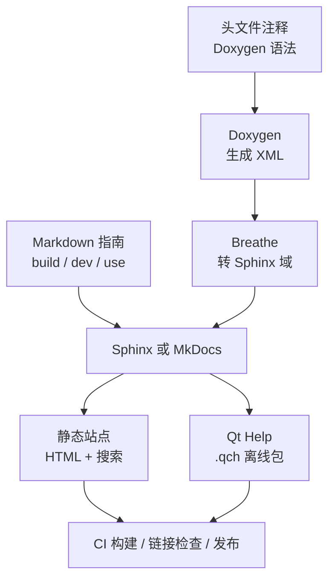
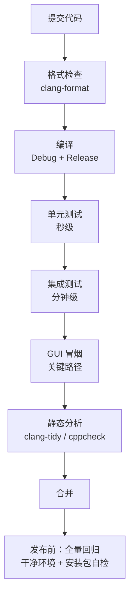

# 文档、质量测试及自动化

!!! abstract "本章要点"
    文档、测试、静态分析和格式化不是四件彼此独立的事，而是一条从代码到发布的同一条流水线：代码里的注释生成 API 文档，测试和静态分析验证代码行为，格式化统一代码形态，CI 在合并和发布前把这几件事串起来。工业软件的文档和测试之所以经常失败，不是因为团队不重视，而是因为它们被放在“有空再做”的位置，没有进入自动化的门禁。本章把文档当构建产物、把测试当反馈信号、把格式和静态分析当门禁，给出一套能在中小团队落地的配置与检查项。核心判断是：没有进入流水线的质量要求，等于没有要求。

## 7.1 文档也是一种构建

很多团队把文档理解成“写完代码之后再补的说明”，于是文档永远滞后、永远不完整。更有效的视角是把文档当成构建产物：源材料是代码注释、Markdown、示例和截图，构建工具把它们变成 API 文档站、用户手册、离线帮助，CI 在每次提交时检查链接、示例和版本号。这样文档和代码共享同一套版本、同一条流水线、同一个发布节奏，才不会在三个月后变成历史遗迹。

### 注释写给谁看

C++ 注释大致分三类，写法完全不同。第一类是**接口注释**，写给调用者看，说明这个函数做什么、参数含义、返回值、异常、线程约束、生命周期；这类注释应该出现在头文件里，用 Doxygen 语法结构化。第二类是**实现注释**，写给维护者看，解释“为什么这样写”，比如为什么这里要加锁、为什么这个分支不能合并、为什么这个数值是经验值。第三类是**临时注释**，比如 `TODO`、`FIXME`、`HACK`，它们应该带责任人和 issue 编号，否则半年后没人知道能不能删。

接口注释最容易被写成复述函数名。`\brief 设置宽度` 对读者没有信息量，真正有用的是单位、取值范围、边界行为和失败语义。比如“宽度单位为毫米，必须大于 0；小于等于 0 时返回 false 并保持原值”，这句话能避免调用方猜。Qt 自己的文档就是很好的范本：它会把参数单位、默认值、信号触发时机、线程安全都写清楚，读者不需要读源码就能正确使用。

```cpp
/**
 * \brief 按给定公差对形状做三角化。
 *
 * \param shape     待三角化的形状，函数内部不修改它。
 * \param tolerance 线性偏差，单位与 shape 的单位一致；必须大于 0。
 * \param parallel  是否使用并行三角化；对小于 1 万个面的形状通常没有收益。
 * \return 三角化后的网格；shape 为空或 tolerance 非法时返回空网格。
 * \warning 该函数不是线程安全的，同一个 shape 不能并发三角化。
 * \since 2.4
 * \see BRepMesh_IncrementalMesh
 */
Mesh triangulate(const TopoDS_Shape &shape, double tolerance, bool parallel = false);
```

这段注释里，`\brief` 给一句话结论，`\param` 给单位和约束，`\return` 给失败语义，`\warning` 给并发限制，`\since` 给版本，`\see` 给相关实现。它没有复述函数名，也没有写“这是一个三角化函数”这种废话。写注释的时间主要花在确认约束上，而不是敲字上；确认约束的过程本身就能发现设计问题。

### 从注释到文档站

C++ 的注释不会自己变成文档。常见的工具链是 Doxygen 解析注释生成 XML，Breathe 把 XML 转成 Sphinx 的域对象，Sphinx 负责主题、搜索、交叉引用和多语言；另一条路线是 Doxygen 直接生成 HTML，再嵌进项目文档站。Qt 项目还有第三条路线：`qhelpgenerator` 把 HTML 和 `.qhp` 索引打包成 `.qch`，供 Qt Assistant 或 Qt Creator 离线查看。

| 工具 | 输入 | 输出 | 适合场景 |
| --- | --- | --- | --- |
| Doxygen | C++ 注释 | HTML / XML / LaTeX | 纯 API 文档、快速上手 |
| Sphinx + Breathe | Doxygen XML + reST/Markdown | 多页文档站 | API 与指南混排、需要交叉引用 |
| Qt Help | HTML + `.qhp` | `.qch` 离线帮助 | 随产品分发的离线手册 |
| MkDocs | Markdown | 静态站点 | 项目主页、开发指南、使用手册 |

选择哪一种，取决于文档的读者和分发方式。API 参考适合 Doxygen 或 Sphinx + Breathe；用户手册适合 MkDocs 或 Sphinx；需要随安装包离线查看的，用 Qt Help。三者可以共存：同一份注释生成 API 参考，手写 Markdown 写指南，最后在文档站里互相链接。关键是不要维护两套内容，API 参考从注释生成，指南从 Markdown 生成，截图和示例从仓库读取，避免“文档里的代码”和“仓库里的代码”各说各话。

CMake 集成 Doxygen 和 Breathe 的骨架大致如下。`DOXYGEN_OUTPUT_DIRECTORY` 指向构建目录，`GENERATE_XML` 打开给 Breathe 用的 XML，`GENERATE_HTML` 可以关掉或保留作为快速预览；Sphinx 侧在 `conf.py` 里配置 `breathe_projects` 指向 XML 目录。这样注释改动会触发文档重建，CI 不需要单独维护一份 API 定义。

```cmake
# 结构示意：CMake 生成 Doxygen XML，供 Breathe 使用
find_package(Doxygen REQUIRED)

set(DOXYGEN_GENERATE_XML YES)
set(DOXYGEN_GENERATE_HTML NO)
set(DOXYGEN_OUTPUT_DIRECTORY ${CMAKE_BINARY_DIR}/doxygen)
set(DOXYGEN_EXTRACT_ALL YES)
set(DOXYGEN_EXCLUDE_PATTERNS "*/3rdparty/*" "*/build/*")

doxygen_add_docs(api_docs
    ${CMAKE_SOURCE_DIR}/src
    COMMENT "生成 API 文档 XML"
)

add_custom_target(docs
    COMMAND ${SPHINX_EXECUTABLE} -b html
            ${CMAKE_SOURCE_DIR}/docs ${CMAKE_BINARY_DIR}/docs-html
    DEPENDS api_docs
)
```

<figure class="book-diagram" markdown>

<figcaption><span class="fig-no">图 7-1</span>文档构建链：注释和 Markdown 是源材料，Doxygen/Breathe/MkDocs 是构建工具，静态站点和 Qt Help 是产物。把这条链放进 CI，文档才会跟着代码一起更新。</figcaption>
</figure>

## 7.2 项目文档站点

项目文档站最常见的问题不是“没有文档”，而是“文档不知道给谁看”。开发者需要构建指南、模块依赖、调试方法；用户需要安装、操作、快捷键、故障排查；维护者需要架构决策、发布流程、兼容策略。把这些内容混在一个“Wiki”里，搜索会失效，新人也不知道从哪读起。

data-workbench 的公开文档给了一个可用的分法：`build/` 放环境准备、构建步骤、常见错误；`dev-guide/` 放开发者入门、架构、模块、Agent、插件、Python 绑定；`use-guide/` 放命令行参数、绘图、配置、快捷键；`reference/` 放 FAQ、术语、API 索引。四类文档的读者不同，更新节奏也不同，但都在同一个仓库、同一个站点、同一个搜索框里。这个结构比“一个 README 写所有事”多花一点组织成本，换来的是读者能按角色找到入口。

文档站的技术选型不复杂。MkDocs + Material 适合以 Markdown 为主的项目，配置少、搜索好、部署到 GitHub Pages 方便；Sphinx 适合 API 文档和需要交叉引用的项目，主题选择多、扩展强；Docusaurus 适合需要版本化文档和多语言的前端项目。Qt 项目通常选 MkDocs 或 Sphinx，因为作者大多是 C++ 工程师，Markdown/reST 的学习成本低于前端框架。

比工具更重要的是三条纪律。**文档与代码同仓库**：文档放在 `docs/` 下，和代码一起提交、一起 review、一起打 tag；文档改动和代码改动在同一个 PR 里，评审时一起看。**文档与代码同版本**：文档站可以按版本发布，至少保证主干文档和主干代码一致；发布包里的离线帮助要和安装包版本对应。**文档与示例同源**：文档里的代码片段尽量从可编译的示例或测试里抽取，不能手写一段“看起来能跑”的代码。三条纪律听起来是流程问题，实际决定了文档半年后还有没有人维护。

文档站还需要一些工程化细节。构建时检查内部链接和图片路径，断链直接失败；检查代码块的语言标记，避免高亮错乱；检查页面标题和导航，避免出现“未命名页面”；把搜索索引、sitemap、canonical URL 配好，方便搜索引擎和外部引用。这些检查不复杂，但如果不做，文档站会在几百页之后变成一座迷宫。

一个可维护的 MkDocs 配置通常把导航、主题、插件和 Markdown 扩展分开写，导航只列稳定结构，不把每个页面都塞进去。下面是本书使用的骨架，去掉了一些与主题相关的细节：

```yaml
# mkdocs.yml（结构示意）
site_name: 项目文档
theme:
  name: material
  language: zh
  features: [navigation.tracking, navigation.top, search.highlight]

plugins:
  - search:
      lang: zh

markdown_extensions:
  - admonition
  - tables
  - toc:
      permalink: true
  - pymdownx.superfences:
      custom_fences:
        - name: mermaid
          class: book-mermaid
          format: !!python/name:pymdownx.superfences.fence_code_format

nav:
  - 首页: index.md
  - 构建: build/index.md
  - 开发者指南:
      - 入门: dev-guide/getting-started.md
      - 架构: dev-guide/architecture.md
  - 使用指南: use-guide/index.md
  - FAQ: reference/faq.md
```

导航结构本身就是文档信息架构的投影。构建、开发、使用、参考四块分开，读者按角色进入；每块内部再用二级页面展开，避免首屏列出几十个链接。版本化的项目可以用 `mike` 或 `sphinx-multiversion` 做多版本部署，但第一版不必上，先把单版本文档写完整更重要。

文档也要有版本策略。产品有 1.2、1.3、2.0，文档不能只有“最新”一份，否则用户升级后找不到对应说明。可行的做法是：主分支文档跟随开发版，发布时从 tag 构建一份文档并归档到 `docs.example.com/1.2/` 这样的路径；每份文档页脚标注对应产品版本和构建时间；旧版本文档不再更新，但保留可访问。文档版本和产品版本对不上，是客户支持成本最高的来源之一。

### 离线帮助与在线文档的分工

工业软件的客户常常在内网，在线文档不可达，安装包里必须带一份离线帮助。离线帮助不需要和在线文档完全一样：在线文档可以包含视频、外部链接、最新 FAQ；离线帮助应该以操作步骤、参数说明、故障排查为主，体积可控、打开快、不依赖网络。Qt Help 的 `.qch` 适合这种场景，它把 HTML、目录、索引打包成一个文件，Qt Assistant 或 Qt Creator 可以直接打开。

离线帮助的构建可以和在线文档共用源文件，只是选择不同的主题和导航。需要额外检查的是：离线包里的链接不能指向外网；图片必须随包分发；搜索索引要包含中文分词；帮助文件要和产品版本一起打包。很多项目把帮助文件做成“可选下载”，结果现场根本没有装，等于没有帮助。

## 7.3 自动化测试

测试的价值不在于“证明代码正确”，而在于“在改动之后快速告诉你哪里坏了”。工业软件的测试难点在于数据规模、GUI 交互和外部依赖：一个几何算法要跑真实模型，一个插件要加载动态库，一个界面要模拟鼠标事件。把测试按成本和反馈速度分层，是让测试可持续的关键。

### 单元测试

单元测试跑得最快、定位最准，应该覆盖不依赖界面的核心逻辑：数据模型、算法、序列化、命令与撤销、配置解析。Qt 项目常用 Qt Test，C++ 项目常用 Catch2 或 GoogleTest；选择哪一个不重要，重要的是测试能在没有 `QApplication` 的情况下跑起来，能在几秒内完成。

Qt Test 的好处是和 Qt 类型集成好，支持数据驱动测试、信号监听、GUI 事件模拟。一个典型的测试类是“私有槽即测试用例”：`initTestCase()` 做一次性准备，`cleanup()` 做每个用例的清理，`QVERIFY`/`QCOMPARE` 做断言。Catch2 的好处是语法轻、编译快、不需要 moc，适合纯 C++ 模块。两者可以在同一个项目里共存：界面相关用 Qt Test，核心算法用 Catch2。

```cpp
// 结构示意：Qt Test 的数据驱动测试
class DocumentTest : public QObject {
    Q_OBJECT
private slots:
    void initTestCase() { qRegisterMetaType<Document*>(); }

    void testCreateNode_data() {
        QTest::addColumn<QString>("type");
        QTest::addColumn<bool>("expected");
        QTest::newRow("box") << QStringLiteral("box") << true;
        QTest::newRow("unknown") << QStringLiteral("unknown") << false;
    }

    void testCreateNode() {
        QFETCH(QString, type);
        QFETCH(bool, expected);
        Document doc;
        QCOMPARE(doc.createNode(type) != nullptr, expected);
    }
};
```

单元测试的常见误区是只测 happy path。工业软件的边界条件特别多：空文件、单位混用、坐标系缺失、插件版本不匹配、磁盘写满。测试用例应该优先覆盖这些“会出事”的路径，而不是重复验证“正常情况能跑”。另一个误区是把测试写成实现细节的镜像：内部函数改名，测试全红。测试应该断言行为，而不是断言调用顺序；需要验证调用时用 mock 或信号监听，不要直接读私有成员。

### 集成测试

集成测试验证模块之间的契约：文档加载后视图是否更新、插件加载后命令是否注册、保存再打开是否一致、脚本调用是否生效。这类测试比单元测试慢，但能发现单元测试覆盖不到的连接问题。工业软件里最常见的一类 bug 是“模块单独都对，拼起来不对”，集成测试就是为这类问题存在的。

集成测试要控制依赖。数据库用临时文件、网络用本地 mock、插件用测试用的最小插件、Python 用随包解释器。测试数据要小但真实：一个包含两个零件的装配体、一个带中文路径的工程文件、一个旧版本格式的样本。测试结束后清理临时目录，避免测试之间互相污染。

插件和脚本的集成测试值得单独设计。插件加载测试要覆盖三种情况：插件不存在、插件版本不匹配、插件初始化失败；脚本测试要覆盖 API 调用成功、参数非法、脚本抛异常三种路径。工业软件最怕的是“插件崩溃把主程序带崩”，所以测试不仅要验证功能，还要验证隔离：插件抛异常时主程序是否还能继续、插件加载失败时是否给出可读的错误、插件卸载后资源是否释放。这些测试写起来比普通单元测试麻烦，但它们对应的是现场最常见的故障。

### GUI 测试

GUI 测试成本最高，也最容易被放弃。Qt 提供了 `QTest::mouseClick`、`QTest::keyClick`、`QTest::qWait`、`QSignalSpy` 等工具，可以模拟大部分交互；但 GUI 测试的难点不在模拟，而在等待：动画、异步加载、定时器、网络请求都会让“点完按钮立刻断言”变得不可靠。

可用的做法是**等待条件而不是等待时间**：用 `QTRY_VERIFY`、`QTRY_COMPARE` 轮询条件，超时才失败；用 `QSignalSpy::wait()` 等信号；对必须等待的动画，用 `QTest::qWaitFor` 加明确的超时。另一个做法是把 GUI 测试限制在少量关键路径：打开工程、切换视图、执行一次撤销、保存并重新打开，不要试图用 GUI 测试覆盖所有功能。核心逻辑用单元测试覆盖，GUI 测试只验证“界面和逻辑接上了”。

GUI 测试还需要稳定的运行环境。CI 上用离屏平台插件（`QT_QPA_PLATFORM=offscreen`）可以跑无界面测试，但离屏和真实桌面的字体、DPI、窗口管理器行为不同；关键界面测试最好在一台带图形环境的机器或虚拟机上跑。测试失败时要保存截图和日志，否则很难判断是产品 bug 还是测试环境问题。

GUI 测试最怕“不稳定”。同一个用例今天过、明天挂，开发者很快就会学会点重跑，测试就失去了意义。不稳定的来源通常是等待时间写死、依赖执行顺序、依赖屏幕尺寸、依赖系统动画。解决办法是禁用动画、固定窗口尺寸、用条件等待、让每个用例自己准备和清理数据；对确实无法稳定的用例，标记为 quarantine 并限期修复，而不是长期留在主流程里制造噪声。

覆盖率是一个参考指标，不是目标。工业软件里很多关键路径（异常恢复、崩溃转储、许可证过期、插件版本不匹配）很难用覆盖率衡量，但恰恰最需要测试。更实用的做法是维护一份“关键路径清单”：打开大文件、保存并重新打开、撤销到初始状态、加载旧版本工程、插件缺失、Python 环境损坏。每条路径至少有一个自动化或半自动化的测试，覆盖率数字只用来发现完全没人碰过的模块。

<figure class="book-diagram" markdown>

<figcaption><span class="fig-no">图 7-2</span>质量门禁的顺序按反馈速度排：格式和编译最快，单元测试次之，集成和 GUI 测试再次之，静态分析可以并行。越靠前的门禁越便宜，越应该严格。</figcaption>
</figure>

## 7.4 静态分析

静态分析是在不运行程序的情况下找问题：空指针、越界、未初始化、资源泄漏、危险的类型转换、过时的 API、可疑的并发。它不能替代测试，但能覆盖测试很难构造的路径，尤其适合 C++ 这种“错误代价很高”的语言。

clang-tidy 是 Qt/C++ 项目最常用的静态分析工具。它基于 Clang 的 AST，能理解模板、宏和类型，检查项覆盖现代 C++、性能、可读性、并发、安全等类别。接入方式是生成 `compile_commands.json`，然后对每个编译单元运行 clang-tidy；CMake 可以通过 `CMAKE_EXPORT_COMPILE_COMMANDS=ON` 自动生成。关键不是“开启 clang-tidy”，而是**选一套团队能维护的规则集**：全开会淹没在几千条历史告警里，全关等于没开。

一个务实的做法是分三步。第一步只开高置信度的 bug 类检查，比如 `bugprone-*`、`clang-analyzer-*`，把历史告警修掉或加入基线；第二步开性能和现代化检查，比如 `performance-*`、`modernize-*`，但允许按文件豁免；第三步把新增告警设为 CI 失败，历史文件逐步清理。规则集写在 `.clang-tidy` 里，跟着仓库走，评审时可以看到规则的变更。

cppcheck 是另一个选择，优点是轻量、不需要编译数据库、对未初始化变量和资源泄漏的检查不错；缺点是误报率比 clang-tidy 高，对模板和现代 C++ 的理解弱一些。它适合作为补充，在 CI 里跑一遍，重点关注新增代码。商业工具如 PVS-Studio 检查更全，但成本和集成复杂度也更高。

静态分析最容易失败的地方不是配置，而是“开了但没人看”。解决办法是把告警数量当成一个指标：新增代码不允许新增告警，历史告警数量只能降不能升；CI 里对新增文件严格执行，对历史文件用基线文件豁免。另一个办法是把静态分析和代码评审绑定：review 时先看静态分析结果，再看逻辑。工具只有进入流程，才会被真正使用。

`.clang-tidy` 的配置同样要跟着仓库走。下面的骨架只开高置信度检查，并把几个噪音大的检查关掉；团队可以按自己的代码风格调整，但不要把整份配置写成“全开”。

```yaml
# .clang-tidy（结构示意）
Checks: >
  -*,
  bugprone-*,
  clang-analyzer-*,
  performance-*,
  modernize-use-nullptr,
  modernize-use-override,
  readability-braces-around-statements,
  -bugprone-easily-swappable-parameters,
  -bugprone-narrowing-conversions
WarningsAsErrors: 'bugprone-*,clang-analyzer-*'
HeaderFilterRegex: '^(src|plugins)/'
FormatStyle: file
```

`WarningsAsErrors` 只对高置信度检查生效，避免一条风格告警阻断整个构建。`HeaderFilterRegex` 限定检查范围，避免把第三方头文件的问题算到项目头上。`FormatStyle: file` 让 clang-tidy 的修复建议和 clang-format 的配置一致，减少“修完还要再格式化”的来回。

## 7.5 自动格式化

格式化是最没有争议的工程实践，却经常因为“改格式会产生大量 diff”而被搁置。正确的做法不是一次性格式化整个仓库，而是先统一配置、再逐步收敛：新文件必须符合格式，修改到的旧文件顺手格式化，最后在 CI 上做全量检查。

clang-format 是 C++ 的事实标准，配置文件是 `.clang-format`。配置项很多，但团队真正需要决定的不多：基础风格（LLVM、Google、Chromium、Mozilla、WebKit）、缩进宽度、行宽、指针和引用的对齐、大括号位置、排序 include。工业软件通常把行宽放在 100–120，缩进 4 空格，指针靠类型，include 按类别分组。风格没有绝对好坏，重要的是全队一致，并且写进仓库。

```yaml
# .clang-format（结构示意）
BasedOnStyle: LLVM
IndentWidth: 4
ColumnLimit: 120
PointerAlignment: Left
SortIncludes: CaseSensitive
IncludeBlocks: Regroup
IncludeCategories:
  - Regex: '^<Q'
    Priority: 2
  - Regex: '^"'
    Priority: 1
    SortPriority: 0
  - Regex: '^<'
    Priority: 3
```

配置好之后，要把格式化和编辑器、提交钩子、CI 三处接起来。编辑器集成让开发者在保存时自动格式化，减少手工调整；提交钩子（pre-commit）在本地拦截不合规的代码，避免“格式化提交”污染历史；CI 在合并前做一次全量检查，防止有人绕过钩子。三处缺一不可：只配编辑器，有人不配；只配钩子，有人用 `--no-verify`；只配 CI，反馈太晚。

格式化的价值不只是“好看”。它减少无意义的 diff，让 review 聚焦逻辑；它让代码搜索和 grep 更可靠；它让新人不用猜风格。代价是首次全量格式化会产生一个巨大的提交，最好在独立分支上完成，并把这个提交加入 `.git-blame-ignore-revs`，避免 `git blame` 被格式化提交淹没。

本地钩子可以用 pre-commit 框架统一管理，也可以用简单的 shell 脚本。关键不是工具，而是把检查写进仓库、让每个人安装一次即可。下面的钩子只检查暂存区的 C++ 文件，避免每次提交都格式化整个仓库。

```bash
#!/usr/bin/env bash
# .githooks/pre-commit（结构示意）
set -euo pipefail

files=$(git diff --cached --name-only --diff-filter=ACM | grep -E '\.(cpp|h|hpp|cc)$' || true)
[ -z "$files" ] && exit 0

for f in $files; do
    clang-format --dry-run --Werror "$f" || {
        echo "格式不符合 .clang-format：$f"
        echo "运行 clang-format -i $f 后再提交"
        exit 1
    }
done
```

钩子要能被绕过，但不能被默认绕过。`git commit --no-verify` 应该只用于紧急情况，CI 仍然会做全量检查；团队可以在 PR 模板里加一条“是否使用了 --no-verify”，让绕过行为可见。格式检查失败时，提示要直接给出修复命令，而不是只报一个错误码。

## 7.6 质量门禁：提交前、合并前、发布前

质量要求要变成门禁才有约束力。门禁按反馈速度分三层：提交前在本地跑，合并前在 CI 跑，发布前在干净环境跑。每一层检查什么、失败后怎么处理，应该写进仓库文档，而不是靠口口相传。

| 阶段 | 检查项 | 失败处理 | 目标 |
| --- | --- | --- | --- |
| 提交前 | 格式化、编译、单元测试、提交信息 | 本地阻止提交 | 30 秒内反馈 |
| 合并前 | 全量编译、单元 + 集成测试、静态分析、文档构建、链接检查 | PR 阻止合并 | 10–30 分钟 |
| 发布前 | 干净环境构建、安装包自检、启动冒烟、关键回归、许可证清单 | 阻止发布 | 小时级 |
| 定期 | 全量回归、性能基准、依赖漏洞扫描、文档死链 | 建 issue 跟踪 | 每周/每月 |

提交前的门禁要快。格式化、增量编译、相关单元测试，控制在 30 秒到 1 分钟；超过这个时间，开发者就会绕过。合并前的门禁可以慢一些，但要有明确的超时和失败日志；全量编译、测试、静态分析、文档构建可以并行，失败时只重跑失败的部分。发布前的门禁最重，必须在干净环境（没有开发工具、没有缓存、没有管理员权限）里跑，否则“我机器上能过”会变成“客户机器上不能跑”。

门禁的另一个关键是**失败要可解释**。CI 失败时，日志里要能直接看到是哪个文件、哪一行、哪个检查项失败；不要只输出“exit code 1”。测试失败要保存失败用例的数据和截图；静态分析失败要输出具体的检查名和修复建议；文档构建失败要输出断链的源文件和目标。门禁不是为了让 CI 变红，而是为了让问题在最早、最便宜的地方被发现。

最后，门禁本身也要维护。规则太松，问题会漏过去；规则太严，开发者会绕过。可行的节奏是：每次线上事故或严重 bug，复盘时问一句“哪个门禁本可以拦住它”，然后补一条检查；每次有人抱怨门禁太慢，就优化缓存、并行或缩小范围。门禁不是一次配置，而是一个和团队一起演进的系统。

发布前的门禁还要包含许可与合规检查。构建产物里要有一份第三方组件清单，列出名称、版本、许可证、用途和链接；新增依赖必须在 PR 里显式声明，不能悄悄出现在构建脚本里；打包前检查许可证文件、Qt 的 LGPL 声明、Python 依赖的许可证、字体和图标的授权。这些检查可以和 SBOM（软件物料清单）生成工具结合，输出一份机器可读的清单，交付时随包提供。第 3 章讨论过许可证义务，门禁是把义务变成可执行检查的地方。

质量门禁的度量不要只看“通过率”。通过率 100% 可能意味着规则太松，也可能意味着大家都不敢改代码。更有用的指标是：门禁平均耗时、失败后平均修复时间、新增代码的告警密度、缺陷逃逸率（发布后才发现的问题比例）。这些指标不需要天天看，每个迭代复盘一次，足以判断门禁是在帮忙还是在添乱。

!!! note "小结"
    文档、测试、静态分析和格式化，单看都是“重要但不紧急”的事；放进同一条流水线之后，它们变成了可执行、可验证、可维护的工程习惯。第 8 章讨论性能，第 9 章讨论稳定性，这两章的前提都是本章的测量和门禁：没有测试和日志，性能和稳定性都只能靠猜。
