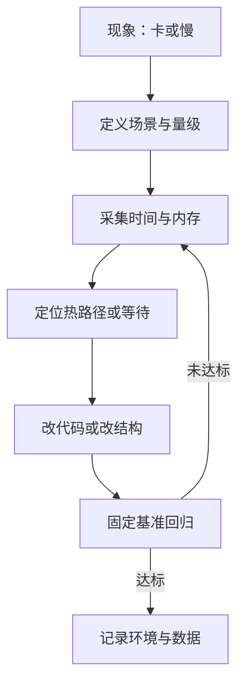
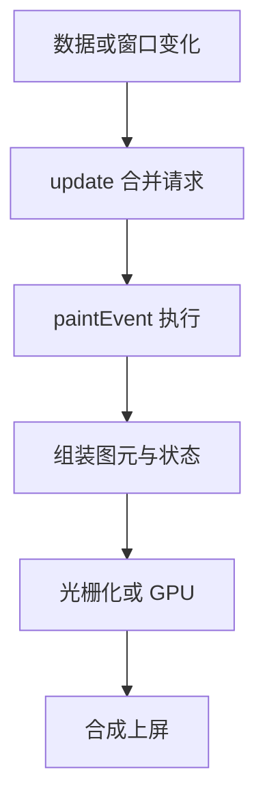
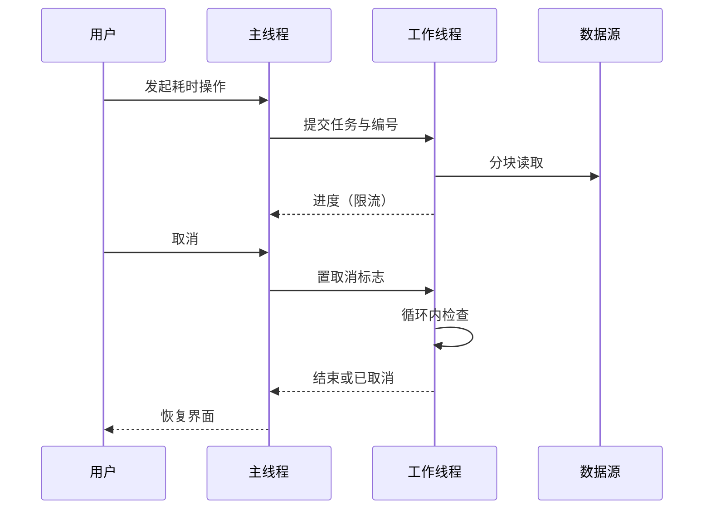
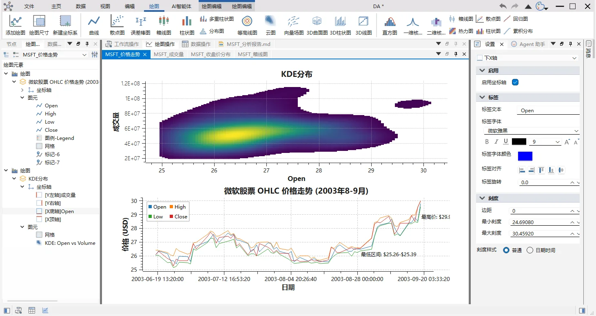

# 性能工程

!!! abstract "本章要点"
    性能工程要解决的问题不是“让程序更快”，而是把“慢”变成可复现、可归属的数字，再判断这次修改值不值得做。工业客户端的性能问题大多出在架构和默认行为上：数据全量驻留、主线程做重活、每帧重建图元、日志与样式反复触发重算，微优化能救回的只是一小部分。本章按“测量—定位—修复—回归”的顺序给出方法，先讲工具与判据，再列 C++ 与 Qt 的常见坑，最后用数据工作台的百万点曲线和亿行表格场景说明取舍。文中数字只给量级，任何实测值都必须绑定机器、构建类型和数据集。

## 8.1 先测量，再谈优化

性能问题最容易被写成形容词。用户说“卡”，开发者说“优化一下”，两边都没有说清指的是启动慢、拖动掉帧、打开大文件要等，还是连续工作两小时后内存涨到崩溃。工程上的第一件事，是把形容词拆成可测量的场景：哪个操作、什么数据规模、在什么硬件和系统上、慢在哪一段。场景不明确时做的任何优化，都无法验证是否真的有效。

测量本身有三条纪律。第一条是用真实数据规模，拿十个点画出的曲线证明不了百万点的性能，数据量提升两个数量级后，瓶颈会从算法换到内存带宽或绘制调用。第二条是在发布配置下测，Debug 构建里的迭代器检查、未内联的调用和额外的拷贝会让热点完全变形，而带调试符号的 Release 构建才是既接近用户又足够可读的测量对象。第三条是区分冷路径和热路径，打开一次文件慢三秒和拖动一次卡三帧是两类问题，前者看启动时间线，后者看单帧内的工作量，用同一套工具同时解决这两件事通常两头落空。

<figure class="book-diagram" markdown>

<figcaption><span class="fig-no">图 8-1</span>性能问题的定位在测量与修改之间循环，退出循环的条件是固定环境下的基准稳定通过，而不是“感觉快了”。先定义场景，才能决定用火焰图、内存快照还是事件时间线。</figcaption>
</figure>

工具的选择取决于要回答的问题。火焰图回答“CPU 时间花在哪个调用栈”，它把采样得到的栈按宽度累加，横向宽度就是时间占比，纵向是调用关系；读图时不要只盯最宽的叶子函数，先看从根到叶哪一层出现了不该存在的调用，比如每次重绘都重新解析样式表、每次滚动都重新查询数据库。内存问题要用分配器视角的快照工具，heaptrack 一类的工具能给出分配点、保留路径和峰值，比只看进程 RSS 有用得多；进程内存涨而分配快照不涨时，再去查映射文件、图形驱动缓存或碎片。等待类问题要靠系统调用跟踪和锁分析，磁盘、网络、锁、字体枚举都可能让主线程停住，火焰图上看不到这些时间。

| 要回答的问题 | 代表工具 | 重点看什么 | 已知局限 |
| --- | --- | --- | --- |
| CPU 时间花在哪 | 火焰图（Linux 用 perf，Windows 用 WPA 或 IDE 的 CPU 诊断） | 从根到叶的异常调用链 | 采样会漏短调用；缺符号时栈不可读 |
| 内存在哪里涨 | heaptrack、Massif、IDE 内存快照 | 分配点、保留路径、峰值 | 采样开销改变时序；长跑数据难采集 |
| 主线程在等什么 | 系统调用跟踪、ETW 等待分析、锁分析 | 阻塞时长与等待对象 | 只说明等待，不解释业务原因 |
| 启动慢在哪一段 | 进程启动到首帧的时间线 | 初始化、插件、字体、首帧绘制 | 受磁盘缓存与安全软件影响大 |
| 改动是否退化 | QBENCHMARK、Google Benchmark、自建计时 | 相对基线的比值与分布 | CI 机器噪声大，绝对值不可比 |
| 现场偶发卡顿 | 慢日志与主线程看门狗 | 超阈值操作的类型与次数 | 阈值要按场景调，误报要治理 |

同一份表里的工具在真实项目里通常要组合使用。定位一次“打开工程后滚动卡顿”，常见的路径是先用现场慢日志确认卡顿发生在滚动而不是加载，再用火焰图看滚动期间的 CPU 分布，最后用内存快照确认块缓存是否被反复重建。每一步只回答一个问题，避免一次抓一堆数据却得不出结论。

数据工作台（data-workbench）在公开的开发者文档里给了一套值得借鉴的轻量方案：常态在线的慢日志分三层，作用域计时宏覆盖显式埋点的函数，`DAApplication::notify()` 重写覆盖所有经主线程事件循环派发的事件，独立线程的看门狗用约 50 ms 的心跳监测主线程是否长时间不响应；阈值和环境变量可调，Debug 配置默认开启，Release 配置下埋点宏展开为空。这套设计的好处是平时几乎不花成本，出问题时又能拿到“哪个事件或哪段代码超时”的粗粒度账本，再决定是否上重量级采样工具。代价是阈值和埋点位置需要维护，埋错了地方一样查不出来。

有了工具，还需要把问题变成一个可比较的实验。同一台机器、同一个构建、同一份数据，只改一个变量，重复运行取分布，再把环境写进记录；一次把三项改动一起上，最后无法判断是哪一项起了作用。冷启动和热启动要分开测，磁盘缓存、杀毒软件、首次加载 DLL 都会让第一轮数据明显偏慢，把第一轮当结论是常见的误判。实验设计看起来是流程问题，实际决定了后面几个星期是在修真正的原因，还是在追一个测量假象。

基准回归是测量体系里最容易被跳过的一环。性能修复如果没有基准锁住，半年后一次“顺手重构”就能让结果回到原点，却没人发现。可用的做法是把固定数据集、固定操作序列写成基准用例，记录中位数与分位数而不是单次最好成绩，在稳定的机器上按版本保存结果，用相对基线的比值做门禁。CI 机器上跑绝对时间通常不可靠，把阈值从“不超过 800 ms”改成“不超过上一版的 1.2 倍”，误报会少很多，前提是基线本身也在同一台机器、同一条流水线上产生。

测量设施本身也有代价。符号文件要归档，基准机器要固定，数据集要脱敏后随仓库或制品保存，埋点要跟着代码演进，这些工作不产生面向用户的功能。没有它们，性能讨论就只能靠感觉；有了它们，团队才能把“这次改得很值”变成一张可复查的趋势图。一个务实的折中是：常态只保留低开销的慢日志和少量核心基准，需要深挖时再开完整采样，把昂贵的测量留给少数几个关键场景。

## 8.2 C++ 常见性能坑

C++ 的性能问题很少来自“语言慢”，多数来自在热路径上做了本可以不做的事。下面 18 条是按症状归类的高频项，覆盖拷贝、容器、间接调用、I/O、编译期、并发和绘制七类。它们不值得逐条背诵，值得的是在代码评审和性能分析时能对上号：当火焰图里出现一条稳定的 `memcpy` 宽带，或者基准显示每次滚动都有固定分配，先从这里找原因，比直接改算法更快命中。

| # | 坑 | 症状 | 测法 | 改法 |
| --- | --- | --- | --- | --- |
| 1 | 大对象按值传参 | 热路径出现整块内存复制 | 火焰图中 `memcpy` 占比高 | 参数改 `const&`，返回依赖 NRVO |
| 2 | 范围 for 漏写引用 | 循环体里反复执行拷贝构造 | 断点看拷贝次数 | `const auto&` 或 `std::as_const` |
| 3 | 返回值与临时对象 | 小对象在循环里反复构造析构 | 计数构造与分配 | 提前构造、移动语义、`emplace_back` |
| 4 | Qt 隐式共享 detach | 只读访问后内存翻倍 | 对比 const 与非 const 调用的容量 | 用 `const` 引用、`at()`、`constData()` |
| 5 | QString 反复拼接 | 长字符串构建时临时对象多 | 火焰图里构造与析构密集 | `QStringBuilder`、`arg()`、`append` |
| 6 | 编码来回转换 | `QString` 与 `QByteArray` 反复互转 | 看转换函数调用次数 | 在边界处转换一次，内部统一类型 |
| 7 | 容器未预留 | 持续插入触发多次扩容 | 观察容量增长与分配次数 | `reserve()`，选对容器 |
| 8 | 循环内分配小对象 | 分配器采样密集 | heaptrack 的分配点 | 栈对象、对象池、复用缓冲 |
| 9 | 高频虚调用与 `std::function` | 热路径充满极短的小帧 | 火焰图放大后出现大量小函数 | 先确认是热区，再考虑模板化或内联 |
| 10 | 异常路径成本 | 频繁抛掷与捕获异常 | 计数抛掷次数 | 可预期失败改用返回值或 expected |
| 11 | 锁粒度与伪共享 | 多线程扩展性差 | 锁竞争分析、缓存一致性采样 | 缩小临界区、按线程分片 |
| 12 | 遍历中删除 | 迭代器失效或多余拷贝 | 断言、ASAN、代码审查 | 先记录待删、倒序遍历、erase-remove |
| 13 | 同步小写入 | 主线程被磁盘或网络拖住 | 系统调用耗时 | 缓冲、批量、移到工作线程 |
| 14 | 数据库逐条写 | 导入慢且日志暴涨 | 事务统计与 SQL 计时 | 事务批提交、预编译语句、索引 |
| 15 | 头文件与模板膨胀 | 编译时间随规模上涨 | 编译单元依赖与编译时间线 | 前向声明、预编译头、拆接口 |
| 16 | 启动期静态初始化 | 首帧前固定延迟 | 启动时间线 | 延迟初始化、懒加载插件与字体 |
| 17 | 并发误用 | CPU 空转或界面等待 future | 线程时间线与锁分析 | 线程池、可取消任务、主线程不等待 |
| 18 | 绘制路径里分配 | 拖动掉帧而 CPU 不高 | 帧时间与分配采样 | 预创建画笔、缓存路径、局部重绘 |

前七条可以归到一个判断：**热路径上的拷贝都是设计问题，不是语言问题。** `QString` 的隐式共享让“赋值很便宜”成为默认印象，但只要发生一次非 const 访问就会 detach，整个字符串被复制。一个接收 `QString` 的槽函数如果按值传参并且在内部修改过参数，调用方和槽函数各持有一份数据，火焰图上看不见这条路径，内存快照上却能看见峰值翻倍。把参数改成 `const QString&`、把只读访问改成 `at()` 或 `constData()`，收益不一定立竿见影，但它是零风险的，应该成为代码规范而不是优化任务。

分配与对象生命周期是另一类隐性成本。热路径上每帧 `new` 一个临时对象，分配器要维护元数据、要处理碎片，长时间运行后分配器本身会变慢；把临时对象改成栈对象、把频繁创建销毁的小对象改成对象池或复用的缓冲，收益通常在内存分配器的火焰图上能直接看到。对象的所有权和生命周期也要算进性能设计：一个按值返回的大结构如果破坏了 NRVO，多出来的那次搬移在百万次调用下就是实打实的带宽消耗。

数据结构的选择比算法复杂度更容易被忽略。两个实现都是 O(n)，一个顺序访问连续数组，一个每次访问跳一次指针，后者在数据量上来后会慢几倍，原因不在指令条数，而在缓存未命中和预取失败。热路径上的容器应该优先考虑连续存储、可预测的访问顺序和紧凑的元素大小；结构体里字段的顺序、用 `int` 还是 `bool`、补齐字节放在哪里，这些细节在百万级循环里都会显形。代价是代码可读性下降，所以只在被测量证明的热区里这么做。

容器和分配相关的几条要结合 STL 与 Qt 的差异看。Qt 5 的 `QList` 对大于指针大小的类型存的是指针数组，遍历时的间接寻址和缓存局部性都不如连续存储；Qt 6 把 `QList` 实现成连续数组，与 `QVector` 合并，同一条代码在两个大版本上的表现可能完全不同。跨版本维护的项目要么统一用 `QVector`，要么在迁移时把这点写进说明。另一个常见错误是在循环里 `push_back` 却不 `reserve()`，容器扩容时整块搬移，元素越多越慢；对于尺寸已知的结果集，预留容量是一行代码的事。

间接调用和异常两条要克制。虚函数和 `std::function` 本身不贵，贵的是它们阻止内联、把控制流打散，并且经常伴随一次堆分配；只有在剖析确认某段代码是热区之后，改成模板或函数对象才有意义，否则只是用可读性换一个测不出来的收益。异常同理，C++ 的零成本异常模型在“不抛”的路径上确实接近零成本，但工业软件里常见的是用异常做输入校验和流程控制，一秒抛几千次，栈展开的代价就会出现在火焰图上。把可预期的失败表达成返回值或 `std::expected`，把异常留给真正的意外，边界会清楚很多。

I/O、数据库和编译期三类问题有一个共同点：它们不在业务代码的中心，却经常是端到端时间的大头。导入十万行数据时，逐条 `INSERT` 自动提交会把每次写入变成一次事务日志落盘，改成一批提交后端到端时间可能下降一个数量级；反过来，如果业务要求每个事务可见，就必须接受这个代价，或者在数据库层做批量接口。编译期问题在大型项目里会累积成日常摩擦，一个头文件里多包含一个重型模板库，所有包含它的编译单元都要重新解析，最终表现为“改一行代码要等十分钟”，这类问题的修复收益不在运行时，而在每天的开发循环里。

并发与绘制两条放到后面的小节单独展开，因为它们牵扯的是 Qt 的线程模型和绘制模型，不只是代码写法。这里先给出总的处理顺序：先用测量确认问题属于哪一类，再从表里挑对应的改法，改完用基准验证，最后把这条经验写成评审规则。18 条全部照做会让代码变得难以阅读，性能工程的目标是找到真正的那三五个热区，而不是把每一行都写成竞赛题。

## 8.3 Qt 特有的坑

Qt 的性能问题大多来自它替你做的隐式工作：隐式共享在背后复制，元对象系统在背后查表，样式表在背后解析匹配，布局在背后反复计算，事件循环在背后排队。这些机制单独看都不贵，组合起来就能让一个看起来普通的界面在数据量上来后变得迟钝。理解它们的设计意图，比记住“不要用某个函数”更有用。

隐式共享（copy-on-write）是第一个要讲清楚的机制。`QString`、`QByteArray`、`QImage`、Qt 容器都带引用计数，拷贝只增加计数，读写共享数据时才真正复制。问题出在“非 const 访问”也会触发分离：对容器调用非 const 的 `operator[]`、非 const 的迭代器、`data()`，甚至用 range-for 遍历一个非 const 容器，都可能让整块数据被复制。data-workbench 的公开开发规范里专门列了一条禁令：禁止对非 const 的 Qt 容器直接做范围迭代，理由就是 COW 深拷贝；它给出的写法是声明成 `const` 或者用 `std::as_const()` 包一层。这条规范看起来像风格要求，实际上是性能要求。

```cpp
// 结构示意：同一段只读遍历，两种写法在 Qt 容器上代价不同
for (const QString& name : m_names) {          // 触发 COW 分离的风险
    consume(name);
}
for (const QString& name : std::as_const(m_names)) {  // 只读，不分离
    consume(name);
}
```

信号与槽的代价集中在两处。跨线程连接默认是队列连接，参数会被复制一份放进事件队列，传大对象时这份拷贝很显眼；自定义类型需要在元类型系统里注册，否则连接建立不起来或者运行时丢弃。另一处是连接数量与发射频率，一个高频信号连到几十个接收者，每个接收者都在主线程做一点工作，累加起来就是掉帧。批量修改模型时用 `QSignalBlocker` 包住，或者用 `beginResetModel()` 与 `endResetModel()` 成对替换逐条 `dataChanged`，都能把“每个 item 一次信号”降成“一次信号”。

| 机制 | 典型症状 | 测法 | 改法 |
| --- | --- | --- | --- |
| 隐式共享分离 | 只读操作后内存翻倍、拷贝耗时 | 对比 const 访问的容量与分配 | `const` 引用、`at()`、`constData()` |
| 队列连接复制参数 | 跨线程回传大结果时卡顿 | 比较连接类型与参数大小 | 传 `shared_ptr`、改用共享缓冲 |
| 高频信号与逐条模型通知 | 批量更新时界面无响应 | 统计信号发射与模型通知次数 | 批量更新、信号阻塞、成对 reset |
| 事件循环被阻塞 | 动画停住、点击无响应 | 主线程看门狗与事件时间线 | 计算移出主线程、拆分任务 |
| 嵌套事件循环 | 重入导致状态错乱、卡顿 | 检查 `exec()`、`processEvents()` | 改成异步状态机 |
| 样式表重解析 | 切换主题或改属性后整窗变慢 | 测量 polish 与布局耗时 | 复用样式表、改调色板、属性变化后局部刷新 |
| 深层布局嵌套 | 窗口缩放与数据刷新变慢 | 布局激活次数与时长 | 减少层级、缓存 sizeHint、批量隐藏再显示 |
| 模型视图全量查询 | 滚动大表时 `data()` 反复取值 | 统计 `data()` 调用与耗时 | 缓存格式化结果、视图层降载、分页取数 |

事件循环那条值得单独展开。主线程的职责是分发事件和刷新界面，任何超过一帧预算的同步工作都会表现为掉帧；更隐蔽的问题是重入，`QDialog::exec()` 和 `QApplication::processEvents()` 都会在调用点内部再跑一轮事件循环，用户在这期间可以关闭窗口、删除正在使用的对象，于是出现只在偶发时机崩溃的 bug。工程上的原则是尽量不写嵌套事件循环，需要等待时用信号回调或 `QEventLoop` 配合明确的生命周期管理，并且明确禁用会引发重入的入口。这条原则同时改善性能和稳定性，重入引起的对象生命周期问题，往往要在崩溃分析里才能看清。

样式表（QSS）和布局的成本都发生在“界面重建”而不是“绘制”阶段。给一个父控件设置新样式表会让整棵子树重新 polish，解析选择器、重算尺寸、重绘，切换主题时这种全量重建是必要的，但在数据刷新时反复设置样式就是浪费。更常见的坑是拿样式表改一个颜色：更直接的做法是改调色板或控件属性，只有需要复杂外观时才上样式表。布局方面，嵌套层级越深、参与布局的控件越多，窗口缩放和内容变化时的重算越贵；在批量插入控件前先 `setUpdatesEnabled(false)` 或隐藏父控件，结束时再统一刷新，可以把几十次重排压成一次。

模型视图是 Qt 性能问题的常客。`QAbstractItemModel::data()` 会在滚动、排序、悬停、编辑时被反复调用，如果里面做了字符串格式化、单位换算、数据库查询，界面就会越用越慢。合理的做法是把原始值和显示值分开，`data()` 只做 O(1) 的取数与简单格式化，复杂的统计结果在数据变化时预先算好。视图侧可以用统一行高、关闭不必要的委托、限制 `QSortFilterProxyModel` 的重过滤频率来降载；超大表格更应该换成分页或滑动窗口，而不是指望视图控件扛住全部数据。

## 8.4 渲染性能

渲染成本可以粗略拆成三项：图元数量、状态切换次数、像素填充量。工业软件的典型场景是大量线、点、面和文本，问题往往出在前两项，而不是 GPU 算力不够。一个百万点的曲线如果按点逐个调用绘制接口，CPU 会在提交绘制命令上耗尽，显卡大部分时间在空转；把它合成一条 `QPolygonF` 或一条折线路径交给 `QPainter::drawPolyline()`，绘制调用从每点一次变成每批一次，帧率就回来了。这类修改不需要换渲染后端，只需要把“一个元素一次调用”改成“一批元素一次调用”。

<figure class="book-diagram" markdown>

<figcaption><span class="fig-no">图 8-2</span>一帧的绘制路径。`update()` 只是登记重绘请求，事件循环会把同一轮里的多次请求合并成一次 `paintEvent`；掉帧时先看这条链上哪一段在重复做工作，再决定是减少刷新区域、减少图元，还是换渲染后端。</figcaption>
</figure>

在 QWidget 体系里，局部刷新和预计算是最划算的两件事。`update()` 会合并请求并只重绘脏区域，`repaint()` 则立即同步重绘，前者是正常路径，后者只应在少数需要立刻反映状态的场合使用。绘制函数里不要分配对象、不要查字体度量、不要构造字符串，画笔、画刷、字体、布局好的文本都应该在构造时准备好；`QStaticText` 适合重复绘制且内容不变的文字，`QFontMetrics` 的结果应该缓存而不是每帧重算。对于自绘控件，`Qt::WA_OpaquePaintEvent` 可以跳过背景擦除，干净的局部重绘能省掉一次整块填充。

`QGraphicsView` 适合中等数量的可交互图元，它的场景索引用二叉树加速碰撞与拾取。图元数量在万级时，开启 `BspTreeIndex` 并关闭不必要的抗锯齿通常就够用；图元频繁增删时索引重建会成为瓶颈，这时可以切到 `NoIndex` 并在上层自己维护空间结构。图元缓存（`DeviceCoordinateCache` 或 `ItemCoordinateCache`）能减少复杂图元的重复绘制，但缓存本身占显存，缩放频繁时缓存失效反而更慢，需要按场景选。

文本和字体是容易被低估的一项。工业界面里标签、坐标轴刻度、图例、状态栏都在频繁重绘，每次都算 `QFontMetrics` 的宽度、每次都构造 `QString` 再交给 `QPainter::drawText()`，成本会累积到可观测的程度。把不变的文字缓存成 `QStaticText`，把度量结果存在成员里，在字体或 DPI 变化时统一失效，能显著降低绘制开销。高 DPI 屏幕上还有一层额外成本：按设备像素比渲染会让字形和线条落在非整数像素上，抗锯齿和重新栅格化的代价都会增加，缩放比例切换后要主动清空字体缓存，否则会一直用错误分辨率的旧缓存。

三维视口是另一套账。基于 OpenGL 或 Qt 6 的渲染硬件接口（RHI）做自绘时，性能关键在批处理、实例化和数据传输：相同材质和相同几何的对象合并成一次绘制，重复结构用实例化，顶点数据常驻显存，每帧只更新变化的统一变量。最贵的操作往往是同步回读，`glReadPixels()` 或把 GPU 结果拷回 CPU 会强制管线等待，截图、拾取、导出图像时尤其明显。远处的细节用层次细节（LOD）降低面数，视锥外的对象直接剔除，点云按屏幕像素密度抽稀，这些手段比单纯提升显卡更有效。

渲染路线还有一个工程代价：工业现场大量使用远程桌面、虚拟机和老显卡，OpenGL 版本和驱动质量参差不齐。选择硬件加速渲染，就要准备软件回退路径和针对远程桌面的降级策略，否则客户现场遇到的往往直接是黑屏或启动失败，连“慢”都算不上。Qt 默认的光栅引擎在这些环境里反而更稳，代价是大场景下的帧率上限较低。这个取舍要在产品定义阶段决定，不能等交付前才发现客户机没有独立显卡。

Widgets 与 Qt Quick 的渲染模型不同，性能特征也不同。Widgets 用 CPU 光栅化和双缓冲，控件数量多、层级深时成本在布局和重绘上；Qt Quick 走场景图和 GPU，适合动画和视觉效果多的界面，但每个元素都要过一遍场景图，大量静态表格反而不占优势。工业软件里常见的选择是主界面用 Widgets，特定的可视化区域用 Quick 或自绘 OpenGL，这个混合方案需要处理两套事件与焦点系统，代价是调试路径变长。不要为了“看起来现代”把整棵界面迁到 Quick，渲染性能只是选型的一个维度，输入法、辅助功能、打印和远程桌面支持都要一起算。

## 8.5 数据性能

数据性能可以分三层看：数据怎么表示、怎么搬运、怎么访问。界面卡顿经常只是最外层的症状，真正的成本在内存布局和拷贝次数上。一个百万点的数组，按“每个点一个对象”存和按“两个连续 double 数组”存，内存占用可能差几倍，遍历时的缓存命中率也完全不同；工业软件里常见的 `struct Point { double x, y, z; }` 数组属于“数组的结构”（AoS），拆成三个独立数组属于“结构的数组”（SoA），前者适合按点整体访问，后者适合按字段批量计算，选哪种取决于热路径的形状。

Qt 的容器在版本之间有实实在在的差异。Qt 5 的 `QList` 对大型元素使用指针数组，随机访问要两次跳转；Qt 6 的 `QList` 与 `QVector` 统一为连续存储，缓存局部性更好，但在 Qt 5 上按 Qt 6 的习惯写代码会得到更差的性能。跨版本项目应该在规范里写清楚容器选择，不要依赖“Qt 会自动优化”。另一个容易被忽略的点是 `QList<QString>` 这类容器的遍历：每次取元素都可能触发隐式共享的引用计数操作，热路径上应该用 `const` 引用或索引访问。

零拷贝是数据密集场景里收益最大、风险也最大的手段。`QByteArray::fromRawData()`、`QString::fromRawData()`、用外部缓冲区构造 `QImage`、把裸数组通过 `setRawSamples()` 交给绘图项，这些接口都避免了复制，代价是调用方必须保证缓冲区在对象使用期间有效，同时不能跨越重分配。API 设计上要把生命周期写进注释和命名里，比如提供 `View` 后缀的类型或显式的所有权参数；一旦调用方误以为对象持有数据，就会得到随机的花屏或崩溃，这类 bug 比性能问题难查得多。

大文件的读写与序列化同样属于数据性能。工程文件里存着几何、网格、属性表，序列化时逐字段写 `QDataStream` 会产生大量小写入，I/O 次数比数据量更影响耗时；合理的做法是先在内存里拼块、用缓冲写、对重复结构做引用化。压缩要看场景：zlib 压缩比高但费 CPU，工程保存时值得，实时日志就不值得。格式设计还会反过来影响读取性能，能一次映射或一次读入的结构，不要设计成需要来回寻址的格式；能在后台线程解析的，就不要阻塞首帧。

大数据表格的做法是把“数据”和“视图”之间的接口从“逐格取数”改成“按块取数”。data-workbench 的公开文档描述了一个表格数据源抽象层：schema 与数据本体分离，行列数与列名作为低开销元信息，数据通过 `fetchBlock(startRow, rowCount)` 按块获取，视图侧对任意数据源做滑动窗口和块缓存，默认每块 512 行；pandas 实现一次调用取整块，数据库实现用 `LIMIT/OFFSET` 分页查询，并且要求分页语句带确定性排序，否则并发写入时会跳行或重复。工程持久化只保存连接、查询和 schema 这类引用信息，数据本体不进工程文件。

这套接口的边界也写得很清楚：块取数仍然发生在 GUI 线程，惰性数据源要保证单次查询延迟可接受，块大小可以调，异步化留作后续扩展；只读惰性表不参与整表快照式撤销，结构性编辑会被拒绝；pandas 源在做块取数时要保持与逐格取数一致的类型语义。把限制写进文档，比假装接口能覆盖所有场景更可靠。对使用方来说，这些限制决定了哪些表可以接、哪些表只能导出后分析，属于产品设计的一部分。

采样是另一个必须明说的取舍。公开文档给出的策略是：小表全量绘制，大表折线用确定性分块均匀采样，目标约两千点，直方图约两万个值，统计聚合在内存源和阈值内尽量走全量精确路径，超阈值或惰性源则采样并在界面上标注近似；一次构建的取数调用和行数还有总预算，耗尽就停止采样并标记“样本受限”。确定性采样意味着同样的数据和同样的顺序得到同样的图，便于复现和比较；但采样会漏掉尖峰和极值，所以界面必须标明“这是采样结果”，否则用户会把它当成精确曲线。

| 数据量级 | 能否全量驻留 | 推荐路径 | 要接受的代价 |
| --- | --- | --- | --- |
| 千级 | 可以 | 直接建模、直接绘制 | 无特殊处理 |
| 万到十万级 | 可以 | 连续数组、批处理绘制 | 注意拷贝与格式化开销 |
| 百万级 | 可以，但要省着用 | 原始数组加视图、按需计算、必要时抽稀 | 渲染仍需降载，统计按需触发 |
| 千万级 | 视内存而定 | 分块加载、滑动窗口、增量统计 | 交互复杂度上升，撤销要重新设计 |
| 亿行级 | 不能 | 惰性数据源、数据库侧过滤与分页、流式导出 | 依赖后端性能，功能边界收缩 |

这张表里的“量级”是设计阶段的分类，不是实测结论。真正的分界点取决于每行有多宽、有多少列参与显示、是否有索引、机器有多少内存，以及用户能不能接受分页等待。把量级写进需求文档的价值在于提前暴露取舍：要在客户端里打开亿行表，就必须接受“只能看窗口、不能整表排序、不能整表撤销”，如果产品不接受这些限制，就应当把数据留在服务端，客户端只做结果呈现。

## 8.6 界面响应

界面响应的关键在主线程不被占用，计算本身有多快反倒次要。主线程一帧的预算在 60 Hz 显示器上大约是 16 ms，超过这个时间，动画和拖动就开始掉帧；一次同步的数据库查询、一次文件写入、一次网络请求，都可能把这个预算一次性花光。把工作移到工作线程只是第一步，完整方案还要包括进度、取消、防止重入和结果过期处理，这四件事缺一件，用户就会遇到“点了没反应”“取消关不掉”“旧结果覆盖新结果”之类的问题。

<figure class="book-diagram" markdown>

<figcaption><span class="fig-no">图 8-3</span>异步任务的时序。取消不是“发个信号然后忘掉”，工作线程必须在每个可中断点检查标志；主线程用任务编号丢弃过期结果，避免用户连续操作时旧结果覆盖新结果。进度回传要限流，否则事件队列会被进度消息填满。</figcaption>
</figure>

一个可用的最小骨架是任务对象加编号。任务在工作线程里按块处理，每个块之间检查取消标志和代数编号；主线程在发起任务时把编号加一，收到结果时只接受与当前编号一致的结果；进度用单调时钟限流，比如每 50 ms 最多发一次，避免计算很快时把事件队列刷爆。

```cpp
// 结构示意，非完整实现：可取消、可丢弃过期结果的取数任务
class LoadTask : public QObject {
    Q_OBJECT
public:
    LoadTask(Source source, QObject* parent = nullptr)
        : QObject(parent), m_source(std::move(source)) {}

    void run(int generation) {
        const int total = m_source.blockCount();
        for (int i = 0; i < total; ++i) {
            if (m_cancel.loadRelaxed() || generation != m_currentGeneration.loadRelaxed()) {
                return;                       // 用户取消，或结果已经过期
            }
            process(m_source.block(i));
            publishProgress(i + 1, total);    // 内部按时间节流
        }
        emit finished(generation);
    }

    void cancel() { m_cancel.storeRelaxed(true); }
    void setCurrentGeneration(int generation) { m_currentGeneration.storeRelaxed(generation); }

signals:
    void progress(int done, int total);
    void finished(int generation);

private:
    void publishProgress(int done, int total) {
        if (m_clock.isValid() && m_clock.elapsed() < 50) {
            return;
        }
        m_clock.restart();
        emit progress(done, total);
    }

    Source m_source;
    QElapsedTimer m_clock;
    std::atomic_bool m_cancel{false};
    std::atomic_int m_currentGeneration{0};
};
```

线程之间的对象生命周期比算法更容易出错。工作线程不能直接碰界面，必须通过队列连接回到主线程，传大结果时用 `std::shared_ptr` 避免深拷贝；`QObject` 的线程亲和性决定了它属于哪个事件循环，跨线程删除要经过 `deleteLater()`；工作线程正在读的数据如果会被主线程修改，就需要复制快照或加锁，不能假设“它读得很快所以不会撞上”。这些规则写在架构层，比散落在每个槽函数里可靠。

防抖和延迟执行是同一类问题的另一面。搜索框每敲一个字符就查一次数据库、属性面板每个值变化就重建整棵表单、窗口大小每动一像素就重排一次布局，这些行为的浪费在数据量小的时候看不出来，在工业现场的大工程里会累积成明显的迟滞。用定时器把连续变化合并成一次处理，输入停止后再发请求，布局变化用 `update()` 交给事件循环合并，都是小改动大收益的做法；关键是给用户一个明确的状态反馈，让他们知道操作已经被接收、正在处理。

进度反馈的设计要跟随任务的状态机，而不是随手弹一个进度条。操作开始后界面要进入忙碌状态，明确哪些入口暂时不可用；进度要能表达“完成了多少”和“还要多久”的粗略量级，不能长时间停在 0% 或 99%；取消要立即生效并在界面上反馈“正在停止”，而不是等任务自然结束才消失；结束后要恢复原状态，失败时把可读的原因留在界面上。进度条本身不产生性能收益，它产生的是用户对等待的容忍度，工业软件里这个容忍度往往决定了操作员会不会重复点击，而重复点击又会制造新的重入问题。

启动响应需要单独设计。工业软件的启动阶段常被插件扫描、字体枚举、配置读取、最近文件预加载占满，把首帧拖到十秒以上。可行的做法是把非关键初始化推迟到首帧之后，插件目录异步扫描，界面先显示骨架和进度，重要的先做、次要的延后；同时用启动时间线量出各段耗时，别让“启动慢”停留在体感层面。启动优化有一个天然的上限：依赖库越多、磁盘越慢、杀毒软件越积极，冷启动就越难压，产品上要接受这一点，并把“首次启动慢、之后快”的预期告诉用户。

## 8.7 案例：百万点曲线与亿行表格

图 8-4 的公开截图能看出这个平台的工作区结构：同一份数据既要出分布热力图，又要出时间序列曲线，还要支持在对象树和属性面板里逐项调整坐标轴、图例、线型。百万点级曲线的压力不在“读出数据”，而在“画出来”和“调得动”；亿行级表格的压力反过来，读出数据本身就是问题，界面只能看窗口。两个场景对应两套完全不同的性能策略，把它们混在一张优化清单里，通常两头都做不好。

<figure markdown>
  { loading=lazy }
  <figcaption><span class="fig-no">图 8-4</span>data-workbench 的绘图区：上方是分布热力图，下方是 OHLC 曲线，左侧是绘图对象树，右侧是逐项属性。压力落在“视图要提交多少图元、属性面板要重算多少项”，而不是“文件能不能读进来”。</figcaption>
</figure>

百万点曲线在内存里只占十几 MB，读入和解析不是瓶颈，瓶颈在视图层。绘图项如果持有每个点的独立对象，内存会膨胀，遍历和绘制都要经过指针；更好的做法是把数据保留成连续数组，绘图项只引用这段内存，坐标变换和抽稀在绘制前完成。轴自动缩放需要扫描极值，统计和直方图需要再扫一遍，这些“看不见的遍历”在大数据量下可能比绘制还贵，应该缓存结果并在数据版本变化时才失效。属性面板的调整不应该触发重新读数和重新采样，只重绘视图，这条在公开的界面结构里能看出来：对象树管结构，属性面板管参数，数据本身是另一层。

亿行表格的问题要现实得多。按每行几十字节估算，一亿行就是数 GB 到数十 GB，全量驻留内存既装不下，勉强装下也会把缓存冲垮。公开文档给出的路径是惰性数据源：数据留在数据库或外部存储，客户端通过 schema 拿到列信息，通过分页查询取当前窗口的块，视图侧维护滑动缓存；工程只保存引用，不保存数据本体；只读的惰性表不参与整表快照式撤销，也不允许结构性编辑。把这条路推到亿行级，真正的瓶颈会从 Qt 的表格模型转移到数据库的索引、排序和分页查询上，客户端能做的是减少请求次数、避免客户端排序、把聚合下推给数据库。

公开文档也标出了当前的边界：块取数还在 GUI 线程同步执行，没有 SQL 聚合下推，惰性源只能采样聚合，统计的精确路径依赖内存中的 pandas 数据。这些限制意味着亿行级的交互体验取决于后端能提供什么，而不是客户端单方面优化能解决。把边界写清楚，比在演示里用一千万行撑场面更有价值：用户知道哪些操作会等、等多久是正常的、哪些功能在超大表上不可用，售后成本会下降很多。

演示性能最常见的错误，是拿一个精心准备的小数据集跑一遍，然后宣布“百万点没问题”。验收应该按客户实际会遇到的最坏情况设计：最大工程、最宽的表、最多曲线、最慢的机器、最苛刻的 DPI 和远程桌面条件。演示时要给出数据规模、硬件、构建版本和操作步骤，让听众能判断这个结果是否适用于自己的现场；只展示“流畅”的动画，不展示打开同样的数据需要多久，等于回避了工业用户最在意的那部分时间。

这也是为什么本书坚持不给具体耗时数字。同一段绘制代码在集成显卡、独立显卡、远程桌面、4K 屏和 1080p 屏上的表现可以差好几倍，同一个分页查询在本地 SQLite 和远程数据库上差一个数量级。可报告的是量级和条件：百万点曲线要把绘制提交从按点降到按批，并且按屏幕分辨率抽稀，才能保持可交互；亿行表格必须走惰性取数并且按窗口加载。工程结论要写成“在什么条件下达到什么量级”，而不是“优化后性能提升 300%”这种无法复现的句子。

## 8.8 把性能变成回归

性能工程的最后一环是把结论固定下来，否则它只是一次性的经验。固定数据集、固定操作序列、固定构建配置，三者写进基准用例，每次发版前跑一遍，把结果按版本存档；关键场景再配一条趋势图，团队才能在评审时看到“这次改动让启动时间回到了三个月前”。基准不必覆盖所有功能，把最容易退化的五到十个场景守住，收益就已经很大。

基准本身也会失真，需要定期校准。数据集换了、依赖库升级了、基准机器的电源策略变了，都会让历史曲线失去可比性；解决办法是给基准结果附上环境指纹，包括编译器版本、Qt 版本、关键依赖版本、CPU 型号和电源模式。基准的维护成本不低，但比“每隔半年重新争论一次性能是否退化”低。把基准当成测试资产而不是个人脚本，才有人愿意在发版前跑它。

现场性能问题需要一条回传通道。慢日志的阈值按场景调整，把超过阈值的操作类型、次数、当时的操作环境记录下来；用户反馈“卡”时，先看慢日志和版本信息，再决定是否远程抓火焰图或内存快照。回传的数据要做脱敏，图纸、工艺参数、客户名称都不能进日志；同时要记录机器配置、显示器缩放、是否远程桌面、数据文件规模，这些条件决定了结论能不能复现。

团队层面的安排比工具更重要。每个模块有人对性能负责，性能 bug 单有固定模板（场景、数据规模、环境、期望、实测、火焰图或时间线），发版前有一张很短的门禁清单：启动时间、打开大工程时间、核心交互帧时间、长时运行内存。清单上的数字只和自身上一版比，不和别的产品比，因为工业软件的硬件环境差异太大，跨产品比较没有意义。

性能解决的是“快不快”，稳定性解决的是“能不能一直跑下去”。一个响应很快但每小时崩一次的程序，工业现场不会接受；一个从不崩溃但打开文件要半分钟的程序，同样会被投诉。下一章讨论如何在设计阶段处理错误、如何在现场留下可分析的证据，以及如何让软件在升级和老化中保持可用。
