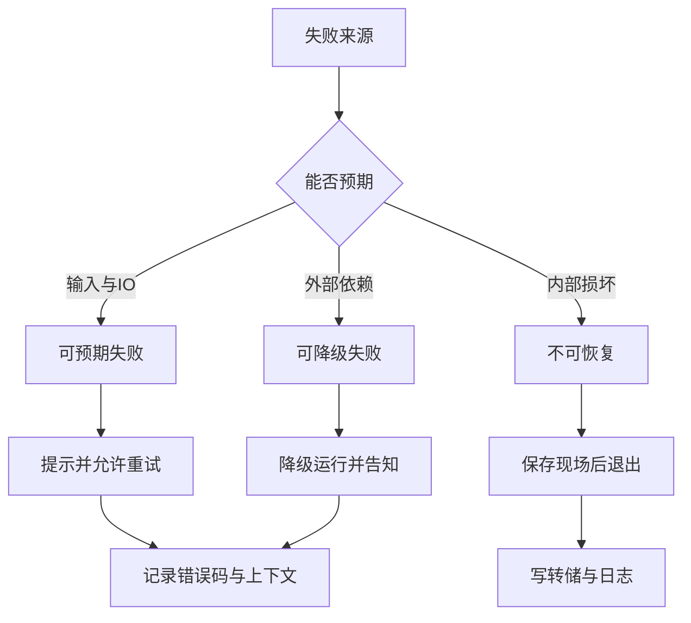
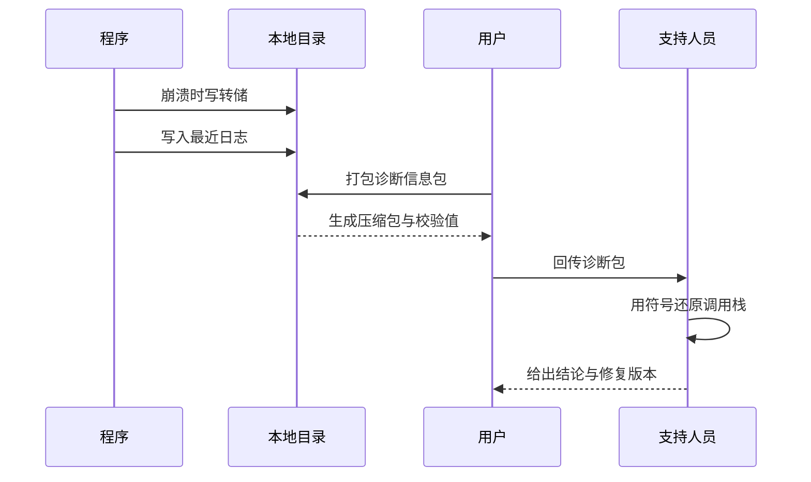
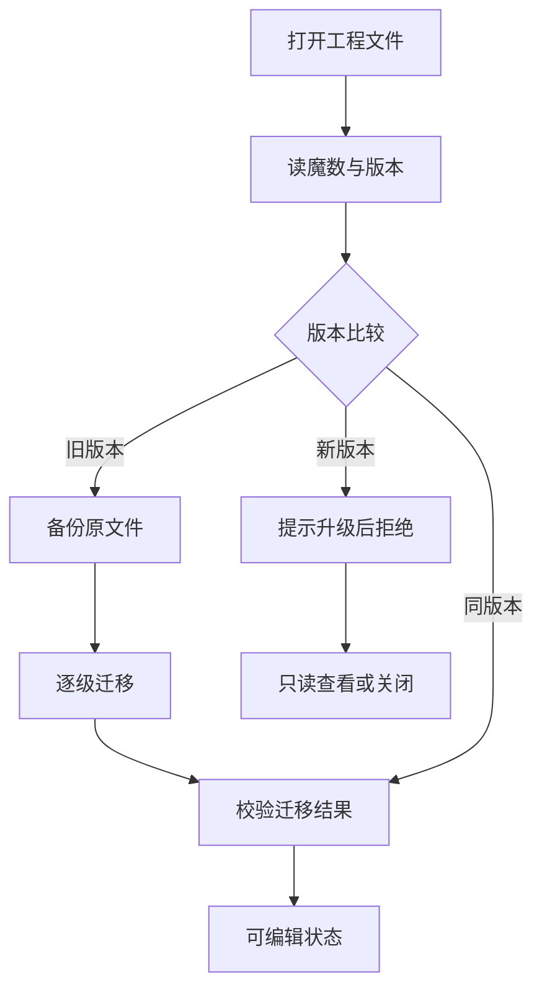

# 稳定性与可维护性

!!! abstract "本章要点"
    稳定性指的是软件在连续运行、外部环境变化和版本升级中仍然可用的能力，而不只是“没有 bug”。工业现场的代价不对称：一次崩溃可能丢掉几小时的工艺参数，一次升级失败可能让整条产线停摆，所以稳定性设计要先保证不丢数据、可恢复、可追溯，再谈错误处理用哪种语法。本章按错误处理、长时间运行、现场诊断、兼容升级、代码老化五条线展开，最后给一张可以带进评审会的清单。核心判断是：诊断能力必须在发布前设计好，等现场出事再补就来不及。

## 9.1 错误处理：先定策略，再选语法

错误处理的第一决定落在错误发生之后谁负责、系统停在什么状态、用户看到什么，语法选择排在这些问题之后。工业软件里错误的后果分三档：输入非法、文件不存在、权限不足这类可预期失败，应当就地提示并允许重试；插件缺失、显卡不可用、Python 环境异常这类外部依赖失败，应当降级运行并明确告知；内存耗尽、数据文件损坏、内部不变量被破坏这类不可恢复错误，应当保存现场后退出，而不是带着坏状态继续跑。把这三档分清楚，语法选择就只是实现细节。

Qt 生态对错误的默认表达是返回值和输出参数。`QFile::open()` 返回 `bool`，失败后用 `errorString()` 取原因；`QImageReader::read()` 用 `error()` 和 `errorString()`；`QJsonDocument::fromJson()` 接收一个 `QJsonParseError*` 报告位置。这套约定不好看，但它有一个重要优点：错误必须被显式处理，不会被悄悄穿过调用链。Qt 的文档同时写明，从信号槽调用路径上抛出的异常属于未定义行为，除非在槽内部就处理掉；原因是 Qt 的事件循环和信号槽实现并不保证异常安全，异常穿过去可能留下半更新的对象。C++ 标准库的异常可以用于模块内部，但不要让异常穿过 Qt 事件循环的边界。

```cpp
// 结构示意，非完整实现：统一的错误类型与 expected 风格返回值
struct Error {
    enum class Code { NotFound, Permission, Busy, Corrupt, Internal };
    Code code;
    QString message;   // 面向用户，已翻译
    QString context;   // 面向诊断：路径、模块、附加信息
};

template <class T>
using Result = std::expected<T, Error>;   // C++23；C++17 项目可用 tl::expected

Result<Document> openDocument(const QString& path)
{
    QFile file(path);
    if (!file.open(QIODevice::ReadOnly)) {
        return std::unexpected(Error{Error::Code::Permission,
                                     QObject::tr("无法读取工程文件"), path});
    }
    // ... 解析内容，失败时返回 Corrupt，并附上偏移量与字段名
}
```

C++23 的 `std::expected` 把“成功值或错误”放进类型里，调用方必须解包才能取值，比 `bool` 加输出参数更难忽略。C++17 项目用 `tl::expected` 或自己封一个轻量的 `Result<T>` 成本也不高，关键是团队统一：同一种失败在同一层用同一种表达，不要在文件层用错误码、网络层用异常、界面层用空指针，最后每层都要猜上一层是什么意思。代价是类型变长、样板代码变多，另外 `expected` 与 Qt 的信号槽、容器、元对象系统没有原生配合，跨层传递时通常要转成错误码或错误对象。

<figure class="book-diagram" markdown>

<figcaption><span class="fig-no">图 9-1</span>错误先按处置能力分类，再落到不同的出口。分类判断的是“系统还能不能继续提供价值”，而不取决于错误来自哪个模块；同一类失败在不同层要映射到同一个出口，避免界面上提示重试、后台却已经进入不可用状态。</figcaption>
</figure>

| 策略 | 适用场景 | Qt 中的典型写法 | 代价 | 例子 |
| --- | --- | --- | --- | --- |
| 返回值加错误码 | 文件、网络、数据库 | `bool` 加 `errorString()` | 容易忽略返回值 | `QFile::open()` |
| 空值或可选值 | 查询可能无结果 | 指针判空、`std::optional` | 无法携带原因 | 查找节点、取配置项 |
| expected 风格 | 需要区分多种失败 | `std::expected`、`tl::expected` | 类型与样板代码变多 | 工程加载、格式解析 |
| 异常 | 模块内部，且能就地捕获 | `try` / `catch` 包住边界 | 不能穿过事件循环 | 第三方库抛出 |
| 断言 | 程序员错误 | `Q_ASSERT`、`assert` | Release 下失效 | 不变量、枚举越界 |
| 崩溃转储 | 不可恢复错误 | 未处理异常过滤器 | 只能事后分析 | 访问违例、栈溢出 |

断言只用来检查“代码写错了”，不要拿来校验用户输入。`Q_ASSERT` 在 Release 构建里是空操作，用断言挡住非法参数，发布后就会变成未定义行为；反过来，内部不变量在不该失败的地方失败了，继续跑下去只会让错误扩散，用断言在 Debug 构建里尽早炸掉是合理的。Qt 还提供 `Q_UNREACHABLE` 和 `Q_ASSERT_X`，前者告诉编译器这个分支不可达，后者能附带上下文，适合在复杂状态机里表达“这里不该被走到”。

错误消息要分成两层：给用户看的和给维护者看的。给用户的消息应当短、可操作、已翻译，例如“工程文件版本高于当前软件，请升级后再打开”，不要带内部异常名和内存地址；给维护者的上下文写进日志，包含模块、文件路径、错误码、操作步骤，必要时附上数据规模。这两层混在一起的后果是用户看不懂、支持人员也拿不到有用信息。错误码本身要稳定，能按版本统计“哪类错误最多”，否则每次改文案就把历史数据打断了。

错误处理最后会牵出组织问题。团队需要在代码规范里写清楚异常的使用边界、日志与界面的分工、错误码的注册方式，并且在评审时真的检查；否则每个人都会在自己那一层做“最合理”的选择，组合起来就成了一锅粥。这套约定本身的维护成本不高，前提是它在项目早期定下来；等到几十万行代码写完再统一，代价会大到没人愿意启动。

## 9.2 长时间运行

工业软件常被要求连续运行数周甚至数月，稳定性问题在这类场景里暴露得最充分。判断一个程序能不能长跑，看三件事：资源占用有没有上界，状态能不能回收，外部依赖失效时会不会拖垮整个进程。内存泄漏只是其中最显眼的一种，句柄泄漏、缓存无界增长、线程越开越多、定时器漂移和日志膨胀同样能让程序在第三天早上变得不可用。

内存问题要区分“泄漏”和“增长”。泄漏是对象已经没人引用却回收不了，常见于 `QObject` 的父子关系被拆开后忘记 `delete`、回调里捕获了 `this` 导致生命周期延长、Python 与 C++ 混合编程时循环引用跨过了垃圾回收器。增长则可能是缓存没有上限：缩略图缓存、块缓存、撤销栈、最近打开列表、日志缓冲，只要它们按使用量单调增长，长跑就一定会出问题。处理方式并非“少用缓存”，重点在给每个缓存定容量和淘汰策略。`QUndoStack::setUndoLimit()` 就是现成的例子，撤销记录不设上限时，用户编辑一个下午就能把内存吃掉几个 GB。

句柄泄漏在 Windows 上尤其隐蔽。GDI 对象、USER 对象、文件句柄、注册表句柄、套接字都是有限资源，默认配额下单个进程的 GDI 对象上限是一万个左右，达到上限后创建画笔、字体、位图会失败，界面开始出现黑块或空白，日志里却未必有明确错误。排查要靠任务管理器之外的计数工具：`GetGuiResources()` 能读到进程当前占用的 GDI 与 USER 对象数，`GetProcessHandleCount()` 给出句柄总数，Linux 上可以看 `/proc/<pid>/fd` 与 `/proc/<pid>/status`。把这些计数接进慢日志或状态面板，定期采样，比等用户报告“用久了界面花了”有效得多。

| 现象 | 常见原因 | 观测手段 | 处理方式 |
| --- | --- | --- | --- |
| 内存持续上涨 | 缓存无上限、对象未释放、循环引用 | 分配快照、RSS 趋势、`QObject` 计数 | 定容量、弱引用、定期回收 |
| 界面元素变黑或缺失 | GDI/USER 对象耗尽 | `GetGuiResources` 采样 | 释放画笔与字体、复用资源 |
| 文件无法再打开 | 文件句柄泄漏 | 句柄计数、`lsof` | RAII、检查异常路径的关闭逻辑 |
| 线程数缓慢增加 | 任务线程未退出、回调未清理 | 线程枚举与栈采样 | 线程池、明确生命周期 |
| 定时任务越跑越晚 | 定时器漂移、主线程卡顿 | 单调时钟对比计划时间 | 按截止时间调度、误差补偿 |
| 磁盘被日志写满 | 日志无轮转、级别过细 | 日志目录大小监控 | 轮转与保留份数、分级输出 |
| 撤销越用越慢 | 命令栈无限增长、快照过大 | 撤销栈深度与内存 | 限制深度、合并命令、轻量快照 |

定时器漂移是长跑里最容易忽略的一项。`QTimer` 的默认精度是粗定时器，允许一定比例的偏差，主线程一旦被长任务占住，定时器回调就会延后；它也不会把错过的时间补回来，一个每 100 ms 触发一次的任务，如果主线程卡了 5 秒，恢复后通常只触发一次，而不是补 50 次。依赖“累计次数”做逻辑的代码会慢慢落后于真实时间。可靠的做法是用 `QElapsedTimer` 这类单调时钟计算真实经过的时间，定时器只负责唤醒，业务按截止时间推进；需要严格周期时用 `Qt::PreciseTimer`，但要知道它只能提高精度，不能解决主线程阻塞。系统休眠、时钟回拨、时区切换是另外几类事件，长跑程序要在恢复通知后重新校准状态，而不是假设时间连续。

日志和临时文件是长跑的另一个坑。调试期开启的详细日志在生产环境可能每天写出几个 GB，日志轮转按大小和份数配置，保留策略要和磁盘容量一起算；data-workbench 的公开文档里给出的推荐配置是单文件 10 MB、保留 5 份，用异步日志写入，慢日志单独一个文件、不进界面队列，这种分流思路值得借鉴。临时文件、解压目录、转储文件、缩略图缓存都要有清理策略，程序异常退出后遗留的锁文件和临时目录，下次启动时要能识别并清理，否则用户会在几个月后发现磁盘满了。

长跑测试要当成固定科目，而不是出问题才想起。用脚本模拟典型操作循环，持续跑三天到一周，定时采样内存、句柄、线程数、定时器误差和日志目录大小，画出趋势；只看“跑完没崩”说明不了稳定性，很多问题在崩溃前就已经开始劣化。测试环境尽量接近现场：同样的操作系统版本、同样的安全软件、同样的网络共享和打印机，工业现场的杀毒软件和域策略经常是慢速句柄泄漏的元凶。

文件与网络资源在工业现场的表现需要单独考虑。工程文件放在共享盘上、日志写到映射的网络驱动器、授权文件放在 U 盘里，这些用法在客户现场很常见，断网、掉线、设备拔出却经常被当成“不会发生”。网络文件系统上的 `QFile` 操作可能阻塞数秒，超时设置不对会让主线程看起来像死掉；SQLite 官方文档明确不建议把数据库文件放在网络共享上，因为文件锁在 SMB 上的语义不可靠，轻则读不到刚写的数据，重则数据库损坏。长跑程序的资源策略要包含“外部资源随时可能消失”的假设：所有外部路径访问都有超时和失败分支，关键数据先写本地再同步，设备移除时关闭相关句柄并给出可恢复的提示。

## 9.3 现场诊断

软件交付之后，开发者拿不到用户的桌面，只能靠现场留下的证据推断问题。诊断能力应当作为发布架构的一部分设计，不能等出事再临时加补丁：崩溃时写什么、日志保留多久、环境信息怎么采集、文件怎么回传、符号文件在哪里。这些东西设计得早，一个电话就能定位；设计得晚，同样的故障要派工程师飞一趟现场。

崩溃转储是证据链的起点。Windows 上用 `MiniDumpWriteDump()` 在未处理异常过滤器里写一个转储文件，转储类型要包含线程栈和必要的内存引用，否则拿到的只是一个没有变量值的壳；程序写完转储后应当尽快退出，不要尝试恢复后继续跑，坏状态可能把用户的数据写坏。data-workbench 的公开仓库里有 `DADumpCapture` 负责在 Windows 上生成转储，文件落在 `dumps/` 目录；Linux 上可以启用核心转储或使用 `coredumpctl`，macOS 用系统崩溃报告。转储文件要配合同一版本的符号文件（Windows 的 PDB、Linux 的调试信息、macOS 的 dSYM），每个发布版本归档一套，符号丢了，转储基本等于没用。

```cpp
// 结构示意，非完整实现：未处理异常时写转储，然后让进程退出
LONG WINAPI onUnhandledException(EXCEPTION_POINTERS* info)
{
    const QString name = QDateTime::currentDateTime().toString("yyyyMMdd-HHmmss");
    const QString path = dumpDirectory() + QLatin1Char('/') + name + QStringLiteral(".dmp");
    HANDLE file = CreateFileW(reinterpret_cast<LPCWSTR>(path.utf16()), GENERIC_WRITE, 0,
                              nullptr, CREATE_ALWAYS, FILE_ATTRIBUTE_NORMAL, nullptr);
    if (file != INVALID_HANDLE_VALUE) {
        MINIDUMP_EXCEPTION_INFORMATION mei{GetCurrentThreadId(), info, FALSE};
        MiniDumpWriteDump(GetCurrentProcess(), GetCurrentProcessId(), file,
                          MiniDumpWithIndirectlyReferencedMemory, &mei, nullptr, nullptr);
        CloseHandle(file);
    }
    return EXCEPTION_EXECUTE_HANDLER;   // 结束进程，避免带着坏状态继续写数据
}
```

只有转储还不够，现场还需要环境快照和操作轨迹。环境快照至少包含：软件版本与构建标识、Qt 版本、操作系统版本与补丁、显卡型号与驱动版本、内存与 CPU、显示器数量与缩放比例、语言与区域设置、是否运行在远程桌面或虚拟机里、插件列表及版本、Python 解释器与依赖版本、工程文件版本。操作轨迹来自日志，日志里要有时间戳（单调时间和墙上时间都记）、线程标识、模块名、用户动作和错误上下文；崩溃前的最后几十条日志往往比转储更快定位问题。这些信息在隐私上很敏感，采集和回传要经过用户同意，传之前做脱敏，图纸、工艺参数、客户名称、内网路径都不能原样带走。

<figure class="book-diagram" markdown>

<figcaption><span class="fig-no">图 9-2</span>崩溃诊断的证据链：转储、日志、环境快照三样东西必须属于同一个版本，否则调用栈和环境对不上。回传包带校验值并经过用户确认，支持侧拿到后先用符号文件还原栈，再结合日志还原用户操作。</figcaption>
</figure>

诊断包的结构值得标准化：一个压缩包，根目录放清单文件，列出各项内容的来源与版本；`crash/` 放转储，`logs/` 放最近若干份日志和慢日志，`env.json` 放环境快照，`recent/` 放最近打开的文件路径与操作记录，`manifest.sha256` 做完整性校验。标准化的好处是支持流程可以自动化，用户只要按提示点两次，不需要理解每一份文件是什么。诊断包的体积要控制，转储可以只保留崩溃线程和必要内存，日志截取最近若干 MB，否则用户会因为上传太慢而放弃。

诊断能力还要能在不重启的情况下调整。现场排查时经常需要把日志级别从 Info 调到 Debug，或者打开某些模块的详细输出，如果每次都要改配置文件、重启软件、复现问题，支持的效率会低很多；更好的做法是保留一个运行期可切换的日志级别，把高详细度日志写入独立文件并按大小截断，避免把界面日志窗口刷爆。慢日志和看门狗这类常驻监测工具应该默认开启一个低开销档位，等需要时再提高阈值敏感度。这些开关本身也是风险，权限要控制，调试结束后要能一键恢复默认，否则下一次交付时客户机器上还留着全量调试日志。

这套能力也有代价。转储可能包含内存中的敏感数据，采集要得到授权，保存要有期限和加密；符号文件体积不小，需要专门的归档位置和访问控制；诊断包多了以后要有清理策略，不能把客户机器塞满。更现实的一点是，支持人员要接受读转储的训练，否则采回来的证据没人会看。诊断体系的价值不在采了多少数据，而在从故障到结论的路径有多短。

## 9.4 兼容与升级

兼容性问题在交付之后才真正开始。客户的工程文件是用旧版本做的，插件是第三方按旧接口编译的，配置文件里存着用户调了很久的参数，任何一次升级都可能让其中某一样失效。稳定的做法是把“变化”设计成有版本、有路径、可回退的流程，而不是靠“尽量不要改”来回避。

文件格式的第一个字节就要能说明自己是谁。一个可用的文件头包含魔数、格式主版本、次版本、数据模型版本和内容校验，加载时先校验魔数再判断版本：同版本直接读，旧版本走迁移链，新版本给出明确提示并拒绝打开。拒绝比“尽力解析”安全得多，半解析出来的数据一旦被保存，用户的原始文件就被破坏了。迁移链的每一步只负责相邻两个版本之间的转换，写测试时每个历史版本留一份样本文件，升级时按顺序跑过去；迁移前自动备份原文件，迁移失败要能回退，不能把用户的工程改成半新半旧的状态。

```cpp
// 结构示意：文件头的版本字段
struct FileHeader {
    quint32 magic;      // 固定魔数，用于快速识别文件类型
    quint16 major;      // 破坏性变更时递增，旧版本拒绝打开
    quint16 minor;      // 兼容新增时递增，旧版本可忽略新增字段
    quint32 schema;     // 数据模型版本，驱动迁移链
    quint64 payloadCrc; // 内容校验，防止损坏文件被当作有效数据
};
```

写文件同样要讲策略。最安全的保存方式是先写临时文件、刷盘成功后再原子替换原文件，避免写到一半断电把原工程毁掉；对大工程还要考虑保存耗时，用户可能在中途强制结束程序，进度和取消要能工作。格式选择上，文本格式便于排查和合并，二进制格式省空间、读取快，工业软件常见的组合是“主数据二进制、元信息文本”，让工具链和人工排查都能介入。

<figure class="book-diagram" markdown>

<figcaption><span class="fig-no">图 9-3</span>工程文件的加载分支。旧版本必须先备份再迁移，迁移结果要重新校验；新版本文件直接拒绝，避免生成半损坏的工程，落到只读查看或关闭。迁移链的每一步只做相邻版本间的转换，才能测试和回退。</figcaption>
</figure>

插件兼容比文件格式更棘手，因为插件是二进制。Qt 插件用 IID 标识接口，接口一变就换 IID，宿主加载不到旧插件会报错而不是崩溃；但 IID 只能防住“接口签名变了”，防不住编译器 ABI、C++ 标准库实现和 Qt 小版本差异带来的二进制不兼容。实践中的做法是把插件接口做窄，只暴露纯虚函数和 Qt 类型，不在接口里传 STL 容器和自定义模板；插件实现用 PIMPL 隐藏内部结构；宿主在加载前检查插件清单里的宿主版本范围和 SDK 版本，不匹配就明确拒绝并记录。编译器大版本升级、运行库切换、Qt 大版本迁移之后，所有插件都必须重新编译，不能指望旧二进制继续工作。

配置迁移相对简单，但同样需要版本号。`QSettings` 里放一个 `config/version` 键，读取时按版本补默认值、改键名、搬分组；配置损坏或字段类型不对时回退到默认值并提示用户，而不是让程序在启动时崩溃。用户配置和工程配置要分开：用户配置跟随机器，工程配置跟随文件，混在一起会导致“换台电脑设置全丢”或“打开别人的工程把自己的界面改乱”。升级安装时保留用户配置目录，卸载时询问是否清理，这些细节决定了升级体验。

升级安装本身也需要回退路径。覆盖安装之前把旧版本目录整体复制一份，或者保留上一个版本的安装包与配置备份，出问题时能在一刻钟内退回可用状态；升级脚本要能处理“旧版本还在运行”“文件被占用”“安装目录没有写权限”这些常见情况，失败时给出明确原因而不是留下一个半装状态。插件目录、用户配置目录、缓存目录要区分清楚哪些随版本保留、哪些必须清理，清理错一个目录就可能让用户丢掉多年积累的自定义设置。升级完成后第一次启动应该做一次自检：版本号、插件列表、配置文件版本、数据库 schema，任何一项不符合预期就提示并给出修复选项，不要等到用户打开工程时才报错。

兼容投入的规模要有边界。支持所有历史版本会让迁移代码无限膨胀，常见策略是只保证最近几个大版本可以直接迁移，更老的版本要求先升到中间版本；插件只保证与当前宿主版本匹配，不为旧插件做兼容层。把支持窗口写进发布说明，比事后解释“为什么你的文件打不开”省事。每一份迁移代码都配一个样本文件和一条自动测试，否则几年后没人敢删也没人敢改。

## 9.5 代码老化

代码老化的标志不是“老”，而是“没人敢改”。一个模块如果每次修改都要先问三个人、改完不确定会不会影响别处，它就已经在贬值，和它用了多少年、写得多漂亮关系不大。老化的典型症状是死代码、废弃 API、没有主人的 TODO、注释与实现相反、依赖库停更，以及“这段代码不能动，动了会出问题”这类口口相传的禁忌。

死代码要主动清理。链接器的 `/OPT:REF` 只能删掉从未被引用的函数，删不掉被开关关掉的分支、被注释掉的旧实现、永远不会进入的状态机分支；覆盖率工具能给出“测试从没走到”的代码，静态分析能找出未使用的变量与函数，编译器的废弃警告能标出还在用旧 API 的地方。清理的收益不只是体积，更是心智负担：读代码的人不用再判断这段逻辑是否还有效。风险在于误删仍然通过反射、插件或脚本被调用的代码，所以清理前要确认调用路径，删完跑一遍集成测试。

废弃 API 的处理要跟版本绑定。Qt 从 5 到 6 迁移时，大量旧接口被标记为废弃，项目可以在编译选项里禁用某个版本之前的废弃接口，让使用处直接编译失败，逼着迁移在可控的时间内完成；临时兼容用 `QT_VERSION_CHECK` 隔离，并在代码里写清“这段代码在哪个版本可以删”。把“以后再说”换成“计划在哪个版本删”，废弃项才有机会真正消失。第三方库的升级同样要有节奏，长期锁死在旧版本上，等安全漏洞出现时会被迫做大跨度跳跃，风险更高。

TODO 治理靠格式和归属，不靠自觉。一个可执行的约定是 `TODO(负责人, 目标版本): 原因`，负责人是具体的人而不是团队，目标版本是具体的版本号；没有负责人或没有版本的 TODO 视为注释，在评审时要求改写或删除。定期统计 TODO 数量不是目的，目的是让技术债可见、可排序，避免它变成没人认领的噪声。注释与实现不符是更隐蔽的老化，文档测试、代码生成和“改代码必须改注释”的评审规则都能缓解，但根本上还是靠团队对“注释也是代码”的共识。

依赖老化需要预算。Qt 补丁版本、第三方库、Python 包、构建工具、CI 镜像都会过期，安全更新和编译器升级会逼着项目动起来。可行的做法是每个季度做一次依赖盘点，列出当前版本、可用版本、升级风险和工作量，把升级排进版本计划，而不是等某个库停止维护才动手。升级的验收标准要包含构建、测试、安装包体积、启动时间和目标平台矩阵，只在开发机上跑通不算完成。

重构老代码之前要先有测试保护。没有测试的模块，任何“清理一下”的改动都只能靠肉眼验证，改完不敢提交，提交了不敢发布，最后干脆不动；有测试的模块，重构可以从外围开始，先把关键行为用回归测试固定下来，再逐步替换内部实现。测试不必追求覆盖率数字，优先覆盖会被重构路径影响的行为、错误分支和边界数据。老项目补测试的性价比最高的位置，通常是那些“改动最频繁但测试最少”的模块，因为它们既是日常摩擦的来源，也是回归风险最高的地方。

代码老化最终是组织问题。给它固定时间窗口（例如每个版本留出一定比例的工作量做清理）、给指标（废弃 API 数量、编译警告数量、TODO 趋势、依赖滞后版本数）、给责任人（模块 owner），它就会像其他工程工作一样被管理；只靠“大家注意一下”，它一定排在所有功能之后。老化的代价是渐进的，今天省下的清理时间，会在两年后变成一次大重构，或者变成新人离职的理由。

## 9.6 稳定性评审清单

稳定性评审要问具体问题，不能只问“稳不稳定”。评审的价值在于把隐藏在代码和流程里的假设翻出来：这个错误路径有没有人处理、这个资源的上界是多少、这个外部依赖失效会发生什么、这个版本能不能回退。下面这张表可以直接带进评审会，每一项都要求给出证据，而不是口头保证。

| 维度 | 检查项 | 需要的证据 |
| --- | --- | --- |
| 错误路径 | 每个可能失败的外部调用都有处理和日志 | 错误分支的测试用例或代码审查记录 |
| 资源边界 | 内存、句柄、线程、缓存都有上限和回收 | 长跑趋势图与上限配置 |
| 现场诊断 | 崩溃能写转储，日志能定位操作 | 一次模拟故障的诊断包 |
| 兼容升级 | 文件格式有版本和迁移链，新版本文件被拒绝 | 每个历史版本的样本文件与迁移测试 |
| 插件隔离 | 插件缺失、版本不匹配时主程序可用 | 删除插件目录后的启动测试 |
| 配置容错 | 配置损坏、字段缺失时回退默认值 | 篡改配置文件的启动测试 |
| 外部依赖 | 断网、共享盘失效、数据库不可达时行为明确 | 故障注入记录 |
| 权限与路径 | 只读目录、中文路径、超长路径、无权限用户 | 受限账户下的安装与运行测试 |
| 时间与环境 | 休眠唤醒、时钟回拨、双屏与高 DPI 切换 | 手工操作记录或自动化用例 |
| 数据规模 | 最大工程、最宽表格、最多曲线可打开或明确拒绝 | 大文件测试结果与提示文案 |

评审之外还要做故障注入。拔网线、拔加密狗、把工程放到只读目录、把磁盘填满、把系统时间往回拨、让显示器在 100% 与 200% 缩放之间切换、把程序切到后台再唤醒，这些都是工业现场真实发生过的场景。故障注入不需要复杂工具，一份手工检查表加少量自动化脚本就能覆盖大部分；关键是每次发布前真的做，并把结果记下来，而不是写在文档里没人执行。

评审的时机同样重要。发布前评审覆盖全部维度，大版本升级前重点看兼容与迁移，新插件接入时重点看隔离与 ABI，数据结构变更时重点看错误路径和迁移链。每次线上故障处理完之后，把对应的问题补进清单，让清单跟着故障演进，而不是一次性写完就锁进抽屉。清单不能太长，超过一页半就没人认真填；宁可少几项，也要保证每一项都有人看、有证据。

稳定性解决的是“能不能一直跑下去”，交付解决的是“怎么把软件完整地送到客户手里”。这两件事在流程上是一体的：构建、打包、自检、发版，任何一步缺少验证，前面所有的稳定性设计都可能被一个装错的 DLL 毁掉。下一章讨论如何把这条交付链路做成一条可重复、可验证、可回退的流水线。
