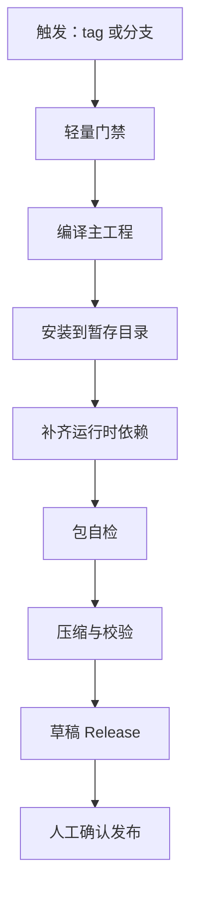
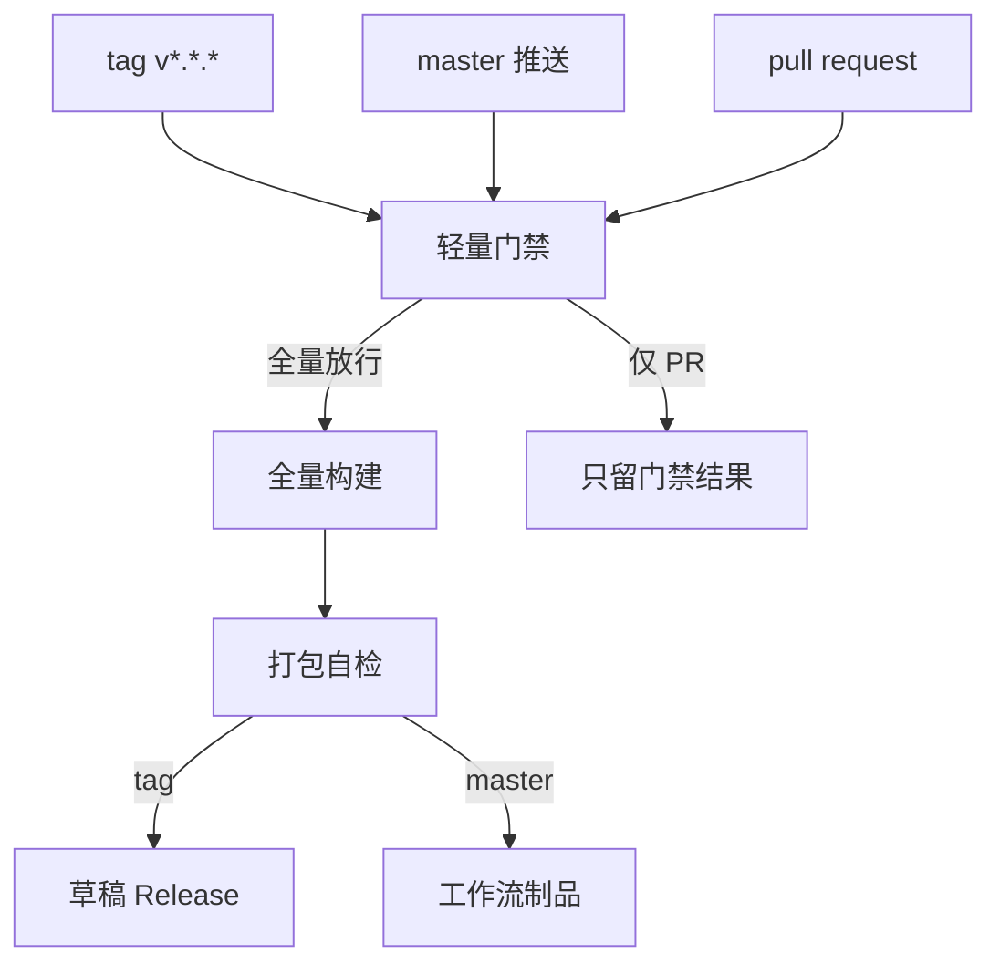
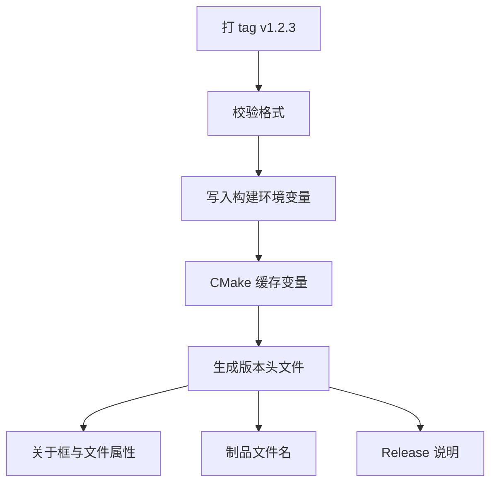

# 交付与部署

!!! abstract "本章要点"
    交付要解决的是从“在我机器上能跑”到“任何人拿到同一个 tag 都能得到同一个包”的问题。工业软件的交付环境比互联网产品苛刻：客户在内网、机器没有管理员权限、运行库和显卡驱动不可控、安装包动辄几百 MB，任何一步手动操作都会在几十个现场重复成事故。本章把交付拆成触发、版本、依赖、打包、自检、发布、文档七段，给出一条可以照着搭的流水线，并标出 data-workbench 公开 workflow 里踩过的坑。核心判断是：只有一条流水线，且每种触发共用同一套配方，交付才可验证。

## 10.1 一条流水线

交付的第一原则是只有一条路径。源码到安装包之间的每一步，编译、安装、收集运行库、打包、自检、发布，都必须写在同一套脚本或同一个 workflow 里，由同一条命令串起来。另开一条“只编译”的 workflow 看起来省事，实际上会分叉成两套工具链：一套给开发用、一套给发版用，配置、环境变量、依赖版本慢慢漂移，最后发版失败时才发现问题在另一条线上。data-workbench 的公开 workflow 在文件开头就写明了这个取舍：三种触发共用同一套配方，不再维护只编译的旧流程。

<figure class="book-diagram" markdown>

<figcaption><span class="fig-no">图 10-1</span>发布流水线的主干。每一步都有明确的输入、输出和失败条件，前一步的产物是后一步的唯一输入；自检放在压缩之前，是为了让“缺 DLL”“版本号不对”在生成发布资产前就失败，而不是等用户解压后才发现。</figcaption>
</figure>

这条链上的每一段都有它存在的理由。编译段锁定工具链和依赖版本，安装段把可执行文件、插件、翻译、资源按运行时的目录结构摆好，组包段把 Qt 运行库、Python 解释器、VC++ 运行库、第三方 DLL 补进暂存目录，自检段验证文件清单和启动，发布段只负责把已经验证过的产物挂到 Release 上。把“构建”和“发布”混在一起，最直接的后果是失败不可恢复：编译成功但发布失败，下一次重跑又要从头编译；分开之后，产物可以先落成工作流制品，发布失败时只重跑最后一段。

流水线的成本主要在构建时长和排队。带 Qt、Python、几何与可视化依赖的工程，全量构建是小时级的，data-workbench 的公开 workflow 把超时设在 180 分钟，为全量构建留出了小时级的余量；Windows runner 的计费、并发限制和磁盘空间都要算进团队预算。优化构建时间的常规手段是缓存 Qt 安装、预编译第三方库、用 ccache 或 sccache，但这些缓存本身也会变成“只在 CI 上成立的假设”，需要定期做一次无缓存的全量构建来验证。

流水线的可读性同样重要。一个两千行的 workflow 文件，几个月后没人敢改。把重复逻辑抽成脚本（安装、组包、自检各自一个脚本），workflow 只负责编排和条件，出错时先看脚本日志；在关键步骤打印版本号、路径、文件数、大小，这些信息平时无用，排查时能省掉几轮猜测。data-workbench 的公开 workflow 就在关键步骤里打印了 Qt 版本、Python 解释器路径、安装目录的 DLL 数量和 7z 压缩耗时，这类日志花不了几行代码，却能让一次失败从“猜”变成“看”。

流水线的每个阶段还应该能在开发机上独立重跑。编译用一条命令，安装用一条命令，组包和自检用脚本，发布用命令行工具；这样出问题时可以在本地复现某一段，不必每次都推一个提交等 CI。把阶段拆开也方便换实现：明天把 7z 换成别的压缩格式，或者把草稿 Release 改成内部制品库，只动一段，其余不变。做不到独立重跑，流水线就只是一个黑盒，坏了只能整条重跑。

构建产物要保留多久，也是需要定下来的策略。工作流制品的保留天数直接决定存储成本，保留太久会积累出几百 GB 的临时包，保留太短又会在追溯问题时找不到当时的产物；常见的做法是主干制品保留一到两周，tag 制品永久归档到 Release 或内部制品库，调试符号按版本长期保存。暂存目录在构建结束后可以删除，但要在删除前把文件清单和校验值写进日志，否则日后想核对“当时包里到底有什么”就只剩一条无法验证的记录。

## 10.2 触发设计

触发设计要回答三个问题：什么事件需要出发布包，什么事件只需要验证能构建，什么事件连构建都不该跑。最常见的三种触发是 tag 发版、主干推送试跑、PR 门禁。tag 是唯一会产出对外发布制品的触发，它应该跑完整链路并在成功后创建草稿 Release；主干推送跑同样的完整链路，但产物只作为工作流制品保留，用来持续验证工具链没有坏；PR 默认只跑轻量门禁，需要验证全量构建时再由维护者显式打标签放行。

<figure class="book-diagram" markdown>

<figcaption><span class="fig-no">图 10-2</span>三种触发汇入同一道门禁，再按事件类型分流到不同出口。门禁必须便宜到能在每次 PR 上跑，全量构建必须贵到只能有条件地跑，两者的边界决定了流水线的成本和可信度。</figcaption>
</figure>

| 触发 | 目的 | 跑什么 | 产物 | 注意事项 |
| --- | --- | --- | --- | --- |
| tag `v*.*.*` | 正式发版 | 门禁、全量构建、组包、自检、草稿 Release | 压缩包、校验文件、草稿 Release | tag 不允许被并发取消；格式先校验再注入版本 |
| 推送 `master` | 及时发现工具链漂移 | 门禁、全量构建、组包、自检 | 工作流制品，保留若干天 | 不出 Release；可缩短保留期控制空间 |
| PR | 合并前把关 | 默认只跑门禁；打 `ci-run` 标签才跑全量 | 无（或临时制品） | 全量构建贵，靠标签显式放行 |
| 纯文档改动 | 不占用构建资源 | 跳过 | 无 | 路径过滤对 tag 推送不生效 |
| 手动触发 | 补发、验证打包 | 指定 tag 与 dry-run 选项 | 视参数而定 | 输入要校验，默认不发布 |

这份设计里有两个容易踩的细节。路径过滤（`paths-ignore`）可以让文档和 Markdown 改动不触发构建，但它只对分支推送和 PR 生效，tag 推送和手动触发不受影响，因为 tag 必须保证构建，不能因为“这次只改了文档”就跳过发版。并发控制（`concurrency`）要能取消同一分支或同一 PR 的旧运行，避免连续提交把 runner 队列堵住，但 tag 运行绝不能取消，发版构建被打断的恢复成本远高于多占一台机器。

```yaml
# 结构示意，非完整实现：触发、并发、权限与作业结构
on:
  push:
    tags: ['v*.*.*']
    branches: [master]
    paths-ignore: ['docs/**', '**/*.md']
  pull_request:
    branches: [master]
    paths-ignore: ['docs/**', '**/*.md']
  workflow_dispatch:
    inputs:
      tag:
        description: '要发布的 tag，例如 v0.2.1'
        required: true

concurrency:
  group: ${{ github.workflow }}-${{ github.ref }}
  cancel-in-progress: ${{ github.ref_type != 'tag' }}

permissions:
  contents: read

jobs:
  guard:
    runs-on: ubuntu-latest
    steps:
      - uses: actions/checkout@v4
      - name: 轻量门禁
        run: python scripts/check_translations.py

  release:
    needs: guard
    # PR 默认不跑全量，只有打了标签才放行
    if: ${{ github.event_name != 'pull_request' || contains(github.event.pull_request.labels.*.name, 'ci-run') }}
    runs-on: windows-2022
    timeout-minutes: 180
    permissions:
      contents: write      # 仅发版作业需要写 Release
    steps:
      - uses: actions/checkout@v4
        with:
          submodules: recursive
      # ... 编译、安装、组包、自检、压缩、草稿 Release
```

权限要按最小化原则分配：整个工作流默认只读，只有需要创建 Release 的作业拿 `contents: write`，其他作业不碰仓库写权限。这样即使某个第三方脚本被污染，能造成的破坏也有限。代码检出时不要把默认令牌持久化到 `.git/config`，发版用单独的令牌，减少凭据在构建环境里停留的时间。

工作流文件本身也要可维护。一个几百行的 YAML 会把条件判断、路径拼接、错误处理混在一起，改一个参数要在十几个地方同步；可行的做法是把安装、组包、自检抽成脚本，YAML 只保留触发、依赖关系、权限和作业顺序，脚本接受参数并返回非零退出码。脚本可以用任意语言写，但要在本地能直接跑，最好再配一份简短的用法说明。别人接手流水线时，先读脚本，再读 YAML，比反过来容易得多。

触发设计也有维护成本。标签放行依赖人记得打，忘记打的结果是 PR 没做全量验证就合并；路径过滤维护不好，改构建脚本时可能被误判成文档改动而跳过。可行的缓解是把“哪些路径属于构建相关”写进注释并在评审时检查，同时每周对主干做一次全量构建，把漏网的漂移暴露出来。流水线的成本不是零，触发设计就是在这笔成本和它买到的置信度之间做配比。

权限和审批是触发设计的一部分。能推 tag 的人应该是一个小集合，tag 一旦推送就进入对外发布路径，必须靠分支保护和环境审批来约束；GitHub Pages 这类部署环境可以要求人工批准后再执行，Release 创建也应当由发版负责人确认。公开仓库里权限通常写到作业级，内部项目还要加上单点登录、审计日志和令牌轮换。把“谁能触发发版”当成生产权限来管理，比事后追查是谁把半成品发出去了更有效。

## 10.3 版本号唯一真相源

版本号最容易变成一堆互相矛盾的数字：源码里写一个、安装包里是另一个、关于对话框里是第三个、Release 标题又是第四个。根因是版本号有多个入口，每个人改自己那一处。工程上的解法是只留一个入口，通常是 git tag：打 tag 的人决定版本，其余所有地方都从 tag 派生，不允许手写。

<figure class="book-diagram" markdown>

<figcaption><span class="fig-no">图 10-3</span>版本号从 tag 单向流到所有消费点，任何一处都不允许反向覆盖。校验步骤拒绝不符合语义化格式的 tag，避免把 `v1.2` 或 `release-1.2.3` 解析成意料之外的版本号。</figcaption>
</figure>

data-workbench 的公开 workflow 展示了一条完整链路：先校验 tag 是否匹配 `v<主>.<次>.<修订>` 的格式，拆出三段数字写进环境变量，再把它们作为 `-DDA_VERSION_MAJOR` 之类的缓存变量传给 CMake；分支和 PR 上没有 tag，就退回一个占位版本，只用于命名和验证打包链路，并且要求占位值与 `CMakeLists.txt` 里的兜底值保持一致。这段流程里最关键的是“校验”和“兜底”两个动作：校验挡住格式错误，兜底保证没有 tag 时也能构建，两者的值必须同步维护，否则分支产物和正式产物的命名会混在一起。

```cmake
# 结构示意：版本号只从构建参数进入，不在源码里写死
set(DA_VERSION_MAJOR 0 CACHE STRING "主版本号")
set(DA_VERSION_MINOR 0 CACHE STRING "次版本号")
set(DA_VERSION_PATCH 0 CACHE STRING "修订号")

configure_file(
    cmake/da-version.h.in
    ${CMAKE_BINARY_DIR}/generated/da-version.h
    @ONLY
)
target_include_directories(app PRIVATE ${CMAKE_BINARY_DIR}/generated)
```

版本头的生成让编译产物、文件属性、关于框、崩溃转储、日志里的版本标识来自同一处，排查问题时不会出现“包名说 1.2.3、程序说 1.2.2”的情况。Windows 的可执行文件还要写入资源段里的文件版本和产品版本，资源管理器、安装器和崩溃分析工具都会读它；Linux 和 macOS 有各自的版本字段，发布脚本要一起更新。版本号还要和文档站点、Release 说明、更新日志保持一致，任何一处漏改都会让支持人员多问一轮。

`git describe` 可以作为开发构建的版本补充，例如显示“距离上一个 tag 多少次提交、当前提交哈希”，但它不适合作为发布版本的唯一来源：工作区有未提交改动时它会带 `-dirty` 后缀，浅克隆时它可能找不到 tag，轻量标签和附注标签的行为也不同。发布版本以 tag 为准，`git describe` 的结果只写进开发构建的关于框和日志，两者用途分开。

版本策略的边界也要写清楚。主版本变更意味着文件格式或插件接口可能不兼容，次版本新增功能并保持兼容，修订版本只修缺陷；预发布版本可以加后缀（例如 `-rc.1`），但要把 tag 格式的校验规则扩展好，否则 CI 会把它判成非法。热修复通常要求基于已发布 tag 新建分支再打新 tag，不要在原 tag 上移动，移动 tag 会让已经下载过旧包的客户无法判断自己拿到的是哪个版本。版本号看起来是一个字符串，实际是交付可追溯性的根。

构建元数据要和版本号一起记录。同一个 tag 重新构建得到的二进制未必逐字节相同，时间戳、绝对路径、并行编译顺序都会影响结果，所以每次构建除了版本号，还要记录提交哈希、构建时间、构建机标识和依赖清单；出了问题能判断现场那个包是不是来自这次构建。完全可复现的构建是另一层目标，要求固定编译器、固定路径、去掉时间戳，工业软件团队通常先把“可追溯”做到位，再考虑“可复现”。

## 10.4 依赖与运行时

交付失败最常见的原因在运行时，代码本身的问题反而少见。开发机上装过 Qt、Python、VC++ 运行库、各种第三方库，程序当然能跑；客户的机器是干净的，缺一个 DLL 就启动失败，失败信息往往只有一句“无法启动此程序，因为计算机中丢失……”。依赖管理的目标是把“开发机上有”变成“包里有”，并且能自动验证。

Qt 要锁版本并显式列出模块。data-workbench 的公开 workflow 把 Qt 固定在一个小版本上，并把用到的附加模块逐个列出来，原因是 Qt 官方安装包并不包含所有模块，某些版本甚至缺少项目依赖的模块；只写“安装 Qt”会在某次工具链更新后突然缺库。锁版本、列模块之后，再加一个几十秒的探针步骤，用一个临时 CMake 工程一次性 `find_package` 全部组件，缺哪个会在构建开始前就点名，而不是等第三方库编译完才发现。

| 运行时组件 | 来源 | 常见遗漏 | 检查方法 |
| --- | --- | --- | --- |
| Qt 库与插件 | 官方安装包或自建构建 | 附加模块、平台插件、图像格式插件 | 探针工程加 `windeployqt` 清单 |
| Python 解释器与包 | 随包内置 | 编译期 ABI 与打包解释器不一致 | 检查 CMakeCache 里的 `python3XX.lib` 与包内 DLL |
| VC++ 运行库 | Visual Studio Redist | 安装期复制逻辑被静默跳过 | 直接在暂存目录里查 `msvcp*.dll`、`vcruntime*.dll` |
| 第三方 DLL | 自建或包管理器 | 间接依赖、只有 import 库没有 DLL | 按导入表递归推导，逐项确认存在 |
| 纹理、翻译、图标资源 | 仓库资源或构建产物 | 资源没被 install 规则带上 | 文件清单比对与运行时加载测试 |
| 授权与许可证文件 | 仓库许可证目录 | 只放了主程序，漏了第三方声明 | 清单核对，发布前人工抽查 |

Python 是一个典型例子。C++ 程序通过 `pybind11` 或 Python C API 链接解释器时，链接的是编译期那个 Python 的导入库（例如 `python312.lib`），运行时加载的必须是同一 ABI 的解释器；如果编译用 3.12、打包时换了 3.11，程序启动或第一次调用 Python 时就会失败。公开 workflow 的做法是编译和打包复用同一个解释器路径，把整个 Python 运行时目录复制进暂存目录，再写一个 `python-config.json`，把解释器路径写成相对于程序目录的 `${current-app-dir}/python/python.exe`，这样不需要注册表、不需要 PATH，解压即用。代价是包体积增加，Python 运行时和依赖包动辄上百 MB。

VC++ 运行库是另一个高频坑。`windeployqt --compiler-runtime` 在正常安装流程里能复制运行库，但当它被放在 CMake 的 `install(CODE)` 里执行时，构建环境里没有 `VCINSTALLDIR`，这一步可能被静默跳过，日志里只有一条不显眼的提示。公开 workflow 因此单独加了一步，从 Visual Studio 的 Redist 目录直接复制 `msvcp`、`vcruntime` 等 DLL，并打印复制清单。这类“工具自己做了一半”的地方，交付脚本要自己兜底，不能假设工具的默认行为可靠。

第三方库的依赖链要比想象中长。`windeployqt` 只扫描可执行文件和主库的导入表，扫描不到第三方库间接引入的 Qt 模块；公开 workflow 的记录里提到，QWT 的绘图模块依赖 `Qt6Concurrent`，安装期没有把它带进来，直到对整个暂存目录重跑一次 `windeployqt` 才补上。包管理器（例如 vcpkg）安装的库通过 imported target 引入，`LOCATION` 属性可能取不到 DLL 路径，复制逻辑会被 `EXISTS` 判断静默跳过。应对方式都是同一个：不要相信单点扫描，组包完成后对整个目录做一次依赖推导，列出所有缺失项，缺一个就失败。

依赖管理的代价是升级成本。锁版本意味着安全补丁不会自动进来，每次升级 Qt、Python、编译器或第三方库，都要重跑整条链路并做目标平台回归；依赖越多，这个矩阵越大。把依赖清单和升级节奏写进维护文档，比每次临时决定更可靠。包体积也是代价，Qt 加 Python 加几何与可视化库的便携包在几百 MB 量级，压缩后仍然不小，交付前要确认客户能接受下载和磁盘占用，必要时裁剪模块、拆分可选组件。

离线构建环境是另一个现实约束。内网构建机不能访问外网时，Qt 安装包、Python 解释器、包管理器缓存、pip 依赖都要提前镜像或预置在构建机上；依赖下载失败和依赖版本不一致，在离线环境里会放大成整条流水线不可用。可行的做法是把依赖预置成目录或内部制品库，构建脚本只从固定位置取，不隐式联网。这样做的代价是首次搭建和升级时的准备量，换来的是构建结果不再取决于当时外网能不能连上。

依赖升级需要一套回归矩阵，不能改完版本号就重跑。Qt 小版本升级可能改变插件目录结构和部署行为，Python 升级会动 ABI，编译器升级会影响运行库和 C++ 符号，包管理器升级可能换掉 DLL 的名字；每次升级都要在目标平台矩阵上重跑构建、自检、启动冒烟和关键功能回归，并检查包体积与启动时间有没有明显变化。矩阵不必覆盖所有组合，但至少要有最新支持的系统、最老的受支持系统、无管理员权限的账户和一台没有开发环境的干净机器。

## 10.5 打包

打包的第一步是暂存目录（staging directory）。编译产物、依赖库、插件、翻译、资源、许可证文件都按最终运行时的目录结构安装到一个干净的目录里，之后所有操作都只针对这个目录，不再碰构建树。这样做的原因是可控：暂存目录可以被完整检查、压缩、校验、重跑；构建树里混着中间文件、绝对路径和调试符号，不能直接交给用户。CMake 的 `install()` 规则负责这一步，安装前缀指向暂存目录，配置类型决定是 Release 还是 Debug。

包的形式要在项目早期定。便携包（解压即用）适合内网、无管理员权限、需要多版本并存的现场；安装器适合需要快捷方式、文件关联、卸载入口、自动更新的场景。两者不是二选一，可以先出便携包，安装器作为后续增量。data-workbench 的公开 workflow 明确写了当前只出便携包，安装器留到后续版本，这是一个很务实的边界：安装器意味着签名、卸载逻辑、升级检测、静默安装参数，每一样都要测试，第一版先把“能解压、能启动、能自检”做扎实。

| 产物 | 内容 | 校验方式 | 适用场景 |
| --- | --- | --- | --- |
| 便携包 | 暂存目录整体压缩，内含版本目录 | 解压后启动冒烟、文件清单 | 内网、无管理员权限、多版本并存 |
| 校验文件 | 压缩包的 SHA256 与文件名 | 客户侧重新计算比对 | 传输完整性、发布说明引用 |
| 调试符号 | PDB、dSYM 或调试信息包 | 与版本号、构建标识关联归档 | 崩溃分析，不随用户包分发 |
| 文档站 | 静态站点制品 | 构建日志与链接检查 | 在线文档，与产品版本对应 |
| 安装器 | 安装、卸载、升级、文件关联 | 干净虚拟机上的安装与卸载 | 面向普通用户的分发 |

压缩格式和参数同样影响体验。7z 的 LZMA2 最高压缩率能把体积压到明显小于 zip，代价是压缩时间和客户侧需要解压工具；公开 workflow 用 7z 最高等级压缩，并在文件里保留了压缩耗时和包大小日志，同时生成 SHA256 文件供下载页引用。压缩包内部要套一层带版本号的目录，否则用户解压出来是一堆散落的 DLL 和 exe，既不好放也不好删。文件名建议包含产品名、版本、平台和 Qt 版本，例如 `DAWorkbench-0.2.1-win64-qt6.10.3.7z`，支持人员看到文件名就能判断环境。

还有几样东西容易被忘在包外：第三方许可证与版权声明、Qt 的 LGPL 声明与可替换库的说明（第 3 章讨论过）、Python 及其依赖包的许可证、图标与字体资源的授权、帮助文档与示例工程。工业客户的采购和法务会检查这些，缺失会在验收阶段被退回。许可证文件由打包脚本从固定目录复制进暂存目录，版本升级时自动跟随，比每次人肉找齐可靠。

未签名的包会遇到 SmartScreen 拦截，这是 Windows 上无法回避的体验问题。代码签名证书有成本，签名流程要接入 CI，证书和私钥的安全管理又是一套工程；在没有签名之前，发布说明里要写清楚“首次启动可能被拦截，选择更多信息后仍要运行”，并给出校验值让客户确认包没有被篡改。签名不是技术上的必需项，但它直接影响客户对交付物的信任，属于要尽早决策的商务问题。

安装布局要在第一版就定下来，因为后面改目录结构会让用户的快捷方式、脚本和配置路径一起失效。常见的布局是根目录放可执行文件与 Qt 运行库，`plugins/` 放程序自身的插件，`python/` 放内置解释器与依赖，`translations/` 放翻译，`docs/` 放离线帮助，许可证与版本说明放在根目录显眼位置；所有路径都相对程序目录解析，不写绝对路径，不依赖当前工作目录。升级时只替换程序目录、保留用户配置目录，这样用户的自定义设置不会丢，卸载时也能分清哪些是程序资产、哪些是用户数据。

调试符号不要塞进用户包。PDB 文件体积大、暴露内部结构，用户也用不上；它应该作为单独的制品归档到符号服务器或发布附件里，按版本和构建标识索引，崩溃分析时按需取用。打包脚本在生成用户包之前把符号文件移出去，或者干脆安装规则就不包含它们，避免某次误操作把符号带进正式包。

## 10.6 自检

自检是交付链路里唯一能回答“这个包能不能用”的环节。编译成功只说明代码能过编译器，打包成功只说明文件被复制过去了，两者都不能证明用户解压后能启动。自检要回答三个问题：文件齐不齐、版本对不对、程序能不能起来。

文件完整性检查不能只对清单。最可靠的方式是从可执行文件和所有 DLL 的导入表递归推导依赖，检查每个依赖是否在暂存目录或系统组件里，缺一个就报出完整路径和引用者。公开 workflow 把这一步封装成脚本，在自检阶段按导入表推导并运行启动冒烟，脚本失败就让作业失败，后面的压缩和发布不会执行。清单比对能发现“该有的文件少了”，导入表推导还能发现“文件在但依赖不满足”，两者互补。

启动冒烟要尽可能接近真实环境。把包解压到一个干净目录，设置与客户一致的运行条件（无开发环境变量、无 PATH 里的 Qt、无已安装的 Python），启动程序，等待主窗口出现或进程正常退出，检查日志里没有致命错误。CI 的 Windows runner 与客户机不是同一个桌面环境，可以用离屏平台插件（`QT_QPA_PLATFORM=offscreen`）跑无界面启动，或者接受“进程能启动到初始化完成”这个较弱的断言；更强的验证要放到干净的虚拟机上做，尤其是验证 VC++ 运行库、显卡驱动和权限相关的行为。

版本信息也要自检。程序里读到的版本、文件资源的版本、包文件名里的版本、Release 说明里的版本，四者必须一致；Python 运行时、Qt 库、第三方库的版本要能打印出来，与依赖清单对上。自检脚本把这些值汇总成一份文本或 JSON 放进制品或日志，出问题时先看这份汇总，比在客户机器上翻文件快得多。

自检的代价是时间和误报。启动冒烟在某些 runner 上可能因为缺少图形环境、杀毒软件扫描、首次加载慢而失败，需要设置合理的超时和重试；离屏启动能通过不代表真实桌面能通过，反过来也一样。自检覆盖的是已知的几类致命问题，不追求覆盖所有功能，发布前的人工验收仍然需要，只是从“全靠人”变成“人检查自检没覆盖的部分”。

自检脚本本身也是代码，需要维护和测试。依赖推导规则、临时目录清理、日志解析这些逻辑一旦写错，就会漏报或误报；有效的办法是故意制造一个缺失 DLL 的包，确认自检能失败，再做一个正确的包，确认自检能通过，两条用例都放进流水线的维护清单。换 runner 镜像、换 Qt 版本、换 Python 版本之后，先跑一遍自检的正例与反例，再相信它的结论。

异机验证是自检的最后一道。同一台构建机上跑通的包，换一台没装过开发环境的机器，可能因为缺少运行库、权限不同、路径含空格或显示器缩放而失败；可行的做法是维护一到两台虚拟机镜像，一台是最小化安装的目标系统，一台是装过常见安全软件和办公组件的“脏”环境，每次发版前把包拷进去跑一遍解压与启动。虚拟机的维护成本不低，但它是模拟客户现场操作系统状态和权限模型的唯一办法，CI 只能覆盖逻辑层面的错误。

自检失败必须阻断发布。这条规则听起来是废话，实际执行时总有人想“先发出去，回头再修”：自检脚本非零退出，流水线就停，Release 不创建；实在要紧急发版，绕过自检的决定要留痕，并且事后补上。自动化的价值在于它把判断从人的情绪里拿出来，放在一条每次都会执行的条件上。

## 10.7 发布

发布阶段要做的事情比想象中少：确认产物、写说明、创建草稿、上传资产。把发布做成一键操作的前提是前面所有验证都已完成，发布本身只是把已经验证过的东西挂出去。草稿 Release 是这里的关键设计：流水线只创建草稿，不直接公开，人工确认说明、资产、校验值之后再点发布，既保留了自动化，又留了一道人工闸门。

说明文字要模板化。一份合格的发布说明至少包含：版本号、构建用的 Qt 与编译器版本、Python 运行时版本、包文件名与大小、SHA256、安装或解压步骤、已知限制、升级注意事项。公开 workflow 在创建草稿时生成的就是这样一张表，并且提示未签名包可能被 SmartScreen 拦截。模板化的好处是每一项都能被检查，不会出现“这次忘了写 SHA256”的情况；升级注意事项尤其重要，文件格式迁移、配置变更、插件重新编译这些信息必须在用户升级前看到。

创建和更新 Release 的命令行工具已经足够成熟：首次用 `gh release create --draft` 带资产和说明文件创建草稿，重跑时先检查同名 Release 是否存在，存在就用 `gh release upload --clobber` 补传资产，避免因为一次失败的重跑创建出两个草稿。发布权限只给这一步的作业，资产路径从环境变量传入，不写死；上传后打印资产地址，方便直接点开检查。

更新日志可以从 git 历史生成，但要人再整理一遍。自动化能列出两次 tag 之间的提交，人要做的是把它们分类成“新功能、修复、破坏性变更、已知问题”，删掉内部重构和无关提交。工业软件的更新日志还要写清楚对数据格式、插件接口、硬件要求的影响，这些信息比功能列表更重要，因为客户会据此决定要不要升级、什么时候升级。

回滚方案要在发布前想好。已经公开的包如果发现严重问题，最直接的处理是撤下 Release、发布修复版本；如果只是说明写错，可以编辑 Release 说明或替换资产。移动或删除 tag 是下策，已经下载的用户无法判断自己拿到的是哪个版本；正确的做法是发新版本并在说明里注明“修复了上一版的问题”。发布不是终点，版本号、文档、支持渠道要能承接后续的补丁和咨询。

发布渠道和通知方式也要提前约定。内网客户通常走内部制品库或邮件附链接，公开客户走 GitHub Release，两条渠道的说明文字和校验值来源要一致；更新提醒不能靠用户自己想起来看网页，可以在软件里加“检查更新”入口，或者由交付团队在版本发布后发一封简短通知。通知里只写三件事：版本号、这个版本修了什么、升级前要注意什么。写多了没人看，写少了客户会来问。

发布之后的反馈要能回流到流水线。用户报告“这个版本装不上”，需要能查到那个包是哪次构建、依赖什么版本、当时的自检结果；发现某个环境普遍缺 DLL，就把检查规则加进自检脚本，而不是只给这一位用户远程修好。每一次现场问题如果只解决个案，不改变流水线，下一次还会以另一种形式出现。把支持记录和发布记录放在一起看，才能发现哪些问题是交付流程本身造成的。

发版节奏和支持窗口要写进约定。每月一个功能版本、每周一个补丁版本，还是只在客户要求时发版，决定了流水线的触发频率、文档的更新节奏和支持团队的工作量；同时要明确每个版本支持多久、旧版本的问题是否还修、客户能否停留在旧版本。工业客户的升级周期长，支持窗口写清楚比“尽量兼容”更实际。版本节奏稳定之后，交付团队才能把发版准备做成例行工作，而不是每次临时动员。

## 10.8 文档站自动发布

产品包和文档站是两条流水线，但它们应该从同一个提交出发。文档站用 MkDocs 构建，产物是静态 HTML，推送到 GitHub Pages 只需要两步作业：构建并上传制品，部署到 Pages 环境。data-workbench 的公开 workflow 在构建前先跑 Doxygen 生成 API 文档，再安装 Python 文档依赖、执行 `mkdocs build`，最后用官方的 Pages 制品和部署动作发布；权限声明了 `contents: read`、`pages: write`、`id-token: write`，并发组设为 `pages` 并允许取消旧运行，避免多次推送同时部署。

这套结构值得照搬的地方在边界，不在命令：文档构建失败只影响文档站，不阻塞产品发布；文档站每次推送都重建，不需要人工上传；构建和部署分成两个作业，部署失败可以单独重跑。本站自己的发布 workflow 也是同样的形状：检出、安装依赖、生成站点图片、`mkdocs build --strict`、上传 Pages 制品、部署。严格模式让断链、缺图、语法错误在构建期暴露，文档站的问题不会拖到读者发现。

文档站和产品版本的关系需要设计。产品文档如果随代码主干滚动，用户看到的可能是“下一个版本”的说明；更稳妥的做法是文档站保留当前稳定版，下一个版本在主干的预览地址或版本子目录里构建。MkDocs 本身不解决版本化，社区插件或目录约定可以实现，选择之前先确认维护成本。工业软件的文档还常包含随包分发的离线手册，这条链路可以从同一份 Markdown 生成 PDF 或静态包，与在线站点共用内容源。

文档发布也有坑：构建依赖和产品构建依赖分开（文档进 `requirements-docs.txt`，产品运行时依赖进另一份），否则文档构建会拖进一堆用不到的包；历史日期、修订记录这类插件需要完整 git 历史，检出时要把 `fetch-depth` 设为 0；Pages 的权限和分支保护要在仓库设置里配好，否则部署动作会因为没有环境授权而失败。这些都属于一次配置、长期受益的工作。

文档的版本要和产品版本对应。在线站点默认展示当前稳定版，下一个版本的说明放到预览地址或以版本号命名的子目录；每份文档的页脚标注适用的版本与更新时间，读者可以判断自己看的是不是匹配的内容。随产品分发的离线帮助最好从同一份源生成，版本号与产品一致，避免客户拿着旧 PDF 对照新界面。文档站的构建结果也要留档，出了问题能确认某个时间点发布的是什么内容。

## 10.9 踩坑清单与交付边界

流水线的坑大多来自“工具默认行为”和“环境隐含假设”。下面这些来自 data-workbench 公开 workflow 的注释和步骤，每一条都对应一次真实的失败；换成别的项目，坑的形状可能不同，但类别差不多，可以当作搭建自己流水线时的检查表。

| 坑 | 症状 | 处理与依据 |
| --- | --- | --- |
| 子模块地址只在 CI 重写 | CI 上拉不到子模块，本地却正常 | 用 `git url.insteadOf` 在 CI 临时重写，仓库配置不动；替换值不要带 `.git`，否则拼成 `.git.git` |
| Qt 官方包缺少所需模块 | 某次升级后 `find_package` 找不到组件 | 锁定 Qt 小版本，显式列出附加模块，构建前用探针工程一次性验证 |
| 安装期没带上间接依赖 | 程序启动时报缺少 Qt 模块 | 对整个暂存目录重跑 `windeployqt`，再按导入表推导补漏 |
| 运行库复制被静默跳过 | 客户机报缺少 VC++ 运行库 | 从 Visual Studio Redist 目录直接复制，不依赖 `--compiler-runtime` 的隐式行为 |
| 包管理器 DLL 没被复制 | 缺 zlib 等第三方库 | imported target 取不到路径时，按包管理器安装目录显式复制 |
| Python ABI 不一致 | 启动即失败或调用 Python 时崩溃 | 编译与打包复用同一个解释器，检查 CMakeCache 与包内 DLL |
| 文档改动触发 tag 构建 | 发版时多跑一次全量 | 路径过滤对 tag 不生效，接受这个行为，不要试图跳过 tag 构建 |
| 并发取消了发版运行 | 发版构建做到一半被取消 | 并发规则按引用类型判断，tag 不取消 |
| Release 重跑资产冲突 | 同名资产上传失败 | 先查 Release 是否存在，存在就覆盖上传 |
| 未签名包的拦截 | 用户首次启动被 SmartScreen 挡住 | 发布说明写清处理步骤并给出校验值，评估后续签名方案 |
| 压缩包解压出散文件 | 用户解压后目录混乱 | 压缩前套一层带版本号的目录 |
| runner 磁盘或超时 | 构建中途失败 | 清理中间产物、控制缓存、设置合理超时并监控日志 |

这些坑有一个共同点：它们都不在代码里，而在流程和环境的接缝处。修一次之后要把处理写进脚本和注释，否则下一个人、下一次升级还会踩。工作流文件的注释应该记录“为什么这样做”，而不只是“做了什么”，因为半年后看到一行奇怪的复制命令，没有人知道它是不是可以删。

流水线搭起来之后，维护它的成本会持续存在，这一点在项目立项时很少被写进计划。Windows 构建机按分钟计费，一个全量构建加打包动辄一两个小时，频繁发版的项目每月在这上面的支出不算小；runner 的镜像会更新，Qt 的安装源会变化，GitHub Actions 的运行时版本会升级，任何一次外部变化都可能让昨天的流水线今天失败。把流水线当作需要维护的产品，而不是一次性的脚本，才能解释为什么它值得被评审、被测试、被文档化。

流水线还要能回答“这次发布的内容和上次相比变了什么”。只靠 tag 和提交历史不够，工业软件的交付物里包含第三方依赖、运行时、资源文件，这些变化不会出现在源码 diff 里。可行的做法是每次构建生成一份依赖清单和文件清单，随版本归档，客户或支持人员需要时可以比对两个版本的清单，确认某个 DLL 是否换过、某个资源是否被删掉。清单本身也是合规材料，许可证审计和漏洞响应都要用它。

流水线的边界在于它只能保证“包是同一套流程产出的”，不能保证“包里的软件是正确的”。功能正确性靠测试，稳定性靠第 9 章的评审与长跑，性能靠第 8 章的基准，交付环节的职责是让这些验证的产物不被装包过程毁掉。把责任边界说清楚，团队才不会指望一条流水线解决所有质量问题，也不会在发布失败时互相推诿。

最后一个现实问题：交付需要人。发版前的确认、说明文字的整理、客户现场的安装支持、问题反馈的接收，这些工作不会因为自动化而消失，只会从重复劳动变成判断和沟通。流水线省下的是“每次都要手工做对几十步”的精力，让人能用在真正需要判断的地方。对工业软件团队来说，这可能是交付自动化最实际的回报。

交付这条线做完，书的第三部就结束了。架构、性能、稳定性、交付合起来回答的是同一个问题：怎么让一个软件在工业现场长期可用。第四部换一个角度看同一件事：当你要做某项具体功能时，现成的库能提供什么、边界在哪里、怎么把第三方组件放进自己的工程。
