# 常见第三方库推荐

!!! abstract "本章要点"
    Qt 只提供人机接口，工业软件需要的几何、可视化、图表、通信、脚本和日志能力都要从第三方库来。这一章不是“最佳库排行榜”，而是一张按能力和约束组织的查阅表：每个领域先给能力矩阵，再讲每个库补的是哪一块、许可和维护状态如何、典型坑在哪里，最后给出按需求出发的选择判断。作者参与维护的库也在同一张表里比较，读者应该根据能力边界和许可做决定，而不是根据作者偏好。文中版本与许可核对时间为 2026 年 11 月，实际使用前请以仓库和官网为准。

## 11.1 怎么用这一章

第三方库选型最常见的错误，是把“功能列表”当成唯一依据。一个库功能全，但许可证不允许闭源、维护停更、和现有 Qt 版本不兼容，接进来就是负债。工业软件的选型至少要同时看三个维度：**能力**决定它能不能解决问题，**许可**决定它能不能被你分发，**维护**决定它三年后还能不能修。三个维度里任何一项不合格，其他两项再强也不应该选。

能力维度要看得比功能列表细。以绘图库为例，“支持曲线图”只是起点，真正要问的是：百万点能不能实时刷新，缩放时是否抽稀，能不能导出矢量图，能不能在图上做交互编辑，多轴和子图是否支持。这些问题不写进 README，往往要翻示例代码或自己压测。许可维度要看整条依赖链，不只是主库的 LICENSE；一个 MIT 库如果依赖 GPL 组件，分发时仍然受 GPL 约束。维护维度不能只看最后一次提交时间，还要看 issue 响应、版本节奏、是否跟随 Qt 大版本升级、有没有商业支持。

<figure class="book-diagram" markdown>
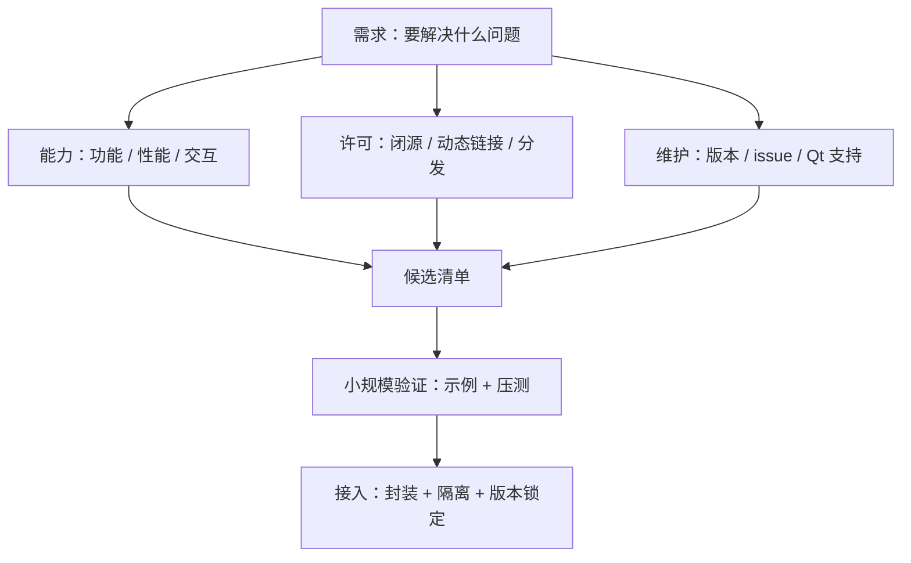
<figcaption><span class="fig-no">图 11-1</span>选型不是一次比较，而是一条从需求到验证的链路。三个维度先筛掉不合格的候选，再用一个小规模验证确认“在你的数据规模下真的可用”，最后用封装把库隔离在项目边界内。</figcaption>
</figure>

还有一条工程原则：**不要直接让第三方库的类型出现在你的领域接口里**。无论选 QWT、VTK 还是 OCCT，都应该在自己的模块里包一层适配，把库的类型、异常、线程模型挡在边界外。这一层封装会增加一点代码，但换来的是可替换性：三年后换库，只需要改适配层，不需要改业务代码。后面每一节讲“典型坑”时，很多问题本质上都是没有这层边界。

## 11.2 三维显示与几何

三维能力是工业软件里最难选的一块，因为它同时涉及数学内核、渲染性能、拾取交互和格式交换。开源世界没有一个库能把四件事都做到最好，常见的做法是“几何内核 + 渲染引擎”组合：OCCT 负责几何与拓扑，VTK 或 Coin3D 负责显示和拾取，Qt 负责窗口与交互。

| 库 | 显示 | 拾取 | 建模 | 格式交换 | 大规模场景 | 许可 |
| --- | --- | --- | --- | --- | --- | --- |
| OCCT | ◐（自带 AIS） | ● | ● | ● | ◐ | LGPL-2.1（含例外） |
| VTK | ● | ● | ○ | ◐ | ● | BSD-3 |
| Coin3D | ● | ● | ○ | ◐ | ◐ | BSD-3 |
| OpenSceneGraph | ● | ● | ○ | ◐ | ● | OSGPL 1.0（LGPL 衍生） |
| Qt 3D | ◐ | ◐ | ○ | ○ | ○ | LGPLv3 / GPLv2 / 商业 |
| Qt Quick 3D | ● | ◐ | ○ | ○ | ◐ | GPLv3 / 商业（无 LGPL） |
| QIm | ●（2D/3D 图） | ◐ | ○ | ○ | ●（点云/曲线） | MIT |

**OpenCASCADE Technology（OCCT）** 是开源世界里唯一能支撑工业级 B-Rep 建模的内核。它提供几何与拓扑、布尔运算、倒角、抽壳、STEP/IGES 交换、三角化和一个基于 OpenGL 的 AIS 视口。OCCT 的强项是“精确几何”，弱项是渲染管线和交互体验：AIS 视口能显示和拾取，但界面定制、批量渲染、现代 GPU 特性都不如专业渲染引擎。它的 API 风格停留在 2000 年代，异常和句柄管理需要时间适应；LGPL-2.1 加例外允许闭源动态链接，但静态链接仍要满足替换义务，例外条款本身也要以仓库里的 `OCCT_LGPL_EXCEPTION.txt` 为准。

**VTK** 是科学可视化的事实标准，强项是数据处理管线和渲染，弱项是几何建模。VTK 的 `vtkAlgorithm` 管线、`vtkMapper`/`vtkActor` 渲染模型、`vtkRenderer` 多视图，适合后处理和结果展示；它也能做拾取、剖切、体绘制、流线。VTK 的体量和学习曲线都很大，模块裁剪和编译配置是常见坑。BSD-3 许可对商业产品友好，这也是 ParaView、3D Slicer 等平台选择它的重要原因。

**Coin3D** 是 Open Inventor 的继承者，场景图模型清晰，和 OCCT 的 `TopoDS_Shape` 配合得很好，FreeCAD 就是这条路线。它的渲染管线较老，超大装配的性能不如现代引擎，社区活跃度也一般；如果项目已经用 OCCT，Coin3D 是最省事的显示方案之一，但新项目要评估长期维护。

**OpenSceneGraph（OSG）** 是另一套成熟的场景图引擎，擅长大规模场景、地形、粒子、飞行模拟等方向，社区在仿真和 GIS 领域比较活跃。OSG 的 API 偏底层，状态管理、节点访问器、回调机制需要时间理解；它使用 OSGPL 1.0（LGPL 的衍生许可，不是 SPDX 标准名），商业使用要按该许可的条款评估动态链接和替换义务。

**Qt 3D** 是 Qt 自带的实体组件系统（ECS）三维框架，和 Qt 的信号槽、属性系统集成好，适合中小规模的可视化和交互。它的性能和维护状态不适合作为大型工业渲染的主力，Qt 官方近年把重心放在 Qt Quick 3D 上；许可为 LGPLv3 / GPLv2 / 商业，新项目如果只是做轻量三维展示，可以评估，但不建议把核心视口押在它上面。

**Qt Quick 3D** 是 Qt 6 的 QML 三维方案，适合和 Qt Quick 界面混排、做仪表盘、产品展示和轻量场景。它不提供 B-Rep、拾取几何语义和科学数据处理，不能替代 OCCT/VTK；许可为 GPLv3 / 商业，没有 LGPL 选项，闭源产品必须购买商业许可，这一点在选型时经常被忽略。

**QIm** 是作者维护的 Qt 封装，底层是 ImPlot/ImPlot3D，定位是“高频刷新的科学图表和三维图”，不是 CAD 内核。它用 GPU 批量绘制，百万点曲线和热力图能保持流畅；API 是 Qt 风格的信号槽，接入成本低。它的边界也很清楚：不做几何建模、不做格式交换、不做复杂场景管理，适合监控、仪器、实时数据分析和轻量三维展示。

**怎么选**：要建模和格式交换，选 OCCT；要科学数据处理和体绘制，选 VTK；要场景图和 OCCT 配合，选 Coin3D；要大规模仿真场景，评估 OSG；要轻量 QML 三维，选 Qt Quick 3D；要高频二维/三维数据图，选 QIm。多数工业软件最后是“OCCT + VTK/Coin3D + Qt”的组合，而不是单一库。

<figure markdown>
  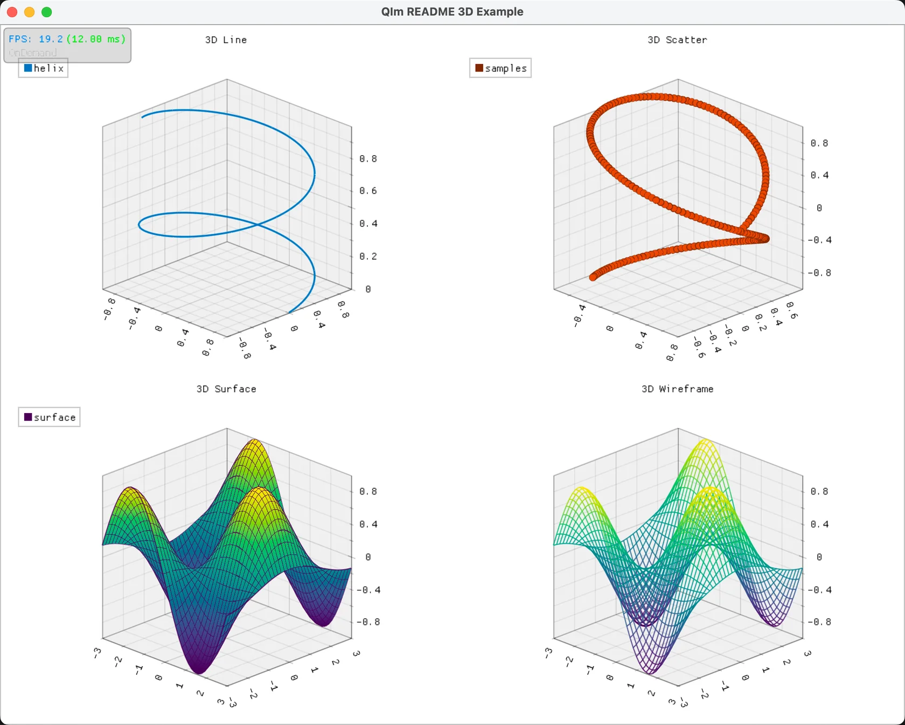{ loading=lazy }
  <figcaption><span class="fig-no">图 11-2</span>QIm 的三维绘图示例。它的定位是把 ImPlot3D 的 GPU 绘制能力包成 Qt 控件，适合实时数据展示，不承担几何建模和场景管理。</figcaption>
</figure>

## 11.3 二维绘图与图表

二维图表是工业软件里使用频率最高、选型最容易走偏的一类。监控曲线、科学绘图、统计报表、论文插图，对性能、交互和导出的要求完全不同；一个库在监控场景很优秀，拿去做论文插图可能缺标注和矢量导出；反过来，一个报表库做实时刷新会卡。

| 库 | 实时刷新 | 百万点 | 交互编辑 | 矢量导出 | 许可 |
| --- | --- | --- | --- | --- | --- |
| QWT | ● | ◐（需抽稀） | ◐ | ●（SVG/PDF） | Qwt License 1.0 |
| QIm | ● | ● | ◐ | ◐ | MIT |
| QCustomPlot | ● | ○（十万级更稳） | ● | ●（PDF/SVG） | GPLv3 / 商业 |
| Qt Charts | ◐ | ○ | ◐ | ◐ | GPLv3 / 商业 |
| JKQtPlotter | ◐ | ◐ | ● | ● | LGPL-2.1 |
| KD Chart | ○ | ○ | ◐ | ● | MIT |

**QWT（Qt Widgets for Technical Applications）** 是工业监控领域的老牌库，提供曲线、柱状、散点、频谱、仪表盘、刻度、图例等一套技术绘图控件。它的设计偏“技术图表”，对坐标轴、刻度、图例的控制很细，适合监控和仪器界面；性能中等，百万点需要自己做抽稀或分块。QWT 的经典版本更新缓慢，CMake 支持、Figure 容器、多轴、实时平移、数据拾取这些能力在原版里要么没有、要么要自己补，这也是作者维护扩展分支的原因；该分支的 README 自述已接替官方维护，并提供 Qwt 7、CMake、Qt 6、Figure 布局、多轴、SIMD 抽稀和三维图等能力，使用前仍应以其仓库说明为准。许可为 Qwt License 1.0，基于 LGPL 并带子类与静态链接例外，商业使用要核对具体条款。

**QIm** 在二维场景里补的是“高频、大规模数据”的位置。它把 ImPlot 的 GPU 批量绘制接到 Qt，适合实时曲线、热力图、频谱、百万点监控；交互和样式定制的丰富度不如 QWT/QCustomPlot，但刷新性能是它的强项。如果项目的核心诉求是“数据一直在变、界面不能卡”，QIm 值得压测；如果核心诉求是“论文级排版和精细标注”，它不一定合适。

**QCustomPlot** 是单文件库，接入极简，交互编辑和导出做得很好，适合中小规模的科学绘图和报表。它的性能在十万点量级比较稳，百万点需要开自适应采样；GPLv3 与商业双许可，闭源产品必须购买商业授权，这一点在选型早期就要确认。单文件带来的另一个代价是定制深度：想改内部绘制逻辑，只能改源码并自己维护分支。

**Qt Charts** 是 Qt 官方模块，和 Qt 的模型视图、QML 集成好，适合常规业务图表和仪表盘。它的科学绘图能力（多轴、误差棒、频谱、百万点）不如 QWT/JKQtPlotter，性能也偏中等；许可为 GPLv3 / 商业，没有 LGPL 选项，闭源产品必须购买商业许可。Qt 6.10 起 Qt Charts 被标记为弃用，官方建议迁移到 Qt Graphs；新项目选它之前，要确认 Qt Graphs 是否已经覆盖你的图表类型。

**JKQtPlotter** 是功能很全的科学绘图库，支持多轴、误差棒、参数曲线、图像、等高线、柱状、统计图等，交互和导出都比较完整，LGPL-2.1 对商业产品友好。它的代码量和学习曲线比 QCustomPlot 大，性能取决于数据量和绘制模式；适合“科学绘图 + 交互 + 矢量导出”三者都要的场景。

**KD Chart** 是 KDAB 维护的报表图表库，强项是复杂的商业报表、堆叠图、甘特图、轴布局，MIT 许可很宽松。它的实时性和大数据性能不是重点，界面风格偏传统报表；如果需求是“生成可打印的复杂报表”，它比监控类库合适。

**怎么选**：监控和仪器界面优先 QWT 或 QIm；科研绘图和交互编辑优先 QCustomPlot 或 JKQtPlotter；常规业务图表用 Qt Charts；复杂报表用 KD Chart。百万点以上不要只看“支持”，要拿真实数据压测刷新、缩放、拾取三条路径。

<figure markdown>
  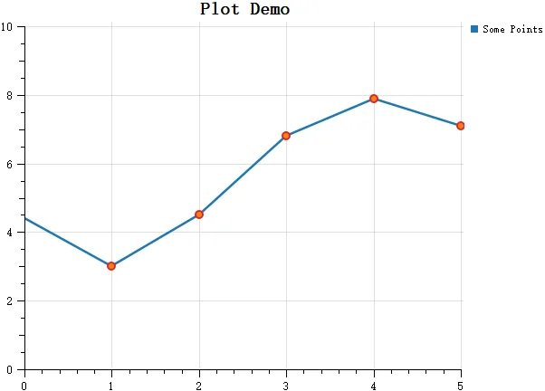{ loading=lazy }
  <figcaption><span class="fig-no">图 11-3</span>Qwt 7 的简单绘图示例。QWT 的强项是技术图表的坐标轴、刻度和图例控制，不是开箱即用的炫酷样式。</figcaption>
</figure>

<figure markdown>
  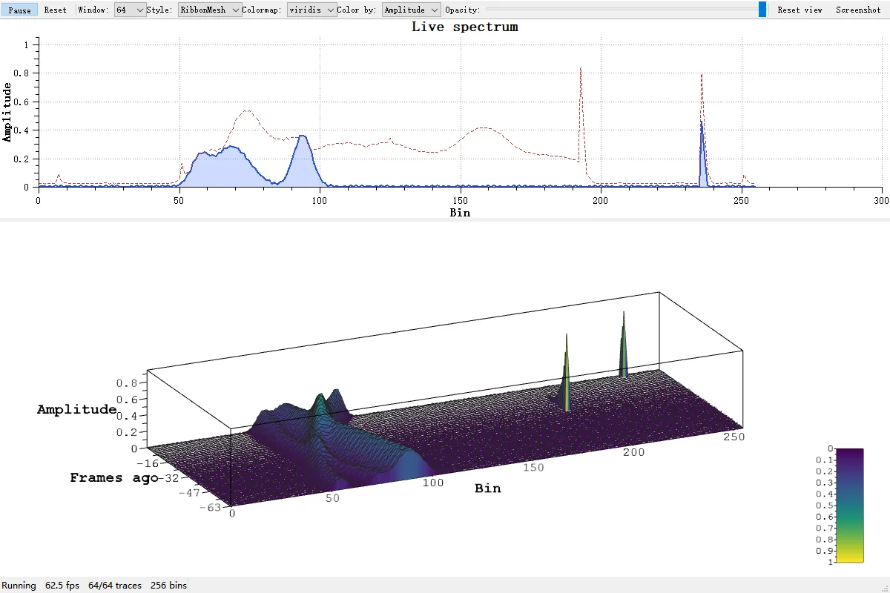{ loading=lazy }
  <figcaption><span class="fig-no">图 11-4</span>QWT 扩展分支里的三维瀑布图。它说明技术绘图库也在向三维频谱、瀑布图这类场景延伸，但三维能力仍以数据展示为主。</figcaption>
</figure>

<figure markdown>
  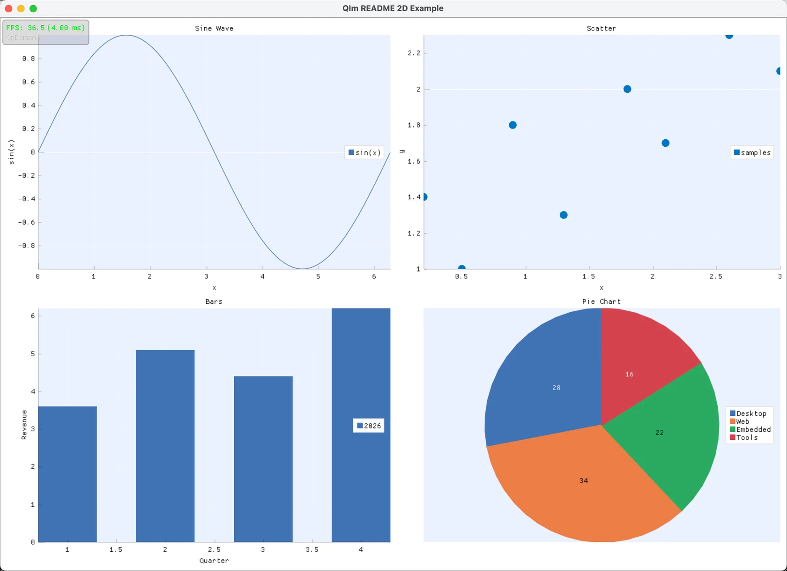{ loading=lazy }
  <figcaption><span class="fig-no">图 11-5</span>QIm 的二维绘图示例。GPU 批量绘制让百万点刷新保持流畅，代价是样式定制和排版能力不如传统 QWidget 绘图库。</figcaption>
</figure>

<figure markdown>
  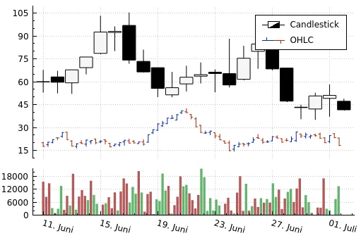{ loading=lazy }
  <figcaption><span class="fig-no">图 11-6</span>QCustomPlot 的交互式绘图界面。单文件、接入快、交互编辑完整，是它在中型项目里流行的原因。</figcaption>
</figure>

<figure markdown>
  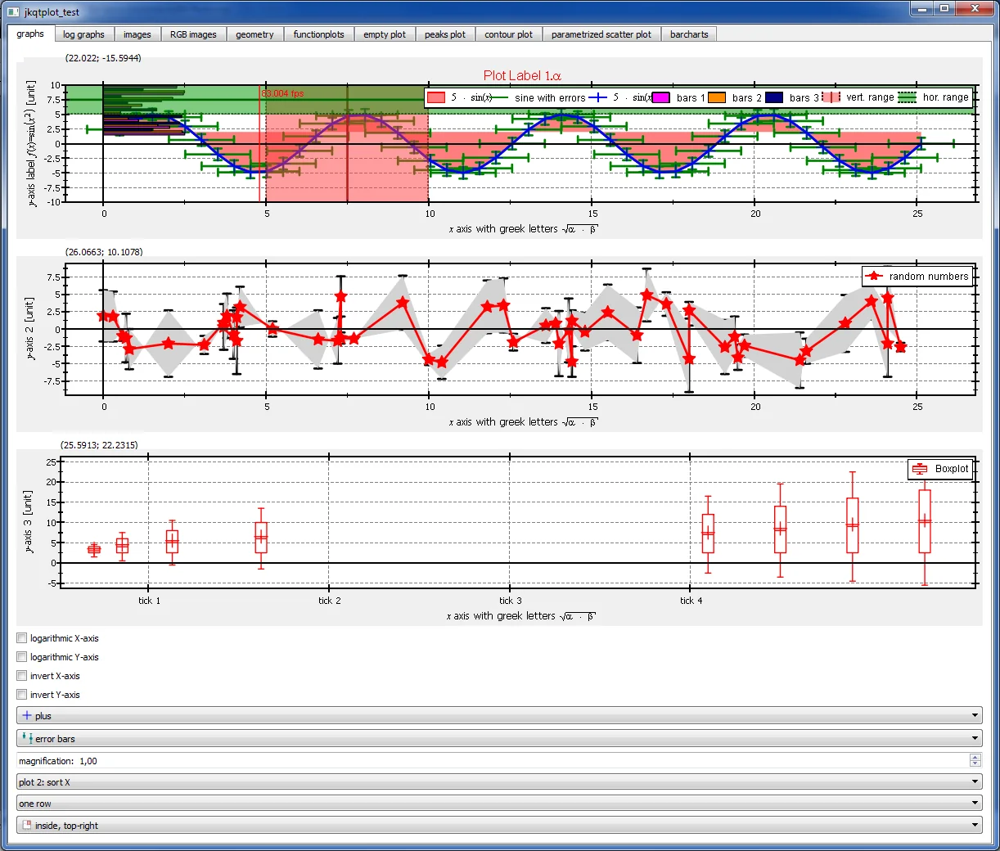{ loading=lazy }
  <figcaption><span class="fig-no">图 11-7</span>JKQtPlotter 的科学绘图示例。多轴、误差棒、统计图和矢量导出是它的主要卖点。</figcaption>
</figure>

<figure markdown>
  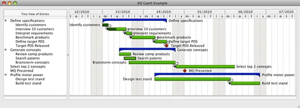{ loading=lazy }
  <figcaption><span class="fig-no">图 11-8</span>KD Chart 的报表图表示例。它的设计目标是复杂报表和打印布局，不是高频实时刷新。</figcaption>
</figure>

## 11.4 界面与控件

Qt Widgets 提供了按钮、表格、树、停靠窗口这些基础控件，但工业软件常见的 Ribbon、属性面板、颜色选择、无边框窗口、标签输入、折叠面板，原生控件并不覆盖。这个领域的库大多是“补缺口”型：每个库解决一个具体问题，组合起来才是一套完整的界面。

| 库 | 补的缺口 | 许可 | Qt 5 / Qt 6 | 维护状态 |
| --- | --- | --- | --- | --- |
| SARibbon | Ribbon 工具栏 | MIT | 均支持 | 活跃 |
| Qt-Advanced-Docking-System | 可停靠面板 | LGPL-2.1 | 均支持 | 活跃 |
| QtPropertyBrowser | 属性编辑面板 | 见仓库 | 均支持 | 低活跃 |
| DAWidgets | 标签输入、折叠、颜色/画笔/字体编辑 | MIT（README 声明） | 均支持 | 活跃 |
| SAColorWidgets | Office 风格颜色按钮与调色板 | MIT | 均支持 | 活跃 |
| qwindowkit | 无边框窗口 | Apache-2.0 | 均支持 | 活跃 |

**SARibbon** 是作者维护的 Ribbon 控件库，目标是把 Office/WPS 风格的 Ribbon 带入 Qt 应用。它支持四种按钮、六种布局、上下文标签、快速访问栏、Gallery、QSS 主题切换、RTL 和高 DPI；MIT 许可对商业产品最友好。Ribbon 适合功能多、命令分组明确的工业软件，但它会占掉大量垂直空间，界面密度高的工具型软件未必合适。选型时要先确认用户真的需要 Ribbon，而不是因为“看起来像 Office”。

**Qt-Advanced-Docking-System** 补的是可停靠、可浮动、可保存布局的面板系统。工业软件的主界面通常有模型树、属性、日志、视口等多个面板，Qt 自带的 `QDockWidget` 在复杂布局、浮动窗口、布局持久化上不够用。ADS 的 API 清晰、示例完整，LGPL-2.1 允许闭源动态链接；典型坑是浮动窗口的生命周期、布局保存的版本兼容、以及和高 DPI 的配合。

**QtPropertyBrowser** 来自 Qt Solutions，提供树形、按钮、分组三种属性浏览器，支持按类型生成编辑器。它的代码稳定、接入简单，适合做属性面板；缺点是维护活跃度低、Qt 6 兼容需要自己修、编辑器工厂的扩展不如现代方案灵活。如果项目只需要一个“能编辑属性”的面板，它仍然是一个低成本的起点。

**DAWidgets** 是作者维护的 QWidget 补充库，灵感来自 Element UI，补齐 Qt 原生控件缺失的交互形态：多标签下拉选择、流式标签输入、折叠面板、颜色/画笔/画刷/字体编辑器、文件路径、字符串列表、撤销历史面板等。它的定位是“通用控件”，不绑定具体业务；README 声明为 MIT，但仓库里没有附标准 LICENSE 文件，商用前建议向作者确认。典型坑是样式和主题的适配，以及和既有 QSS 的冲突。

**SAColorWidgets** 是作者维护的颜色操作组件，提供 Office 风格的颜色按钮、调色板网格、最近使用颜色、菜单式选色。它解决的是“工业软件里到处都要选颜色，但 Qt 原生 `QColorDialog` 太重、样式不统一”的问题。MIT 许可，接入简单；边界是它只做颜色，不做完整的属性面板。

**qwindowkit** 是作者维护的无边框窗口框架，支持 Windows、macOS、Linux 的窗口拖动、缩放、贴边、系统菜单。无边框窗口在工业软件里常用于自定义标题栏、深色主题、沉浸式界面；它的难点不在绘制，而在各平台窗口管理器的差异。Apache-2.0 许可宽松，适合商业产品；典型坑是高 DPI、多屏、窗口阴影和系统手势。

**怎么选**：需要 Ribbon 选 SARibbon；需要复杂停靠布局选 ADS；需要属性面板从 QtPropertyBrowser 起步或自研；需要现代表单控件选 DAWidgets；需要统一颜色交互选 SAColorWidgets；需要自定义标题栏选 qwindowkit。组合使用时，先统一主题和间距，再谈控件，否则每接一个库就多一种视觉语言。

<figure markdown>
  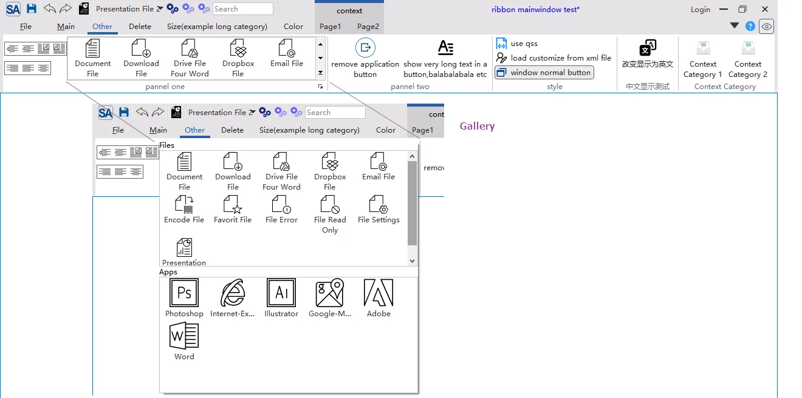{ loading=lazy }
  <figcaption><span class="fig-no">图 11-9</span>SARibbon 的 Ribbon 界面。它补的是命令分组和工具栏组织方式，不是业务控件本身。</figcaption>
</figure>

<figure markdown>
  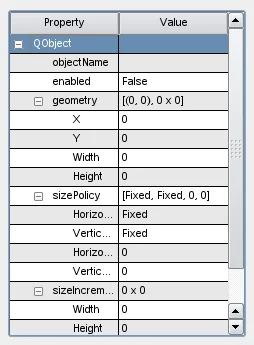{ loading=lazy }
  <figcaption><span class="fig-no">图 11-10</span>QtPropertyBrowser 的属性树。属性名、编辑器和分组由属性管理器生成，适合快速搭出属性面板。</figcaption>
</figure>

<figure markdown>
  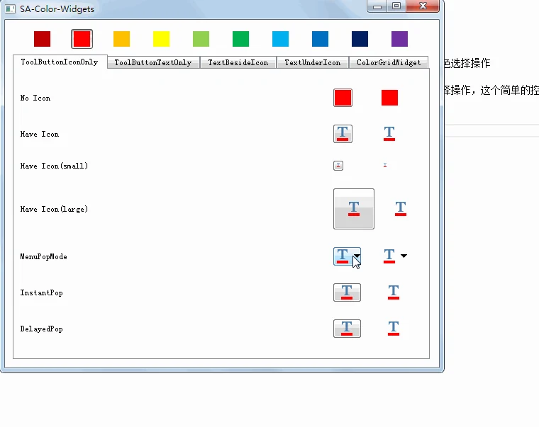{ loading=lazy }
  <figcaption><span class="fig-no">图 11-11</span>SAColorWidgets 的颜色控件。颜色按钮、调色板和最近使用颜色被封装成可直接放进工具栏的控件。</figcaption>
</figure>

<figure markdown>
  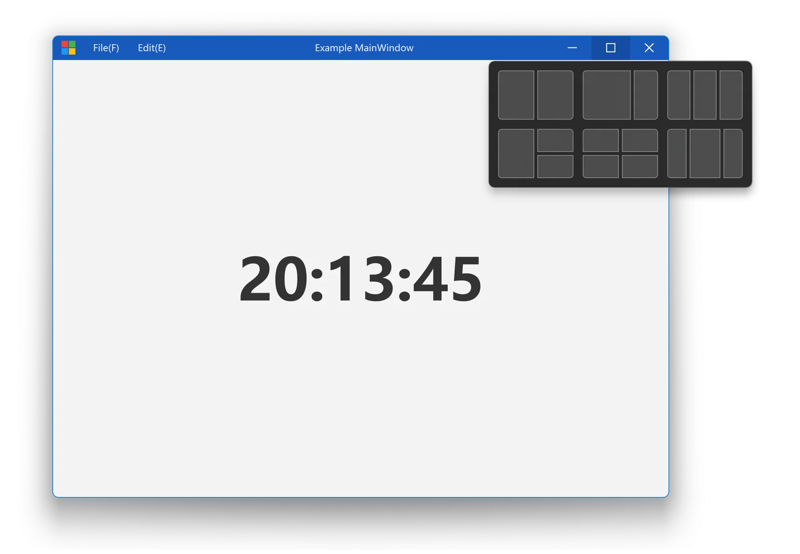{ loading=lazy }
  <figcaption><span class="fig-no">图 11-12</span>qwindowkit 的无边框窗口示例。窗口的拖动、缩放和系统按钮由框架处理，业务层只负责标题栏内容。</figcaption>
</figure>

<figure markdown>
  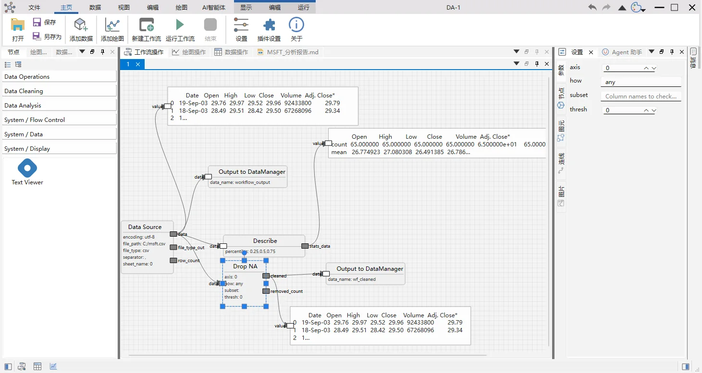{ loading=lazy }
  <figcaption><span class="fig-no">图 11-13</span>data-workbench 的工作流编辑器。Ribbon、停靠面板、图形视图和属性面板在同一个界面里组合，是前面这些库“拼起来是什么效果”的实例。</figcaption>
</figure>

## 11.5 日志

日志库的选择比想象中重要，因为工业软件的现场诊断高度依赖日志：客户不能复现、不能连调试器，唯一能带回来的就是日志和 dump。Qt 自带的 `qDebug()`/`QLoggingCategory` 能解决基本输出，但异步、滚动、格式化、多线程、性能埋点这些需求要额外做工作。

| 库 | 定位 | 许可 | 适合场景 | 注意 |
| --- | --- | --- | --- | --- |
| spdlog | 高性能 C++ 日志 | MIT | 高频日志、异步、格式化 | 与 Qt 消息处理器需要桥接 |
| glog | Google 风格日志 | BSD-3 | 服务端/工具链、崩溃栈 | 依赖 gflags，风格偏旧 |
| Qt 日志 | 框架内置 | 随 Qt | 轻量、与 Qt 类型集成 | 异步和滚动要自己做 |

**spdlog** 是 C++ 里最常用的日志库之一，header-only、格式化快、支持异步和滚动文件，MIT 许可。它和 Qt 的集成方式是写一个 `QtMessageHandler`，把 `qDebug()` 转到 spdlog，或者反过来把 spdlog 的输出接到 Qt 的日志面板。典型坑是异步队列满时的丢弃策略、滚动文件的命名和清理、以及多线程下的格式化开销。

**glog** 是 Google 的日志库，强项是崩溃时的栈信息、日志级别和条件日志，BSD-3 许可。它依赖 gflags，风格偏服务端，和 Qt 项目的集成不如 spdlog 自然；如果项目已经有 gflags 或需要 Google 风格的日志，可以评估，否则 spdlog 更轻。

**Qt 自带日志** 的优势是零依赖、和 `QLoggingCategory`、`qInstallMessageHandler` 集成好，适合中小项目。它的弱项是异步、滚动、结构化输出都要自己补；如果项目只需要“输出到文件 + 界面日志面板”，自己包一层就够，不必引入第三方库。

**怎么选**：高频、多线程、需要滚动和异步，选 spdlog；需要 Google 风格和崩溃栈，评估 glog；轻量项目用 Qt 日志加一层封装。无论选哪个，都要定义日志级别、字段格式、脱敏规则和保留周期，否则日志越多越难查。

spdlog 和 Qt 的桥接通常写成这样：在 `main()` 里安装一个消息处理器，把 Qt 的日志级别、类别、文件与行号转成 spdlog 的字段；日志面板再订阅同一个 sink，避免界面和文件各写一套。代码不长，但它是“日志能不能用于现场诊断”的分界线。

```cpp
// 结构示意：把 Qt 日志转发到 spdlog，并保留类别与位置
qInstallMessageHandler([](QtMsgType type, const QMessageLogContext &ctx, const QString &msg) {
    auto logger = spdlog::get("app");
    spdlog::source_loc loc(ctx.file ? ctx.file : "", ctx.line, ctx.function ? ctx.function : "");
    switch (type) {
    case QtDebugMsg:    logger->debug(loc, "[{}] {}", ctx.category, msg.toStdString()); break;
    case QtInfoMsg:     logger->info(loc, "[{}] {}", ctx.category, msg.toStdString()); break;
    case QtWarningMsg:  logger->warn(loc, "[{}] {}", ctx.category, msg.toStdString()); break;
    case QtCriticalMsg: logger->error(loc, "[{}] {}", ctx.category, msg.toStdString()); break;
    case QtFatalMsg:    logger->critical(loc, "[{}] {}", ctx.category, msg.toStdString()); break;
    }
});
```

## 11.6 脚本绑定

脚本是工业软件性价比最高的扩展方式。用户可以用脚本做批处理、定制分析、连接外部工具；开发者可以把内部能力暴露出去，而不必为每个需求改界面。Qt 自带 `QJSEngine`，Python 生态有 pybind11 和 sol2，选择取决于脚本语言的用户群和绑定成本。

| 方案 | 脚本语言 | 许可 | 适合场景 | 注意 |
| --- | --- | --- | --- | --- |
| QJSEngine | JavaScript | 随 Qt | 轻量自动化、表达式、界面脚本 | 生态小，科学计算库少 |
| pybind11 | Python | BSD-3 | 科学计算、数据分析、机器学习 | 构建复杂，GIL 与生命周期 |
| sol2 | Lua | MIT | 嵌入式脚本、游戏/工具 | Lua 生态偏小 |

**QJSEngine** 是 Qt 自带的 JavaScript 引擎，接入成本最低：把 `QObject` 暴露给脚本，槽函数加 `Q_INVOKABLE` 或 `Q_PROPERTY`，脚本就能调用。它适合轻量自动化、表达式求值、界面行为定制；弱点是 JavaScript 的科学计算生态远不如 Python，复杂脚本的性能也一般。典型坑是脚本对象的生命周期、异常处理、以及脚本 API 的版本兼容。

```cpp
// 结构示意：把文档对象暴露给 QJSEngine
QJSEngine engine;
auto *doc = engine.newQObject(document);   // document 继承 QObject
engine.globalObject().setProperty("doc", doc);
engine.evaluate("doc.createBox(10, 20, 30);");
```

这段代码看起来很简单，真正要设计的是脚本 API 的边界：哪些方法暴露、参数怎么校验、失败怎么返回、脚本能不能访问文件系统和网络。`QJSEngine` 默认不提供文件系统能力，这是好事；如果业务需要，应该通过宿主提供的受控对象暴露，而不是把 `QFile` 直接塞给脚本。

**pybind11** 是 C++ 与 Python 之间最常用的绑定库，header-only、API 现代、和 STL 容器集成好，BSD-3 许可。它适合把领域模型暴露给 Python，让用户用 pandas/numpy/scipy 做分析；代价是构建复杂度上升，需要处理 Python 版本、GIL、对象生命周期和异常转换。工业软件里常见的做法是“C++ 宿主 + 内嵌 Python 解释器 + pybind11 绑定”，data-workbench 就是这条路线。

pybind11 的典型坑比语法更值得记。第一是对象生命周期：C++ 对象被 Python 引用时，谁负责释放、谁持有 `shared_ptr`、回调里能不能访问已销毁的对象，都要在设计绑定层时想清楚。第二是 GIL：从 C++ 工作线程调用 Python 必须获取 GIL，从 Python 调用耗时的 C++ 函数要释放 GIL，否则界面线程会被卡住。第三是异常：C++ 异常要翻译成 Python 异常，否则解释器会直接终止；反过来，Python 异常穿过 C++ 栈也要有明确处理。第四是构建：Python 版本、ABI、调试/发布配置必须和宿主一致，否则运行时会出现难以理解的导入错误。

**sol2** 是 Lua 绑定库，header-only、性能好、API 简洁，MIT 许可。Lua 适合嵌入式脚本和配置，生态比 Python 小得多；如果用户群是工程师而不是数据科学家，Lua 的轻量和易嵌入有优势，但科学计算库要自己补。

**怎么选**：要最低接入成本，选 QJSEngine；要科学计算生态，选 pybind11 + Python；要轻量嵌入式脚本，评估 sol2。脚本 API 一旦被用户写进生产流程，改起来的代价比 C++ API 还高，第一版就要设计窄接口、版本号和错误处理。

## 11.7 数据与通信

工业软件的另一半工作是把数据读进来、存下去、传出去。这个领域的库大多很成熟，选型的关键不是功能，而是格式、性能、线程模型和部署依赖。

| 需求 | 首选 | 备选 | 注意 |
| --- | --- | --- | --- |
| 本地结构化存储 | SQLite | HDF5（科学数据） | 事务与索引决定导入性能 |
| 大规模科学数据 | HDF5 | Parquet / Arrow | 文件锁、并发写、版本兼容 |
| 进程间/网络序列化 | protobuf | FlatBuffers / JSON | schema 演进与默认值 |
| 串口设备 | Qt SerialPort | 系统 API | 线程归属、超时、热插拔 |
| 工业总线 | Qt SerialBus（Modbus/CAN） | libmodbus | 实时性、错误恢复 |
| OPC UA | open62541 | 商业 SDK | 许可、证书、安全策略 |

**SQLite** 是最常用的嵌入式数据库，单文件、零配置、事务完整，公有领域许可。工业软件用它存工程元数据、测量记录、配置和缓存很合适；典型坑是逐条 insert 不开事务、缺索引、在 UI 线程做长查询、多进程同时写。把批量写包进事务、把查询放到工作线程、给常用过滤字段建索引，性能会差一个量级。WAL 模式能改善读写并发，但会带来额外的 `-wal`/`-shm` 文件和备份复杂度，交付脚本要一起处理。

**HDF5** 适合大规模科学数据和多维数组，支持分块、压缩、部分读写，BSD-3 许可。它的文件格式复杂、并发写支持有限，版本升级也可能带来兼容问题；如果数据是规则的多维数组，HDF5 很合适，如果是表格数据，Parquet/Arrow 更现代。HDF5 的另一个坑是文件锁和异常退出后的残留锁文件，客户端崩溃后要能自动恢复。

**protobuf** 是结构化序列化的常用方案，schema 驱动、跨语言、向后兼容，BSD-3 许可。它的强项是进程间通信和网络协议，弱项是文本可读性和调试便利；schema 演进要遵守字段编号规则，删字段要保留编号，否则老数据会解析错。工业软件里如果协议要和外部系统对接，schema 文件本身应该纳入版本管理，并写清楚兼容策略。

**Qt SerialPort** 提供跨平台串口访问，随 Qt 发布，适合仪器、PLC、采集卡。典型坑是串口对象的线程归属、读写超时、热插拔后的重新枚举、以及 Windows 下 COM 口被占用时的错误处理。**Qt SerialBus** 提供 Modbus 和 CAN 总线支持，适合工业现场；复杂协议或高实时性场景仍要评估专用库。

**open62541** 是开源的 OPC UA 实现，MPL-2.0 许可，适合需要标准工业通信协议的项目。OPC UA 的证书、安全策略、地址空间建模都比普通 socket 复杂，接入前要确认团队有没有相应的运维能力； commercial SDK 在工具链和支持上更完整，但成本和锁定风险要一起算。

**怎么选**：本地存储用 SQLite；科学数组用 HDF5；序列化用 protobuf；设备通信用 Qt SerialPort/SerialBus；OPC UA 用 open62541 或商业 SDK。数据格式一旦发布，迁移成本很高，第一版就要设计版本字段和兼容策略（第 9 章会展开）。

## 11.8 压缩与容器

压缩和容器库看起来是边角料，实际影响交付体积、启动速度和跨平台行为。工业软件的安装包动辄几百 MB，压缩率、解压速度、内存占用都要考虑；工程文件里的资源打包也需要稳定的容器格式。

| 库 | 用途 | 许可 | 注意 |
| --- | --- | --- | --- |
| zlib | 通用压缩 | zlib License | API 老但稳定，几乎所有平台都有 |
| quazip | Qt 封装的 ZIP | LGPL-2.1 | 和 Qt 的 IO 集成好，注意编码与路径 |
| ordered-map | 有序哈希表 | MIT | 小工具库，适合需要稳定遍历顺序的场景 |

**zlib** 是最通用的压缩库，zlib License 宽松，几乎每个平台都自带或可静态链接。它适合压缩日志、资源、网络数据；典型坑是流式压缩的缓冲区管理、压缩级别与速度的取舍、以及跨版本二进制兼容。

**quazip** 是 Qt 对 minizip 的封装，提供 `QuaZip`、`QuaZipFile` 等类，和 `QIODevice` 集成好，适合在 Qt 应用里读写 ZIP。LGPL-2.1 许可，闭源使用要满足动态链接和替换义务；典型坑是文件名编码（GBK/UTF-8）、路径分隔符、大文件 ZIP64、以及压缩包内的目录遍历安全。

**ordered-map** 是作者维护的小型容器库，提供保留插入顺序的哈希表，MIT 许可。它在需要“哈希查找 + 稳定遍历顺序”的场景很有用，比如序列化字段、UI 配置项；边界是它只是容器，不解决并发和内存管理。

**怎么选**：通用压缩用 zlib；Qt 项目里读写 ZIP 用 quazip；需要稳定遍历顺序的哈希表用 ordered-map。压缩库的选型不要只看压缩率，解压速度和内存峰值在客户端启动路径上同样重要。

## 11.9 总表：需求 → 首选 → 备选 → 注意

| 需求 | 首选 | 备选 | 注意 |
| --- | --- | --- | --- |
| 参数化几何建模 | OCCT | 商业内核 | LGPL 动态链接；学习曲线陡 |
| 科学数据可视化 | VTK | ParaView 二次开发 | 体量大，按需裁剪模块 |
| 大规模场景渲染 | OSG | VTK / 自研引擎 | 团队要有图形学能力 |
| 实时监控曲线 | QIm | QWT | 百万点必须压测 |
| 科学绘图与交互 | QCustomPlot / JKQtPlotter | QWT | QCustomPlot 闭源需商业许可 |
| 复杂报表 | KD Chart | Qt Charts | 实时性不是强项 |
| Ribbon 界面 | SARibbon | 自绘 | 确认用户真的需要 Ribbon |
| 可停靠面板 | Qt-Advanced-Docking-System | QDockWidget | 布局持久化与浮动窗口生命周期 |
| 属性面板 | QtPropertyBrowser | 自研 Model/View | 维护活跃度低，Qt 6 要适配 |
| 现代表单控件 | DAWidgets | 自研 | 许可与主题统一 |
| 颜色选择 | SAColorWidgets | QColorDialog | 只解决颜色，不解决属性面板 |
| 无边框窗口 | qwindowkit | 平台原生 API | 多屏、高 DPI、窗口阴影 |
| 日志 | spdlog | Qt 日志 + 封装 | 异步队列与滚动策略 |
| Python 绑定 | pybind11 | sol2 / QJSEngine | GIL、生命周期、构建复杂度 |
| 本地数据库 | SQLite | HDF5 | 事务、索引、线程归属 |
| 设备通信 | Qt SerialPort / SerialBus | 厂商 SDK | 热插拔、超时、线程 |
| 工业协议 | open62541（OPC UA） | 商业 SDK | 证书、安全策略、运维能力 |

这张表只能作为起点。真正的选型要把项目的数据规模、目标平台、团队能力、许可证约束带进来，做一次小规模验证。第三方库没有“最好”，只有“在你的约束下最合适”；而约束会变，所以封装层和版本锁定比选型本身更重要。下一章讨论 AI 如何参与这些工作，包括如何让 Agent 读懂这些库的文档、生成接入代码，以及哪些判断仍然必须由人来做。
