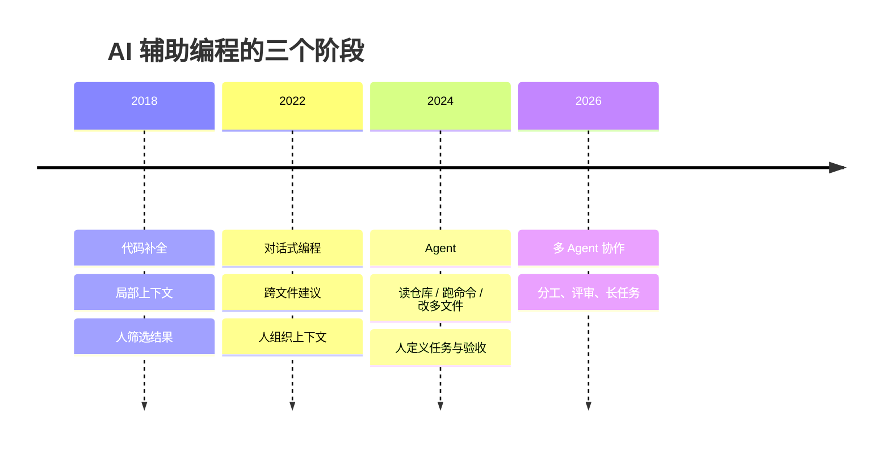
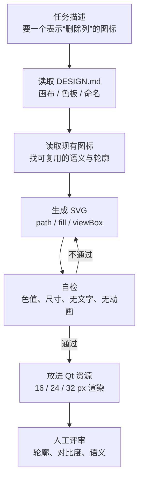
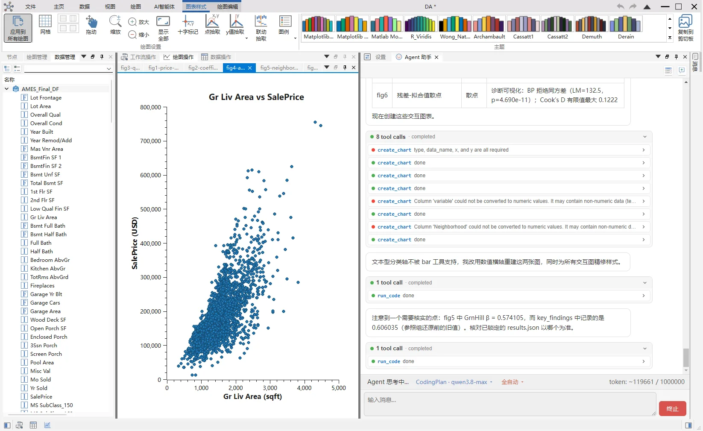
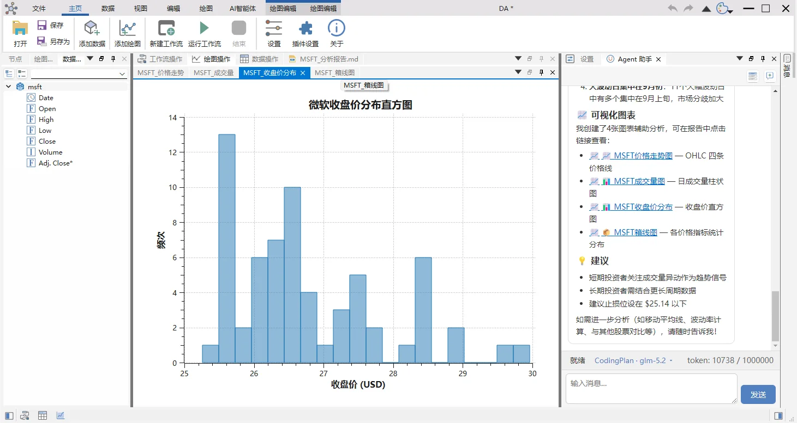

# AI 驱动开发

!!! abstract "本章要点"
    AI 编程工具在 2024 年之后完成了从“补全代码”到“读写仓库、执行命令、修改多个文件”的转变，工业软件团队已经可以把大量重复劳动交出去。但 Agent 不会替你决定模块边界、许可证边界和性能取舍，它放大的是团队原有的工程能力：文档越清楚、结构越干净、测试越可靠，AI 的产出越可用；反过来，一个靠口口相传维持的项目，接入 Agent 之后只会更快地产生混乱。本章讨论工具形态、接入方式、文档驱动开发、Qt 项目中的具体用法，以及必须保留的人工评审边界。

## 12.1 从补全到 Agent：三个阶段

把 AI 辅助编程当成一个整体来谈，很容易得出“有用”或“没用”这种没有信息量的结论。更有用的做法，是按交互形态把它分成三个阶段，每个阶段解决的问题不同，对项目的要求也不同。

第一个阶段是代码补全，时间大约从 2018 年到 2021 年。工具根据当前文件和上下文预测下一行或下一个函数体，开发者负责筛选和修改。这个阶段的价值主要在样板代码：getter/setter、信号槽连接、重复的 if-else、单元测试的骨架。它对项目结构几乎没有要求，因为模型看到的是一个局部窗口；它也不会改变工程实践，补全错了，编译器会告诉你。

第二个阶段是对话式编程，大约从 2022 年到 2023 年。开发者把一段代码、一个报错或者一段需求贴进对话框，模型给出解释、修改建议或完整实现，再复制回编辑器。这个阶段开始处理跨文件的问题，但上下文仍由人手工组织。它暴露了两个新问题：模型不知道你的项目约定，也不知道它给出的代码在仓库里是否真的能编译。于是“把项目背景写进提示词”变成一种技能，但这种方式不可维护，换一个人、换一个会话，上下文就丢了。

第三个阶段是 Agent，大约从 2024 年延续到 2026 年。工具不再只接受一段粘贴的代码，而是被允许读取仓库、搜索文件、执行构建和测试、修改多个文件，再根据运行结果继续调整。它把“生成代码”变成了“完成一个任务”：修一个 bug、加一个功能、迁移一个模块、补一组测试。这个阶段对项目的要求突然变得很高，因为 Agent 的判断依赖仓库里的信息：目录结构是否清晰、模块依赖是否有文档、构建命令是否可复现、测试是否能在本地跑起来。一个靠老员工口口相传维持的项目，对人还能运转，对 Agent 几乎不可用。

<figure class="book-diagram" markdown>

<figcaption><span class="fig-no">图 12-1</span>AI 辅助编程的三个阶段。每一次跃迁都不是模型单方面的进步，而是“模型能接触到的上下文”扩大了一步。</figcaption>
</figure>

工业软件恰好是第三阶段最能发挥价值的场景，原因有三个。代码库大，模块多，新人需要几个月才能建立完整的心智地图，Agent 可以在几分钟内检索完整个仓库；文档要求高，接口、许可证、构建步骤都必须写清楚，这正好是 Agent 需要的上下文；重复劳动多，插件模板、属性面板、序列化代码、测试用例、安装包脚本，形态固定而数量庞大。这三条叠加起来，使得“把 Agent 接进日常开发”在工业软件项目里的收益，往往比在互联网业务项目里更明显。

但收益有一个前提：项目本身要能被描述。如果连人都说不清某个类为什么放在这个模块，Agent 只能猜；如果构建命令依赖某台机器上的环境变量，Agent 无法复现；如果测试跑一遍要两个小时，Agent 的迭代循环就转不起来。第 5、6、7 章讲的结构、接口和流水线，在 AI 时代不是过时了，而是变成了基础设施。

也要承认 AI 在工业软件里有很多不擅长的环节。几何算法的鲁棒性、求解器的数值稳定性、性能瓶颈的定位，这些需要长期领域经验和真实数据，模型只能给候选方案，不能替代验证。界面审美、交互手感、行业术语的准确性，同样需要人来把关。把 AI 放在“生成候选、检索信息、重复劳动、写测试”这些位置上，收益最大；把它放在“最终判断”的位置上，风险最高。

## 12.2 Agent 工具怎么选

2026 年可用的 Agent 工具已经很多，DeepSeek Harness、Claude Code、Codex、Cursor、Cline、Qoder、Kimi 都在各自的路径上演进。工具变化太快，做一张“谁更强”的横评表，半年后就会过期，而且容易把选型变成站队。更有用的做法，是把选型拆成几个稳定的维度，让团队按自己的约束打分。

第一个维度是**仓库访问方式**。有的工具以命令行进程运行，可以直接读写工作目录、执行任意命令；有的工具寄生在编辑器里，通过语言服务器和补全接口工作；有的工具只接受粘贴的上下文。工业软件的仓库通常很大，依赖第三方源码，构建一次要几分钟到几十分钟，Agent 必须能自己跑构建、看日志、改代码，否则它就只是一个更聪明的搜索引擎。

第二个维度是**工具调用能力**。Agent 能不能执行 shell、读文件、写文件、跑测试、查 Git 历史，决定了它能完成多长的任务链。工具调用越强，安全边界越重要：一个能执行任意命令的 Agent，也能执行 `rm -rf`、把内网数据发到外部 API、或者在没有授权的情况下改动构建脚本。团队要提前想清楚哪些命令允许、哪些目录只读、哪些操作必须人工确认。

第三个维度是**上下文组织方式**。有的工具依赖一个固定的项目说明文件，有的工具会自动索引仓库，有的工具支持子 Agent 分工。对工业软件来说，最重要的不是“上下文窗口有多大”，而是“项目知识能不能被稳定地喂进去”。一个两千行的 `AGENTS.md` 加上清晰的目录结构，往往比一个两百万 token 的窗口更有用，因为前者可以评审、可以版本化、可以在 code review 里改。

第四个维度是**数据与合规**。代码能不能离开内网，API 请求会不会把图纸、工艺参数、客户信息带出去，日志和会话记录保存在哪里，模型供应商的数据保留策略是什么。军工、能源、芯片行业的项目，往往在第一轮就把云端工具排除了，只能选择本地部署或私有化方案。这个维度没有折中余地，必须在选型开始时就确认。

第五个维度是**成本与可替换性**。Agent 的调用成本不只是 token 费用，还包括构建时间、评审时间、错误修复时间。一个工具再强，如果它把团队锁死在一个私有格式的会话历史里，迁移成本也会在两年后显现。优先选择那些配置、提示词、项目说明都以纯文本保存的工具，换工具时至少不用重写项目知识。

把这五个维度放在一起，会发现没有“最好的工具”，只有“在当前约束下最合适的组合”。一个常见的做法是：日常编辑留在 Qt Creator 或 Visual Studio，构建、调试、批量重构、测试生成交给命令行 Agent；需要跨仓库理解时用支持自动索引的工具；涉及保密数据时切换到本地模型或离线模式。工具之间不是互斥的，关键是让项目知识独立于工具存在。

| 使用场景 | 更合适的形态 | 判断依据 |
| --- | --- | --- |
| 补全、重命名、局部修改 | 编辑器内联补全 | 延迟低，不打断输入 |
| 跨文件重构、迁移 | 命令行 Agent | 能读仓库、跑构建、改多文件 |
| 探索陌生代码库 | 带索引的对话工具 | 检索和解释能力强 |
| 保密项目、内网环境 | 本地模型 / 私有部署 | 数据不出内网 |
| 批量生成测试、样板代码 | 脚本 + Agent | 可重复、可校验 |
| 最终代码评审 | 人 + 静态分析 | 需要工程判断和责任归属 |

这张表不是工具排名，而是提醒团队：不要用一种形态解决所有问题。编辑器补全适合“手在键盘上”的时刻，命令行 Agent 适合“离开键盘、让它跑一会儿”的任务，本地模型适合“代码不能出门”的项目。把它们混着用，比寻找一个全能工具更现实。

以 DeepSeek Harness 为例，接入一个 Qt 项目通常只需要三步：把仓库放在工作目录下，写一份 `AGENTS.md` 说明项目结构和构建命令，然后从命令行启动会话。Agent 会读取说明文件、检索源码、执行构建，必要时再向人确认。Qt Creator 仍然可以打开同一个目录，负责代码浏览、断点调试和界面预览；构建和测试交给命令行，反而比在 IDE 里点按钮更容易被 Agent 复现。这种“IDE 管编辑，Agent 管任务”的分工，在 2026 年是比较务实的做法。

需要提醒的是，工具的能力边界变化很快。今天需要人写死的项目说明，明天可能由工具自动生成；今天只能读文本的 Agent，明天可能直接看截图、操作界面。团队应该把注意力放在“项目知识是否可描述、构建是否可复现、测试是否可信”这三件稳定的事情上，而不是追逐每一个新工具。

## 12.3 文档驱动开发：把项目知识写成文件

Agent 接入项目后，第一个暴露出来的问题通常不是模型能力，而是项目没有被写下来。新人问“这个模块能不能依赖那个模块”，老员工回答“原则上不行，但有几个例外”；问“构建要加什么参数”，回答“看情况，我机器上是这么配的”。这些知识在人脑里是模糊的、带例外的、依赖上下文的，Agent 无法可靠使用。文档驱动开发要做的，就是把这些模糊知识变成可评审、可版本化的文件。

### AGENTS.md：给 Agent 的项目说明书

`AGENTS.md` 不是给人看的宣传文档，而是一份“Agent 上岗手册”。它应该回答五个问题：项目是做什么的，代码怎么组织，模块之间怎么依赖，怎么构建和测试，哪些事情不能做。写法上要具体到路径、命令和类名，避免“遵循良好的编码规范”这种无法执行的句子。

一个可用的结构大致如下：

```markdown
# 项目名

## 概览
一句话说明项目做什么、用什么技术栈、支持哪些平台。

## 目录
src/APP          应用入口、主窗口、Ribbon
src/DAGui        界面层，按领域分目录
src/DAData       数据层，DataFrame 封装
plugins/         插件，C++ 与 Python 两种
tests/           单元测试与集成测试

## 模块依赖
上层可以依赖下层，下层不能依赖上层。
L1 基础层：DAShared、DAUtils
L2 功能层：DAData、DAFigure、DAPyWorkFlow
L3 界面层：DAGui
L4 接口层：DAInterface、DAPluginSupport、DAAgent
L5 应用层：APP

## 构建
cmake -S . -B build -DCMAKE_PREFIX_PATH=<Qt 路径>
cmake --build build --config Release

## 测试
ctest --test-dir build --output-on-failure

## 风格
C++17，4 空格缩进，类名大驼峰，成员变量 m_ 前缀。
提交前跑 clang-format。

## 禁区
不要修改 src/3rdparty/ 下的第三方源码。
不要在主线程做超过 16 ms 的计算。
不要在界面层直接访问数据库。
```

这段模板的重点不在格式，而在“每一条都能被验证”。`src/3rdparty/` 只读，Agent 就不会去改第三方库；测试命令写清楚，Agent 才能在修改后自己验证；模块依赖写成层级，Agent 在新建类时才有判断依据。反过来，如果 `AGENTS.md` 里写“注意模块解耦”，Agent 只能凭感觉猜，猜错的概率和人类新人差不多。

`AGENTS.md` 必须跟架构一起维护，而不是写完就锁进抽屉。一个实用的规则是：架构变更先改文档，再改代码。新增一层、拆一个模块、换一个构建系统，都先在 `AGENTS.md` 和架构文档里落一笔，再让 Agent 按新结构工作。这样文档不会变成历史遗迹，Agent 也不会拿着过期的地图做决策。

维护 `AGENTS.md` 的时间成本比想象中低。每次 code review 发现“Agent 又放错模块了”，就把判断规则补进去；每次新人问“这个命令怎么跑”，就把命令补进去；每次架构调整，先改文档再改代码。半年之后，这份文件会覆盖项目里大多数“只可意会”的知识，人读它也能快速上手。反过来，如果 `AGENTS.md` 一年没更新，它比没有更危险，因为 Agent 会认真执行一份过期的规则。

### DESIGN.md：视觉与交互的唯一权威

代码结构之外，工业软件还有大量“看起来不重要、实际上很容易失控”的规范：颜色、图标、间距、控件状态、图表配色。这些规范如果只存在于设计师的 Sketch 文件里，Agent 无法遵守；如果每个开发者各写一套，界面就会变成拼贴画。解决办法是给视觉规范也建一份“唯一权威”文档。

data-workbench 的 `DESIGN.md` 是一个可以借鉴的样本。它把界面和图标拆成两套规则：界面部分规定面板、按钮、状态指示的配色与层级；图标部分规定画布尺寸、颜色语义、命名规则、SVG 文件结构和自检清单。所有颜色必须从官方色板取，新增颜色要先更新色板并登记；图标统一用 200×200 或 64×64 的 `viewBox`，禁止渐变、阴影、文字，字形必须用 `<path>` 绘制。这些规则听起来琐碎，但它们让“AI 生成图标”从不可控变成了可 review：Agent 产出的 SVG 只要不符合色板或画布尺寸，就会被明确拒绝。

<figure class="book-diagram" markdown>

<figcaption><span class="fig-no">图 12-2</span>图标生成的关键不在模型会不会画 SVG，而在项目有没有把画布、色板、命名和自检规则写成 Agent 能读取的文件。</figcaption>
</figure>

### 上下文组织：示例、目录树与失败案例

Agent 的上下文不是越多越好。把整个仓库塞进去，模型会被无关文件淹没；只给一个文件，它又看不到依赖关系。有效的上下文通常由三类材料组成：**目录树**给出空间感，**关键文件**给出约定，**示例**给出可模仿的范式。

目录树不需要完整，列出三层左右，标出每个目录的职责即可。关键文件包括 `AGENTS.md`、`DESIGN.md`、构建脚本、接口头文件、一个单元测试。示例最重要：给一个“新增一个插件”的完整提交，比写十页插件开发指南更有用，因为 Agent 可以直接模仿文件结构、命名和注册方式。

失败案例也值得写进去。比如“不要在 `paintEvent` 里 new 对象，之前这样做导致 4K 屏下拖动卡顿”“不要用 `QRegExp`，Qt 6 已经移除”“静态链接 Qt 会违反 LGPL 的替换义务”。这些句子看起来像吐槽，实际上是高密度的约束，能避免 Agent 重复踩坑。写失败案例时尽量给出症状和正确做法，不要只写“不要这样做”。

## 12.4 AI 在 Qt 项目中的实战

### 生成 UI 与样板代码

Qt 项目里最适合交给 Agent 的，是形态固定、重复度高的代码：属性面板的一行、设置页的一个分组、插件模板、序列化函数、信号槽连接、单元测试骨架。这些代码有明确的模式，Agent 只要看到两三个示例，就能按同样的结构生成新的。

一个典型的任务是“给设置页加一个分组”。人需要打开设置页类、找到分组布局、照着现有代码写控件、连接 `valueChanged`、处理配置读写、补翻译字符串，半小时到一小时。Agent 可以在几分钟内完成，前提是项目里有清晰的设置页基类和两个现成示例。如果没有基类，每个设置页各写各的，Agent 就会生成第三种风格，评审时反而更累。

例如，项目里已经有一个属性面板的基类，Agent 要新增一个“渲染设置”分组，它需要模仿的结构大致如下。代码本身不复杂，真正重要的是它遵循的约定：属性用 `Q_PROPERTY` 暴露、修改走命令、控件通过统一的工厂创建。

```cpp
// 结构示意：新增一个属性分组时，Agent 应模仿的既有模式
class RenderSettingsGroup : public PropertyGroup {
    Q_OBJECT
    Q_PROPERTY(bool showGrid READ showGrid WRITE setShowGrid NOTIFY changed)
public:
    explicit RenderSettingsGroup(Document *doc, QWidget *parent = nullptr)
        : PropertyGroup(doc, parent) {
        auto *grid = addBool(QStringLiteral("显示网格"), true);
        connect(grid, &PropertyItem::valueChanged, this, &RenderSettingsGroup::setShowGrid);
    }

    bool showGrid() const { return m_showGrid; }
    void setShowGrid(bool on) {
        if (on == m_showGrid) return;
        pushCommand(new SetShowGridCommand(m_doc, on)); // 修改统一走命令栈
    }
private:
    bool m_showGrid = true;
};
```

这段代码是否“由 AI 生成”并不重要，重要的是它和项目里其他分组长得一样：同样的基类、同样的属性工厂、同样的命令栈入口。Agent 最容易犯的错误不是语法错误，而是“另起一套写法”。评审时先看它有没有复用既有模式，再看逻辑是否正确，比逐行读代码更有效。

这也是为什么第 5、6 章反复强调“约定”和“窄接口”。AI 不会让烂架构变好，只会让烂架构的复制速度变快。

### 大型代码库检索与重构

Agent 的检索能力在大型仓库里价值最高。人找一个信号在哪些地方被连接，通常靠 grep 加记忆；Agent 可以先搜符号，再顺着调用链读文件，最后给出一张影响面清单。重构时，这张清单比“改完编译一下”可靠得多。

Qt 5 到 Qt 6 的迁移是一个典型场景。`QRegExp` 被 `QRegularExpression` 取代，`QDesktopWidget` 被移除，`QOpenGLWidget` 从 `QtWidgets` 移到 `QtOpenGLWidgets`，这些变化单个看都不难，难的是在一个几十万行的仓库里找全。让 Agent 先列一份“旧 API 使用点”清单，按模块分组，再逐个替换，每替换一组跑一次构建和测试，比一次性全改安全得多。迁移过程中还要处理行为差异，例如 `QRegularExpression` 的匹配语义和 `QRegExp` 不完全一致，Agent 可以指出可疑调用点，但是否需要改业务逻辑，必须由人判断。

但重构任务必须切割。让 Agent “把整个模块改成新接口”，它会在几十个文件之间来回跳，最后改出一个能编译但语义错误的结果。更有效的做法是把重构拆成可验证的步骤：先加新接口并保留旧接口，再逐个子系统迁移，每一步都跑测试，最后删除旧接口。每一步都给 Agent 明确的验收标准，比如“编译通过、测试全绿、`grep` 不到旧接口”。这和人类工程师做重构的方法没有区别，只是 Agent 执行得更快，也更需要边界。

### 测试生成与缺陷复现

工业软件的测试最难的部分不是写断言，而是构造数据：一个带倒角的零件、一个包含十万行的 CSV、一个特定版本的工程文件。Agent 可以读现有测试的数据工厂，生成新的测试用例，也可以根据 bug 报告构造最小复现。

这里有一个反直觉的经验：让 Agent 先写一个**失败的测试**，再修代码，效果通常比直接让它修 bug 好。失败的测试把“bug 是什么”变成了可执行的断言，Agent 有了明确的反馈信号，人也能在 review 时判断它有没有真正理解问题。修完之后，测试留在仓库里，成为回归保护。这个流程对 Qt 的 GUI 代码同样适用：`QTest` 可以模拟鼠标和键盘事件，虽然写起来啰嗦，但一旦写好，Agent 就能反复运行。

```cpp
// 结构示意：先写失败测试，再让 Agent 修实现
class UndoStackTest : public QObject {
    Q_OBJECT
private slots:
    void moveCommandMergesContinuousDrag() {
        Document doc;
        auto *item = doc.createItem(QStringLiteral("line"));
        auto *stack = doc.undoStack();

        stack->beginMacro(QStringLiteral("拖动"));
        for (int i = 0; i < 10; ++i) {
            stack->push(new MoveCommand(item, QPointF(1, 0)));
        }
        stack->endMacro();

        QCOMPARE(stack->count(), 1); // 连续拖动应合并成一条撤销记录
    }
};
```

工业软件里最难构造的测试数据，Agent 反而有优势。它可以读现有的数据工厂、测试夹具和示例工程，生成新的用例；也可以根据一份现场日志，构造最小复现路径。但数据一旦涉及真实图纸或工艺参数，必须在脱敏后的样本上做，不能把客户数据直接喂给外部模型。

### Agent 驱动应用：让自然语言操作 GUI

比“AI 辅助写代码”更进一步的是“AI 作为软件的一部分”。data-workbench 内置了一个 Agent，用户可以用自然语言让它读取数据、做统计、画图、加标注、生成报告。这个 Agent 不是外挂的聊天窗口，而是能操作真实软件对象的执行者：它查询的是工作区里已经加载的数据集，画出的图出现在绘图区，生成的报告在内置查看器里打开。

实现上，data-workbench 把 Agent 拆成 C++ 主进程和 Python 子进程两部分。C++ 侧持有工具注册表、会话持久化和进程管理，Python 侧用 LangGraph 驱动 LLM 推理，两边通过 stdin/stdout 的 JSON Lines 协议通信。工具的实际执行始终在 C++ 主进程里完成，LLM 只看到工具的接口描述，不直接执行代码。这个设计把“模型能做什么”和“模型能碰到什么”分开了，既让 Agent 能操作软件，又不给它任意执行命令的权限。

工具的接口通常长这样：名字、描述、参数 schema、执行函数。描述写给模型看，要求说清“什么时候用、参数是什么单位、失败返回什么”；执行函数写在宿主侧，负责校验参数、调用领域对象、返回结构化结果。

```cpp
// 结构示意：把领域操作包装成 Agent 工具
struct CreateChartArgs {
    QString dataset;
    QString chartType;   // line / scatter / bar
    QString xColumn;
    QString yColumn;
};

class CreateChartTool : public AgentTool {
public:
    QString name() const override { return QStringLiteral("create_chart"); }
    QString description() const override {
        return QStringLiteral("在工作区创建图表。dataset 必须是已加载的数据集名称；"
                              "chartType 取 line、scatter、bar；xColumn/yColumn 为列名。");
    }
    QJsonObject schema() const override; // JSON Schema，供 LLM 读取
    ToolResult execute(const QJsonObject &args) override {
        const auto parsed = parse<CreateChartArgs>(args);
        if (!m_workspace->hasDataset(parsed.dataset)) {
            return ToolResult::error(QStringLiteral("数据集不存在"));
        }
        auto *chart = m_workspace->createChart(parsed);
        return ToolResult::ok(QJsonObject{{"chartId", chart->id()}});
    }
};
```

这段代码的关键不在 C++ 写法，而在边界：工具只能通过 `Workspace` 的公开方法操作软件，不能直接访问窗口、文件系统或网络；工具返回结构化错误，让模型能根据错误信息重试；工具描述里写清约束，减少模型乱猜。把这三件事做好，Agent 的可靠性会比“给模型一个万能脚本接口”高一个量级。

<figure markdown>
  { loading=lazy }
  <figcaption><span class="fig-no">图 12-3</span>data-workbench 中 Agent 根据自然语言指令生成图表。图不是一张静态图片，而是绘图区里可以继续手动调整的真实对象。</figcaption>
</figure>

这个案例对工业软件的启发，不是“每款软件都要内置聊天框”，而是“把领域操作包装成工具”。一个 CAD 可以把“创建草图”“拉伸”“倒角”“导出 STEP”包装成工具；一个 CAE 可以把“导入网格”“设置边界条件”“提交求解”“提取云图”包装成工具。工具描述写清楚，Agent 就能组合它们；工具边界收窄，错误操作的影响也可控。相比让 Agent 直接生成脚本、调用内部 API，工具化是更安全、也更可维护的路径。

### 用 AI 设计图标

图标是工业软件里最容易被忽视、又最影响观感的部分。传统流程是设计师画 SVG，开发者切图、改颜色、适配深浅主题，一个图标改三轮很常见。如果项目已经有明确的图标规范，Agent 可以承担大部分初稿工作。

具体做法是把 `DESIGN.md` 里的规则变成提示词的一部分：画布用 200×200，主操作色 `#5280C1`，危险操作用 `#CE6043`，中性轮廓 `#727272`，禁止渐变和文字，字形用 path，文件不带动画。再给两三个现有图标作为风格示例，让 Agent 生成候选 SVG。生成的图标先过自动检查：`viewBox` 对不对、颜色是否在色板内、有没有 `<text>` 或 `<animate>`、路径数量是否过多。通过检查的候选，再放到 Qt 里按 16、24、32 像素渲染，看轮廓是否还清楚、语义是否一眼能懂。最后一步仍然是人：图标是视觉语言，模型可以生成一百个候选，但“哪个能被用户正确理解”需要人来判断。

<figure markdown>
  { loading=lazy }
  <figcaption><span class="fig-no">图 12-4</span>data-workbench 的 Agent 对话面板。用户用自然语言描述任务，Agent 调用内置工具操作软件，结果直接出现在工作区里。</figcaption>
</figure>

这套流程的价值不在于“省掉美工”，而在于把图标设计从“依赖个人手感”变成“依赖规范和评审”。规范越清楚，Agent 的初稿越可用，人只需要做最后的审美和语义判断。对于没有专职设计师的工业软件团队，这已经足够把图标质量拉到一个稳定的水平。

## 12.5 风险与团队规范

AI 带来的风险，大部分不是“模型会毁灭世界”，而是“模型会非常自信地做错一件小事”。工业软件的容错空间很小，一行错误的单位换算、一个漏掉的许可证声明、一次未经验证的 API 调用，都可能变成现场事故。团队需要把风险分成几类，分别制定规则。

**幻觉 API。** 模型会把 Qt 5 的 API 写到 Qt 6 项目里，会把不存在的类名拼得很像真的，会给出“看起来能编译”的代码。防御方式不是反复提醒模型，而是让编译器和测试说话：Agent 每次修改后必须跑构建，构建失败就自己修；关键路径必须跑单元测试；涉及 Qt 版本差异的代码，用 `QT_VERSION_CHECK` 隔离并在两个版本上各跑一次 CI。

**许可证污染。** Agent 可能从训练数据里“回忆”出一段 GPL 代码，也可能建议引入一个许可证不兼容的库。团队要在 `AGENTS.md` 里写明许可证政策，在 CI 里加依赖许可证扫描，在 review 时重点看新增依赖。第 3 章讲的合规检查表，在 AI 时代要再加一条：新增的每一行代码，都要能说清来源。

**安全与数据泄露。** 能执行命令的 Agent，也能读环境变量、访问内网、把代码发到外部 API。涉及保密项目时，必须使用本地模型或私有化部署，关闭遥测，限制工具权限，记录会话日志。一个实用的原则是：Agent 默认只能读工作目录，写操作和网络访问需要显式授权；涉及删除、发布、部署的命令，必须人工确认。

**评审流程。** AI 生成的代码不能因为“是 AI 写的”就降低评审标准，也不能因为“是 AI 写的”就额外歧视。正确的做法是同一套标准：能编译、有测试、符合架构、许可证清楚、有注释。评审时重点看三件事：这段代码放在正确的模块了吗，它有没有引入新的依赖，它的错误处理是否完整。至于代码是不是模型写的，不影响判断。

**团队规范。** 建议每个团队写一页纸的 AI 使用规范，至少包含：允许使用哪些工具、哪些代码和数据不能上传、生成代码的评审要求、提交信息是否需要标注、出现事故时的回滚流程。规范不要写得太长，太长没人看；要写成可执行的检查项，最好能进 CI 或 PR 模板。

| 风险 | 典型表现 | 防线 |
| --- | --- | --- |
| 幻觉 API | Qt 5 写法混进 Qt 6，类名拼错 | 编译 + 双版本 CI + 人工抽查 |
| 许可证污染 | 引入 GPL 代码或不兼容依赖 | 依赖扫描 + 新增依赖评审 |
| 数据泄露 | 源码、图纸、日志被发到外部 API | 本地模型 / 私有部署 / 网络白名单 |
| 越权操作 | Agent 删除文件、执行危险命令 | 工具白名单 + 人工确认 + 只读目录 |
| 架构漂移 | 新代码放错模块、复制旧模式 | `AGENTS.md` + 架构评审 + 静态检查 |
| 测试失真 | 生成只覆盖 happy path 的测试 | 覆盖率门槛 + 变异测试 + 人工补边界 |

这张表不能替代规范，但可以当作规范的目录。真正执行时，团队需要指定一个负责人，定期检查工具配置、权限和日志，处理“Agent 又绕过了某条规则”的问题。AI 使用规范和代码规范一样，写下来只是第一步，能不能进日常流程，取决于评审和工具链是否真的执行它。

最后需要说清楚一件事：AI 不会让工业软件的工程判断变得不重要，恰恰相反，它让判断变得更值钱。当写代码的成本下降，决定“写什么、放在哪、怎么验证”的成本就上升了。一个团队如果架构清晰、文档完整、测试可靠，AI 会成为放大器；如果这些基础不存在，AI 只会让混乱来得更快。第 5 章到第 10 章讲的所有工程实践，在 AI 时代不是可选项，而是使用 AI 的前提。

!!! note "小结"
    AI 驱动开发的落点不在工具，而在项目能否被描述、被构建、被验证。先把 `AGENTS.md`、`DESIGN.md`、构建命令和测试写清楚，再让 Agent 进来；先给它窄工具和明确验收标准，再逐步放权。工具会换，这套方法不会。
